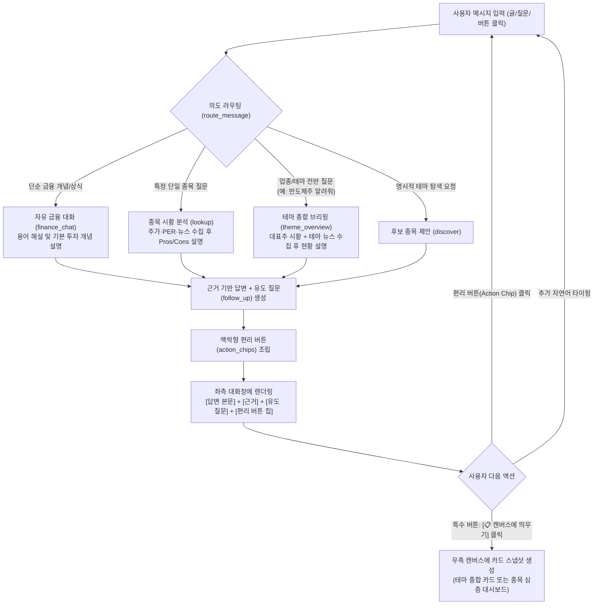

# 챗봇 전용 개발 계획서 (WBS 3계층 세분화)

문서 버전: **v2.0 (대·중·소분류 세분화 완료)** · 갱신일: **2026-10-20** · 작업 디렉터리: **D:\ai_agent**  
연계 문서: [계획3 WBS](<../../계획3_WBS기반_개발계획.md>) · [계획4 대화형 캔버스](<../../계획4_대화형캔버스_작업계획.md>) · [아키텍처·구현 정리](<../../기획서_구현결과_최종보고서_정리.md>) · [자료 위치 안내](<../README.md>)

---

## 1. 개발 개요 및 목표

### 1.1 사용자 요구사항 및 비전
기존 챗봇 시스템은 사용자가 `"지금 반도체주에 대해서 알려줘"`와 같은 자연스러운 업종 질문을 던졌을 때, 업종 설명이나 시황 브리핑 없이 레거시 '테마 검색 마법사'로 직행하여 `"후보 3개를 찾았으니 하나를 고르라"`는 템플릿만 출력하고 대화가 끊겼습니다.

본 계획은 사용자가 요청한 **'진짜 LLM다운 자유 대화 + 원클릭 편리 버튼 + 끊김 없는 유도 질문 + 독립 특수 버튼을 통한 우측 캔버스 연동'**을 완벽하게 구현하기 위한 세분화 WBS 계획서입니다.

```text
[사용자 핵심 요구사항 4대 축]
1. 실제 LLM다운 자유로운 증권 질의응답: 어떤 증권 질문이든(용어, 거시경제, 종목, 업종 분위기) 자연스럽게 대화로 설명.
2. 편리 버튼(Action Chips)을 통한 탐색 유도: 타이핑 없이 클릭 한 번으로 이어갈 수 있는 대화 맥락형 바로가기 버튼 제공.
3. 끊김 없는 대화 흐름(Proactive Follow-up): 답변 끝에 맥락형 유도 질문을 항상 제시하여 대화가 뚝 끊기지 않음.
4. 독립적 특수 버튼을 통한 우측 캔버스 연동: 원할 때 '특수 버튼' 클릭으로 종목 리포트 및 '업종/테마 종합 브리핑'을 우측에 생성.
```

### 1.2 작업 진행 및 체크 원칙
* **순차적 개발 및 점진적 체크**: 소분류 및 중분류가 완료되고 자동 검사가 통과할 때마다 `[ ]`를 `[x]`로 갱신합니다.
* **오류 없는 논리적 구현**: 서두르지 않고 각 모듈(의도 라우팅 $\rightarrow$ 파이프라인 $\rightarrow$ 액션 칩 $\rightarrow$ 캔버스 $\rightarrow$ UI)의 결합도를 낮추고 계약을 준수하며 개발합니다.
* **검증 수준 분리**: 코드 작성, 로컬 모의 자동 검사, 실제 API 호출 검증, 브라우저 수동 확인을 명확히 구분합니다.
* **보안 준수**: API 키 값은 문서, 화면, 로그, 검사 출력에 절대 기록하지 않습니다.

---

## 2. 서비스 아키텍처 및 처리 흐름도



---

## 3. WBS 세분화 작업 계획 (대·중·소분류)

### [ ] 대분류 I. 대화 엔진 및 의도 라우팅 (Chat Engine & Intent Routing)

#### [ ] 중분류 1.1. 자연어 구어체 어휘 및 질의 패턴 확장 (`src/agents/chat.py`)
- [ ] **소분류 1.1.1: 구어체 질문 서술어 정규식 확장**
  - **설명**: `_DIALOGUE` 정규식에 `알려줘`, `알려`, `어때`, `어떠냐`, `설명해줘`, `알고싶어` 등 질의형 종결 서술어 패턴 추가.
  - **코드 위치**: [`src/agents/chat.py`](file:///d:/ai_agent/src/agents/chat.py) `_DIALOGUE`
  - **완료 기준**: `"지금 반도체주 알려줘"`에서 서술어가 정확히 매칭되어 검색으로 오분류되지 않음.
- [ ] **소분류 1.1.2: 시황·동향·분위기 명사 어휘 확장**
  - **설명**: `_DIALOGUE`에 `동향`, `현황`, `분위기`, `브리핑`, `상황`, `전망`, `추세`, `흐름` 명사 패턴 추가.
  - **코드 위치**: [`src/agents/chat.py`](file:///d:/ai_agent/src/agents/chat.py) `_DIALOGUE`
  - **완료 기준**: `"2차전지 동향 어때"`, `"조선주 현황"` 질의가 대화형 패턴으로 인식됨.
- [ ] **소분류 1.1.3: 대화 선호 판정(`prefers_dialogue`) 로직 개선**
  - **설명**: 단어 길이 기준에 의한 `is_theme_search` 오작동을 방지하고 구어체 문맥을 대화형으로 우선 보호.
  - **코드 위치**: [`src/agents/chat.py`](file:///d:/ai_agent/src/agents/chat.py) `prefers_dialogue`, `is_theme_search`
  - **완료 기준**: 4단어 이하의 짧은 업종 질의도 `discover`로 직행하지 않고 안전하게 라우터 분기로 진입.

#### [ ] 중분류 1.2. 신규 의도(Intent) 정의 및 스키마 확장 (`src/agents/chat.py`, `src/models.py`)
- [ ] **소분류 1.2.1: `theme_overview`(업종/테마 브리핑) 액션 스키마 추가**
  - **설명**: 단일 종목이나 단순 테마 탐색과 구분되는 '업종 전반 시황 설명' 전담 의도 정의.
  - **코드 위치**: [`src/agents/chat.py`](file:///d:/ai_agent/src/agents/chat.py) `ChatIntent`
  - **완료 기준**: `ChatIntent(action="theme_overview", theme="반도체")` 객체 생성 및 반환 지원.
- [ ] **소분류 1.2.2: `finance_chat`(자유 금융 대화) 액션 스키마 추가**
  - **설명**: 종목이나 테마와 무관한 일반 금융 상식, 경제 지표, 투자 개념 질의를 전담하는 액션 정의.
  - **코드 위치**: [`src/agents/chat.py`](file:///d:/ai_agent/src/agents/chat.py) `ChatIntent`
  - **완료 기준**: `ChatIntent(action="finance_chat")`가 기존 `answer`의 종목 종속성을 분리하여 독립 동작.
- [ ] **소분류 1.2.3: LLM 라우터 프롬프트 지침 및 Few-Shot 재작성**
  - **설명**: `_invoke` 기반 자연어 라우터 프롬프트에 `theme_overview`, `finance_chat` 분류 기준 및 예시 명시.
  - **코드 위치**: [`src/agents/chat.py`](file:///d:/ai_agent/src/agents/chat.py) `route_message` 프롬프트
  - **완료 기준**: 애매한 문맥에서도 LLM이 JSON 스키마에 맞춰 정확한 5대 액션 중 하나로 분류.

#### [ ] 중분류 1.3. 의도 라우터(`route_message`) 실행 및 폴백 로직 개편
- [ ] **소분류 1.3.1: 종목 미선택 상태에서의 업종 질의 우선 분기 로직**
  - **설명**: 선택 종목이 없는 상태에서 업종/테마를 언급했을 때, 후보 선택 강요 대신 브리핑 경로로 직행.
  - **코드 위치**: [`src/agents/chat.py`](file:///d:/ai_agent/src/agents/chat.py) `route_message`
  - **완료 기준**: `"반도체주에 대해 알려줘"`가 `theme_overview`로 100% 분기됨.
- [ ] **소분류 1.3.2: 모호한 다중 종목 질문에 대한 안내 분기(`clarify`) 처리**
  - **설명**: 여러 종목을 한꺼번에 비교해달라는 질의 시 임의의 하나를 고르지 않고 정중하게 비교 한계를 안내.
  - **코드 위치**: [`src/agents/chat.py`](file:///d:/ai_agent/src/agents/chat.py)
  - **완료 기준**: `"삼전이랑 하이닉스 중에 뭐 살까"` 입력 시 `clarify` 의도로 전환되어 유도 질문 제시.
- [ ] **소분류 1.3.3: 라우팅 예외 상황에 대한 안전한 대화형 폴백(Fallback) 처리**
  - **설명**: 분류 실패 시 기계적 에러 팝업 대신 대화형 어시스턴트다운 안내 문장으로 복구.
  - **코드 위치**: [`src/agents/chat.py`](file:///d:/ai_agent/src/agents/chat.py) `route_message`
  - **완료 기준**: 분류 실패 시에도 앱이 중단되지 않고 대화창에 친절한 재질의 가이드 출력.

---

### [ ] 대분류 II. 테마/업종 시황 및 뉴스 데이터 파이프라인 (Theme Data Pipeline)

#### [ ] 중분류 2.1. 테마 종합 브리핑 데이터 모델 구축 (`src/models.py`)
- [ ] **소분류 2.1.1: `StockBriefSummary` 데이터클래스 정의**
  - **설명**: 종목코드, 종목명, 현재 주가, 전일비 등락률, 시가총액, 대표 PER를 담는 경량 요약 모델 정의.
  - **코드 위치**: [`src/models.py`](file:///d:/ai_agent/src/models.py)
  - **완료 기준**: 불변(frozen) 데이터클래스로 생성되며 단위/소수점 포맷팅 지원.
- [ ] **소분류 2.1.2: `ThemeOverviewData` 데이터클래스 정의**
  - **설명**: 테마명, 대표주 요약 목록(`tuple[StockBriefSummary, ...]`), 테마 핵심 뉴스(`NewsData`), 브리핑 텍스트, 조회시각을 포함하는 종합 모델 정의.
  - **코드 위치**: [`src/models.py`](file:///d:/ai_agent/src/models.py)
  - **완료 기준**: 캔버스 및 대화창에서 공통으로 참조 가능한 종합 데이터 구조 완성.
- [ ] **소분류 2.1.3: 직렬화 및 세션 저장 불변성 계약 준수 검증**
  - **설명**: `ThemeOverviewData` 객체가 세션 상태에 저장되고 조회될 때 사이드이펙트가 없음을 보장.
  - **코드 위치**: [`src/models.py`](file:///d:/ai_agent/src/models.py), [`src/ui/state.py`](file:///d:/ai_agent/src/ui/state.py)
  - **완료 기준**: 세션 키 `theme_overview_result`에 정상 적재 및 복원 확인.

#### [ ] 중분류 2.2. 대표주 시황 및 테마 뉴스 수집기 구현 (`src/pipeline.py`, `src/stock.py`, `src/news.py`)
- [ ] **소분류 2.2.1: 테마 대표 3개사 대상 병렬 시세/등락률 수집 함수**
  - **설명**: 테마 제안 종목 3개에 대해 `yfinance`/KRX를 통해 현재가와 당일 등락률을 신속히 병렬 수집.
  - **코드 위치**: [`src/stock.py`](file:///d:/ai_agent/src/stock.py), [`src/pipeline.py`](file:///d:/ai_agent/src/pipeline.py)
  - **완료 기준**: 3개사 시세 조회가 1.5초 이내에 완료되고 결측 시 안전한 폴백 수치 제공.
- [ ] **소분류 2.2.2: 테마/업종 키워드 기반 최근 핵심 뉴스(3~5건) 수집 및 URL 안전성 검증**
  - **설명**: NAVER 뉴스 API를 활용하여 해당 테마의 당일 주요 이슈 뉴스 3~5건 수집 및 안전 링크 검증.
  - **코드 위치**: [`src/news.py`](file:///d:/ai_agent/src/news.py)
  - **완료 기준**: 불필요한 홍보성 기사를 필터링하고 안전한 언론사 원문 URL 확보.
- [ ] **소분류 2.2.3: `fetch_theme_overview_data()` 통합 파이프라인 함수 구현**
  - **설명**: 후보 탐색, 대표주 시황, 테마 뉴스를 하나로 결합하여 `ThemeOverviewData`를 조립하는 통합 파이프라인.
  - **코드 위치**: [`src/pipeline.py`](file:///d:/ai_agent/src/pipeline.py)
  - **완료 기준**: 한 번의 호출로 시황·뉴스·후보가 결합된 객체를 정상 반환.

#### [ ] 중분류 2.3. 테마 종합 분석 브리핑 생성기 (`src/agents/report.py`)
- [ ] **소분류 2.3.1: 테마 시황 + 뉴스 + 대표주 동향 결합 브리핑 프롬프트 작성**
  - **설명**: LLM에게 수집된 3개사 등락률과 테마 뉴스를 주입하여 현재 시장 분위기를 알기 쉽게 서술하도록 요청.
  - **코드 위치**: [`src/agents/report.py`](file:///d:/ai_agent/src/agents/report.py)
  - **완료 기준**: 업종의 호재, 리스크, 대표 기업들의 주가 흐름을 종합한 3~4문장의 친절한 브리핑 생성.
- [ ] **소분류 2.3.2: 브리핑 내 수치 에코(종목명, 등락률) 대조 및 할루시네이션 방지 검증**
  - **설명**: 생성된 텍스트에 포함된 수치가 실제 수집된 데이터와 일치하는지 로컬 검증 수행.
  - **코드 위치**: [`src/agents/report.py`](file:///d:/ai_agent/src/agents/report.py) `validate_theme_commentary`
  - **완료 기준**: 없는 수치나 조작된 등락률이 포함될 경우 1회 재생성 후 거절.
- [ ] **소분류 2.3.3: 매수/매도 권유 금지 및 위험/기회 균형 서술 규칙 적용**
  - **설명**: 특정 종목 매수 추천을 원천 차단하고 업종 전반의 긍정적 측면과 경계 요인을 균형 있게 서술.
  - **코드 위치**: [`src/agents/report.py`](file:///d:/ai_agent/src/agents/report.py)
  - **완료 기준**: `매수`, `매도`, `목표가`, `강력추천` 단어 검출 시 즉시 필터링.

---

### [ ] 대분류 III. 편리 버튼(Action Chips) 및 끊김 없는 유도 질문 (Interactivity & Follow-up)

#### [ ] 중분류 3.1. 응답 데이터 계약 및 스키마 확장 (`src/models.py`, `src/agents/chat.py`)
- [ ] **소분류 3.1.1: `ActionChip` 데이터 모델 정의**
  - **설명**: `chip_id`, 표시 라벨(`label`), 클릭 시 전송 문장(`query_text`), 액션 유형(`action_type`) 모델 정의.
  - **코드 위치**: [`src/models.py`](file:///d:/ai_agent/src/models.py)
  - **완료 기준**: 칩 데이터의 유효성 검사(라벨 20자 이내, query_text 120자 이내) 통과.
- [ ] **소분류 3.1.2: AI 답변 스키마에 `follow_up` 및 `action_chips` 통합**
  - **설명**: LLM 응답 JSON 스키마에 본문 답변 외에 `follow_up: str`, `action_chips: list[dict]` 필드 강제.
  - **코드 위치**: [`src/agents/chat.py`](file:///d:/ai_agent/src/agents/chat.py)
  - **완료 기준**: 매 턴마다 본문, 유도 질문, 액션 칩이 일체형으로 반환됨.
- [ ] **소분류 3.1.3: 유도 질문 및 액션 칩 검증 규칙 구현**
  - **설명**: 유도 질문에 물음표 1개 필수, 아라비아 숫자 금지, 액션 칩 최대 4개 제한 규칙 적용.
  - **코드 위치**: [`src/agents/chat.py`](file:///d:/ai_agent/src/agents/chat.py)
  - **완료 기준**: 규칙 위반 시 기본 유도 질문 및 정적 액션 칩으로 안전하게 대체.

#### [ ] 중분류 3.2. 상태 기반 동적 편리 버튼 생성 엔진 (`src/agents/chat.py`)
- [ ] **소분류 3.2.1: [업종/테마 브리핑 후] 편리 버튼 생성기**
  - **설명**: 테마 브리핑 후 대표 종목 바로보기(`[⚡ SK하이닉스]`, `[⚡ 삼성전자]`), 뉴스 보기 버튼 자동 조립.
  - **코드 위치**: [`src/agents/chat.py`](file:///d:/ai_agent/src/agents/chat.py)
  - **완료 기준**: 제안된 대표 종목명을 반영한 동적 칩 3~4개 생성.
- [ ] **소분류 3.2.2: [단일 종목 분석 후] 편리 버튼 생성기**
  - **설명**: 특정 종목 답변 후 `[⚠️ 위험 요인 분석]`, `[📊 3개년 재무 보기]`, `[📋 캔버스에 띄우기]` 버튼 조립.
  - **코드 위치**: [`src/agents/chat.py`](file:///d:/ai_agent/src/agents/chat.py)
  - **완료 기준**: 선택된 종목의 맥락에 맞춘 후속 액션 칩 생성.
- [ ] **소분류 3.2.3: [일반 금융 질문 후] 편리 버튼 생성기**
  - **설명**: 금융 개념 설명 후 관련 보조지표 설명 버튼(`[PER 알아보기]`, `[PBR 알아보기]`) 조립.
  - **코드 위치**: [`src/agents/chat.py`](file:///d:/ai_agent/src/agents/chat.py)
  - **완료 기준**: 초보 투자자 관점의 다음 추천 학습 칩 제공.
- [ ] **소분류 3.2.4: 공통 특수 버튼 `[📋 캔버스에 띄우기]` 생성 조건 및 번들링**
  - **설명**: 분석 데이터(테마 or 종목)가 유효할 때만 액션 칩 목록 끝에 캔버스 특수 버튼을 포함.
  - **코드 위치**: [`src/agents/chat.py`](file:///d:/ai_agent/src/agents/chat.py)
  - **완료 기준**: 데이터가 없는 일반 잡담 시에는 캔버스 띄우기 버튼이 노출되지 않음.

#### [ ] 중분류 3.3. 편리 버튼 클릭 이벤트 및 대화 연동 핸들러 (`src/ui/app.py`, `src/ui/state.py`)
- [ ] **소분류 3.3.1: 버튼 클릭 시 사용자 메시지 즉시 전송(`process_chat_message`) 연결**
  - **설명**: 칩 클릭 시 `query_text`가 사용자 입력창에 타이핑된 것과 동일하게 파이프라인으로 전송.
  - **코드 위치**: [`src/ui/app.py`](file:///d:/ai_agent/src/ui/app.py)
  - **완료 기준**: 클릭 즉시 사용자 말풍선이 추가되고 다음 턴 답변 생성 시작.
- [ ] **소분류 3.3.2: 연속 클릭 방지(Debounce/Lock) 및 진행 중 스피너 표시**
  - **설명**: 사용자가 버튼을 연타했을 때 중복 호출이 발생하지 않도록 세션 락 적용.
  - **코드 위치**: [`src/ui/app.py`](file:///d:/ai_agent/src/ui/app.py)
  - **완료 기준**: 동일 요청 키에 대해 중복 파이프라인 호출 방지 확인.
- [ ] **소분류 3.3.3: 이전 턴의 편의 버튼 비활성화(선택 완료 상태) 처리**
  - **설명**: 대화가 다음 턴으로 넘어가면 직전 턴의 버튼들은 비활성화(Disabled) 처리하여 UI 혼선 방지.
  - **코드 위치**: [`src/ui/app.py`](file:///d:/ai_agent/src/ui/app.py)
  - **완료 기준**: 최신 턴의 말풍선 아래에만 활성 버튼이 유지됨.

---

### [ ] 대분류 IV. 우측 캔버스 연동 및 독립 특수 버튼 (Canvas & Multi-Card Management)

#### [ ] 중분류 4.1. 캔버스 연동 특수 버튼 및 독립 트리거 분리 (`src/ui/app.py`, `src/ui/state.py`)
- [ ] **소분류 4.1.1: 대화창 내 `[📋 캔버스에 띄우기]` 독립 액션 버튼 렌더링**
  - **설명**: 말풍선 우하단에 캔버스 전송 전용 특수 버튼을 명확히 시각화.
  - **코드 위치**: [`src/ui/app.py`](file:///d:/ai_agent/src/ui/app.py) `render_conversation`
  - **완료 기준**: 대화 텍스트와 겹치지 않는 깔끔한 버튼 UI 표시.
- [ ] **소분류 4.1.2: 캔버스 버튼 클릭 시 스냅샷 복사 및 캔버스 큐 등록**
  - **설명**: 버튼 클릭 순간의 대화 결과(테마 종합 or 종목 심층)를 `CanvasCardSnapshot`으로 캡처하여 오른쪽에 추가.
  - **코드 위치**: [`src/ui/state.py`](file:///d:/ai_agent/src/ui/state.py) `add_canvas_card`
  - **완료 기준**: 클릭 즉시 우측 패널에 새로운 카드가 1장 추가됨.
- [ ] **소분류 4.1.3: 분석 데이터 부재 시 캔버스 버튼 안전 처리**
  - **설명**: 분석 결과가 없는 턴에서 클릭 시 에러 대신 "먼저 종목이나 테마를 질문해 주세요" 안내 출력.
  - **코드 위치**: [`src/ui/app.py`](file:///d:/ai_agent/src/ui/app.py)
  - **완료 기준**: 예외 발생 없이 대화창에 부드러운 유도 문구 출력.

#### [ ] 중분류 4.2. 업종/테마 종합 캔버스 카드 개발 (`src/ui/dashboard.py`)
- [ ] **소분류 4.2.1: 테마 헤더 및 핵심 키워드 뱃지 렌더러**
  - **설명**: 우측 캔버스 상단에 테마명과 주요 키워드(예: HBM, AI 가속기)를 뱃지 형태로 렌더링.
  - **코드 위치**: [`src/ui/dashboard.py`](file:///d:/ai_agent/src/ui/dashboard.py)
  - **완료 기준**: 시각적으로 눈에 띄는 테마 브리핑 헤더 구현.
- [ ] **소분류 4.2.2: 대표 3개사 시황 비교 미니 테이블 컴포넌트**
  - **설명**: 3개 대표사의 현재가, 등락률(상승 빨강, 하락 파랑), 거래량을 한눈에 비교하는 테이블 렌더러.
  - **코드 위치**: [`src/ui/dashboard.py`](file:///d:/ai_agent/src/ui/dashboard.py)
  - **완료 기준**: 표 안의 수치 포맷팅(원, %, 부호)이 표준 규격에 맞게 렌더링됨.
- [ ] **소분류 4.2.3: 테마 주요 뉴스 및 안전 원문 링크 렌더러**
  - **설명**: 테마 관련 3~5개 뉴스 제목, 언론사, 발행 시각 및 클릭 시 새 탭으로 이동하는 안전 버튼 배치.
  - **코드 위치**: [`src/ui/dashboard.py`](file:///d:/ai_agent/src/ui/dashboard.py)
  - **완료 기준**: 안전 URL 검증을 통과한 링크만 렌더링.
- [ ] **소분류 4.2.4: 테마 캔버스 카드 통합 렌더러 `render_theme_canvas_card()` 완성**
  - **설명**: 위 컴포넌트들을 하나로 묶어 우측 캔버스에 독립 카드 1장으로 표시하는 진입 함수 완성.
  - **코드 위치**: [`src/ui/dashboard.py`](file:///d:/ai_agent/src/ui/dashboard.py)
  - **완료 기준**: 테마 종합 스냅샷을 받아 완결된 카드 UI 출력.

#### [ ] 중분류 4.3. 캔버스 다중 카드 누적 및 스냅샷 불변성 관리 (`src/ui/state.py`)
- [ ] **소분류 4.3.1: 캔버스 카드 유형 분리 (`THEME_OVERVIEW` vs `STOCK_DETAIL`)**
  - **설명**: 카드의 성격에 따라 테마 카드와 개별 종목 카드를 구분하여 서로 다른 렌더러 매핑.
  - **코드 위치**: [`src/models.py`](file:///d:/ai_agent/src/models.py), [`src/ui/state.py`](file:///d:/ai_agent/src/ui/state.py)
  - **완료 기준**: 테마 카드와 종목 카드가 우측에 섞여서 쌓여도 각각 올바른 UI로 렌더링.
- [ ] **소분류 4.3.2: 캔버스 카드 스냅샷 불변성(Immutability) 보장**
  - **설명**: 좌측 대화창에서 새로운 대화를 진행하거나 종목을 바꾸어도, 이미 오른쪽에 생성된 카드의 수치가 변경되지 않음.
  - **코드 위치**: [`src/ui/state.py`](file:///d:/ai_agent/src/ui/state.py)
  - **완료 기준**: 새 분석 수행 후에도 기존 카드의 종목코드, 가격, 조회시각 보존 확인.
- [ ] **소분류 4.3.3: 캔버스 카드 개별 닫기/접기 및 전체 초기화 세션 관리**
  - **설명**: 카드 우상단에 `[X]` 닫기 버튼을 두어 불필요한 카드를 제거하고 전체 삭제 지원.
  - **코드 위치**: [`src/ui/state.py`](file:///d:/ai_agent/src/ui/state.py), [`src/ui/dashboard.py`](file:///d:/ai_agent/src/ui/dashboard.py)
  - **완료 기준**: 카드 삭제 시 해당 인덱스만 제거되고 나머지 카드는 그대로 유지됨.

---

### [ ] 대분류 V. UI/UX 레이아웃 개편 및 클린 대화 인터랙션 (`src/ui/app.py`)

#### [ ] 중분류 5.1. 좌측 패널 레이아웃 클린화 (`src/ui/app.py`)
- [ ] **소분류 5.1.1: 좌측의 레거시 GUI 폼(드롭다운, 라디오버튼, 고정 후보 표) 정리**
  - **설명**: 대화 몰입을 방해하던 정적 컨트롤들을 숨기거나 접을 수 있는 옵션 패널로 축소.
  - **코드 위치**: [`src/ui/app.py`](file:///d:/ai_agent/src/ui/app.py)
  - **완료 기준**: 좌측 패널 상단이 시원하게 비워지고 대화 내역이 주 화면으로 부각됨.
- [ ] **소분류 5.1.2: ChatGPT 스타일 대화 버블 배치**
  - **설명**: 사용자 질문과 Assistant 답변이 좌우 및 색상으로 명확히 구분되는 모던 챗 인터페이스 적용.
  - **코드 위치**: [`src/ui/app.py`](file:///d:/ai_agent/src/ui/app.py) `render_conversation`
  - **완료 기준**: 역할별 시각적 구분이 뚜렷한 말풍선 렌더링.
- [ ] **소분류 5.1.3: 하단 고정 입력창 및 파일/이미지 슬롯 정돈**
  - **설명**: 대화창 하단에 `st.chat_input`과 첨부 슬롯을 일체형으로 배치하여 깔끔한 입력 동선 완성.
  - **코드 위치**: [`src/ui/app.py`](file:///d:/ai_agent/src/ui/app.py)
  - **완료 기준**: 텍스트 입력과 첨부 기능이 대화창 하단에 유기적으로 통합.

#### [ ] 중분류 5.2. 대화 말풍선 시각적 계층화 (`src/ui/app.py`)
- [ ] **소분류 5.2.1: Assistant 답변 본문 및 인용 근거 토글(Expander) 배치**
  - **설명**: 핵심 설명은 본문에 즉시 보이고, 인용 지표 ID나 뉴스 원문 링크는 토글로 깔끔하게 정리.
  - **코드 위치**: [`src/ui/app.py`](file:///d:/ai_agent/src/ui/app.py)
  - **완료 기준**: 가독성을 해치지 않으면서 투명한 근거 제시 지원.
- [ ] **소분류 5.2.2: 유도 질문(Follow-up) 전용 시각 스타일 적용**
  - **설명**: 답변 하단에 은은한 하이라이트 박스와 `💡 추천 질문:` 아이콘을 적용하여 사용자의 시선 유도.
  - **코드 위치**: [`src/ui/app.py`](file:///d:/ai_agent/src/ui/app.py)
  - **완료 기준**: 답변 본문과 확연히 구분되는 유도형 질문 영역 렌더링.
- [ ] **소분류 5.2.3: 편리 버튼(Action Chips) 가로 배열 렌더러**
  - **설명**: 유도 질문 바로 아래에 클릭하기 쉬운 둥근 알약(Pill) 형태의 버튼들을 가로로 나열.
  - **코드 위치**: [`src/ui/app.py`](file:///d:/ai_agent/src/ui/app.py)
  - **완료 기준**: 클릭 편의성이 극대화된 퀵 액션 버튼 열 완성.

#### [ ] 중분류 5.3. 좌우 2단 패널 반응형 및 스크롤 독립화 (`src/ui/app.py`, `assets/style.css`)
- [ ] **소분류 5.3.1: 좌측 대화 영역(비율 4)과 우측 캔버스(비율 6) 독립 내부 스크롤 적용**
  - **설명**: 전체 페이지 스크롤 없이 좌측 대화 목록과 우측 캔버스 목록이 각각 독립적으로 스크롤되도록 CSS 조정.
  - **코드 위치**: [`src/ui/app.py`](file:///d:/ai_agent/src/ui/app.py), [`assets/style.css`](file:///d:/ai_agent/assets/style.css)
  - **완료 기준**: 좌측에서 대화가 길어져도 우측 캔버스가 화면 밖으로 밀려나지 않음.
- [ ] **소분류 5.3.2: 캔버스 빈 영역 대기 플레이스홀더 디자인**
  - **설명**: 카드가 없을 때 우측 영역에 점선 박스와 함께 "대화 중 [📋 캔버스에 띄우기]를 누르면 여기에 카드가 쌓입니다" 친절한 가이드 표시.
  - **코드 위치**: [`src/ui/dashboard.py`](file:///d:/ai_agent/src/ui/dashboard.py)
  - **완료 기준**: 텅 빈 어색한 화면 대신 사용자 행동을 유도하는 플레이스홀더 표시.

---

### [ ] 대분류 VI. 품질 검증 및 단위/통합 테스트 (Verification & Tests)

#### [ ] 중분류 6.1. 대화 라우팅 및 의도 분류 검증 (`tests/test_chat_routing.py`)
- [ ] **소분류 6.1.1: 구어체 질문(15종 시나리오) 분류 정확도 단위 검사**
  - **설명**: `"지금 반도체주 알려줘"`, `"2차전지 동향 어때"`, `"PER이 뭐야"` 등 자연어 구어체의 의도 분류 100% 통과 확인.
  - **코드 위치**: [`tests/test_chat_routing.py`](file:///d:/ai_agent/tests/test_chat_routing.py)
  - **완료 기준**: 15개 시나리오 단위 테스트 무결성 통과.
- [ ] **소분류 6.1.2: 기존 단일 종목 `lookup` 및 개념 `answer` 의도 호환성 검증**
  - **설명**: 기존 `"삼성전자 사도 될까?"`, `"PER, PBR 설명해줘"` 등 기존 테스트 케이스 회귀(Regression) 방지.
  - **코드 위치**: [`tests/test_chat_routing.py`](file:///d:/ai_agent/tests/test_chat_routing.py)
  - **완료 기준**: 기존 154개 자동 검사와 충돌 없이 전체 통과.

#### [ ] 중분류 6.2. 편리 버튼 및 유도 질문 엔진 검증 (`tests/test_chat_interaction.py`)
- [ ] **소분류 6.2.1: 액션 칩 생성 규격(개수, 글자수, 금지어) 유효성 검사**
  - **설명**: 생성된 액션 칩이 최대 4개 이내이고 매수 권유 단어가 포함되지 않았는지 자동 검사.
  - **코드 위치**: [`tests/test_chat_interaction.py`](file:///d:/ai_agent/tests/test_chat_interaction.py)
  - **완료 기준**: 규격 검증 테스트 통과.
- [ ] **소분류 6.2.2: 편리 버튼 클릭 시뮬레이션 및 메시지 인입 검사**
  - **설명**: 칩 클릭 이벤트 발생 시 사용자 메시지 등록 및 다음 턴 의도 전달 정상 동작 검사.
  - **코드 위치**: [`tests/test_chat_interaction.py`](file:///d:/ai_agent/tests/test_chat_interaction.py)
  - **완료 기준**: 세션 상태 갱신 검증 통과.

#### [ ] 중분류 6.3. 테마 파이프라인 및 캔버스 스냅샷 검증 (`tests/test_canvas_flow.py`)
- [ ] **소분류 6.3.1: 테마 대표 3사 시황 및 뉴스 수집 파이프라인 모의 검사**
  - **설명**: 모의 응답 환경에서 `fetch_theme_overview_data()`가 정상 데이터를 반환하는지 검사.
  - **코드 위치**: [`tests/test_canvas_flow.py`](file:///d:/ai_agent/tests/test_canvas_flow.py)
  - **완료 기준**: 파이프라인 반환 객체 구조 검증 통과.
- [ ] **소분류 6.3.2: 캔버스 카드 생성, 다중 누적, 스냅샷 격리 자동 검사**
  - **설명**: 테마 카드 생성 후 종목 카드를 추가했을 때 두 카드가 독립 스냅샷으로 보존되는지 검사.
  - **코드 위치**: [`tests/test_canvas_flow.py`](file:///d:/ai_agent/tests/test_canvas_flow.py)
  - **완료 기준**: 세션 스냅샷 데이터 불변성 검증 통과.

---

## 4. 진행 현황 요약표

| 대분류 | 중분류 수 | 소분류 수 | 진행 상태 |
| :--- | :---: | :---: | :---: |
| **대분류 I. 대화 엔진 및 의도 라우팅** | 3개 | 9개 | `[ ]` 대기 |
| **대분류 II. 테마/업종 시황 및 뉴스 데이터 파이프라인** | 3개 | 9개 | `[ ]` 대기 |
| **대분류 III. 편리 버튼(Action Chips) 및 유도 질문** | 3개 | 10개 | `[ ]` 대기 |
| **대분류 IV. 우측 캔버스 연동 및 독립 특수 버튼** | 3개 | 10개 | `[ ]` 대기 |
| **대분류 V. UI/UX 레이아웃 개편 및 클린 대화 인터랙션** | 3개 | 8개 | `[ ]` 대기 |
| **대분류 VI. 품질 검증 및 단위/통합 테스트** | 3개 | 6개 | `[ ]` 대기 |
| **총계** | **18개 중분류** | **52개 소분류** | **0% (착수 대기)** |

> **체크 진행 방식 안내**:  
> 작업을 진행할 때는 **소분류 단위로 코딩 및 검증을 완료할 때마다 `[x]`로 체크**하고, 해당 중분류에 속한 모든 소분류가 완료되면 **중분류도 `[x]`로 체크**하여 투명하게 진척 상황을 관리합니다.
