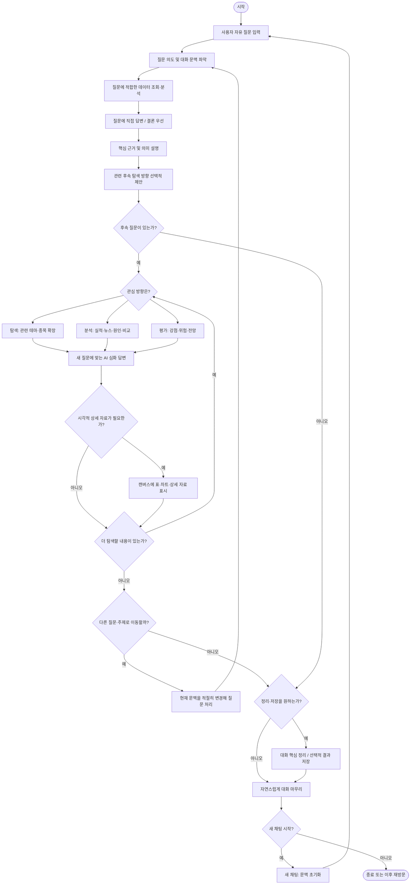

# 금융 챗봇 사용자 흐름 설계서

> 문서 유형: 사용자 여정(User Journey) / 대화 흐름(Conversation Flow) / 캔버스 연동 UX
>
> 기준: 앞서 확정한 사용자 경험 원칙과 생성된 「금융 챗봇 사용자 흐름도 (전체 구조)」
>
> 목적: 기능 목록을 늘리기보다, 사용자가 자연스럽게 질문하고 기업·테마를 이해하며 후속 대화로 이어지는 경험을 정의한다.

## 0. 핵심 설계 원칙

1. **자유 진입:** 테마, 종목, 재무지표, 뉴스, 비교, 금융 개념 등 어떤 질문으로도 시작할 수 있다.
2. **질문 우선:** AI는 질문의 핵심에 먼저 답한다. 종합 평가 질문에는 결론부터, 수치 조회 질문에는 요청한 수치부터 답한다.
3. **이해 중심:** 데이터 나열로 끝내지 않고, 중요한 수치·뉴스가 무엇을 의미하는지 자연스럽게 설명한다.
4. **한 번의 답변도 완결성:** 다음 질문을 하지 않아도 현재 질문의 궁금증이 상당 부분 해결되어야 한다.
5. **자유 순환:** 탐색·분석·평가는 고정 순서가 아니라 대화에서 자유롭게 오갈 수 있는 활동이다.
6. **캔버스는 보조:** 채팅만 읽어도 핵심을 이해할 수 있어야 한다. 캔버스는 표·차트·상세 근거를 확인할 때 사용한다.
7. **문맥 유지 및 전환:** 현재 테마, 종목, 비교 대상과 앞선 질문을 기억하되 사용자가 다른 주제로 바꾸면 자연스럽게 전환한다.
8. **선택적 마무리:** 정리, 저장, 종료, 새 채팅은 필수 단계가 아닌 사용자 선택이다.

---

## 1. 전체 사용자 흐름

**주의:** 위 도식은 가능한 경로를 보여주는 구조도다. `정리 → 종료`를 강제하거나, 모든 질문이 반드시 `탐색 → 분석 → 평가` 순서로 흐른다는 뜻이 아니다.

---

## 2. 단계별 상세 흐름

### 2.1 대화 시작 — 자유 진입

- 사용자는 별도의 종목 선택이나 테마 선택을 거치지 않고 자연어 질문을 입력한다.
- 예시: `요즘 유용한 테마주 알려줘`, `로봇·자동화 관련주`, `두산로보틱스는 어때?`, `삼성SDI 지금 사도 괜찮아?`, `삼성전자 영업이익 얼마야?`, `PER이 뭐야?`
- AI는 질문의 성격을 파악하고 적절한 경로로 바로 진입한다.

### 2.2 첫 답변 — 질문의 핵심 해결

- 질문을 해석할 때 **현재 발화 + 앞선 대화의 관심 대상**을 함께 사용한다.
- 현재 질문에 필요한 자료만 조회·분석한다.
- 종합 평가형 질문: **종합 결론 → 핵심 이유 → 필요할 때 출처·상세 자료**.
- 직접 조회형 질문: **요청한 값·사실 → 의미 있는 간단한 해석**.
- 테마 탐색형 질문: **테마 소개 → 주목 이유 → 분야별 대표 기업 → 추가 탐색 가능성**.
- 숫자, 실적, 뉴스를 기계적으로 나열한 뒤 사용자가 의미를 해석하게 방치하지 않는다.
- 후속 질문을 제안할 수 있지만 그 제안은 현재 답변의 부족함을 보완하는 수단이 아니다.

### 2.3 후속 대화 — 자유 순환

후속 질문은 다음 세 활동 사이를 자유롭게 이동한다.

| 활동 | 사용자의 관심 | 대표 질문 | 답변 방향 |
|---|---|---|---|
| 탐색 | 무엇이 있는가? | `로봇 관련주 더 있어?` | 기존 목록을 단순 반복하지 않고 산업·기업 범위를 확장 |
| 분석 | 왜 그런가? | `매출이 늘었는데 왜 적자야?` | 재무·뉴스·사업구조에 근거해 원인과 변화 설명 |
| 평가 | 어떻게 볼 것인가? | `이 기업은 요즘 어때?` | 장점·부담 요인·주목할 지표를 종합적으로 평가 |

- `탐색 → 평가 → 분석 → 탐색` 등 순서는 제한하지 않는다.
- 같은 질문이라도 앞에서 무엇을 논의했는지에 따라 답변의 중심이 달라질 수 있다.
- 사용자가 버튼을 누르지 않고 직접 질문해도 동일한 방식으로 처리한다.

### 2.4 캔버스 — 선택적 상세 자료

**역할 분담**

- **채팅:** 결론, 핵심 근거, 이해하기 쉬운 설명, 후속 대화
- **캔버스:** 상세 재무표, 기간별 추세, 비교 차트, 원문·근거, 내보내기 자료

**열기 기준**

| 상황 | 기본 동작 |
|---|---|
| 테마 소개·기업 개요 | 채팅에서 설명하고 캔버스는 닫힌 상태 유지 |
| 기업 종합 평가·간단한 뉴스 요약 | 채팅만으로 완결된 설명을 제공하고 상세 보기 선택권 제공 |
| `차트 보여줘`, `표로 비교해줘`, `Excel로 내보내줘` | 관련 캔버스를 자동으로 열거나 해당 자료를 즉시 표시 |
| 일반적인 다기업 비교 | 채팅에 핵심 비교 결과를 먼저 설명하고 상세 비교표를 선택적으로 제공 |
| 다른 질문으로 전환 | 캔버스를 무조건 덮어쓰지 않음. 기존 자료가 남아 있다면 기업명·자료 유형·기준 기간 표시 |

**일관성 규칙:** 캔버스의 자료 대상이 현재 채팅의 대상과 다를 수 있으므로, 표시 자료의 **기업명·자료 종류·기준 시점**이 항상 식별 가능해야 한다.

### 2.5 추가 질문과 주제 전환

- `그중 어디가 좋아?`, `왜?`, `그 회사는?`처럼 생략된 표현은 현재 관심 대상에 연결한다.
- 사용자가 다른 종목·테마를 명시하면 **새 관심 대상으로 전환**한다.
- **주제 전환**과 **새 채팅 시작**은 다르다. 주제 전환은 기록을 유지하고 관심 대상만 바꾸며, 새 채팅은 현재 대화 문맥을 초기화한다.
- 과거 자료는 사용자가 다시 참고할 수 있도록 보존한다.

### 2.6 정리·저장·종료·재시작

- 사용자가 `지금까지 정리해줘`라고 할 때 대화의 핵심 결론, 근거, 관심 지표를 정리한다.
- 저장·보고서·Excel은 **요청이 있을 때** 수행한다.
- 사용자가 `고마워`, `여기까지`라고 하면 간단히 마무리한다.
- 모든 대화 끝에 요약 단계를 강제하지 않는다.
- 사용자가 새 주제를 입력하면 기존 채팅 안에서도 즉시 새 탐색을 시작한다.
- 명시적 `새 채팅`은 대화 문맥 초기화 후 자유 질문 화면으로 돌아간다.

---

## 3. 대표 사용자 여정 — 테마 탐색에서 다시 시작까지

| 순서 | 사용자 | AI의 기대 행동 | 캔버스 |
|---|---|---|---|
| 1 | `요즘 유용한 테마주 알려줘` | 관심 테마 여러 개와 각각 주목할 이유 설명 | 닫힘 |
| 2 | `로봇·자동화` | 사업 분야와 대표 기업의 차이 소개 | 닫힘 |
| 3-A | `기업별 실적 비교` | 기업별 성장성과 수익성 차이를 평가 | 상세 표 필요 시 열기 |
| 3-B | `다른 관련주 보기` | 앞서 소개하지 않은 다른 관련 기업으로 확장 | 닫힘 |
| 3-C | `최근 주요 이슈` | 검증된 사건을 요약하고 사업 영향 설명 | 원문·상세 필요 시 열기 |
| 4 | `두산로보틱스는 어때?` | 현재 상황에 대한 종합 평가와 핵심 이유 제공 | 기본 닫힘 |
| 5 | `매출은 느는데 왜 적자야?` | 앞선 기업 문맥 유지, 비용·수익성 분석 | 필요하면 열기 |
| 6 | `그럼 앞으로는?` | 조건·주요 변수를 중심으로 전망 설명 | 필요하면 열기 |
| 7 | `로보티즈랑 비교하면?` | 비교 대상으로 문맥 확장, 차이 해석 | 상세 비교 자료 선택 가능 |
| 8 | `지금까지 정리해줘` | 핵심 분석과 판단 요약 | 요청 시 저장·내보내기 |
| 9 | `이번엔 AI 반도체 알려줘` | 새 주제에 맞춰 테마 탐색 재개 | 기존 캔버스 결과 식별 가능하게 유지 |
| 10 | `새 채팅` | 대화 문맥 초기화, 새로운 자유 진입 | 새 대화 상태에 맞춰 관리 |

**중요:** 3-A, 3-B, 3-C는 필수로 하나씩 순서대로 수행하는 것이 아니라 **대안적 분기**다. 사용자는 각 경로를 나중에 다시 선택할 수 있다.

---

## 4. 대화 UX 품질 점검 기준

1. **의도 해석:** `삼성SDI는 어때?`를 가격·PER 조회만으로 축소하지 않았는가?
2. **답변 완결성:** 후속 질문이 없어도 현재 질문에 충분히 답했는가?
3. **설명 밀도:** 근거를 본문에서 해석하고 상세 수치는 출처·캔버스로 적절히 분리했는가?
4. **문맥 유지:** `그중`, `왜`, `그러면 내년은` 등 후속 질문의 대상을 정확히 파악했는가?
5. **주제 전환:** 명시적으로 종목·테마를 바꾸면 이전 대상 정보와 혼동하지 않는가?
6. **데이터 시점:** 가격, 분기 실적, 뉴스 등 각 근거의 기준일이 적절하게 표현되는가?
7. **출처 연결:** 종합 평가가 어떤 주요 자료에 기초하는지 확인할 수 있는가?
8. **화면 질서:** 사용자가 채팅과 캔버스 중 어디를 읽어야 할지 혼란스럽지 않은가?
9. **실패 후 회복:** 미공개 자료와 일시적 조회 실패를 구분하고 가능한 범위의 답변을 이어가는가?
10. **응답 대기:** 긴 분석 시간에 비해 답변이 너무 빈약하거나 상태 표시가 혼란스럽지 않은가?
11. **설명 수준:** 질문 방식과 대화 문맥에 맞춰 금융 용어 설명을 조절하는가?
12. **강제 단계 없음:** 버튼·요약·저장·캔버스 없이도 자유롭게 질문하고 끝낼 수 있는가?

---

## 5. 개발 범위에 대한 결론

### 핵심 사용자 경험으로 유지

- 자유로운 자연어 질문으로 시작
- 테마와 관련 기업을 이유와 함께 탐색
- 개별 기업의 현재 상황을 결론 중심으로 설명
- 실적·주요 뉴스와 해석을 연결
- 후속 질문에서 대화 문맥 유지
- 기업 간 기본 비교
- 필요할 때만 상세 캔버스 사용
- 자연스러운 주제 전환, 선택적 요약 및 새 채팅

### 현 단계에서 필수로 확장하지 않음

- 사용자별 복잡한 투자 성향 설문
- 자동 매수·매도 판단 및 주가 보장형 예측
- 모든 산업·기업에 대한 전문 리서치 자동화
- 모든 질문을 정형 템플릿에 강제로 매핑하는 구조
- 매 대화마다 보고서·요약·캔버스를 강제로 생성하는 과정

## 6. 최종 정의

> **자유로운 질문 → 질문에 대한 직접적이고 완결된 답변 → 탐색·분석·평가의 자유로운 순환 → 필요할 때 상세 캔버스 → 선택적 정리·주제 전환·종료 및 새 대화 시작**

이 흐름의 목적은 정보를 단순 조회하는 앱이 아니라, **사용자가 관심 있는 테마와 기업의 현재 상황을 이해하고 대화로 탐구할 수 있는 금융 챗봇**을 만드는 것이다.

---

### 문서의 성격

- 이 문서는 **UX 흐름 설계 기준**이지 코드 변경 지시서나 모든 응답의 고정 템플릿이 아니다.
- 실제 금융 수치 및 최신 뉴스는 이 문서에서 확정하지 않는다.
- 앞서 작성한 상세 답변 시나리오는 이 사용자 흐름을 검증하는 테스트 예시로 활용할 수 있다.
