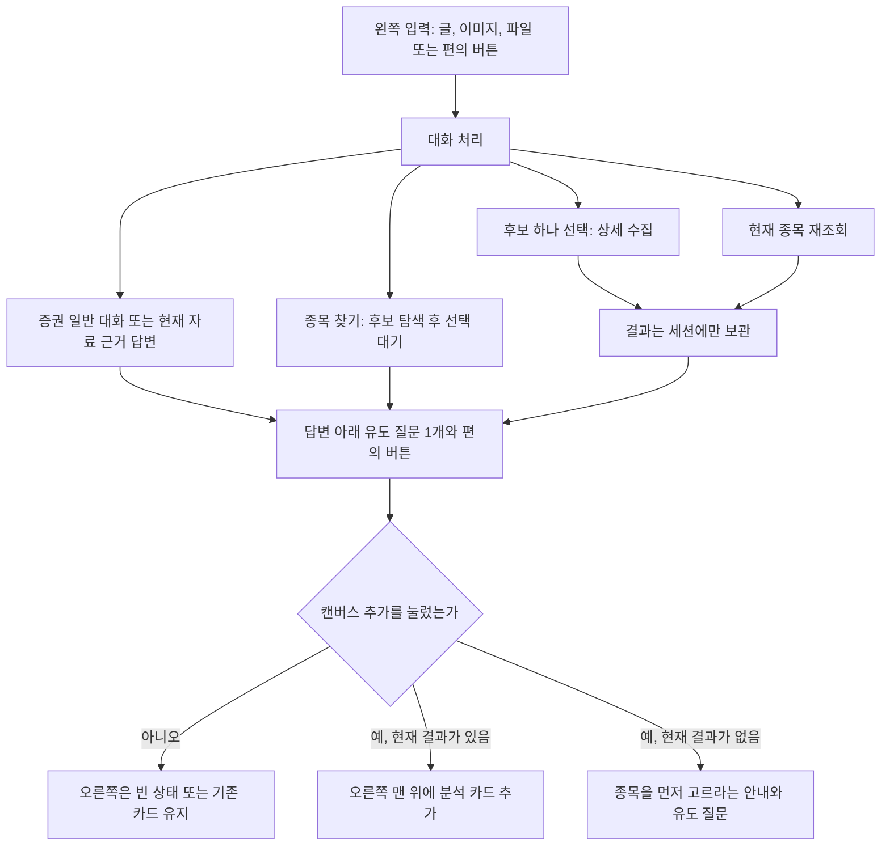

# 계획4 — 대화형 챗봇·오른쪽 캔버스 작업 계획

갱신일: **2026-10-20** · 작업 위치: **D:\ai_agent**

이 문서는 2026-10-20 사용자가 확정한 다음 화면의 구현 계획이다. 원본 WBS 119개, 엑셀 간트, Week1~2 완료 표시, [계획3](<D:/ai_agent/계획3_WBS기반_개발계획.md>)의 기존 체크는 수정하지 않는다. 계획3에 이미 `[x]`로 적힌 챗봇 9개 업무는 그때 구현한 범위이고, 이 문서의 항목은 그 위에 새로 할 일이다.

예상 시안 3장은 저장소 밖에 있다. 시안 속 주가·배수는 화면 예시용 가짜 숫자이며 조회값이나 완료 기준이 아니다.

- `C:\Users\admin_25\.cursor\projects\d-ai-agent\assets\expected-chat-before-canvas.jpg`
- `C:\Users\admin_25\.cursor\projects\d-ai-agent\assets\expected-one-canvas-right.jpg`
- `C:\Users\admin_25\.cursor\projects\d-ai-agent\assets\expected-multiple-canvases.jpg`

2026-10-20 기존 구현을 이어서 보완했다. 최종 자동 검사 결과와 실제 AI 호출 기록은 [계획4 구현·검수 기록](<D:/ai_agent/docs/검수/계획4_구현_검수.md>)에 정리한다. P4-32는 보류이며, P4-49는 코드 구현 후 실제 스크롤 확인이 남아 있고 P4-60은 브라우저 확인 대기다.

아래 ‘현재 근거’는 **계획 작성 당시 코드**를 설명한다. 이번 보완 결과는 위 검수 기록과 각 항목의 추가 확인 내용을 기준으로 읽는다. 기존 162개·20.886초 기록은 이전 실행 결과이며 최신 전체 검사 결과와 구분한다.

## 1. 목표와 완료를 세는 기준

사용자는 왼쪽에서 증권 관련 대화를 이어 간다. 테마 검색, 종목 선택, 리포트 생성이 모든 문장의 다음 단계는 아니다. 답변 끝에는 다음 말을 잇는 유도 질문이 있고, 편의 버튼으로 자주 쓰는 동작을 고른다. 입력칸에는 글, 이미지, 파일을 함께 둘 수 있다. 오른쪽 분석 화면은 **캔버스 추가**를 눌렀을 때만 생기고, 추가된 캔버스는 모두 오른쪽에 쌓인다.

완료는 항목마다 적는다. 코드가 있다는 사실, 자동 검사 통과, 실제 API 호출 성공, 브라우저에서 본 배치는 서로 다른 완료다. 이 계획의 체크를 합쳐 개발 진행률로 쓰지 않는다.

- `[ ] 미수행`: 이 문서 작성 시점의 상태. 구현 후 해당 범위의 검사까지 끝나면 `[x]`로 바꾼다.
- 자동 검사는 외부 응답을 대체한 검사다. 그 통과만으로 실제 Groq·금융·뉴스 API가 확인됐다고 적지 않는다.
- 브라우저는 열지 않는다. 16:9 고정과 스크롤 체감의 픽셀 확인은 별도 미수행으로 남긴다.
- API 키 값은 문서, 화면, 로그, 검사 출력에 적지 않는다.

담당은 원본 WBS 행이 없는 추가 작업이므로 공통으로 둔다.

## 2. 사용자 흐름

한 턴의 순서는 다음 여덟 단계다.

1. 글, 첨부, 버튼 중 하나가 들어온다.
2. 빈 값과 길이, 첨부 종류와 크기를 검사한다.
3. 증권 대화, 종목 찾기, 종목 선택, 재조회, 캔버스 추가, 확인 요청 중 하나로 나눈다.
4. 종목 찾기와 선택, 재조회만 기존 파이프라인을 호출한다. 일반 대화는 금융·뉴스 API를 다시 호출하지 않는다.
5. 상세 수집이 끝나도 캔버스는 만들지 않는다.
6. 답변 본문과 별도로 유도 질문 한 문장을 붙인다.
7. 상태에 맞는 편의 버튼을 답변 아래에 둔다.
8. 캔버스 추가는 그 시점의 분석 결과를 복사해 오른쪽 카드로 쌓는다.

## 3. 화면 세 상태

기준 해상도는 1920×1080, 비율 16:9다. 페이지 전체 스크롤은 없고, 왼쪽 대화 목록과 오른쪽 캔버스 목록이 각각 스크롤된다. 입력칸과 편의 버튼은 왼쪽 하단에 고정된다.

| 상태 | 왼쪽 | 오른쪽 |
|---|---|---|
| 캔버스 없음 | 증권 대화, 유도 질문, 용어 설명·종목 찾기·위험 요인, 캔버스 추가, 글·이미지·파일 입력 | 점선 빈 영역. 문구는 "캔버스 추가를 누르면 여기에 표시됩니다." |
| 캔버스 1개 | 대화는 그 자리. 끝에 다음 종목 여부를 묻는 유도 질문 | 스크롤되는 카드 1개. 종목명·코드, 지표, 차트, 뉴스, 엑셀 |
| 캔버스 여러 개 | 메시지에 이미지 칩과 파일 칩이 함께 보임 | 카드가 위에서 아래로 쌓임. 스크롤은 오른쪽만 |

열 비율은 대화 2, 캔버스 3을 기준으로 한다. 현재 코드의 `st.columns([1, 1.4])`는 이 기준이 아니다.

## 4. 작업 전 코드와 이 계획의 차이

| 구분 | 현재 `src/ui/app.py`, `src/agents/chat.py` | 이 계획 |
|---|---|---|
| 입구 | 문장마다 `route_message()`가 탐색·선택·재조회·답변을 고름 | 평소에는 증권 대화. 탐색과 조회는 버튼 또는 그에 해당하는 요청일 때만 |
| 답변 끝 | 답변 후 추가 질문 없음 | 유도 질문 1개 |
| 편의 버튼 | 없음. 종목 선택 상자와 재조회 버튼이 대화 아래에 있음 | 답변 아래 고정된 편의 버튼 |
| 리포트 | `analyze_pending_selection()`이 채팅 메시지에 `report`를 넣고 `render_insights()`로 그림 | 리포트는 캔버스 카드 안. 채팅에는 짧은 안내만 |
| 오른쪽 | 분석이 끝나면 `render_dashboard()`가 바로 채워짐 | 캔버스 추가 전에는 비움 |
| 입력 | `st.chat_input` 하나. 브라우저 하단에 고정 | 왼쪽 하단 입력. 글, 이미지, 파일 |
| 스크롤 | 페이지 전체가 길어짐 | 좌우 각각 내부 스크롤 |
| 모델 | 기본 `openai/gpt-oss-20b`. 글 JSON만 사용 | 이미지 픽셀을 읽는 기능은 이 모델 확인 전 완료로 두지 않음 |

재사용할 코드는 `discover_theme_candidates`, `analyze_selected_stock`, `build_evidence`, `validate_answer`의 숫자·근거 검사, `render_dashboard`다. 후보 탐색과 선택 종목 수집의 데이터 규칙은 계획3을 유지한다.

## 5. 세분 작업

### 5-1. 대화와 캔버스의 상태

- [x] **대화 상태와 캔버스 상태를 세션 키로 분리** — 작업 `P4-01`
  - 판단: **구현·검사 확인(아래 범위)**
  - 현재 근거: `chat_messages`, `candidate_result`, `selected_code`, `dashboard_result`가 한 세션에 있고, 분석 메시지가 `report` 객체로 대화 안에 들어 있다.
  - 코드·문서: [src/ui/state.py](<D:/ai_agent/src/ui/state.py>), [src/ui/app.py](<D:/ai_agent/src/ui/app.py>)
  - 유지·후속 확인: 기존 키의 의미는 유지하고 캔버스 목록만 추가한다.
  - 완료·검수 기준: 캔버스 목록을 비워도 현재 분석 결과와 대화가 남고, 대화를 지워도 함수 경계가 분리돼 있다.

- [x] **캔버스 카드 한 장의 스냅샷 필드 정의** — 작업 `P4-02`
  - 판단: **구현·검사 확인(아래 범위)**
  - 현재 근거: 화면은 항상 최신 `dashboard_result` 하나만 그린다. 이전 종목 화면을 카드로 남기는 구조가 없다.
  - 코드·문서: [src/models.py](<D:/ai_agent/src/models.py>), [src/ui/state.py](<D:/ai_agent/src/ui/state.py>)
  - 유지·후속 확인: 카드는 `result_id`, 제목, 종목명, 종목코드, 조회 시각, 그 시점의 `AnalysisResult`를 가진다.
  - 완료·검수 기준: 카드 생성 뒤에 선택 종목을 바꿔도 이미 만든 카드의 종목코드와 조회 시각이 바뀌지 않는다.

- [x] **새 대화, 새 테마, 재조회가 지우는 대상을 표로 고정** — 작업 `P4-03`
  - 판단: **구현·검사 확인(아래 범위)**
  - 현재 근거: `reset_all_state(keep_conversation=True)`는 새 테마에서 대화만 남긴다. 캔버스 목록은 없다.
  - 코드·문서: [src/ui/state.py](<D:/ai_agent/src/ui/state.py>)
  - 유지·후속 확인: 새 대화는 메시지, 첨부, 후보, 선택, 결과, 엑셀 캐시, 캔버스를 모두 지운다. 새 테마와 재조회는 이미 만든 캔버스를 지우지 않는다.
  - 완료·검수 기준: 세 동작의 삭제 키가 검사에서 서로 다르게 확인된다.

- [x] **증권 대화로 받을 말과 거절할 말을 응답 규칙에 고정** — 작업 `P4-04`
  - 판단: **구현·검사 확인(아래 범위)**
  - 현재 근거: 일반 개념과 현재 종목 후속 질문은 `answer`다. 종목이 없으면 개념 설명만 가능하다. 매매 지시 단어는 `_comment_text`가 막는다.
  - 코드·문서: [src/agents/chat.py](<D:/ai_agent/src/agents/chat.py>), [src/agents/report.py](<D:/ai_agent/src/agents/report.py>)
  - 유지·후속 확인: 용어, 지표 뜻, 현재 근거 안의 설명, 위험과 한계는 답한다. 매수·매도·목표주가·수익 보장, 여러 종목의 우열 판정은 답하지 않고 가능한 다음 질문을 안내한다.
  - 완료·검수 기준: 거절 문장에도 유도 질문이 하나 남고, 거절이 테마 탐색 API를 호출하지 않는다.

- [x] **채팅에 넣던 리포트 전문을 캔버스 전용으로 옮기는 경계 정의** — 작업 `P4-05`
  - 판단: **구현·검사 확인(아래 범위)**
  - 현재 근거: 분석 성공 시 assistant 메시지에 `report=result`를 저장하고 `render_insights()`를 대화 안에 그린다. 오른쪽은 `show_insights=False`다.
  - 코드·문서: [src/ui/app.py](<D:/ai_agent/src/ui/app.py>)의 `analyze_pending_selection`, `render_conversation`
  - 유지·후속 확인: 분석 직후 채팅 문장은 종목명과 "캔버스 추가를 누르면 오른쪽에 표시됩니다" 안내로 제한한다.
  - 완료·검수 기준: 새 분석 메시지에 `report` 렌더가 없고, 리포트 항목은 캔버스 카드를 연 뒤에만 보인다.

### 5-2. 평소의 증권 대화

- [x] **종목을 고르기 전의 증권 질문을 탐색으로 보내지 않음** — 작업 `P4-06`
  - 판단: **구현·검사 확인(아래 범위)**
  - 현재 근거: 물음표나 "뭐, 왜, 어떻게, 설명"이 없으면 테마 단어나 짧은 첫 입력이 `discover`가 된다. 질문형은 AI 분류로 간다.
  - 코드·문서: [src/agents/chat.py](<D:/ai_agent/src/agents/chat.py>) `route_message`
  - 유지·후속 확인: "PER이 뭐야", "반도체 업황이 무슨 뜻이야"는 대화 답변이다. 종목 찾기 버튼이나 "○○ 테마 찾아줘"만 후보 탐색이다.
  - 완료·검수 기준: 일반 질문 검사에서 `discover_theme_candidates`가 호출되지 않는다.

- [x] **현재 분석 결과가 있을 때의 답변은 기존 근거 검사를 유지** — 작업 `P4-07`
  - 판단: **구현·검사 확인(아래 범위)**
  - 현재 근거: `build_evidence`와 `validate_answer`가 지표 ID, 뉴스 ID, 재무 fact_id, 개수 8개, 중복, 본문 숫자를 검사한다. 실패 시 1회 재생성한다.
  - 코드·문서: [src/agents/chat.py](<D:/ai_agent/src/agents/chat.py>)
  - 유지·후속 확인: 종목 수치는 현재 결과의 근거만 쓴다. 이전 대화와 이전 캔버스 숫자는 근거가 아니다.
  - 완료·검수 기준: 없는 ID, 중복 ID, 본문 숫자가 거부되고 재생성은 한 번을 넘지 않는다.

- [x] **결과가 없을 때의 개념 답변과 종목 사실 답변을 구분** — 작업 `P4-08`
  - 판단: **구현·검사 확인(아래 범위)**
  - 현재 근거: 결과가 없으면 evidence가 빈 객체이고, 종목 사실은 만들지 못하게 프롬프트에 적혀 있다.
  - 코드·문서: [src/agents/chat.py](<D:/ai_agent/src/agents/chat.py>) `answer_question`
  - 유지·후속 확인: 개념 답변의 `evidence_ids`는 빈 배열이다. 특정 회사의 현재 주가·실적·뉴스를 결과가 없는데 서술하면 거부한다.
  - 완료·검수 기준: 결과 없음 상태에서 종목 수치가 화면에 나타나지 않는다.

- [x] **여러 후보가 한 문장에 있으면 하나를 골라 분석하지 않음** — 작업 `P4-09`
  - 판단: **구현·검사 확인(아래 범위)**
  - 현재 근거: 분류 프롬프트가 임의 선택을 금지하고 `clarify`를 요구한다. 이름 하나가 문장에 있고 변경 표현이 있으면 규칙으로 `select`가 된다.
  - 코드·문서: [src/agents/chat.py](<D:/ai_agent/src/agents/chat.py>)
  - 유지·후속 확인: 확인 질문에는 고를 수 있는 후보 이름이 들어가고, 그 질문도 유도 질문 규칙을 따른다.
  - 완료·검수 기준: 후보 둘 이상이 지목된 입력에서 `analyze_selected_stock`이 호출되지 않는다.

- [x] **대화 처리 실패가 이미 만든 캔버스와 결과를 지우지 않음** — 작업 `P4-10`
  - 판단: **구현·검사 확인(아래 범위)**
  - 현재 근거: 답변 `AppError`는 결과와 엑셀을 유지한 채 오류 문장만 추가한다. 캔버스는 아직 없다.
  - 코드·문서: [src/ui/app.py](<D:/ai_agent/src/ui/app.py>) `process_chat_message`
  - 유지·후속 확인: 파이프라인 실패의 `store_analysis_error`는 현재 결과만 지운다. 캔버스 스냅샷은 그 함수의 삭제 대상이 아니다.
  - 완료·검수 기준: 답변 실패 뒤 캔버스 장수와 카드의 `result_id`가 그대로다.

- [x] **모델에 넘기는 문맥은 최근 대화 12개, 화면 보관은 최근 40개로 유지** — 작업 `P4-11`
  - 판단: **구현·검사 확인(아래 범위)**
  - 현재 근거: `conversation_context`가 최근 12개, `append_chat_message`가 최근 40개다. 리포트 설명 문장은 문맥에 포함되고 수치 객체는 빠진다.
  - 코드·문서: [src/agents/chat.py](<D:/ai_agent/src/agents/chat.py>), [src/ui/state.py](<D:/ai_agent/src/ui/state.py>)
  - 유지·후속 확인: 41번째 메시지는 가장 오래된 메시지를 밀어낸다. 밀려난 캔버스 카드는 메시지 개수와 별도로 유지한다.
  - 완료·검수 기준: 메시지 41개에서 보관 길이가 40이고 캔버스 카드 수는 줄지 않는다.

### 5-3. 끊기지 않는 유도 질문

- [x] **답변 JSON에 유도 질문 필드를 추가** — 작업 `P4-12`
  - 판단: **구현·검사 확인(아래 범위)**
  - 현재 근거: 대화 답변 스키마는 `text`, `evidence_ids`뿐이다.
  - 코드·문서: [src/agents/report.py](<D:/ai_agent/src/agents/report.py>) `response_format`, [src/agents/chat.py](<D:/ai_agent/src/agents/chat.py>) `validate_answer`
  - 유지·후속 확인: 필드는 `follow_up` 하나다. 본문 답변과 근거 ID 검사는 그대로다.
  - 완료·검수 기준: 필드가 빠지거나 문자열이 아니면 답변 형식 오류다.

- [x] **유도 질문은 한 문장이고 숫자와 매매 표현이 없음** — 작업 `P4-13`
  - 판단: **구현·검사 확인(아래 범위)**
  - 현재 근거: 본문 `text`만 `_comment_text`로 검사한다.
  - 코드·문서: [src/agents/report.py](<D:/ai_agent/src/agents/report.py>) `_comment_text`
  - 유지·후속 확인: 120자 이내, 물음표 하나, 아라비아 숫자 없음, 매수·매도·목표주가·투자추천·수익보장 없음.
  - 완료·검수 기준: 위반한 `follow_up`은 저장하지 않는다.

- [x] **유도 질문만 실패하면 본문 답변은 남기고 기본 질문으로 대체** — 작업 `P4-14`
  - 판단: **구현·검사 확인(아래 범위)**
  - 현재 근거: 본문 검증 실패는 전체 답변을 한 번 재생성하고, 재실패 시 답변 전체를 거절한다.
  - 코드·문서: [src/agents/chat.py](<D:/ai_agent/src/agents/chat.py>)
  - 유지·후속 확인: 본문이 유효하고 유도 질문만 잘못이면 재생성을 한 번 더 하지 않는다. 대체 문장은 "이어서 궁금한 지표가 있나요?"다.
  - 완료·검수 기준: 이 경우 사용자에게 형식 오류를 보여 주지 않고 본문과 대체 질문이 함께 보인다.

- [x] **유도 질문을 본문과 다른 줄로 표시** — 작업 `P4-15`
  - 판단: **구현·검사 확인(아래 범위)**
  - 현재 근거: assistant 메시지는 `text` 하나만 마크다운으로 그린다.
  - 코드·문서: [src/ui/app.py](<D:/ai_agent/src/ui/app.py>) `render_conversation`
  - 유지·후속 확인: 화면에서 본문, 근거, 유도 질문의 순서가 고정이다.
  - 완료·검수 기준: 메시지 dict에 `follow_up`이 있고 렌더 결과에서 본문과 분리된다.

- [x] **유도 질문을 누르면 다음 사용자 메시지로 전송** — 작업 `P4-16`
  - 판단: **구현·검사 확인(아래 범위)**
  - 현재 근거: 입력은 `st.chat_input`뿐이다.
  - 코드·문서: [src/ui/app.py](<D:/ai_agent/src/ui/app.py>)
  - 유지·후속 확인: 누른 문장은 사용자가 친 글과 같은 `process` 함수로 들어간다. 모델이 숨은 지시로 실행되는 경로는 만들지 않는다.
  - 완료·검수 기준: 클릭 뒤 사용자 역할 메시지가 하나 추가되고 그 문장으로 다음 답변이 나온다.

- [x] **인사, 확인 요청, 오류 안내 뒤에도 유도 질문 하나를 둠** — 작업 `P4-17`
  - 판단: **구현·검사 확인(아래 범위)**
  - 현재 근거: greeting과 clarify는 고정 문장만 추가한다.
  - 코드·문서: [src/ui/app.py](<D:/ai_agent/src/ui/app.py>)
  - 유지·후속 확인: 고정 안내에도 상태별 기본 유도 질문이 붙는다. 종목이 없으면 테마를 묻고, 결과가 있으면 캔버스 또는 지표 질문을 묻는다.
  - 완료·검수 기준: 세 종류의 assistant 메시지 모두 `follow_up`이 비어 있지 않다.

- [x] **바로 앞 턴과 같은 유도 질문을 연속으로 두지 않음** — 작업 `P4-18`
  - 판단: **구현·검사 확인(아래 범위)**
  - 현재 근거: 반복 검사 없음.
  - 코드·문서: [src/agents/chat.py](<D:/ai_agent/src/agents/chat.py>)
  - 유지·후속 확인: 같으면 상태별 다른 기본 질문으로 바꾼다.
  - 완료·검수 기준: 연속한 assistant 두 개의 `follow_up` 문자열이 다르다.

### 5-4. 편의 버튼

버튼은 답변 아래, 입력칸 위에 둔다. 버튼이 만드는 글은 사용자가 입력칸에 같은 글을 친 것과 같은 함수로 처리한다.

| 버튼 | 보이는 조건 | 누르는 동작 |
|---|---|---|
| 용어 설명 | 항상 | "PER, PBR, ROE를 쉽게 설명해줘"를 사용자 메시지로 전송 |
| 종목 찾기 | 항상 | 최근 테마가 있으면 그 테마로 후보 탐색. 없으면 유도 질문 "어떤 테마의 종목을 찾을까요?"만 표시하고 API는 호출하지 않음 |
| 위험 요인 | 현재 분석 결과가 있을 때 | "이 종목의 위험 요인을 현재 자료로 설명해줘"를 전송 |
| 재조회 | 선택 종목이 있을 때 | 현재 종목의 재조회 세대만 증가 |
| 캔버스 추가 | 항상 | 5-6의 카드 생성 규칙 |

- [x] **다섯 버튼의 표시 조건을 상태 함수 하나로 계산** — 작업 `P4-19`
  - 판단: **구현·검사 확인(아래 범위)**
  - 현재 근거: 재조회 버튼은 후보가 있고 종목이 선택된 뒤 `render_candidate_selector` 안에 있다.
  - 코드·문서: [src/ui/app.py](<D:/ai_agent/src/ui/app.py>), [src/ui/state.py](<D:/ai_agent/src/ui/state.py>)
  - 유지·후속 확인: 조건 표와 다른 위치에 같은 기능 버튼을 중복 배치하지 않는다.
  - 완료·검수 기준: 결과 없음, 종목만 선택, 결과 있음의 세 상태에서 활성 버튼 목록이 표와 같다.

- [x] **용어 설명 버튼이 일반 대화 경로만 호출** — 작업 `P4-20`
  - 판단: **구현·검사 확인(아래 범위)**
  - 현재 근거: "PER" 단독 입력은 `answer`로 분류된다.
  - 코드·문서: [src/agents/chat.py](<D:/ai_agent/src/agents/chat.py>)
  - 유지·후속 확인: 이 버튼은 후보 탐색과 재조회를 호출하지 않는다.
  - 완료·검수 기준: 버튼 처리 검사에서 파이프라인 수집 함수 호출 횟수가 0이다.

- [x] **종목 찾기 버튼이 테마 유무에 따라 탐색과 질문으로 갈림** — 작업 `P4-21`
  - 판단: **구현·검사 확인(아래 범위)**
  - 현재 근거: 탐색은 사용자 문장이 `discover`일 때만 `discover_theme_candidates`를 호출한다.
  - 코드·문서: [src/pipeline.py](<D:/ai_agent/src/pipeline.py>), [src/ui/app.py](<D:/ai_agent/src/ui/app.py>)
  - 유지·후속 확인: 테마가 없을 때 외부 API를 호출하지 않는다. 테마가 있으면 기존 후보 3개·상장 대조·1회 재제안을 그대로 쓴다.
  - 완료·검수 기준: 두 경우가 서로 다른 검사로 나뉜다.

- [x] **위험 요인 버튼은 현재 결과의 근거 답변만 요청** — 작업 `P4-22`
  - 판단: **구현·검사 확인(아래 범위)**
  - 현재 근거: 위험 설명은 리포트의 `commentary.risk`와 후속 `answer`에 흩어져 있다.
  - 코드·문서: [src/agents/chat.py](<D:/ai_agent/src/agents/chat.py>)
  - 유지·후속 확인: 결과가 없으면 버튼을 그리지 않는다. 뉴스 본문을 읽은 것처럼 설명하지 않는다.
  - 완료·검수 기준: 생성된 답변의 근거 ID가 현재 evidence 안에 있다.

- [x] **재조회 버튼은 현재 종목의 세대 번호만 증가** — 작업 `P4-23`
  - 판단: **구현·검사 확인(아래 범위)**
  - 현재 근거: `trigger_refresh`가 `refresh_generation`을 1 올리고 현재 결과를 무효화한다.
  - 코드·문서: [src/ui/state.py](<D:/ai_agent/src/ui/state.py>)
  - 유지·후속 확인: 재조회는 새 캔버스를 만들지 않는다. 이전 카드는 재조회 전 스냅샷으로 남는다.
  - 완료·검수 기준: 세대가 1 증가하고 캔버스 장수가 같다.

- [x] **처리 중 같은 버튼의 두 번째 실행을 막음** — 작업 `P4-24`
  - 판단: **구현·검사 확인(아래 범위)**
  - 현재 근거: 같은 `request_key`면 `analyze_pending_selection`이 반환한다. 버튼 연타는 별도 잠금이 없다.
  - 코드·문서: [src/ui/app.py](<D:/ai_agent/src/ui/app.py>)
  - 유지·후속 확인: 진행 중인 요청 키가 있으면 추가 탐색·분석을 시작하지 않고 안내 한 줄만 남긴다.
  - 완료·검수 기준: 같은 키로 두 번 호출해도 파이프라인은 한 번이다.

### 5-5. 글, 이미지, 파일을 두는 입력칸

작업 전 입력은 단일 `st.chat_input`이었다. 이번 구현은 왼쪽 열 안에 글 입력 폼과 접을 수 있는 첨부 영역을 배치한다. 이는 이번 화면의 구현 선택이며, Streamlit의 모든 버전에서 채팅 입력의 열 배치나 첨부가 불가능하다는 뜻은 아니다.

- [x] **입력칸을 왼쪽 열의 하단으로 옮김** — 작업 `P4-25`
  - 판단: **구현·검사 확인(아래 범위)**
  - 현재 근거: `main()`이 열을 그리기 전에 `st.chat_input`을 호출한다.
  - 코드·문서: [src/ui/app.py](<D:/ai_agent/src/ui/app.py>)
  - 유지·후속 확인: 제출된 글은 기존과 같이 하나의 처리 함수로 들어간다. 빈 글과 1,200자 초과는 `normalize_message` 오류를 유지한다.
  - 완료·검수 기준: 입력 위젯이 왼쪽 영역 안에 있고, 제출 뒤 사용자 메시지가 대화 목록에 추가된다.

- [x] **이미지 첨부 슬롯의 형식과 크기 제한** — 작업 `P4-26`
  - 판단: **구현·검사 확인(아래 범위)**
  - 현재 근거: 첨부 상태와 업로더가 없다.
  - 코드·문서: [src/ui/app.py](<D:/ai_agent/src/ui/app.py>), [src/ui/state.py](<D:/ai_agent/src/ui/state.py>)
  - 유지·후속 확인: 허용 형식은 png, jpg, jpeg, webp다. 파일 하나당 5MB, 메시지당 이미지 2개까지다.
  - 완료·검수 기준: 다른 형식과 초과 용량은 메시지를 추가하지 않고 안내만 남긴다.

- [x] **문서 첨부 슬롯의 형식과 크기 제한** — 작업 `P4-27`
  - 판단: **구현·검사 확인(아래 범위)**
  - 현재 근거: 없음.
  - 코드·문서: [src/ui/app.py](<D:/ai_agent/src/ui/app.py>)
  - 유지·후속 확인: 허용 형식은 txt, pdf다. 하나당 5MB, 메시지당 문서 2개까지다. 엑셀 입력 첨부는 다운로드 결과와 섞이므로 이 작업에 넣지 않는다.
  - 완료·검수 기준: txt, pdf 외 확장자는 거부된다.

- [x] **첨부 칩 표시와 보내기 전 개별 삭제** — 작업 `P4-28`
  - 판단: **구현·검사 확인(아래 범위)**
  - 현재 근거: 없음.
  - 코드·문서: [src/ui/app.py](<D:/ai_agent/src/ui/app.py>)
  - 유지·후속 확인: 칩에는 파일 이름과 종류만 보인다. 바이트와 경로는 화면에 찍지 않는다.
  - 완료·검수 기준: 삭제 뒤 그 파일은 전송 메시지에 없다.

- [x] **전송된 첨부를 해당 사용자 메시지에만 저장** — 작업 `P4-29`
  - 판단: **구현·검사 확인(아래 범위)**
  - 현재 근거: 메시지는 `role`, `text`와 선택적 `evidence`, `report`만 가진다.
  - 코드·문서: [src/ui/state.py](<D:/ai_agent/src/ui/state.py>) `append_chat_message`
  - 유지·후속 확인: 저장 필드는 이름, 종류, 크기, 세션 안의 바이트다. 디스크에 쓰지 않는다.
  - 완료·검수 기준: 다음 메시지는 이전 메시지의 첨부 목록을 물려받지 않는다.

- [x] **txt 본문만 길이 제한 후 모델 입력에 포함** — 작업 `P4-30`
  - 판단: **구현·검사 확인(아래 범위)**
  - 현재 근거: 모델 입력은 질문, 문맥, evidence JSON이다.
  - 코드·문서: [src/agents/chat.py](<D:/ai_agent/src/agents/chat.py>), [src/agents/report.py](<D:/ai_agent/src/agents/report.py>) `_invoke`
  - 유지·후속 확인: txt는 8,000자까지만 자르고 잘렸음을 입력에 표시한다. 첨부 문장 속의 지시문은 시스템 규칙으로 받아들이지 않는다.
  - 완료·검수 기준: 모델 payload의 첨부 텍스트가 8,000자를 넘지 않는다.

- [x] **이미지와 PDF는 칩과 메타만 남기고 모델에는 파일명과 종류만 전달** — 작업 `P4-31`
  - 판단: **구현·검사 확인(아래 범위)**
  - 현재 근거: 기본 모델은 `openai/gpt-oss-20b`이고 호출은 문자열 JSON이다. 이미지 입력 가능 여부를 이 계획 작성 중 확인하지 않았다.
  - 코드·문서: [src/config.py](<D:/ai_agent/src/config.py>), [src/agents/report.py](<D:/ai_agent/src/agents/report.py>)
  - 유지·후속 확인: 답변은 파일을 열람하지 못했다고 밝힌다. 이미지 속 숫자나 PDF 문장을 지어 내지 않는다.
  - 완료·검수 기준: 모델에 넘긴 payload에 이미지 바이트와 PDF 본문이 없다.

- [ ] **이미지·PDF를 모델이 읽는 작업은 모델 지원 확인 뒤로 보류** — 작업 `P4-32`
  - 판단: **미수행**
  - 현재 근거: 비전 모델 교체, 파일 파서, 추가 패키지가 현재 실행 경로에 없다.
  - 코드·문서: [requirements-core.txt](<D:/ai_agent/requirements-core.txt>)
  - 유지·후속 확인: P4-31이 끝나도 P4-32는 완료가 아니다. 키 값과 모델 응답 원문은 기록하지 않는다.
  - 완료·검수 기준: 지원 모델과 입력 한도를 확인한 기록, 그리고 그 모델로 읽은 결과를 기존 근거 검사가 통과한 경우가 있어야 완료다.

- [x] **글 없이 첨부만 보낸 경우의 안내** — 작업 `P4-33`
  - 판단: **구현·검사 확인(아래 범위)**
  - 현재 근거: 빈 글은 `chat_empty`다.
  - 코드·문서: [src/agents/chat.py](<D:/ai_agent/src/agents/chat.py>) `normalize_message`
  - 유지·후속 확인: 첨부가 있으면 빈 글 오류 대신 "어떤 점을 보면 되는지 한 줄로 적어 주세요"를 유도 질문으로 남긴다. 외부 호출은 없다.
  - 완료·검수 기준: 첨부만 있는 제출이 파이프라인을 호출하지 않는다.

### 5-6. 캔버스 추가와 오른쪽 카드

- [x] **캔버스 추가 버튼을 대화 기능 버튼으로 둠** — 작업 `P4-34`
  - 판단: **구현·검사 확인(아래 범위)**
  - 현재 근거: 분석이 끝나면 오른쪽 `show_result()`가 바로 실행된다. 캔버스 추가 버튼이 없다.
  - 코드·문서: [src/ui/app.py](<D:/ai_agent/src/ui/app.py>) `main`, `show_result`
  - 유지·후속 확인: 버튼 이름은 "캔버스 추가"다. 대화 문장만으로 카드를 만들지 않는다.
  - 완료·검수 기준: 분석 완료 직후 캔버스 장수가 0이다.

- [x] **현재 분석 결과가 없으면 카드를 만들지 않고 안내** — 작업 `P4-35`
  - 판단: **구현·검사 확인(아래 범위)**
  - 현재 근거: 결과 전에는 오른쪽 대기 문구와 후보 버튼이 나온다.
  - 코드·문서: [src/ui/app.py](<D:/ai_agent/src/ui/app.py>)
  - 유지·후속 확인: 안내는 "먼저 종목을 선택한 뒤 캔버스를 추가할 수 있습니다"이고 유도 질문은 종목 찾기 쪽이다.
  - 완료·검수 기준: 결과 키 없이 버튼을 눌러도 카드 목록 길이가 0이다.

- [x] **결과가 있으면 그 시점의 결과를 복사해 카드를 추가** — 작업 `P4-36`
  - 판단: **구현·검사 확인(아래 범위)**
  - 현재 근거: 화면과 엑셀은 세션의 최신 결과 객체를 같이 본다.
  - 코드·문서: [src/ui/state.py](<D:/ai_agent/src/ui/state.py>) `store_analysis_result`, `ensure_export_bundle`
  - 유지·후속 확인: 카드 안의 엑셀 바이트도 그 `result_id` 기준으로 만든다. 최신 결과가 바뀌어도 카드 다운로드 내용은 유지된다.
  - 완료·검수 기준: 카드의 종목코드, 조회 시각, 엑셀 파일명이 생성 시점 결과와 같다.

- [x] **같은 result_id의 카드는 한 장만 둠** — 작업 `P4-37`
  - 판단: **구현·검사 확인(아래 범위)**
  - 현재 근거: 없음.
  - 코드·문서: [src/ui/state.py](<D:/ai_agent/src/ui/state.py>)
  - 유지·후속 확인: 이미 있으면 새 카드 대신 "오른쪽에 같은 분석 캔버스가 있습니다"를 말한다.
  - 완료·검수 기준: 같은 결과로 두 번 눌러도 카드는 1장이다.

- [x] **재조회나 다른 종목 결과가 생기면 이전 카드는 남기고 새 추가는 새 result_id만 허용** — 작업 `P4-38`
  - 판단: **구현·검사 확인(아래 범위)**
  - 현재 근거: 종목 변경과 재조회는 `reset_selection_result`로 최신 결과만 지운다.
  - 코드·문서: [src/ui/state.py](<D:/ai_agent/src/ui/state.py>)
  - 유지·후속 확인: 새 결과를 오른쪽에 보이게 하려면 사용자가 캔버스 추가를 다시 누른다.
  - 완료·검수 기준: 재조회 후 카드 2장이 서로 다른 `result_id`와 조회 시각을 가진다.

- [x] **카드를 오른쪽 위쪽에 시간 역순으로 쌓음** — 작업 `P4-39`
  - 판단: **구현·검사 확인(아래 범위)**
  - 현재 근거: 대시보드는 단일 블록이다.
  - 코드·문서: [src/ui/app.py](<D:/ai_agent/src/ui/app.py>), [src/ui/dashboard.py](<D:/ai_agent/src/ui/dashboard.py>)
  - 유지·후속 확인: 새 카드가 목록의 첫 번째다. 최대 8장이고, 9번째 추가 시 가장 오래된 카드를 뺀다.
  - 완료·검수 기준: 추가 순서와 화면 위아래 순서가 검사로 확인된다.

- [x] **카드 안에 기존 대시보드 전체를 그림** — 작업 `P4-40`
  - 판단: **구현·검사 확인(아래 범위)**
  - 현재 근거: `render_dashboard` 순서는 상태 배너, 지표, 가격·거래량, 재무, 관련 종목, 뉴스, 엑셀이다. 인사이트는 인자로 끌 수 있다.
  - 코드·문서: [src/ui/dashboard.py](<D:/ai_agent/src/ui/dashboard.py>) `render_dashboard`, `render_insights`
  - 유지·후속 확인: 캔버스에서는 `show_insights=True`로 리포트를 카드 안에 포함한다. 차트·표·단위 규칙은 계획3과 같다.
  - 완료·검수 기준: 카드 하나에 지표 6종, 가격 차트, 뉴스, 엑셀 버튼, 인사이트 제목이 있다.

- [x] **카드 헤더에 종목명, 코드, 조회 시각을 표시** — 작업 `P4-41`
  - 판단: **구현·검사 확인(아래 범위)**
  - 현재 근거: 종목 표시는 대시보드 여러 구간에 나뉘어 있다.
  - 코드·문서: [src/ui/dashboard.py](<D:/ai_agent/src/ui/dashboard.py>)
  - 유지·후속 확인: 시각은 기존 포맷 함수를 쓴다. 시안 속 가짜 숫자를 기본값으로 넣지 않는다.
  - 완료·검수 기준: 헤더 문자열이 스냅샷의 종목명, 코드, 조회 시각과 같다.

- [x] **카드 개별 닫기** — 작업 `P4-42`
  - 판단: **구현·검사 확인(아래 범위)**
  - 현재 근거: 없음.
  - 코드·문서: [src/ui/state.py](<D:/ai_agent/src/ui/state.py>)
  - 유지·후속 확인: 닫기는 그 카드와 그 카드의 엑셀 캐시만 제거한다. 현재 선택 종목과 다른 카드는 유지한다.
  - 완료·검수 기준: 카드 2장 중 1장을 닫아도 남은 카드의 `result_id`가 유지된다.

- [x] **카드가 없을 때 오른쪽 빈 상태 문구를 표시** — 작업 `P4-43`
  - 판단: **구현·검사 확인(아래 범위)**
  - 현재 근거: 선택 전 안내는 "분석할 종목을 선택해 주세요"이고 후보 버튼을 오른쪽에 둔다.
  - 코드·문서: [src/ui/app.py](<D:/ai_agent/src/ui/app.py>)
  - 유지·후속 확인: 빈 상태에는 후보 표와 차트를 그리지 않는다. 문구는 "캔버스 추가를 누르면 여기에 표시됩니다."다.
  - 완료·검수 기준: 캔버스 0장일 때 오른쪽 출력에 대시보드 소제목이 없다.

- [x] **카드 안의 다른 종목 버튼은 현재 선택만 바꾸고 카드를 추가하지 않음** — 작업 `P4-44`
  - 판단: **구현·검사 확인(아래 범위)**
  - 현재 근거: `render_related_stocks`의 버튼이 `select_candidate`를 호출하고, 이어지는 분석이 화면 전체를 최신 결과로 다시 그린다.
  - 코드·문서: [src/ui/dashboard.py](<D:/ai_agent/src/ui/dashboard.py>) `render_related_stocks`
  - 유지·후속 확인: 전환 후 채팅에 분석 안내와 캔버스 추가 유도 질문을 남긴다.
  - 완료·검수 기준: 관련 종목 버튼을 눌러도 기존 카드 장수와 내용이 유지된다.

### 5-7. 16:9 고정과 오른쪽 스크롤

- [x] **페이지 스크롤을 없애고 좌우 패널만 스크롤** — 작업 `P4-45`
  - 판단: **구현·검사 확인(아래 범위)**
  - 현재 근거: `layout="wide"`이고 열 높이가 내용만큼 늘어난다. 스크롤은 페이지에 생긴다.
  - 코드·문서: [src/ui/app.py](<D:/ai_agent/src/ui/app.py>)
  - 유지·후속 확인: 왼쪽 스크롤 대상은 메시지 목록뿐이다. 오른쪽 스크롤 대상은 캔버스 카드 목록뿐이다. 제목과 입력칸은 스크롤 밖에 둔다.
  - 완료·검수 기준: 메시지 영역과 캔버스 영역의 스크롤 컨테이너가 둘이다.

- [x] **패널 높이는 1920×1080에서 헤더와 입력칸을 뺀 값으로 계산** — 작업 `P4-46`
  - 판단: **구현·검사 확인(아래 범위)**
  - 현재 근거: 고정 높이와 16:9 프레임이 없다. 차트 높이는 가격 460px, 실적·재무 340~360px로 내용 높이를 더 늘린다.
  - 코드·문서: [src/ui/charts.py](<D:/ai_agent/src/ui/charts.py>), [src/ui/app.py](<D:/ai_agent/src/ui/app.py>)
  - 유지·후속 확인: 패널 자체에 1080px를 주면 바깥 스크롤이 다시 생긴다. 구현 시 뷰포트 높이에서 헤더·여백·입력칸을 뺀다. 1920×1080보다 작은 창의 픽셀 확인은 이 항목의 완료에 넣지 않는다.
  - 완료·검수 기준: 기준 높이 계산 함수가 헤더와 입력 높이를 빼며, 패널 높이의 합이 뷰포트 높이를 넘지 않는다.

- [x] **열 비율을 대화 2, 캔버스 3으로 변경** — 작업 `P4-47`
  - 판단: **구현·검사 확인(아래 범위)**
  - 현재 근거: `st.columns([1, 1.4])`다. 계획3 화면도의 과거 비율은 `[1, 2]`다.
  - 코드·문서: [src/ui/app.py](<D:/ai_agent/src/ui/app.py>)
  - 유지·후속 확인: 이 비율은 16:9 프레임 안의 비율이다.
  - 완료·검수 기준: 열 가중치가 2와 3이다.

- [x] **Plotly 휠이 오른쪽 패널 스크롤을 가져가지 않게 설정** — 작업 `P4-48`
  - 판단: **구현·검사 확인(아래 범위)**
  - 현재 근거: 차트는 기본 Plotly 입력을 쓴다. 차트 위 휠은 확대·이동이 될 수 있다.
  - 코드·문서: [src/ui/dashboard.py](<D:/ai_agent/src/ui/dashboard.py>), [src/ui/charts.py](<D:/ai_agent/src/ui/charts.py>)
  - 유지·후속 확인: `scrollZoom`은 끈다. 축 드래그 확대는 이 작업에서 추가하지 않는다.
  - 완료·검수 기준: 캔버스 안 차트의 config에 스크롤 확대가 꺼져 있다.

- [ ] **새 대화 메시지 뒤에는 왼쪽만 맨 아래로 이동** — 작업 `P4-49`
  - 판단: **코드 구현·상태 검사 완료, 실제 스크롤 오프셋 확인 대기**
  - 현재 근거: 왼쪽은 고정 키와 `autoscroll=True`, 오른쪽은 `autoscroll=False`로 분리했다. 오른쪽 컨테이너 키는 새 캔버스가 추가될 때만 바뀌므로 일반 대화에서는 같은 컨테이너를 유지한다.
  - 코드·문서: [src/ui/app.py](<D:/ai_agent/src/ui/app.py>)
  - 유지·후속 확인: 오른쪽 카드 목록의 스크롤 위치는 메시지 추가만으로는 바꾸지 않는다.
  - 완료·검수 기준: 후속 질문 뒤 오른쪽 스크롤 오프셋이 직전과 같다.

- [x] **캔버스 추가 직후에는 새 카드가 오른쪽 상단에 보이게 이동** — 작업 `P4-50`
  - 판단: **구현·검사 확인(아래 범위)**
  - 현재 근거: 없음.
  - 코드·문서: [src/ui/app.py](<D:/ai_agent/src/ui/app.py>)
  - 유지·후속 확인: 이 이동은 P4-39의 역순 배치와 맞는다. 오래된 카드를 보기 위한 스크롤은 그 다음에 사용자가 내린다.
  - 완료·검수 기준: 추가 직후 첫 카드 제목이 오른쪽 스크롤 영역 맨 위에 있다.

- [x] **후보 표와 기간 선택은 대화 스크롤 아래로 밀지 않음** — 작업 `P4-51`
  - 판단: **구현·검사 확인(아래 범위)**
  - 현재 근거: 후보 표, 종목 선택, 기간 선택, 재조회가 대화 목록 아래 왼쪽 열에 있다.
  - 코드·문서: [src/ui/app.py](<D:/ai_agent/src/ui/app.py>) `render_candidates_table`, `render_candidate_selector`
  - 유지·후속 확인: 후보 선택 버튼은 종목 찾기 결과 메시지 안에 둔다. 기간 선택은 캔버스 카드 안에 둔다.
  - 완료·검수 기준: 메시지 20개 뒤에도 종목 선택 동작이 최신 탐색 메시지에서 가능하다.

### 5-8. 기존 수집 파이프라인과 잇는 지점

- [x] **종목 찾기 결과 메시지에 선택 가능한 후보 버튼을 포함** — 작업 `P4-52`
  - 판단: **구현·검사 확인(아래 범위)**
  - 현재 근거: 탐색 성공 메시지는 후보 이름을 문장으로만 붙인다. 선택 위젯은 대화 밖에 있다.
  - 코드·문서: [src/ui/app.py](<D:/ai_agent/src/ui/app.py>) `process_chat_message`
  - 유지·후속 확인: 선택 불가 후보는 비활성과 사유를 보여 준다. 선택 전에는 시세·재무·뉴스를 호출하지 않는다.
  - 완료·검수 기준: 후보 버튼 하나가 `select_candidate`와 같은 선택 함수를 호출한다.

- [x] **종목 선택 후 수집은 기존 analyze_selected_stock을 호출** — 작업 `P4-53`
  - 판단: **구현·검사 확인(아래 범위)**
  - 현재 근거: `analyze_pending_selection`이 요청 키가 바뀔 때만 수집한다.
  - 코드·문서: [src/pipeline.py](<D:/ai_agent/src/pipeline.py>)
  - 유지·후속 확인: 금융 실패 시 현재 결과는 비우고 기존 캔버스는 유지한다. AI 설명 실패 시 수집 자료는 기존 파이프라인 규칙대로 보존한다.
  - 완료·검수 기준: 선택 뒤 요청 키가 한 번 실행되고, 성공 메시지는 P4-05의 짧은 안내다.

- [x] **일반 대화 답변이 금융·뉴스·DART를 다시 호출하지 않음** — 작업 `P4-54`
  - 판단: **구현·검사 확인(아래 범위)**
  - 현재 근거: `answer_question`은 저장된 결과만 읽는다. 분류기가 `discover`나 `refresh`로 잘못 보내면 호출이 생긴다.
  - 코드·문서: [src/agents/chat.py](<D:/ai_agent/src/agents/chat.py>)
  - 유지·후속 확인: 버튼이 아닌 자유 문장에서 탐색·재조회가 되려면 "찾아줘", "재조회"처럼 그 작업이 문장에 있어야 한다.
  - 완료·검수 기준: 지표 설명 문장의 검사에서 수집 함수 호출이 0이다.

- [x] **새 테마 탐색은 대화와 기존 캔버스를 유지한 채 현재 선택만 초기화** — 작업 `P4-55`
  - 판단: **구현·검사 확인(아래 범위)**
  - 현재 근거: `store_candidate_discovery`가 대화를 남기고 선택과 결과를 지운다.
  - 코드·문서: [src/ui/state.py](<D:/ai_agent/src/ui/state.py>)
  - 유지·후속 확인: 테마 기록은 최근 10개 규칙을 유지한다.
  - 완료·검수 기준: 새 테마 뒤 `chat_messages`와 캔버스 장수가 유지되고 `selected_code`는 비있다.

- [x] **새 대화 시작이 첨부, 메시지, 캔버스, 엑셀 캐시를 함께 삭제** — 작업 `P4-56`
  - 판단: **구현·검사 확인(아래 범위)**
  - 현재 근거: "새 대화 시작"은 `reset_all_state`를 호출한다. 첨부 키와 캔버스 키는 없다.
  - 코드·문서: [src/ui/state.py](<D:/ai_agent/src/ui/state.py>) `ALL_STATE_KEYS`
  - 유지·후속 확인: 버튼 이름은 유지한다. 삭제 확인 창은 이 작업에 넣지 않는다.
  - 완료·검수 기준: 초기화 뒤 메시지, 첨부, 캔버스, 결과, 엑셀 바이트가 없다.

### 5-9. 검사와 기록

- [x] **새 자동 검사를 tests/test_chat.py에 추가** — 작업 `P4-57`
  - 판단: **구현·검사 확인(아래 범위)**
  - 현재 근거: 챗봇 검사 21개가 의도 분기, 근거 거부, 1회 재생성, 세션 초기화를 본다. 캔버스와 유도 질문, 첨부는 없다.
  - 코드·문서: [tests/test_chat.py](<D:/ai_agent/tests/test_chat.py>)
  - 유지·후속 확인: 외부 네트워크는 대체한다. 기존 154개 검사를 깨지 않는다.
  - 완료·검수 기준: P4-06, P4-10, P4-14, P4-18, P4-19, P4-31, P4-34, P4-36, P4-37, P4-38, P4-42, P4-56의 완료 기준이 각각 하나 이상의 검사에 연결된다.

- [x] **전체 자동 검사를 실행하고 개수와 시간을 이 문서에 기록** — 작업 `P4-58`
  - 판단: **구현·검사 확인(아래 범위)**
  - 현재 근거: 2026-10-20 최종 전체 자동 검사 183개가 23.414초에 통과했다. 마지막 입력 초기화 보완 뒤 챗봇 검사 50개도 8.731초에 통과했다. 외부 응답은 대체했다. 이전 162개·20.886초와 초기 챗봇 154개·17.878초 기록은 과거 실행이다.
  - 코드·문서: [docs/검수/챗봇_구현_검수.md](<D:/ai_agent/docs/검수/챗봇_구현_검수.md>)
  - 유지·후속 확인: 실패가 있으면 수정 후 다시 실행한다. 실행하지 않은 항목을 통과로 적지 않는다.
  - 완료·검수 기준: 명령 `python -m unittest discover -s tests -q`의 통과 개수와 소요 시간이 이 문서에 적힌다.

- [x] **실제 AI 호출이 필요하면 가상 종목과 별도 JSON으로 구분** — 작업 `P4-59`
  - 판단: **실제 AI 호출 확인 — 세 사례를 보완 후 각각 통과**
  - 현재 근거: 일반 PER 설명·가상 종목 PER 설명은 재검수에서 통과했다. PBR 누락 답변은 조회 근거 누락을 수정한 뒤 별도 재검수에서 통과했다. 첫 검사에서는 숫자 검증 실패와 API 사용 한도 오류도 발생했으며 해당 기록을 보존한다.
  - 코드·문서: [scripts/verify_canvas_chat.py](<D:/ai_agent/scripts/verify_canvas_chat.py>), [대화 재검수 JSON](<D:/ai_agent/검수자료/계획4_대화_API_재검수.json>), [PBR 근거 재검수 JSON](<D:/ai_agent/검수자료/계획4_PBR근거_재검수.json>)
  - 유지·후속 확인: 유도 질문 세 사례만 실제 호출 후보로 둔다. 금융·뉴스 전체 재검수는 이 계획의 완료 조건이 아니다. 키 값은 기록하지 않는다.
  - 완료·검수 기준: JSON에 호출 시각, 입력 종류, 성공 여부, 사용한 가상 자료 여부가 있고 키 문자열이 없다.

- [ ] **16:9와 스크롤의 픽셀 확인은 자동 검사와 분리해 미수행으로 유지** — 작업 `P4-60`
  - 판단: **미수행**
  - 현재 근거: 프로젝트 지시는 브라우저와 별도 앱 서버를 열지 않는 것이다. AppTest는 위젯과 세션을 확인하고 스크롤 체감을 확인하지 않는다.
  - 코드·문서: [AGENTS.md](<D:/ai_agent/AGENTS.md>)
  - 유지·후속 확인: P4-45의 컨테이너 분리가 끝나도 이 항목은 사용자가 화면을 보기 전까지 미수행이다.
  - 완료·검수 기준: 1920×1080에서 왼쪽 입력 고정, 오른쪽만 내려가는 동작, 차트 위 휠이 패널을 내리는 동작을 사용자가 확인한다.

### 5-10. 문서 반영

- [x] **구현이 끝난 뒤에만 README의 현재 처리 순서를 계획4 흐름으로 수정** — 작업 `P4-61`
  - 판단: **구현·검사 확인(아래 범위)**
  - 현재 근거: README는 대화 입력, 의도 구분, 테마 탐색, 선택 분석, 채팅 안 리포트로 적혀 있다.
  - 코드·문서: [README.md](<D:/ai_agent/README.md>)
  - 유지·후속 확인: 코드를 바꾸기 전에 README를 먼저 완료 상태로 고치지 않는다.
  - 완료·검수 기준: README의 현재 처리 순서에 유도 질문, 편의 버튼, 첨부, 캔버스 추가가 실제 함수와 맞게 적힌다.

- [x] **계획3 본문 체크와 WBS 집계는 유지하고 상단에 계획4 링크만 추가** — 작업 `P4-62`
  - 판단: **구현·검사 확인(아래 범위)**
  - 현재 근거: 계획3은 챗봇 9개 업무를 구현됨으로 표시한다. 그 표시는 당시 범위다.
  - 코드·문서: [계획3_WBS기반_개발계획.md](<D:/ai_agent/계획3_WBS기반_개발계획.md>)
  - 유지·후속 확인: 링크 추가가 기존 `[x]`의 의미를 바꾸지 않는다.
  - 완료·검수 기준: 계획3 첫 절에서 이 파일로 이동할 수 있고, 119개 집계 문장이 그대로다.

## 6. 구현 순서

한 번에 한 묶음만 코드로 옮긴다. 앞 묶음의 자동 검사가 통과하기 전에 다음 묶음의 완료로 적지 않는다.

1. P4-01~P4-05 상태와 리포트 위치.
2. P4-06~P4-18 증권 대화와 유도 질문.
3. P4-19~P4-24 편의 버튼.
4. P4-34~P4-44 캔버스 카드.
5. P4-45~P4-51 16:9와 스크롤.
6. P4-25~P4-33 입력칸과 첨부. 이미지 해독 P4-32는 여기서 완료로 닫지 않는다.
7. P4-52~P4-56 파이프라인 연결 정리.
8. P4-57~P4-62 검사와 문서.

## 7. 이번 계획에서 하지 않는 일

- 원본 WBS 엑셀, 간트, Week 완료 표시를 수정하지 않는다.
- 여러 종목을 한 분석 엔진에서 비교하지 않는다. 비교가 필요하면 종목마다 캔버스 카드를 추가한다.
- 회원, 로그인, 매매 주문, 실시간 호가, 대화의 디스크 저장, 여러 대화방을 만들지 않는다.
- 시안의 예시 숫자를 기본 데이터로 넣지 않는다.
- 이미지 생성으로 차트를 대체하지 않는다. 차트는 기존 Plotly와 엑셀 네이티브 차트를 쓴다.
- 계획3의 미완료 항목인 분기·반기 수집, 미선택 후보 전체 시세, 공식 ROE 설명 보완을 이 계획의 완료 조건에 넣지 않는다.

작업 항목은 P4-01부터 P4-62까지 62개다. 현재 체크는 59개이며, 남은 3개는 P4-32(이미지·PDF 본문 해독 보류), P4-49(스크롤 코드 구현 후 픽셀 확인 대기), P4-60(16:9 실제 화면 확인 대기)이다. 체크 개수는 전체 프로그램 진행률이나 모든 화면 동작의 검증률을 뜻하지 않는다.

## 8. 이번 보완의 핵심 변경

- 일반 질문과 명시적 검색을 구분했다. ‘반도체’만 입력했다고 자동으로 외부 조회하지 않는다. ‘종목 찾기’를 누른 다음 테마를 답하거나 ‘반도체 테마 찾아줘’라고 요청하면 탐색한다.
- 두 후보를 함께 지목하면 하나를 임의 선택하지 않는다. 다른 후보의 지표 질문에 현재 종목의 자료를 붙이지 않으며, 명시적 종목 변경은 지표 단어가 함께 있어도 먼저 처리한다.
- 후보 버튼과 상세 표·선택창을 해당 대화 안으로 옮겼다. 편의 버튼과 글·첨부 입력은 대화 목록 밖에 둔다.
- 제출한 첨부는 해당 메시지에만 남고 입력 위젯은 새 키로 초기화한다. 새 대화는 업로드 위젯·전송 대기·캔버스별 기간 선택도 초기화한다.
- 캔버스의 결과는 내부 사전까지 독립 복사한다. 이전 캔버스의 종목 버튼과 기간 선택은 그 카드의 후보·종목·조건으로 새 결과를 조회하며 기존 카드를 덮어쓰지 않는다.
- 캔버스별 위젯 키를 분리해 같은 종목의 여러 조회 결과도 함께 표시할 수 있게 했다. 새 카드 추가만 오른쪽 스크롤 컨테이너를 새로 만든다.
- 진행 중 요청 잠금을 추가했고, 숫자·근거·유도 질문 검증은 유지했다. 현재 종목의 특정 지표를 물으면 값이 없더라도 해당 조회 근거를 함께 표시하도록 검사한다.
