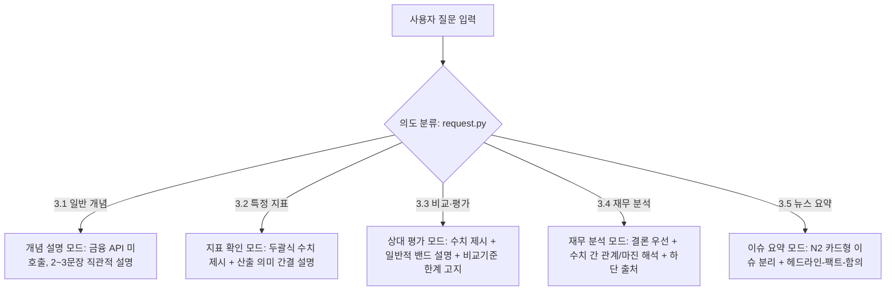

# 계획6 — AI 테마주 인사이트 리포트 로컬 LLM 통합 개발 계획

작성일: **2026-10-26**  
대화 합의·현황 확인을 반영한 상세 보강일: **2026-10-26**  
구현·검수 갱신일: **2026-10-27**  
기존 체크리스트 양식 통합일: **2026-10-27**  
대화 품질 및 금융 분석 응답 구조 개선 상세 보강일: **2026-10-27**  
단계 S~W 아키텍처 설계 10대 보완 및 2차 정밀 보완(7대 결함 해소) 반영일: **2026-10-27**  
개발 기준: `D:\ai_agent` · `woong`/`main`에 반영된 커밋 **`4a197cb`**  
문서 상태: **최신 문서 보강은33절(시나리오9·10 및 공식 정정 확장 분리),32절은 자료 확보·Fact 등록·해석·대화 효용의 상세 계획이다. 실제 구현·검수는31절 S/392개 통과 그대로다. T~W는 미착수, X01(연관 종목)·Y01(공식 정정 연결)은 서로 독립적인 후속 선택 확장이다. 합성 정정 입력 검수와 공식 연결 실제 구현을 구분하며 전체10개 시나리오를 현재 S~W 필수 완료로 일괄 강제하지 않는다. 이번 변경은 문서뿐이며 기존 완료 체크를 유지했다.**

이 문서는 현재 서비스에서 겪었던 문제, 이미 완료된 개선, 로컬 도입의 목적, 변경 경계, 답변 품질과 자원 검수 기준을 기록한 인수인계용 계획서다. **현재 상태와 과거 이력을 혼동하지 않는다.**

관리본: `D:\ai_agent\계획6_로컬LLM_통합_개발계획.md`. 전달받은 `C:\Users\admin_25\Downloads\로컬_LLM_통합_개발계획.md`에도 같은 내용을 반영한다. 이후 변경은 프로젝트 관리본을 기준으로 이력과 체크를 갱신하고, 두 사본이 달라지면 날짜·검수 근거를 대조한다.

## 0. 대화 기록이 사라졌을 때 가장 먼저 읽을 것

1. **프로젝트의 본래 목표:** 대화로 테마를 찾고 사용자가 고른 국내 상장 종목의 실제 금융·재무·뉴스 자료를 바탕으로 설명한다. 핵심 분석은 채팅, 자세한 표·차트·근거는 사용자가 누르는 오른쪽 캔버스, 파일은 같은 결과의 Excel이다.
2. **이번 요청의 핵심:** 기존 Groq를 삭제하거나 앱을 두 벌로 복사하지 않고 로컬 모델을 선택 가능한 공급자로 추가한다. 현재 구조에서 유지보수가 쉬워야 하며, 전환 뒤 대답 품질까지 확인해야 한다.
3. **이미 반영된 기준선:** 다른 AI의 마지막 개선과 실제 재무·뉴스 검수 성공까지 커밋 `4a197cb`에 포함됐다. 과거의 숫자 표현 거절·출처 범위 오심·어색한 문장은 다시 미완료 구현 목록으로 되돌리지 않는다. 로컬 전환의 회귀 검수 사례로 사용한다.
4. **로컬 도입은 새 작업:** 기존 WBS 원본 191개와 완료 체크를 초기화하지 않는다. 이 문서의 신규 체크리스트로 관리한다. 과거/동종 PER 수집 등 기존의 별도 미완료 기능을 로컬 연결과 섞지 않는다.
5. **최신 실제 작업:** 공식 런타임 배포 digest 대조·Q4 로딩, GPU4K/CPU8K 실제 생성·심사, 공급자 분리, 로컬 오류·무단 Groq 폴백 차단 및 앱/캔버스/Excel 모의 흐름 검수까지 수행했다. 상세 근거는 23절이다.
6. **현재 결론:** 연결과 일부 업무 품질은 확인됐지만 전체 품질·시연 속도 완료는 아니다. GPU4K는 긴 질문에 부족하고 CPU8K는 느리다. 다른 회사 기사 오수용을 발견해 관련성 전달·심사를 보강했으며, 최초 반환을 품질 통과로 세지 않는다.
7. **이어 읽을 순서:** 33절(시나리오9·10 채택 및 공식 정정 확장 경계) → 32절(상세 보강/실행 순서) → 31절(S 실제 구현·검수) → 15절의 미체크 T~W. X/Y는 별도 선택 확장이다. 이번에는 문서만 수정했으며 실제 T 구현은 후속 지시 후 진행한다.
8. **2026-10-27 대화 품질 개선 지침 (나무증권 Agent N2 벤치마크 및 11대 코드 지뢰 방어):** 사용자가 제공한 문제점 보고서(`AI_테마주_인사이트_리포트_대화품질_현문제점.md`)와 개발 지시 프롬프트에 따라, 기계적 리포트 블록 조립(`analysis_flow.py`)·평가 질문의 단어 차단 및 깡통 사전 정의 템플릿 후퇴(`report.py` `asserts_valuation` / `knowledge.py` fallback)·단순 수치 나열 프롬프트(`answer_quality.py`/`chat.py`)·멀티턴 맥락 결여의 4대 병목과, 프롬프트 수정 시 즉시 `AppError`나 LLM 우회를 일으키는 **11대 코드 레벨 지뢰(Code Traps)**를 함께 해소한다. 상세 설계는 27절(특히 27.2.1절), 실행 체크리스트는 15절 단계 N~R에 기록한다.

### 체크 표기의 의미

- `[x] 확인된 사실/완료된 범위`: 어떤 자료·검사로 확인했는지를 같은 항목에서 밝힌다. 문서 작성 완료가 모델 실행 완료를 뜻하지 않는다.
- `[ ] 신규 구현/검수 대기`: 코드가 일부 있더라도 이 단계에 필요한 연결이나 실제 검수가 남아 있다.
- ‘기존 완료’와 ‘로컬 전환 이후 재검수’를 별도로 기록한다. 기존 항목을 무조건 다시 미완료로 만들거나 로컬 검증 없이 완료로 승계하지 않는다.

## 1. 목적과 해결하려는 문제

이 프로젝트는 Python·Streamlit 웹 서비스로, 사용자가 테마나 종목을 자연어로 입력하면 국내 상장 종목을 확인하고 주가·재무제표·뉴스를 수집한다. AI는 질문과 대화 문맥을 이해해 실제 수집 자료에 근거한 설명을 **채팅**으로 제공한다. 사용자가 누르는 ‘차트·근거 보기’로 **오른쪽 캔버스**에 상세 표·차트·뉴스 링크를 연다. 같은 분석 결과로 Excel을 생성한다.

현재 AI 경로는 Groq의 `openai/gpt-oss-20b`를 사용한다. 과거에는 의도 분류(필요한 경우) → 답변 생성 → 의미 심사 → 실패 시 재작성·재심사의 누적 호출로 계정 토큰 처리량 제한과 HTTP 429에 막힌 이력이 있었다. 최근 보강 후 두 사례는 HTTP 4회 모두 200으로 통과했으므로, 현재 모든 요청이 429로 실패한다고 해석하지 않는다. 로컬 전환은 해결된 결함을 되풀이하는 작업이 아니라 클라우드 할당량 의존도를 줄이고 기존 품질을 유지하기 위한 신규 작업이다. 앞선 코드 분석에서 **8,000 TPM** 및 질문당 **약 7,400토큰**이라는 수치가 언급되었으나, 실제 환경에서 호출별 사용량 로그와 응답 헤더를 다시 확인해야 하는 **기존 분석/추정치**로 취급한다.

**목표:** 이미 다운로드한 GGUF 로컬 모델을 이용해 클라우드 AI의 분당 토큰 할당량 의존도를 줄이고, 기존 분석 정확도·UI·데이터 처리·검증을 보존하면서 학교 프로젝트를 로컬 PC에서 시연할 수 있게 한다.

**비목표:** 금융 데이터 제공 API까지 오프라인화하는 것, 모델을 새로 학습시키는 것, 상용 다중 사용자 서비스 구축, 회원·영구 기록 저장, 매매 주문 기능 추가.

## 2. 현재 상태: 직접 확인한 사실과 미확인 범위

아래 ‘직접 확인’은 2026-10-26의 읽기 전용 조사 결과다. 실행 시점에는 모델·GPU·코드 상태가 달라질 수 있으므로 다시 확인한다.

| 구분 | 2026-10-26 확인 결과 | 남은 확인 |
| --- | --- | --- |
| 프로젝트 | `D:\ai_agent`, 현재 기준 커밋 `4a197cb`, Groq 통신이 공통 `_invoke()`에 모여 있음 | 실제 구현 시작 시 Git 변경과 다른 AI의 추가 수정 여부 |
| 기존 AI | Groq의 `openai/gpt-oss-20b`, 금융·뉴스·자료 검증과 연결됨 | 로컬과의 전면 품질 동등성은 미측정 |
| Q4 파일 | `D:\models\gemma-4-12b\gemma-4-12b-it-Q4_K_M.gguf`, **7,121,861,440 bytes**, 약 **6.63GiB / 7.12GB** | 런타임에서 로드·추론 성공, 전체 파일 해시/배포본 정합성 |
| Q5 파일 | `D:\models\gemma-4-12b\gemma-4-12b-it-Q5_K_M.gguf`, **8,413,576,000 bytes**, 약 **7.84GiB / 8.41GB** | Q4 대비 품질 이득과 메모리·지연 차이 |
| GGUF 헤더 | 두 파일 모두 GGUF v3, `general.architecture=gemma4`, `Gemma-4-12B-It`, 메타데이터에 채팅 템플릿 존재 | 헤더 확인은 가중치 전체 무결성이나 런타임 지원을 입증하지 않음 |
| 모델 표시 문맥 | 메타데이터 `context_length=262144` | 이 PC에서 256K 문맥을 쓸 수 있다는 뜻이 아님 |
| GPU | NVIDIA GeForce RTX 3080, VRAM **10,240MiB**. 조사 순간 사용 **1,145MiB**, 여유 **8,909MiB** | 실행 직전 다시 측정. 해당 여유를 고정 예산으로 사용하지 않음 |
| CPU/RAM | Ryzen 9 5900X 12-Core, 물리 RAM 약 **63.9GiB** | CPU 오프로딩 때 실제 처리 시간 |
| OS·디스크 | Windows 11 Enterprise·디스크 여유는 기존 사용자 제공 정보 | 이번 조사에서 OS 에디션·디스크 잔량을 다시 검증하지 않음 |
| 로컬 런타임 | PATH의 `llama-server`, `llama-cli`, `ollama`, `lms`, 확인한 일반 설치 위치 및 1234/8080/11434 수신 포트에서 실행 환경을 확인하지 못함 | 설치되지 않았다고 단정하지 말고 실행 파일·정확한 버전·지원 모델을 확인 |
| 기존 자동 검사 | 저장된 `추가수정_푸시전_로컬검사_2026-10-26.log`에서 **313개 통과**. 당시 이 에이전트가 실행한 결과 | 이번 계획서 작성 중 재실행한 결과는 아님. 구현 직전에 기준선을 재확인 |
| 기존 실제 모델 검수 | 최신 문장 보강 기록에서 `financial`, `basic_report` 모두 첫 생성·심사 통과, HTTP **4회 전부 200**, 재작성/400/429 없음 | 가상 자료 2사례임. 실제 금융 API 전체 종단·긴 연속 대화 검수는 별도 |

현재 파일은 실제로 읽어 확인했지만 모델을 메모리에 올리지는 않았다. 모델 배포 경로와 공식 지원 정보를 확인한 결과 로컬 API 연결 방향은 타당하다. **특정 설치 버전에서 이 두 GGUF가 정상 동작한다는 결론은 실행 전에는 내리지 않는다.**

## 3. 무엇을 유지하고 무엇을 바꿀 것인가

### 3.1 변경하지 않는 핵심

- KRX 종목 확인, Yahoo Finance 시세/지표, OpenDART 재무, NAVER 뉴스 수집
- 정규화된 공통 결과 `AnalysisResult`, 답변·캔버스·Excel을 연결하는 `result_id`
- Python/Decimal 기반 재무 비교 계산과 기간·연결/별도·단위 검증
- 질문에 필요한 근거만 선택하는 설계, 원자료와 출처 연결
- 수치·종목·기간·근거 ID·임의 링크의 코드 검사 및 의미 심사 **품질 목표**
- 채팅 중심 답변, 사용자가 여는 오른쪽 캔버스, 과거 결과 보존, Excel 출력
- 자연스러운 `입니다·합니다`체, 질문하지 않은 결측 지표·형식적 주의문 억제

### 3.2 교체/확장 대상

- Groq 전용 모델 통신을 **공통 AI 호출 인터페이스 + Groq / Local 구현**으로 분리하되 기존 공개 호출 계약을 유지한다. Groq 동작을 먼저 옮겨 보존하고 로컬 분기를 추가한다. 기존 앱·프롬프트·상태 처리를 복사한 두 번째 앱은 만들지 않는다.
- 로컬 추론 서버의 주소·모델·컨텍스트·타임아웃·JSON 지원 여부 등을 설정으로 관리
- 공급자별 차이(인증, 오류, 출력 포맷, 사용량 측정)를 통신 계층에서 처리
- 로컬 모델의 성능에 맞게 프롬프트의 길이와 구조화 출력을 별도 검증·조정
- 실제 처리 시간이 길어질 경우 의도 분류/심사/재시도 경로를 측정 기반으로 최적화

**금지할 우회:** 로컬 모드 오류 시 사용자 동의 없이 Groq를 자동 호출해 429나 사용량 비용을 다시 유발하는 동작.

## 4. 목표 아키텍처

```text
Streamlit UI (채팅 / 캔버스 / Excel)
    │
사용자 입력 → 의도·대상·범위 파악 → 종목 확인
    │
기존 수집 계층 (KRX / Yahoo / DART / NAVER)
    │
정규화 + Decimal 계산 + AnalysisResult / result_id
    │
질문별 근거 선택
    │
AI 업무 계층 (후보 제안 / 답변 생성 / 필요한 의미 심사)
    │
공통 AI 호출 계약
    ├── Groq Provider (기존 보존)
    └── Local Provider → 127.0.0.1 로컬 HTTP 추론 서버 → 다운로드 GGUF
    │
기존 결정적 검증 + 필요한 의미 검증
    │
채팅 답변·출처 / 선택 시 캔버스 / Excel
```

모델 통신 연결은 우선 로컬 HTTP API를 검토한다. LM Studio 또는 llama.cpp 등의 런타임이 **다운로드 파일의 모델 아키텍처와 채팅 템플릿을 실제로 지원하는지** 확인하고 선택한다. 파일 형식이 GGUF라는 이유만으로 어느 런타임에서든 정상 지원된다고 간주하지 않는다. 서버는 기본적으로 `127.0.0.1`에만 열며 인증키·원문 데이터 로그 노출을 방지한다.

## 5. 로컬 모델 특성에 맞춘 대응

### 5.1 VRAM·문맥 길이

Q4 파일 7.12GB(6.63GiB)가 VRAM 10GB에 항상 완전히 들어간다는 뜻은 아니다. Q4와 Q5는 대안 모델 파일이며 우선 한 개만 로드한다. 시작 모델은 **Q4_K_M**으로 두고, 정상 업무 검증 뒤 Q5를 같은 조건으로 비교한다. 실행 버퍼, KV 캐시, 다른 GPU 작업량을 고려한다. **4K는 짧은 한국어/JSON 실행 확인의 초기 시험점**으로만 사용한다. 실제 업무는 8K 설정의 실행 가능성과 입력+출력 예산을 우선 비교한다. 기존 Groq 실제 기록의 입력 토큰은 각각 3,253 / 3,571 / 1,668 / 2,581이고 출력은 117 / 458 / 111 / 900이었다. 로컬 토크나이저의 결과는 다르므로 이 값을 그대로 문맥 계산에 대입하지 않지만, 4K만으로 기존 업무를 충분히 수용한다고 가정할 수 없다는 근거다. CPU 오프로딩과 캐시 설정도 비교한다. CPU 오프로딩 시 처리 속도 저하도 측정한다. VRAM은 시점별로 변하므로 과거 ‘9.1GB 여유’ 수치를 현재 상태로 간주하지 않는다.

### 5.2 프롬프트와 응답 계약

Groq 20B에서 통과하던 지시문/스키마가 로컬 모델에서도 같은 품질을 내는지 확인한다. 우선 기존 계약과 의미 검사를 그대로 기준선으로 사용한다. JSON 구조화 출력이 미흡하면 런타임 지원 기능, 스키마 단순화, 명확한 타입 검사 등을 **동일한 검증 강도 내에서** 적용한다. 잘못된 숫자가 형식만 맞아 통과하는 것을 허용하지 않는다.

### 5.3 질문별 근거 압축

원자료 전체를 모델에 넣지 않는다. 예컨대 ‘2024년 대비 2025년 영업이익 변화’에는 같은 회계 기준의 두 금액, 계산된 차액/증감률, 단위와 출처만 넣는다. 질문에 필요한 뉴스·재무의 복합 근거는 빠뜨리지 않되, 무관한 PBR이나 5년치 OHLCV를 채팅 프롬프트에 강제로 포함하지 않는다.

### 5.4 의미 심사·재작성

로컬 엔진 도입 직후에는 기존 검증을 **성능 비교를 위한 기준선**으로 유지한다. 그 뒤 형식·수치·기간·근거 ID는 Python으로 결정적으로 검증하고, 질문 충족·기사 과장·맥락 왜곡 등 코드로 판정하기 어려운 영역에 LLM 의미 심사를 집중할지 실측 결과를 보고 결정한다. 재작성과 재심사의 횟수는 상한을 둔다. 별도 LLM 심사를 제거하는 결정을 속도만으로 내리지 않는다.

### 5.5 응답 지연 및 상태

Groq TPM을 피하더라도 로컬 모델에서 긴 생성 시간, 첫 로딩 지연, 메모리 부족, Streamlit 리렌더링에 따른 중복 호출이 발생할 수 있다. 요청 직렬화, 모델 재사용, 실패 표시, 명시적 중단/재시도를 설계한다. 일반 채팅에 개발용 65초 호출 간격을 그대로 이식하지 않는다.

## 6. 구현 범위와 단계별 진입/완료 기준

| 단계 | 작업 | 완료 판단 근거 |
|---|---|---|
| **0. 기준선 확보** | Git 상태/설정/테스트 확인, 기존 Groq 단계별 호출·토큰·시간 확인 | 변경 전 결과, 기존 313개 검사 재실행 로그(실패 시 구분) |
| **1. 로컬 실행 검증** | 실제 모델 경로·GGUF 메타데이터·런타임 지원 확인, 한국어/JSON 추론, VRAM 측정 | localhost API로 테스트 응답, 자원·속도 기록 |
| **2. 최소 Provider 연결** | Groq 보존, 로컬 공급자 구현, 명시적 설정 전환 | 한 가지 일반 질문과 스키마 응답 성공, 로컬 모드에서 Groq 미호출 확인 |
| **3. 업무별 연결** | 후보 제안·의도 분류·금융 설명·의미 심사·재작성에 로컬 적용 | 각각 정상/실패 사례 통과, 코드 근거 검사 유지 |
| **4. 최적화** | 문맥/근거 길이·호출 수·오프로딩·타임아웃 조정 | 전후 성능 수치와 품질 비교, 회귀 없음 |
| **5. 통합 검수** | 실제 데이터, 연속 대화, 종목 전환, 캔버스, Excel | 자동/로컬 실제 모델/실제 API/UI 검수 결과를 분리 기록 |

**중간 중단 조건:** 모델 아키텍처 미지원, JSON/의미 정확성 반복 실패, VRAM/응답 시간의 현저한 부적합 등이 확인되면 기존 기능을 무리하게 변경하지 않고 원인을 기록한다.

## 7. 수용 테스트 시나리오

1. **일반 개념**: ‘PER이 무엇인가요?’ — 불필요한 종목 조회 없이 자연스러운 설명.
2. **테마 탐색**: ‘반도체 관련 종목’ — 후보 3개 형식, KRX 종목 대조, 임의 선택 금지.
3. **연간 재무 비교**: 두 사업연도 매출/영업이익 — Python 계산값·%와 %p·회계 기준 일치.
4. **후속 질문**: ‘그럼 왜 늘었나요?’ — 앞선 질문과 종목을 참조하되 근거 없는 원인 추측 금지.
5. **뉴스**: 제목 기반 근거만 설명 — 실제 기사 본문을 읽은 것처럼 쓰지 않음.
6. **복합 질문**: ‘실적과 뉴스 같이 설명해 주세요’ — 두 종류의 근거 보존, 범위 누락 방지.
7. **종목 변경**: A 분석 후 B 분석 — 이전 종목 수치 혼입 금지, A의 과거 캔버스 보존.
8. **오류 대응**: 로컬 서버 종료/JSON 오류/근거 수치 불일치 — 적절한 실패 표시와 제한된 재시도, Groq 무단 폴백 금지.
9. **화면·파일**: 채팅 설명·하단 출처·오른쪽 캔버스·Excel이 동일 `result_id` 기준을 유지.
10. **연속 사용**: 재무 → PER → 뉴스 → 다른 종목을 반복해도 모델·세션 상태와 메모리가 안정적.

검사는 **모의 데이터 회귀**, **실제 로컬 모델 추론**, **실제 금융 API 수집**, **브라우저 UI**, **실제 Excel 파일 편집**을 서로 다른 증거로 구분한다. 모델 실행이나 코드 테스트만으로 전체 서비스 실검수가 끝났다고 적지 않는다.

## 8. 성능·품질 기록 방법

각 시나리오마다 공급자, 모델/양자화, 컨텍스트, GPU 오프로딩, 입력/출력 토큰(런타임 제공 시), 호출 횟수, 최초 응답 지연, 전체 처리 시간, tokens/s, 피크 VRAM·RAM, JSON 준수, 수치 일치, 근거 일치, 문체, 실패 유형을 기록한다. 제공되지 않는 계측값을 임의로 만들지 않는다.

비교 대상은 기존 Groq 실행 결과이며, 동일 가상 금융 자료에 대한 비교를 먼저 수행한 뒤 실제 데이터로 확대한다. 새 Groq 호출을 기준선 확보의 필수 절차로 만들지 말고 우선 저장된 최신 성공/실패 기록을 사용한다. 새 Groq 검수가 필요한 경우 기존 최소 65초·기본 6회·429 중단 규칙을 적용한다. ‘로컬이 빠르다’, ‘동등한 품질이다’는 측정 전 결론으로 쓰지 않는다.

## 9. 주요 리스크와 방지책

| 리스크 | 방지책 |
|---|---|
| 다운받은 모델을 런타임이 지원하지 않음 | 모델 메타데이터/지원 버전부터 확인, 무단 재다운로드 금지 |
| 10GB VRAM 초과 또는 과도한 지연 | 문맥·배치/오프로딩 조정 후 실측, 무리한 전면 전환 금지 |
| Groq보다 낮은 JSON 준수율 | 런타임 구조화 출력·스키마 검증·회귀 사례 강화 |
| LLM 생성과 심사가 동일 오류를 놓침 | 결정적 금융 수치·원자료 대조 유지, 오류 사례별 테스트 |
| Streamlit 재실행이 모델을 중복 로드 | 서버 프로세스/모델 생명주기를 UI와 분리 |
| 로컬 실패가 외부 API 호출로 이어짐 | 공급자 명시 선택, 폴백은 별도 승인 전 비활성 |
| 금융 API의 외부 한도를 로컬 AI가 해결한다고 오해 | 금융 원천 API와 LLM 요청 제한은 별도 관리 |
| 범위가 확장되어 기존 WBS를 훼손 | 로컬 LLM 전환을 **신규 변경 작업**으로 관리, 원본 WBS 191개 체크와 혼합하지 않음 |

## 10. 작업 후 산출물

- 로컬 모델/런타임의 검증된 실행 설정 및 재현 가능한 실행 절차
- Groq와 Local을 선택할 수 있는 최소 변경 코드, 관련 테스트
- 기존 기능 회귀 결과 및 실제 추론·API·화면 검수를 구분한 기록
- 모델별 품질/응답 속도/자원 사용 비교표
- 미완료 항목, 알려진 한계 및 Groq 복귀 방법

## 11. 착수 전 확인 항목 — 재확인과 신규 실행을 구분

- [x] 2026-10-26에 Q4/Q5의 경로·실제 크기·GGUF 헤더·아키텍처·채팅 템플릿 존재를 읽어 확인했다. 전체 가중치를 실행하거나 검증한 것은 아니다.
- [x] GPU 종류·VRAM 사용량 및 CPU/RAM을 읽기 전용으로 확인했다. 실행 직전에는 다시 측정한다.
- [x] 현재 코드 기준 커밋과 공통 AI 호출 경로, 저장된 313개 검사 및 최신 실제 모델 2사례를 확인했다.
- [x] 모델 파일(Q4) 및 공식 런타임(llama.cpp b11900 CUDA12.4)의 실제 설치·로드·채팅 템플릿 지원을 확인했다. (`15절 단계 B`, `23절`)
- [x] 로컬 모델의 실제 한국어 생성·JSON 스키마 출력·GPU4K 추론 속도(1234 포트) 및 기초 통신을 확인했다. (`15절 단계 B·C`, `23절`)
- [x] 실제 `.env`의 `AI_PROVIDER=local` 전환 및 로컬 HTTP API 엔드포인트(`http://127.0.0.1:1234/v1`) 연결을 완료했다. (`15절 단계 C`, `26절`)
- [ ] [미완료] GPU 8K(`ctx 8192`) 서버 재시작 및 장문 문맥·피크 VRAM 실측 (`15절 P6-B03`, `P6-M03`)
- [ ] [미완료] 실시간 외부 금융 API(OpenDART·Yahoo·Naver) 종단 연동 및 브라우저/Excel 수동 육안 검수 (`15절 P6-G02·G03`, `P6-M04`)

**현재 구현 착수 여부:** 2026-10-27 단계 V까지 구현·자동 검증했고 전체508개 검사가 통과했다(최신36절, U 이력35절, T 이력34절, S 이력31절). W와 선택 확장X/Y는 남아 있다. 이전 단계의 완료 및 실제 검수는29절을 따르며, 이번 자동 검사 통과를 실제 금융 API·GPU 8K·전체 답변 품질 완료로 확대하지 않는다.

## 12. 이번 계획에 담아야 하는 사용자 의도와 대화 합의

### 12.1 사용자가 요구한 것은 무엇인가

사용자는 로컬 모델 파일을 `D:\models`에 추가한 뒤 기존 서비스를 삭제하지 않고 로컬 모델을 사용할 방법을 물었다. 이어서 다음 조건을 강조했다.

> 현재 구조를 기준으로 유지보수가 쉬워야 하고, 로직이 엉키면 안 된다. Groq의 토큰량 때문에 애먹던 답변 품질을 로컬에서도 확보할 수 있는지까지 계획에 포함해야 한다. 코드 파일 이름만 나열하지 말고, 지금 어떤 문제가 있었고 그래서 어떻게 하려는지 설명해야 한다.

따라서 이 작업의 완료는 ‘로컬 모델이 한 문장을 출력했다’가 아니다. **기존 서비스와 검증의 책임을 유지하면서, 필요한 근거와 대화 문맥을 전달하고, 답변 생성·심사를 지속적으로 수행해 사용자에게 유용한 설명을 반환할 수 있는지 증거로 확인하는 것**이다.

### 12.2 Groq 사용량 문제를 어떻게 해석하는가

사용자 질문 한 번이 항상 AI 요청 한 번은 아니다. 의도 분류가 필요한 경우의 호출, 답변 생성, 의미 심사, 실패 뒤 재작성·재심사, 종목 선택 직후 기본 리포트와 재무 설명 등이 이어질 수 있다. 생성 문장이 짧아도 프롬프트·근거·대화·심사 입력은 길 수 있다.

이 누적 사용량 때문에 과거 검수가 중간에 멈춰 같은 문제의 수정·검증을 충분히 이어 가지 못했다. 하지만 **과거 답변 결함의 원인을 전부 토큰 제한으로 단정하면 안 된다.** 잘못된 근거 선택, 검사 규칙과 실제 표시의 불일치, 문장 생성 방식도 각각 원인이었다. 로컬 전환은 이 원인들을 자동 해결하지 않는다.

로컬 전환으로 얻으려는 것은 클라우드 할당량에 덜 의존하면서 필요한 생성·심사를 반복 확인할 수 있는 실행 환경이다. 대신 누적 처리 시간과 메모리 문제가 생길 수 있으므로 호출 수·문맥 크기·품질을 함께 측정한다.

### 12.3 다른 AI가 고친 내용을 포함한 현재 기준선

다음은 ‘앞으로 처음 구현할 일’이 아니라 이미 커밋 `4a197cb`에 반영된 내용이다.

| 과거 문제 | 현재 반영된 조치 | 로컬 전환 때 확인할 것 |
| --- | --- | --- |
| 수치와 결론이 맞아도 직접 쓴 숫자·연도 때문에 반환이 막힘 | 항목·기간·%/%p·전기/당기 금액을 같은 CMP 근거와 대조 | 같은 정상 원문은 허용하고 수치/연도/단위 변형은 거절 |
| 화면 하단의 비교 기간을 심사기는 못 봐 정상 답변 거절 | 화면과 의미 심사가 공통 출처 표기와 `displayed_data_sources` 사용 | 메타데이터를 본문에 반복하지 않아도 범위 심사가 정상 작동 |
| 재무 생성마다 제공자 스키마 400 뒤 JSON 대체 호출 반복 | 현재 20B 재무 단문만 첫 요청부터 JSON+필수 스키마 사용 | 이 예외를 Gemma에 모델명 기준으로 그대로 복사하지 않고 런타임 기능에 맞게 전달 |
| 숫자 설명의 번역투·명사구 나열·불완전한 뉴스 문장 | 자연스러운 주어/서술어·완결 문장 지시와 기본 뉴스 문체 검사 | 근거 정확성과 한국어 가독성을 함께 유지 |
| 관련 없는 기업집단 기사를 테마 동향·기회·위험에 반복 | 관련 근거 사용과 빈/null 항목 허용, 공통 의미 심사 | 형식을 채우기 위한 무관한 기사·전망을 만들지 않음 |

최신 실제 검수의 재무 문장:

> 매출은 20.00% 증가했고 영업이익은 80.00% 증가했으며 영업이익률은 5.00%p 상승해 실적이 전반적으로 개선되었습니다.

최신 실제 검수의 기본 뉴스 문장:

> 이 종목은 반도체 메모리 생산라인 가동 계획을 발표했습니다.

두 문장은 실제 모델에 **가상 회사·가상 재무·가상 뉴스**를 넣어 받은 표본이다. 실제 삼성전자나 현재 시장의 수치로 화면에 넣으면 안 된다. 문구 자체를 정답으로 하드코딩하지 말고 ‘질문에 직접 답함·수치와 의미 일치·자연스러운 문장·원문 범위 준수’의 기준으로 쓴다. 수치가 바뀌면 결론도 바뀌어야 한다.

### 12.4 현재 계획에서 반복하지 않을 실수

- ‘Groq에서 거절됐다’는 표현을 모델이 답을 거부했다는 의미로 섞지 않는다. 전송 실패, 코드 수치 검사, 의미 심사, 질문 품질 실패를 각각 기록한다.
- 전체 313개 통과 또는 실제 표본 두 개 성공을 모든 질문의 품질 완료로 설명하지 않는다.
- 이미 해결한 과거 문제를 새 미구현 기능으로 나열하지 않는다. 회귀 사례로 재사용한다.
- 로컬이므로 긴 원자료를 모두 넣어도 된다고 생각하지 않는다. 필요한 문맥 보존과 불필요한 자료 축소를 함께 설계한다.
- 로컬 답변이 어색하다고 UI에서 문장을 임의 교정하거나 검사 실패를 숨기지 않는다. 생성·근거 선택·검사 중 어느 단계 문제인지 확인한다.

## 13. 기존 구조를 보존하는 변경 설계

### 13.1 한 서비스와 하나의 공통 결과를 유지

기존 Groq 모드와 로컬 모드를 같은 앱 안에서 명시적으로 선택한다. 데이터 수집·재무 계산·질문 판단·캔버스·Excel 처리를 공급자별로 두 벌 작성하지 않는다. 공급자는 텍스트/JSON 생성에 필요한 통신과 지원 기능만 담당하고 금융 판단을 직접 소유하지 않는다.

의미 심사 역시 같은 품질 목표를 사용한다. 공급자가 다르다는 이유로 틀린 수치나 근거 없는 전망을 허용하지 않는다. 초기에는 선택한 공급자가 생성과 심사를 모두 수행하고, 생성은 로컬·심사는 Groq 같은 혼합 모드를 암묵적으로 만들지 않는다.

### 13.2 변경 지점과 보존할 계약

다음 파일명은 **구현 위치의 제안**이며 아직 만들거나 수정하지 않았다. 실제 착수 전 현 코드를 확인해 같은 책임의 파일이 생겼다면 재사용한다.

| 영역 | 현재 상태·책임 | 계획된 최소 변경 | 넣으면 안 되는 책임 |
| --- | --- | --- | --- |
| `src/config.py` | Groq·NAVER·DART 설정과 제한 시간 | 공급자와 로컬 서버·모델·시간 제한 추가, 선택 공급자에 필요한 값만 검사 | 모델 로딩·자료 수집·UI 상태 변경 |
| `src/agents/transport.py` | 공통 `_invoke()`, 스키마·메시지·JSON 파싱, 현재 Groq 실행 | 기존 공개 진입점 유지, 공급자 선택 1곳, 공통 파싱과 오류 계약 유지 | UI마다 공급자 분기·종목/재무 계산 |
| 제안 `src/agents/providers/groq.py` | 현재 Groq 실행을 보존할 위치 | 기존 인증·지원 모델·추론 옵션·예산·응답 메타데이터 처리 이동 | 로컬 실패를 보고 스스로 호출되는 폴백 |
| 제안 `src/agents/providers/local.py` | 로컬 HTTP 통신을 추가할 위치 | 로컬 서버 요청, 스키마/템플릿 지원 차이, 제한 시간, 응답 정규화 | 모델 학습·새 금융 데이터 조회·Groq 자동 호출 |
| 공통 응답 정규화 | 현재 응답 `.content`, 사용량·종료 사유를 사용 | 공급자 출력의 내용·종료 사유·선택적 사용량을 같은 내부 의미로 변환 | 없는 토큰/TTFT/VRAM 측정값을 0이나 추정값으로 채우기 |
| `request.py`, `chat.py`, `report.py`, `grounding.py` | 분류·후보·생성·심사의 업무 호출자 | 공개 `_invoke()` 계약을 통해 선택 공급자 사용, 필요한 기능별 조정만 검증 | 파일마다 `if local / if groq`를 추가하거나 업무를 복사 |
| 데이터·UI·내보내기 | 수집·계산·표시·상태 | 기본 기능 유지, 필요한 오류/진행 안내만 연결 | 모델 전환을 이유로 공통 결과·결과 ID·과거 카드 구조 재작성 |
| 검수 스크립트·테스트 | Groq 실제 검수 및 로컬 모의 검사 | 로컬 명시 실행 도구와 공급자 회귀 검사 추가 | 테스트 import만으로 모델 로드·서버 시작·외부 요청 |

보존할 공개 호출 형태는 현재 `_invoke(settings, instruction, payload, max_tokens, temperature=...)`와 성공 시의 **JSON 객체 반환**이다. 생성/심사의 원시 결과는 먼저 공통 형식으로 정리한 뒤 기존 자료형·수치·근거 검사를 통과시킨다. 여러 추상 클래스·자동 플러그인 탐색·범용 에이전트 프레임워크를 처음부터 도입하지 않는다. 공급자 두 개에 필요한 작은 경계부터 만든다.

기존 `report.py`의 호출 재노출, 채팅/심사 테스트가 대체하는 공개 지점 등도 호환성을 확인한다. 호출 위치 이름을 옮겼다는 이유로 모의 검사가 실제 요청을 보내게 되는 회귀를 막는다.

### 13.3 분리 순서의 이유

1. 먼저 Groq 동작을 같은 계약 아래로 옮기고 기존 검사 결과가 유지되는지 확인한다. 여기서 실패하면 로컬 모델 탓으로 돌리지 않는다.
2. 선택 설정을 추가하되 설정이 없으면 기존 Groq 동작을 유지한다.
3. 로컬 통신만 추가하고 한 개의 가상 입력으로 JSON 반환과 오류를 검사한다.
4. 업무별 생성·심사와 전체 흐름에 연결한다.
5. 품질·속도를 확인한 뒤 프롬프트와 문맥을 최적화한다. 경계 분리와 대규모 프롬프트 재작성을 동시에 진행하지 않는다.

## 14. 공급자 설정·실행·오류 처리 계약

### 14.1 설정 이름과 전환 의미 — 모두 신규 제안

| 제안 설정 | 의미·초기 원칙 |
| --- | --- |
| `AI_PROVIDER` | `groq` 또는 `local`. 미설정은 기존 호환을 위해 `groq`, 알 수 없는 값은 오류 |
| 기존 `GROQ_API_KEY`, `GROQ_MODEL` | Groq 선택 때만 필요한 인증·모델 검사. 로컬 모드에서 Groq 키를 요구하지 않음 |
| `LOCAL_LLM_BASE_URL` | 로컬 API 기준 주소. 기본 검토 예 `http://127.0.0.1:1234/v1`, 실제 런타임 선택에 따라 확정 |
| `LOCAL_LLM_MODEL` | 서버가 등록해 반환하는 실제 모델 ID. GGUF 파일 경로나 Groq 모델명을 임의 대입하지 않음 |
| 로컬 인증 설정 | 런타임에서 필요한 경우만 지원. 더미 키가 실제 인증된 것처럼 기록되지 않음 |
| 로컬 연결/생성 제한 시간 | 기존 외부 데이터 API의 공통 제한과 분리. 연결 실패와 느린 생성 구분 |
| 컨텍스트·오프로딩·캐시 설정 | 선택 런타임의 모델 로딩 설정에서 관리. 모든 요청에 무조건 같은 필드를 보내지 않음 |

2026-10-26 제안 당시에는 실제 `.env`를 변경하지 않았으나, 2026-10-27 26절에서 사용자의 명시적 승인에 따라 실제 `.env`의 `AI_PROVIDER=local`, `LOCAL_LLM_BASE_URL=http://127.0.0.1:1234/v1`, `LOCAL_LLM_MODEL=gemma-4-12b-q4` 설정을 전환 완료했다. 현재 `_invoke()`는 선택한 로컬 공급자만 호출하며 로컬 모드에서 Groq 키를 요구하지 않는다. 로컬 오류 시 Groq 자동 폴백 금지는 엄격히 유지된다.

### 14.2 런타임 선택과 프로세스 관리

- LM Studio 또는 llama.cpp 중 실제 파일 지원·CUDA·템플릿·스키마 동작을 확인한 한 가지를 먼저 선택한다. 초기부터 둘을 동시에 통합하지 않는다.
- 기존에 설치한 도구를 확인하고 재사용할 수 있으면 재사용한다. 없는 도구·새 모델·재다운로드를 이미 완료한 것으로 가정하지 않는다.
- 모델은 UI 재실행 때마다 새로 로드하지 않는다. 별도 로컬 추론 서버의 생명주기와 Streamlit 세션을 분리한다.
- 초기에는 Q4 한 개와 동시 요청 1개를 기준으로 측정한다. 큐 대기, 처리 중, 실패, 제한적 재시도를 구분하고 중복 전송을 막는다.
- 현재의 ‘브라우저·Streamlit 앱 서버 자동 실행 금지’는 유지한다. 향후 구현 지시에 따른 로컬 추론 서버 검증과 사용자 웹 화면 실행을 구분한다. 이번 계획 작성에서는 어느 서버도 시작하지 않았다.
- 서버는 `127.0.0.1`에 바인딩한다. 외부 호스트 연결이나 공개 바인딩은 별도 범위로 본다.

### 14.3 공급자 기능 차이는 통신 경계에서 정리

Gemma의 채팅 템플릿, system/user 역할 처리, JSON schema 지원 범위, 생성 종료 사유, 추론/생각 출력 필드는 실제 런타임 버전에서 확인한다. Groq의 `reasoning_effort`, 현재 모델명 화이트리스트, strict 스키마 예외를 로컬에 그대로 보내지 않는다.

런타임이 JSON 문법을 강제하더라도 의미 정확성이 보장되는 것은 아니다. 필요한 enum·required·추가 필드·배열 개수 등의 계약은 기존 코드 검사로 다시 확인한다. 출력이 잘리거나 생각 텍스트와 JSON이 섞였다고 임의의 일부를 정답처럼 추출하지 말고 해당 종료/파싱 오류를 드러낸다.

### 14.4 실패와 되돌리기

다음 오류는 원인을 구별할 수 있게 처리한다. 실제 오류 코드 이름은 착수 시 기존 `AppError` 관례에 맞춰 확정하되 무조건 `ai_failed` 하나로 감추지 않는다.

- 서버 연결 불가 / 잘못된 주소 / 모델 ID 없음.
- 모델 로딩 실패 / 런타임 미지원 / 메모리 부족.
- 생성 제한 시간 / 문맥 초과 / 출력 잘림.
- HTTP 응답 오류 / JSON 형식 오류 / 수치 검사 실패 / 의미 심사 실패.
- 자체 검수 예산 종료 / 사용자 중단 / 모델 또는 요청 대기 상태.

로컬 실패 때 금융 수집 결과와 기존 대화는 필요한 범위에서 보존하고 실패 이유를 알린다. 조용히 Groq로 보내거나, 검증을 건너뛰거나, 이전 답변을 새 결과처럼 표시하지 않는다. Groq 복귀는 명시적인 공급자 설정 전환으로 수행하며 사용자의 기존 API·모델 설정을 덮어쓰지 않는다. 코드 삭제·강제 Git 되돌리기를 복귀 절차로 삼지 않는다.

## 15. 신규 작업 체크리스트와 단계별 완료 증거

**체크 관리 기준:** 단계 A~G는 최초 통합 작업과 기존 체크를 유지한다. 반복 오승인 보완은 같은 양식의 단계 H~M으로 통합했다. 최초 구현 순서는 H→I→J→K→L→M이며, 현재 재개는25절과 미체크 항목부터 진행한다. 문서 보강으로 기존 완료 체크를 초기화하지 않으며, 신규27개 작업은 작업/검증을 분리해 실제 수행한 범위만 체크한다. 최신 근거와 부분 완료의 제한은25절을 따른다.

### 단계 A. 현재 기준선 고정

- [x] 계획 작성 시 코드 커밋 `4a197cb`와 기존 완료 상태를 확인했다.
- [x] 기존 자동 검사 313개와 최신 실제 LLM 표본 2건의 기록을 확인했다.
- [x] 모델 헤더·크기·하드웨어를 읽기 전용으로 확인했다.
- [x] 실제 구현 직전 Git 상태·추가 변경·313개 검사 재실행을 기록했다. `계획6_착수전_로컬검사_2026-10-27.log`.
- [x] 기존 Groq 가상 수치와 같은 fixture를 `scripts/llm_fixture.py`로 고정했다. 실제 시장 데이터가 아니다.

완료 증거: 코드 버전, 검사 결과, 시험 입력 목록. 새 Groq 요청을 무조건 수행할 필요는 없다.

### 단계 B. 로컬 런타임 단독 적합성 확인

- [x] 공식 llama.cpp b11900 / 74b104c9b CUDA12.4를 선택해 해당 Q4 파일 로딩·한국어 생성과 JSON schema 동작을 확인했다. 환경 JSON 참조.
- [x] Q4의 템플릿과 실제 등록 ID `gemma-4-12b-q4`, GPU4K 한국어/JSON 응답을 확인했다.
- [x] GPU4K와 CPU8K의 입력/출력 토큰·전체 처리 시간을 비교했다. CPU 비교를 GPU8K 검증으로 대체하지 않는다.
- [ ] 최초 로딩/첫 요청과 모델이 이미 로드된 재요청을 구분해 VRAM·RAM·시간을 측정한다.
- [ ] 출력 잘림·잘못된 JSON·서버 종료·문맥 초과를 관찰할 수 있는지 확인한다.

완료 증거: localhost 응답, 실제 모델/런타임 설정, 계측 결과. 아직 앱 통합 성공으로 체크하지 않는다.

### 단계 C. Groq 보존과 로컬 최소 연결

- [x] 기존 Groq 호출을 공개 계약 아래 분리하고 회귀 검사를 통과했다. 신규 Groq 실제 호출은 하지 않았다.
- [x] 로컬 HTTP 호출·명시적 설정·공통 Completion/JSON 반환을 추가했다.
- [x] 로컬 모드 Groq 생성 0회를 모의 검사 및 실제 로컬 검수 도구에서 확인했다.
- [x] Groq 모드가 로컬을 호출하지 않음을 공급자 계약 검사로 확인했다.
- [x] 잘못된 JSON·중복 키·출력 잘림·인증·연결·시간·예산·응답 구조·혼잡·리디렉션 실패를 검사했다.
- [x] Q4의 PER 한국어 설명·JSON schema·재무 생성/근거 심사 실제 응답을 확인했다.

완료 증거: 공급자 계약 검사, 무단 폴백 0회, 전체 회귀 결과와 최소 실제 로컬 응답.

### 단계 D. 기존 AI 업무 전체 연결

- [x] 후보 제안·공식 참고 명칭 제한 재제안·자연어 탐색 의도 분류를 Q4에서 실제 확인했다. KRX 원격 조회는 해당 검수에서 수행하지 않았다.
- [x] 가상 자료의 기본 뉴스 리포트·동일 기준 재무 후속 설명을 Q4에서 실제 생성·심사했다. 별도 FinancialFact 설명 경로와 실제 API 종단은 미검증이다.
- [x] 후속 질문의 근거 선택→생성→수치 검사→의미 심사를 연결한다.
- [x] 제한적 재작성과 확인값 기반 대체 설명의 출처·성공 구분을 보존한다.
- [x] 로컬에서 unsupported 스키마/템플릿/역할로 실패하는 경우 공급자 경계에서 수정한다. 업무 코드 곳곳에 예외를 흩뿌리지 않는다.

완료 증거: 업무별 요청 횟수·정상/실패 응답·검사 결과. 생성 한 번의 성공으로 전체 단계를 완료하지 않는다.

### 단계 E. 답변 품질과 오류 대조

- [x] 16~17절 정상/오답 사례를 같은 입력으로 실행하고 답변 원문과 판정을 남긴다.
- [x] 금융 수치·기간·단위·종목·근거 ID의 잘못된 변형은 계속 거절하는지 확인한다.
- [x] 간결한 뉴스와 하단 출처의 기간·연결 기준을 공유하는 재무 답변이 실제 Q4 심사를 통과했다.
- [x] 기존 Groq 성공 2사례와 같은 가상 재무·뉴스 입력을 실제 Q4에서 확인했다. 최신 재무 20%/80%/5%p, 뉴스 계획 발표 모두 일치하며 전체 품질 동등성의 증거로 확대하지 않는다.
- [x] 복합 질문·모호한 후속 질문·종목 변경의 자료 선택과 문맥 유지도 확인한다.
- [x] 같은 모델이 생성과 심사를 맡는 한계를 고려해 결정적 수치 검사와 사람이 읽는 사례 평가를 함께 남긴다.

완료 증거: 문항별 품질 기록, 오답 수용/정답 거절 구분, 미통과 사례와 원인. 자동 심사기의 true만으로 품질 완료라고 하지 않는다.

### 단계 F. 속도·문맥·자원 최적화

- [x] 실제 시도한 GPU4K·CPU8K만 기록했다. GPU8K/Q5 결과를 만들어 쓰지 않았다.
- [x] 필요한 근거·대화만 선택하고 모델 토크나이저 기준 입력+예약 출력 예산을 맞춘다.
- [x] 과거 대화 압축 시 선택 종목·명시 기간·확인한 사건·출처·사용자 요청이 사라지지 않는지 검사한다.
- [x] 생성/심사/재작성 중 어느 단계가 병목인지 측정한 뒤 최적화한다. 심사를 속도만으로 제거하지 않는다.
- [ ] Q4로 기능·품질이 확보된 후 필요한 경우에만 Q5의 품질 이득과 지연을 비교한다.
- [x] 여러 요청을 이어도 중복 로드·병렬 충돌·메모리 누적이 없는지 확인한다.

완료 증거: 전후 지연·호출 수·문맥 크기·자원·품질 비교. ‘로컬이 빠르다’ 또는 ‘Q5가 더 좋다’를 측정 없이 결론내지 않는다.

### 단계 G. 기존 서비스 전체 흐름과 인수인계

- [ ] 가상 자료의 앱 회귀→실제 로컬 추론→실제 금융 API 수집의 증거를 단계적으로 확보한다.
- [x] 테마 입력→후보 선택→재무→PER→뉴스→다른 종목→과거 캔버스→Excel 준비를 연결한다.
- [x] 결과 ID·종목·기간·파일 일치와 실패 후 상태를 확인한다.
- [ ] 실제 브라우저·Microsoft Excel 수동 확인이 아직 없으면 그 항목을 미완료로 남긴다. 사용자 실행 정책을 따른다.
- [x] `docs/로컬_LLM_실행안내.md`와 23절에 설정·실행·수동 종료·Groq 복귀·현재 제한·재개 순서를 기록했다.

완료 증거: 공통 검사, 로컬 실제 사례, 통합 흐름 결과, 미완료 표와 재현 절차.

### 단계 H. 실패 재현 자료와 기대 판정 고정

**우선순위:** P0 · **선행 조건:** 23절의 실제 실패 기록 확인  
**상태:** 재현 자료·오프라인 기대 계약 완료. 실제 모델 품질 전체 합격과 구분한다.

**현재 문제·수정 필요성:** 단일 무관 기사 거절과 복합 오승인이 따로 기록돼 있고, 반환 성공과 품질 합격을 같은 뜻으로 읽을 위험이 있다.

**변경 위치:** tests/fixtures, scripts/verify_local_llm.py, docs/검수의 평가 기록. 기존 원문 JSON은 보존한다.

**예상 영향 범위:** 검수 자료와 평가 계약. 제품의 회사명·기사 ID 조건을 추가하지 않는다.

**세부 작업과 검증:**

- [x] P6-H01 작업 — 최신 복합 오승인·단일 거절·관련 기사만 있는 정상 답변을 같은 자료 버전으로 고정하고 기사별 기대 사용 범위를 표시한다.
- [x] P6-H01 검증 — 최신 복합 오승인은 실패, 관련 기사와 정상 재무는 정상으로 구분되는 기대 판정표를 확인한다.

- [x] P6-H02 작업 — 원자료/채택 목록/생성/심사/표시 원문을 각각 보관할 기록 계약을 정한다. 원문은 보존하고 평가를 별도 덧붙인다.
- [x] P6-H02 검증 — 원문을 수정하지 않고 생성·심사·표시·평가를 각각 추적할 수 있는지 확인한다.

- [x] P6-H03 작업 — 모델을 부르지 않고 저장 원문이 새 판정 계약에서 왜 실패해야 하는지 확인하는 회귀 사례를 먼저 만든다.
- [x] P6-H03 검증 — 저장 원문 대조가 외부 네트워크·실제 모델 호출 없이 실행되는지 확인한다.

- [x] P6-H04 작업 — fixture의 기대 결과를 제품 코드의 회사명/기사 ID 하드코딩으로 옮기지 않는다.
- [x] P6-H04 검증 — 회사명·기사 순서·ID를 바꾼 대조에서도 기대 판정이 유지되며 특정 fixture를 제품 코드가 인식하지 않는지 확인한다.

**완료 증거:** 최신 `returned` 복합 답변이 ‘NEWS_2 연결 미입증·선택 대상 관련성 실패’로 평가되고, NEWS_1과 재무 수치는 정답으로 유지된다. 해당 작업의 자료/코드 변경과 검증 결과를 연결해 기록한 뒤 각각 체크한다.


### 단계 I. 뉴스 관련성 판정과 답변 채택 범위 분리

**우선순위:** P0 · **선행 조건:** 단계 H의 재현 자료·기대 판정 고정  
**상태:** 공통 채택 정책과 차단 연결 완료. 실제 그룹 연결 자료가 있는 긍정 대조는 미완료다.

**현재 문제·수정 필요성:** 검색 결과 전체가 답변의 허용 근거 후보로 들어가고, 회사·산업·기업집단 관계의 입증 여부를 공통 자료로 관리하지 않는다.

**변경 위치:** 제안 news_relevance.py와 공통 판정 타입, evidence.py, report.py, chat.py, output_contract.py. data/news.py는 수집 책임을 유지한다.

**예상 영향 범위:** 기본 리포트·후속 답변의 근거 선택/인용. 원본 NewsArticle·ID·URL·캔버스·Excel 자료는 보존한다.

**세부 작업과 검증:**

- [x] P6-I01 작업 — 공통 기사 판정 타입/정책을 만들고 관련성 근거가 없는 회사/그룹 주장은 채택하지 않는다.
- [x] P6-I01 검증 — 24.4의 company/industry/group/unrelated/unknown 경계와 R04~R07의 정상·부정 대조가 일치하는지 확인한다.

- [x] P6-I02 작업 — 원문 목록은 유지하고, 기본 리포트·후속 대화·허용 ID 스키마·인용 검사에 동일한 채택 판정을 적용한다.
- [x] P6-I02 검증 — 기본 리포트와 후속 대화의 허용 ID가 같은 판정에 근거하며, 원문 기사·링크는 보존되는지 확인한다.

- [x] P6-I03 작업 — 모델이 제외 ID를 고의로 반환하면 코드에서 차단한다. 프롬프트에 ‘쓰지 말라’고만 하지 않는다.
- [x] P6-I03 검증 — 허용하지 않은 ID·알 수 없는 관계 자료 ID·인용 문구를 반환하면 schema 또는 코드 검사에서 거절하는지 확인한다.

- [x] P6-I04 작업 — 선택 회사/테마/결과가 바뀌면 이전 판정을 재사용하지 않는다. 동일 결과 재표시는 불필요하게 재판정하지 않는다.
- [x] P6-I04 검증 — A→B 종목 전환·테마 변경·결과 갱신에는 재판정하고, 동일 결과 재표시에는 불필요한 호출이 없는지 확인한다.

**완료 증거:** 관련 회사 기사·타당한 산업 맥락은 남고, 연결 미입증 지주회사 기사는 선택 종목 주장에 사용되지 않는다. 원문 제목/링크·캔버스/Excel 자료가 삭제되지 않는다. 형식 제약이 의미 판단을 대신한다고 보고하지 않는다. 해당 작업의 자료/코드 변경과 검증 결과를 연결해 기록한 뒤 각각 체크한다.


### 단계 J. 복합 질문의 요구 범위와 근거 계획 명시

**우선순위:** P0 · **선행 조건:** 단계 I의 공통 채택 판정 연결  
**상태:** 실적/뉴스 범위 분리와 기본 대조 완료. 실제 긴 연속 대화·종목 전환은 남아 있다.

**현재 문제·수정 필요성:** 실적과 뉴스를 함께 묻는 요청이 general로 남아 불필요한 지표가 포함되고, 한 범위만 답해도 전체 충족으로 잘못 판단할 수 있다.

**변경 위치:** answer_quality.py의 select_evidence, chat.py의 요청 구성/검사, 필요한 공통 근거 계획 타입. 기존 request.py의 대상·의도 계약과 연결한다.

**예상 영향 범위:** 복합 질문·후속 질문의 자료 선택과 부분 응답. 일반 용어 설명과 기존 직접값 경로는 유지한다.

**세부 작업과 검증:**

- [x] P6-J01 작업 — ‘실적과 뉴스’는 `financials` 선택 결과와 허용 뉴스의 합집합으로 계획한다. 재무 항목·기간·뉴스 범위와 관계없는 PRICE/결측 지표를 무조건 포함하지 않는다.
- [x] P6-J01 검증 — 필요한 연간 비교와 채택 가능한 뉴스가 모두 남고, 질문하지 않은 PRICE/PBR 결측 정보는 강제로 포함되지 않는지 확인한다.

- [x] P6-J02 작업 — 필요한 재무 비교와 뉴스 설명의 충족을 각각 검사한다. 한 범위만 잘 답해 전체를 통과하는 것을 막는다.
- [x] P6-J02 검증 — 재무 누락·뉴스 누락·정상적인 부분 응답을 각각 대조해 질문 범위 충족 판정이 달라지는지 확인한다.

- [x] P6-J03 작업 — 뉴스의 채택 가능한 근거가 없으면 확인된 재무 분석은 제공한다. 사용자가 뉴스를 요청한 경우에만 ‘이번 자료에서 해당 종목과 연결해 설명할 소식을 확인하지 못했습니다’처럼 현재 확인 범위를 짧게 알린다. ‘사건 없음/API 미지원/자료가 원래 없음’으로 확대하지 않는다.
- [x] P6-J03 검증 — 뉴스만 미확인일 때 재무 분석은 유지하며, 사건 없음·API 미지원·누락 사유를 만들어 넣지 않는지 확인한다.

- [x] P6-J04 작업 — 재무↔PER↔그 발표↔다른 종목 전환에서 대상·기간·지시 범위가 유지되는지 검사한다.
- [x] P6-J04 검증 — 재무→PER→그 발표→다른 종목 전환에서 대상·기간·현재 결과와 과거 캔버스가 혼입되지 않는지 확인한다.

**완료 증거:** 복합 질문에서 두 범위가 충족되거나 확인 범위가 정확히 구분된다. 자료가 있는 범위까지 일반 안내로 대체하지 않고, 불필요한 결측 지표·형식적인 주의문을 추가하지 않는다. 해당 작업의 자료/코드 변경과 검증 결과를 연결해 기록한 뒤 각각 체크한다.


### 단계 K. 사실 일치·질문 관련성·전체 충족 검증 분리

**우선순위:** P0 · **선행 조건:** 단계 I·J의 채택 근거/요구 범위 계약 확정  
**상태:** 단위별 사실/관련성 계약과 제한적 재작성 연결 완료. 배치 변형 등 전체 대조는 미완료다.

**현재 문제·수정 필요성:** 문장별 supported와 답변 전체 question_focus만으로는 정상 부분이 무관한 블록의 결함을 가리는 오승인을 막지 못한다.

**변경 위치:** grounding.py, answer_quality.py, output_contract.py, chat.py와 report.py의 공통 심사 연결.

**예상 영향 범위:** 심사 입출력·오류 분류·제한적 재작성. 공급자 통신과 금융 수치 검증은 기존 공통 경계로 유지한다.

**세부 작업과 검증:**

- [x] P6-K01 작업 — 문장/블록마다 ‘근거가 이 주장을 뒷받침하는가’와 ‘이 대상·질문의 허용 범위인가’를 독립적으로 평가하는 계약을 정한다. 필요하면 관련성 판정을 근거 ID 단위로 먼저 수행해 같은 기사를 문장마다 반복 심사하지 않는다.
- [x] P6-K01 검증 — 단일/복합·앞/중간/뒤 배치 대조에서 사실성·관련성을 별도로 평가하고 무관한 단위를 거절하는지 확인한다.

- [x] P6-K02 작업 — 반환 필드·허용 ID·단위 누락·중복·관계 근거의 존재는 코드로 검증하고 의미 적합성은 별도로 평가한다. 점수/총평 하나로 모두 합격시키지 않는다.
- [x] P6-K02 검증 — 필드 누락·중복·미지 ID·존재하지 않는 관계 근거를 차단하고 정상 출처/문체 사례를 과잉 거절하지 않는지 확인한다.

- [x] P6-K03 작업 — 관련성 부적합/미확인 단위가 있으면 최종 합격을 막는다. 부분 답변을 조립할 때에는 도입·결론이 제외된 블록에 의존하지 않는지 재확인한다. 블록을 지우고 이전 종합 결론을 그대로 남기지 않는다.
- [x] P6-K03 검증 — 부적합 블록을 제외한 뒤에도 도입·종합 결론이 그 블록에 기대고 있으면 통과하지 않는지 확인한다.

- [x] P6-K04 작업 — 재작성에는 확인된 근거와 실패 축만 전달하고, 거절된 관계·수치를 새 사실로 반복 입력하지 않는다. 현재의 제한적 재시도와 호출 예산을 유지한다.
- [x] P6-K04 검증 — 거절된 주장·검증기의 자유 서술이 새 사실로 재주입되지 않고, 재작성 횟수와 실제 호출 수가 예산 안에 있는지 확인한다.

**완료 증거:** 정상 재무/NEWS_1이 함께 있어도 NEWS_2의 부적합성이 감춰지지 않는다. 본문 간결화·하단 출처·제목의 명사형·정상 한계 설명을 오답으로 거절하지 않는다. 별도 관계 판단 역시 모델 오판 가능성이 있으므로 부정/정상 대조를 통과해야 한다. 해당 작업의 자료/코드 변경과 검증 결과를 연결해 기록한 뒤 각각 체크한다.


### 단계 L. 비교 문장·입력 예산·처리 지연 개선

**우선순위:** P1 · **선행 조건:** 단계 K의 품질 검증 기준 유지  
**상태:** 비교 표현·입력 중복·계측을 일부 보강했다. 0/복수 기준의 실제 가독성, 요청 전체 예산과 모델 리비전 무효화는 남아 있다.

**현재 문제·수정 필요성:** 완성된 CMP 치환 표현 뒤에 증가·상승을 중복하고, CPU 복합 검수에서 심사만 약129초가 소요됐다. 품질과 속도를 함께 측정해야 한다.

**변경 위치:** chat.py의 표시/요청 계약, 금융 비교 표시 전담 경계, answer_quality.py, 검수 계측. 실제 캐시·턴 예산은 책임을 정해 필요한 위치에만 추가한다.

**예상 영향 범위:** 채팅 가독성·근거 입력·판정 재사용·전체 대기. 기존 value_text를 쓰는 UI/Excel과 숫자/의미 검사는 보존한다.

**세부 작업과 검증:**

- [x] P6-L01 작업 — CMP의 실제 치환 문구까지 포함해 출력 가독성을 검사한다. 현재 `value_text`에는 기간·전기/당기 금액·증감 방향이 이미 들어가므로 뒤에 ‘증가/상승’을 다시 붙이면 중복된다.
- [x] P6-L01 검증 — 최종 치환된 문장을 사람이 읽고 '(증가) 증가'·기간 반복·상승 동사 반복이 없는지 확인한다.

- [x] P6-L02 작업 — 단일 기준의 직접 증감률 문장과 복수 기준의 완전 비교 표시를 구분한다. 필요 시 검증된 비교 조각을 별도 표시 계약으로 조립하며, 공유 `value_text`를 바꿔 UI/Excel을 함께 깨뜨리지 않는다.
- [x] P6-L02 검증 — 단일/복수 회계 기준의 비교와 화면·Excel 숫자/단위가 같은 원자료를 유지하는지 확인한다.

- [x] P6-L03 작업 — 생성 본문 전체를 사후 정규식으로 재작성해 주장을 바꾸지 않는다. 금융 항목·연도·단위의 현재 회귀 검사는 유지한다.
- [x] P6-L03 검증 — 직접 숫자·자리표시자·잘못된 연도/항목/단위를 포함한 기존 회귀가 유지되며 후처리로 의미를 바꾸지 않는지 확인한다.

- [x] P6-L04 작업 — 질문별 입력/예약 출력/실제 출력·호출별 시간을 측정한다. 문맥에 여유가 있다는 이유로 원자료를 모두 보내지 않으며, 필요한 범위는 조용히 잘라내지 않는다.
- [x] P6-L04 검증 — 입력+예약 출력이 문맥 안에 들어가고, 축소 전후 필요한 근거·대상·기간·출처가 유지되는지 확인한다.

- [x] P6-L05 작업 — 관련성 판정을 분리하면 호출이 늘 수 있으므로 변경 전후 전체 턴 시간을 측정한다. 무조건 ‘분리하면 빨라진다’고 가정하지 않는다. 가능한 결정적 검사·동일 요청 안의 판정 재사용을 우선한다.
- [x] P6-L05 검증 — 동일 사례의 변경 전후 생성·판정·심사·재작성 횟수/시간을 비교하고, 판정 분리로 늘어난 비용도 기록한다.

- [x] P6-L06 작업 — 재사용 키에는 종목·테마/질문 범위·기사 내용/목록·정책 버전·필요한 모델 버전을 포함한다. 기사 ID만 같다는 이유로 다른 결과의 판정을 재사용하지 않는다. 만료/원문 변경/종목 전환을 검사한다.
- [x] P6-L06 검증 — 같은 결과 재사용과 종목/테마/기사/정책/모델 변경에 따른 무효화를 각각 검사한다.

- [x] P6-L07 작업 — HTTP별 제한 시간과 질문 전체 대기 시간을 구분한다. 생성/심사/재작성 누적으로 수분이 걸릴 수 있으므로 턴 전체 예산·대기/실패 표시의 계약을 정한다. 취소가 서버 계산까지 중단하는지는 런타임 기능을 확인하기 전 약속하지 않는다.
- [x] P6-L07 검증 — HTTP 제한과 전체 턴 예산·대기/실패 표시를 대조하고, 미확인 서버 취소 동작을 완료로 표시하지 않는지 확인한다.

**완료 증거:** 사실 검증 강도를 유지하면서 비교 문장의 중복과 불필요한 입력을 줄였다는 전후 증거가 있다. GPU8K는 별도 자원 검수로 남기고 서버 제어 제한을 우회하지 않는다. 합의된 지연 목표는 아직 없으므로 임의의 초 단위를 사용자 확정 요구로 적지 않는다. 해당 작업의 자료/코드 변경과 검증 결과를 연결해 기록한 뒤 각각 체크한다.


### 단계 M. 모델 적합성 재평가와 전체 흐름 검수

**우선순위:** P1 · **선행 조건:** 단계 H~K의 정상/오답 기준 확보, 단계 L의 계측 연결  
**상태:** 저장 오답 차단/재작성과 새 복합·업무별 표본을 확인했다. 전체 수용 검수·대안 모델·실제 금융 API 종단은 미완료다.

**현재 문제·수정 필요성:** 단일 Q4 표본의 성공만으로 복합 품질이나 다른 모델의 적합성을 판단할 수 없고 실제 금융 API 전체 흐름도 별도로 남아 있다.

**변경 위치:** scripts/verify_local_llm.py, 대조 fixture/실제 검수 기록, 기존 종단 검수 도구. 필요한 모델 설정 비교는 공급자/런타임 경계에서만 수행한다.

**예상 영향 범위:** 검수 범위·전환 판단·인수인계. Groq 기본값·WBS·기존 .env를 임의로 바꾸지 않는다.

**세부 작업과 검증:**

- [x] P6-M01 작업 — 기존 저장 생성의 심사 대조부터 수행하고, 개선 근거가 생긴 뒤 새 생성 검수를 소수의 구분된 사례로 실행한다. 실패 없이 될 때까지 같은 질문을 반복하지 않는다.
- [x] P6-M01 검증 — 저장 생성 재심사와 새 생성 성공을 구분하고, 사전 호출 예산·실패 중단 조건을 기록했는지 확인한다.

- [x] P6-M02 작업 — 현재 Q4에서 정상/오답 대조·새 복합 생성·후속/종목 전환을 함께 검수한다. 동일 질문 반복 수용률을 확인할 때에도 사전 호출 예산과 중단 기준을 정한다.
- [x] P6-M02 검증 — 새 복합 생성·정상/오답·후속·종목 전환을 함께 평가해 returned만으로 품질 합격시키지 않는지 확인한다.

- [ ] P6-M03 작업 — 남는 오류가 모델 능력 한계인지 판단할 필요가 있으면 같은 입력·판정표·출력 계약으로 Q5/대안 모델 또는 분리 심사 방식을 비교한다. 메모리/속도 변화도 별도 기록한다.
- [ ] P6-M03 검증 — 대안 비교 시 입력·기대 판정·문맥·출력 계약의 차이를 기록하고, 품질과 메모리/지연을 별도로 판단하는지 확인한다.

- [ ] P6-M04 작업 — 실제 금융 API 전체 흐름은 가상 대조가 통과한 뒤 연결한다. 실제 브라우저·Excel 수동 검수는 사용자 실행 정책에 따른다.
- [x] P6-M04 검증 — 가상 자료 검수·실제 금융 API·AppTest·사용자 육안/Excel 앱 검수의 증거를 구분해 완료 처리하는지 확인한다.

**완료 증거:** 정답 수용·오답 거절·문맥·문장·지연을 각각 보고한다. 전체 전환은 복합 관련성 오승인과 실질 답변 누락이 해결된 근거를 확보한 뒤 판단한다. 현재 Groq 기본값과 무단 외부 폴백 금지는 유지한다. 해당 작업의 자료/코드 변경과 검증 결과를 연결해 기록한 뒤 각각 체크한다.


### 단계 N. 대화 품질 및 병목 원인 현상 재현 (Phase 1)

**우선순위:** P0 · **선행 조건:** 기존 359개 검사 기준선 확보, 로컬 공급자 설정(26절)  
**상태:** 완료 (`docs/검수/계획6_대화품질_원인재현_2026-10-27.json` 생성 및 359개 기준선 확인 완료)

**현재 문제·수정 필요성:** 화면 답변이 모델 생성인지, 파이썬 코드 하드코딩 블록 조립인지, 검증 실패 후 깡통 템플릿 대체인지 명확히 분리하여 기록하지 않으면 엉뚱한 프롬프트만 늘리게 된다.

**변경 위치:** tests/fixtures, docs/검수/계획6_대화품질_원인재현_2026-10-27.json, scripts/verify_saved_llm.py.

**예상 영향 범위:** 진단 기록 및 기준 표본. 제품 운영 코드는 변경하지 않는다.

**세부 작업과 검증:**

- [x] P6-N01 작업 — 대표 5대 질문(개념, 수치 확인, 평가, 재무 분석, 뉴스 3개 요약)의 현 파이프라인 통과 로그 및 원본-최종 출력 차이를 고정한다.
- [x] P6-N01 검증 — 각 질문의 최초 LLM 응답, 정규식/심사 결과, 최종 UI 표시 결과가 각각 어떻게 변질·대체되는지 대조 로그로 확인한다.

- [x] P6-N02 작업 — `analysis_flow.py`의 고정 블록 조립과 `HEADLINE_SCOPE` 상단 강제 주입으로 인한 기계식 출력 현상을 재현한다.
- [x] P6-N02 검증 — 첫 종목 조회 시 LLM 호출 없이 파이썬 코드가 `[삼성전자 조회 결과]`, `[연간 실적]`, `[테마 동향]` 블록을 고정 생성하는지 확인한다.

- [x] P6-N03 작업 — "어떤 편이야?" 평가 질문 시 `asserts_valuation`에 의한 `chat_claim` 발생 및 `verified_metric_explanation` 깡통 템플릿 후퇴 경로를 재현한다.
- [x] P6-N03 검증 — 단정적 매수 추천이 아닌 단순 구간 설명도 거절되어 "AI의 추가 해석은 검증하지 못해..." 사전 정의로 전락하는지 확인한다.

- [x] P6-N04 작업 — 재무 분석 시 "매출 A% 증가, 영업이익 B% 증가" 단순 나열 프롬프트의 한계와 이전 턴 개념 재반복 현상을 재현한다.
- [x] P6-N04 검증 — 수치 간 관계(마진 개선, 영업 레버리지) 해석이 누락되고 매 턴마다 기본 지표 정의를 반복하는 로그를 확인한다.

**완료 증거:** 5대 대표 질문별로 병목 원인 함수(`analysis_flow.py`, `asserts_valuation`, `answer_quality.py`, `conversation_context`)와 재현 로그가 1:1로 매핑되어 문서화된다.


### 단계 O. 질문 의도 중심 응답 생성 구조 개편 (Phase 2)

**우선순위:** P0 · **선행 조건:** 단계 N의 병목 재현 확인  
**상태:** 완료 (2026-10-27 구현 및 `test_conversational_quality_plan6.py` 검증 완료)

**현재 문제·수정 필요성:** 모든 질문에 일률적인 DB 리포트 블록이 생성되거나, 사용자 질문의 실제 의도(개념 vs 확인 vs 평가 vs 분석 vs 뉴스)에 맞는 적응형 출력이 이루어지지 않는다.

**변경 위치:** `src/agents/request.py`, `src/agents/chat.py`, `src/agents/answer_quality.py`, `src/analysis_flow.py`, `src/ui/answer.py`.

**예상 영향 범위:** 질문 라우팅, 프롬프트 지시문, 초기 종목 응답 및 화면 블록 렌더링. 우측 캔버스와 Excel 데이터 계약은 보존한다.

**세부 작업과 검증:**

- [x] P6-O01 작업 — `src/agents/request.py`에서 단순 수치 확인과 평가 질문(`is_evaluation_question`: "어떤 편", "수준", "비교")을 명확히 분기한다.
- [x] P6-O01 검증 — "삼성전자 PER은 얼마야?"는 지표 확인 모드로, "어떤 편이야?"는 상대적 평가 모드로 올바르게 라우팅되는지 확인한다.

- [x] P6-O02 작업 — `src/analysis_flow.py`의 하드코딩된 블록 조립을 개선하여, 상단 고정 경고문(`HEADLINE_SCOPE`)을 본문에서 제거하고 자연스러운 요약 대화체 인트로를 생성하도록 변경한다.
- [x] P6-O02 검증 — 첫 종목 조회 시 딱딱한 시스템 경고문이 상단에 노출되지 않고, 핵심 요약 중심의 대화체로 시작하는지 확인한다.

- [x] P6-O03 작업 — 뉴스 요약 요청 시 나무증권 Agent N2 스타일의 이슈별 카드 분리(`[헤드라인/이슈] ➔ [확인된 사실] ➔ [시장/주가 영향 및 의미]`) 구조를 프롬프트 및 스키마에 적용한다.
- [x] P6-O03 검증 — 3개 이슈 요약 시 단순 텍스트 나열이 아닌 명확히 구분된 이슈 단위 카드 구조와 개별 출처가 연결되는지 확인한다.

- [x] P6-O04 작업 — `src/agents/chat.py` 프롬프트에 두괄식 직접 답변 원칙(1. 질문 결론 ➔ 2. 뒷받침 핵심 수치 ➔ 3. 수치 간 관계 ➔ 4. 한계 및 출처)을 명시한다.
- [x] P6-O04 검증 — 생성된 답변의 첫 문장에 사용자의 질문에 대한 직접적인 결론이 도출되는지 확인한다.

- [x] P6-O05 작업 — 일반 개념 질문("PER이 뭐야?") 시 불필요한 주식 시세/재무 API 조회를 차단하고 간결한 개념 설명만 반환한다.
- [x] P6-O05 검증 — 개념 질문에서 외부 API 호출 0회 및 2~3문장 이내의 명료한 설명이 반환되는지 확인한다.

- [x] P6-O06 작업 — 나무증권 N2 스타일의 화면 요소를 접목하여 시스템 주의사항은 하단 접이식 `st.expander`로 숨기고, 답변 하단에 후속 추천 질문 칩(Buttons)을 렌더링하도록 `src/ui/answer.py` 및 UI 표시 계약을 보강한다.
- [x] P6-O06 검증 — 본문 상단에 경고문이 노출되지 않고 하단 접이식으로 이동하며, 추천 후속 질문이 클릭 가능한 칩으로 표시되는지 확인한다.

- [x] P6-O07 작업 — 로컬 LLM의 과도한 중첩 JSON 스키마 강제로 인한 파싱 400 에러를 방지하기 위해 자연스러운 대화체 본문 생성과 파이썬 후처리 계층의 출처 매핑 하이브리드 방식을 적용한다.
- [x] P6-O07 검증 — 로컬 LLM 응답이 스키마 오류 없이 1회에 안정적으로 파싱되고 `evidence_ids`가 안전하게 보존되는지 확인한다.

- [x] P6-O08 작업 — `src/agents/chat.py:203-214`(`_direct_answer`)에서 단일 지표 확인 질문("삼성전자 PER은 얼마야?")이 LLM을 건너뛰고 `"PER 15.20배입니다."` 한 줄로 단축 반환되는 지뢰(Trap 2)를 수정하여 수치와 산출 의미를 함께 설명하도록 개선하고, `src/agents/chat.py:246-247` 및 `src/agents/report.py:83,92,228`의 뉴스 제목 고지문 본문 앞머리 강제 주입(Trap 5)과 초기 리포트 숫자/종목명 소유격 차단(Trap 6)을 정리한다.
- [x] P6-O08 검증 — "삼성전자 PER은 얼마야?" 질문 시 단순 수치 단답이 아니라 두괄식 수치와 산출 의미가 함께 설명되며, 채팅/리포트 본문 첫머리에 기계적인 `수집된 뉴스 제목 기준입니다.` 문구가 중복 강제 주입되지 않는지 확인한다.

**완료 증거:** 5대 질문 의도별로 차별화된 응답 템플릿/프롬프트가 동작하며, 단축 반환 우회나 불필요한 고정 리포트 제목 없이 대화형 문맥으로 전환된다.


### 단계 P. 금융 해석 허용 및 과도한 방어 규칙 정밀화 (Phase 3)

**우선순위:** P0 · **선행 조건:** 단계 O의 의도별 생성 구조 연결  
**상태:** 완료 (2026-10-27 구현 및 양방향 반례·정규식 지뢰 검증 완료)

**현재 문제·수정 필요성:** 계산된 수치에 기반한 합리적 연역(영업이익률 상승 ➔ 수익성 개선)까지 원문에 없다는 이유로 심사 거절되거나, 단정 금지 정규식이 객관적 밴드 설명까지 차단하여 깡통 템플릿으로 전락시킨다.

**변경 위치:** `src/agents/report.py` (`asserts_valuation`), `src/agents/answer_quality.py`, `src/agents/grounding.py`, `src/agents/knowledge.py` (`verified_metric_explanation`).

**예상 영향 범위:** 평가 심사 규칙, 정규식 차단 필터, 대체 설명(Fallback) 품질. Python 계산 및 수치 검증(`financial_numbers.py`)의 엄격성은 100% 보존한다.

**세부 작업과 검증:**

- [x] P6-P01 작업 — `src/agents/report.py`의 `asserts_valuation()` 정규식을 개선하여, 무조건적 매수/매도 권유("지금 사야 한다", "무조건 저평가다")만 차단하고, 객관적 조건부 밴드 설명("업계 평균 대비 낮은 편이나, 비교 자료가 없어 단정할 수 없습니다")은 허용한다.
- [x] P6-P01 검증 — 객관적인 지표 구간 설명이 `chat_claim`으로 오판되지 않고, 확정적 투자 권유는 여전히 안전하게 차단되는지 확인한다.

- [x] P6-P02 작업 — `src/agents/answer_quality.py` 및 `src/agents/chat.py` 프롬프트를 보강하여, 매출 증가율과 영업이익 증가율의 격차 및 영업이익률 변화에 따른 '수익성 개선/악화/영업 레버리지' 관계 해석을 명시적으로 유도한다.
- [x] P6-P02 검증 — "매출보다 영업이익이 4배 빠르게 증가하여 실질적인 영업 효율성과 수익성이 개선되었습니다"와 같은 수치 간 관계 설명이 정상 생성되는지 확인한다.

- [x] P6-P03 작업 — `src/agents/grounding.py` 심사에서 계산된 수치에 부합하는 합리적 경제적 연역(수익성 개선 등)을 `unsupported`로 오판하지 않도록 심사 기준을 정밀화한다. (근거 없는 신제품/외부 원인 단정은 차단 유지)
- [x] P6-P03 검증 — 수치에 부합하는 논리적 귀결은 승인되고, 외부 사실 날조는 거절되는 정밀 심사 분기를 확인한다.

- [x] P6-P04 작업 — `src/agents/knowledge.py`의 `verified_metric_explanation()` 대체 설명을 고도화하여, 검증 실패 시에도 "AI 검증 실패"라는 무성의한 문구 대신 실제 확인된 수치와 시장 맥락을 정중하게 제시한다.
- [x] P6-P04 검증 — 불가피한 Fallback 발생 시에도 사용자가 납득할 수 있는 고품질의 팩트 요약문이 제공되는지 확인한다.

- [x] P6-P05 작업 — 결측치(비교군 부재 등) 안내 시 기계적인 "자료 없음/판단 불가" 거절 대신, "현재 업종 평균 PER은 미제공되어 과거 추이 밴드로만 분석했습니다. 보다 정밀한 평가를 위해서는 동종 기업과의 멀티플 비교가 추가로 필요합니다"와 같은 프로페셔널 금융 분석가 어조 가이드를 주입한다.
- [x] P6-P05 검증 — 결측치가 발생해도 시스템 에러 느낌을 주지 않고, 확인된 범위의 합리적 한계 설명과 추가 비교 기준이 정중하게 전달되는지 확인한다.

- [x] P6-P06 작업 — `src/agents/financial_numbers.py:11-18`(`_RATE`)와 `src/agents/chat.py:455-471`의 '남은 숫자 0개 강제(`re.search(r"\d", number_check)`)' 지뢰(Trap 1)를 보완하여, `"전년 대비 20.00% 증가"`, `"매출 증가율(20.00%)"` 같은 자연어 수식·괄호 구문과 비재무 서수/개수(`"4배 빠르게"`, `"3가지 이슈"`, `"최근 2개년"`)를 안전하게 마스킹하고, `financial_numbers.py:84`에서 영업이익률 변동폭(`delta_pp`) 수치가 정확할 때 `%`와 `%p` 표기 혼동을 자동 정규화(Trap 10)한다.
- [x] P6-P06 검증 — 자연스러운 비교 문장과 서수 표현이 `AppError("chat_numbers")`로 오폭하지 않으면서도, 근거에 없는 재무 수치나 틀린 증감률은 100% 차단되는지 단위 테스트로 확인한다.

- [x] P6-P07 작업 — `src/agents/chat.py:481-485`에서 비교 기준 한계 설명(`"업종 평균 PER이 제공되지 않아"`, `"평균보다 높습니다라고 단정하려면 추가 자료가 필요합니다"`)까지 무조건 `AppError("chat_grounding")`으로 크래시시키는 정규식 오폭(Trap 3, Trap 4)을 정밀화하고, `src/agents/chat.py:442`의 `evidence_ids` 중복 기재 시 예외 발생(Trap 7)을 `list(dict.fromkeys(ids))` 정규화로 방지한다.
- [x] P6-P07 검증 — 비교 자료 부재를 정중히 안내하는 문장이 `chat_grounding`으로 튕기지 않고 통과하며, 근거 없는 DART 공시 누락 추측은 계속 차단되는지 확인한다.

**완료 증거:** 수치 간 상호작용 해석과 자연어 비교 구문이 정규식 오폭 없이 통과하고, 평가 질문에서 깡통 템플릿 대신 균형 잡힌 해석이 출력되며, 허위 사실은 차단된다.


### 단계 Q. 후속 질문과 멀티턴 문맥 처리 개선 (Phase 4)

**우선순위:** P1 · **선행 조건:** 단계 P의 해석 및 검증 체계 확립  
**상태:** 완료 (2026-10-27 구현 및 멀티턴/인과/종목 전환 검증 완료)

**현재 문제·수정 필요성:** "그럼 어떤 편이야?", "두 번째 뉴스 자세히 설명해줘", "SK하이닉스로 바꿔서 비교해줘" 등 대명사/생략 질문에서 문맥을 잃거나, 직전 턴에 설명한 개념을 매번 반복한다.

**변경 위치:** `src/agents/chat.py` (`conversation_context`, `CHAT_INSTRUCTION`), `src/agents/request.py` (`route_message`).

**예상 영향 범위:** 대화 히스토리 참조, 암묵적 종목/지표 바인딩, 중복 설명 억제.

**세부 작업과 검증:**

- [x] P6-Q01 작업 — 주어/목적어가 생략된 후속 질문("그럼 어떤 편이야?", "왜 증가했어?")에서 직전 대화의 선택 종목과 언급된 지표를 암묵적 타겟(`implicit_target`)으로 바인딩한다.
- [x] P6-Q01 검증 — 사용자가 종목명을 재언급하지 않아도 직전 종목("삼성전자")과 직전 지표("PER")를 정확히 연계하여 답변하는지 확인한다.

- [x] P6-Q02 작업 — 시스템 프롬프트(`CHAT_INSTRUCTION`)에 "직전 턴에서 이미 설명한 금융 개념이나 지표 정의는 중복하여 반복하지 말고, 사용자가 질문한 새로운 분석·평가 관점에 집중한다"는 규칙을 주입한다.
- [x] P6-Q02 검증 — 연속 대화에서 동일한 사전 정의가 반복되지 않고 대화 흐름이 매끄럽게 이어지는지 확인한다.

- [x] P6-Q03 작업 — 뉴스 세부 질문("두 번째 뉴스 자세히 설명해 줘") 시 직전 결과의 해당 기사 ID(`NEWS_2`)를 정확히 선택하여 범위 내에서 심층 설명한다. (원문에 없는 사실 날조는 차단)
- [x] P6-Q03 검증 — 지정된 뉴스의 확인된 범위 내에서 상세 배경을 설명하고 타 기사와 혼동하지 않는지 확인한다.

- [x] P6-Q04 작업 — 종목 전환 질문("SK하이닉스로 바꿔서 비교해 줘") 시 새로운 종목의 데이터를 수집하고 직전 종목과의 비교 관점을 제시한다.
- [x] P6-Q04 검증 — 종목 전환 시 기존 결과 ID와 새 결과 ID가 올바르게 갱신되며 비교 분석이 생성되는지 확인한다.

- [x] P6-Q05 작업 — GPU 4K 문맥 한계 내에서 3~4턴 이상 대화 누적 시 토큰 초과(잘림)를 방지하기 위해 직전 턴은 전문 유지, 2턴 이상 과거 턴은 `[Q: ... / A: 핵심 결론 1줄]`로 요약 압축하는 슬라이딩 윈도우 규칙을 구현한다.
- [x] P6-Q05 검증 — 4턴 연속 대화 시에도 총 프롬프트 크기가 4,000토큰 이내로 안정 유지되며 중간 잘림 현상이 발생하지 않는지 확인한다.

- [x] P6-Q06 작업 — 실적 질문 직후 `"왜 증가했어?"` 같은 인과 추궁 후속 질문(Trap 8)에 대해 외부 원인 날조 없이 '① 확인된 수치 간 구조적 관계(매출 대비 영업이익 고성장에 따른 마진율 개선) 설명 ➔ ② 사업부별 세부 원인은 공시 사업보고서/뉴스 추가 확인 필요 안내'의 2단계 답변 프로토콜을 적용하고, `src/agents/request.py:121`에서 3종목 이상 다종목 스크리닝(`unsupported`)과 1:1 종목 전환 비교(`"SK하이닉스로 바꿔서 비교해줘"`, Trap 9)를 구분하여 라우팅한다.
- [x] P6-Q06 검증 — `"왜 증가했어?"` 질문 시 심사 거절 루프에 빠지지 않고 수치 기반 1차 해석과 한계 고지를 반환하며, `"SK하이닉스로 바꿔서 비교해줘"` 입력 시 `unsupported` 거절 대신 종목 전환 및 직전 종목 요약 비교가 수행되는지 확인한다.

**완료 증거:** 3턴 이상의 연속 대화(종목 선택 ➔ 실적 질문 ➔ 인과/평가 질문 ➔ 뉴스/종목 전환 질문)에서 문맥이 끊김 없이 매끄럽게 이어지며 개념 반복이 제거된다.


### 단계 R. 회귀 검사 및 실제 로컬 LLM 정밀 검수 (Phase 5)

**우선순위:** P1 · **선행 조건:** 단계 N~Q 구현 완료  
**상태:** 완료 (2026-10-27 367개 테스트 전원 통과 및 6대 대표 시나리오 실제 로컬 LLM 라이브 검수·전후 비교표 작성 완료)

**현재 문제·수정 필요성:** 대화 품질 개선 과정에서 기존 359개 검사나 금융 수치 검증 체계가 깨지지 않았는지, 실제 로컬 LLM(`gemma-4-12b-q4`) 환경에서 자연스럽게 응답하는지 최종 입증해야 한다.

**변경 위치:** `tests/`, `scripts/verify_local_llm.py`, `docs/검수/`.

**예상 영향 범위:** 전체 파이프라인 무결성, 로컬 LLM 추론 시간 및 토큰 예산 검증.

**세부 작업과 검증:**

- [x] P6-R01 작업 — 전체 단위/통합 회귀 테스트(기존 359개)를 실행하여 단 하나의 테스트도 깨지지 않았음을 검증한다.
- [x] P6-R01 검증 — `python -m unittest discover -s tests -v` 결과 359개 이상 통과 및 실패 0건을 확인한다. (`docs/검수/계획6_NR_전체검사_2026-10-27.log`, 총 367개 통과 / 실패 0건)

- [x] P6-R02 작업 — 실제 로컬 LLM(`http://127.0.0.1:1234/v1`, `gemma-4-12b-q4`)을 대상으로 대표 5대 질문(개념·수치·평가·재무·원인·뉴스 6종) 라이브 추론 검수를 실행한다.
- [x] P6-R02 검증 — HTTP 응답 200(9회 전원 200), 타임아웃/토큰 잘림 없음(0건), finish_reason=stop, 생성 지연시간 및 토큰 사용량을 기록한다. (`docs/검수/계획6_대화품질_개선후_실제검수_2026-10-27.json`)

- [x] P6-R03 작업 — 개선 전후 대표 답변의 텍스트를 대조하여 10대 평가 기준 및 27.10절 7대 품질 기준(결론 우선, 수치 관계 해석, 자연스러운 대화체 등) 충족 여부를 평가표로 작성한다.
- [x] P6-R03 검증 — 개선 전의 기계식 나열/깡통 템플릿 대비 대화 품질 향상이 명확히 입증되는지 확인한다. (`docs/검수/계획6_대화품질_전후비교표_2026-10-27.md`)

- [x] P6-R04 작업 — Streamlit UI AppTest 및 캔버스/Excel 연동 상태를 최종 점검하고 인수인계 보고서를 작성한다.
- [x] P6-R04 검증 — 좌측 채팅의 대화 품질 개선과 우측 캔버스(표, 차트, 링크, Excel)의 정상 연동이 완벽히 유지되는지 확인한다. (단, 실제 브라우저·Excel 데스크톱 앱 수동 육안 확인은 별도 미완료로 구분)

- [x] P6-R05 작업 — `.env`에 `AI_PROVIDER=local`이 설정된 상태에서도 `ChatGroq`를 직접 패치(Mock)하는 기존 단위 테스트(`tests/test_answer_blocks.py`, `tests/test_chat.py` 내 5건, Trap 11)가 환경변수와 무관하게 격리 실행되도록 테스트 픽스처 기본 공급자를 보강한다.
- [x] P6-R05 검증 — 실제 `.env`(`AI_PROVIDER=local`)를 유지한 상태에서 `.\venv\Scripts\python.exe -m unittest` 실행 시 359개 이상의 전체 테스트가 단 1건의 환경 간섭 실패도 없이 100% 통과하는지 확인한다.

**완료 증거:** 기존 테스트 100% 통과 로그 + 로컬 LLM 라이브 검수 JSON + 개선 전후 답변 비교표 확보.


### 단계 S. 복합 질의 의도 보존 및 다중 엔티티·상태 분리 개편 (P0)

**우선순위:** P0 · **선행 조건:** 단계 R 및 29.2절 기준선 확보 (374개 테스트 통과)  
**상태:** 구현·자동 검증 완료 (2026-10-27, 전체392개 통과; 실제 모델/API·육안 검수와 구분)

**현재 문제·수정 필요성:**
1. 신규 종목에 대해 질문이 포함된 발화(`"삼성전자 어떻게 생각해?"`, `"삼성전자를 분석해줘"`) 시 `scope == "all"` 삼항 연산자에 의해 사용자 질문 텍스트가 빈 문자열(`""`)로 소거되어, 데이터 페칭 후 대화형 답변 `_answer()`가 호출되지 않고 단순 초기 조회 정적 리포트 카드만 출력된다.
2. `"삼성전자 종목 이슈 세 줄 요약"`처럼 [종목명 + 수식어 + 키워드]가 결합된 발화에서 정규식 전방 탐색이 수식어(`종목`)를 분리하지 못하고 `"삼성전자 종목"` 전체를 회사명으로 오추출하여 종목 식별에 실패한다.
3. 지분 관계 질의(`"삼성물산이 보유한 삼성전자 지분 알려줘"`) 시 단순히 문두에 먼저 등장한 기업(`삼성물산`)을 주 분석 대상(`primary_stock`)으로 성급하게 축소 지정하면, 사용자가 알고 싶어 하는 지분 관계 맥락이 소실되고 엉뚱한 단일 종목 분석으로 왜곡된다.
4. Streamlit 재실행(Rerun) 환경에서 사용자 요청 트랜잭션 식별자(`request_id`)와 완료된 답변 스냅샷 식별자(`result_id`)가 분리되지 않으면, 매 상호작용마다 중복 생성 및 상태 덮어쓰기 문제가 발생한다.
5. **핵심 불변 조건(Invariant):** 사용자 원본 질문(`original_question`)은 데이터 페칭 과정에서 어떠한 경우에도 삭제되지 않아야 하며, '동일 요청의 중복 방지'와 '완료된 답변의 영속성'이 상태 머신 차원에서 보장되어야 한다.

**변경 위치:** `src/ui/app.py`, `src/agents/request.py`, `src/data/stock.py`, `tests/test_user_flow.py`, `tests/test_request.py`.

**예상 영향 범위:** 입력 메시지 라우팅, 신규 종목 페칭 후속 대화 연결 상태 머신, 엔티티 인식.

**세부 작업과 검증:**

- [x] P6-S01 작업 — `src/ui/app.py`에서 임시 조건부 삼항 연산자를 제거하고 상태 관리 머신을 개편하여, `request_id`(요청 고유 식별자, Streamlit 재실행 시에도 동일 요청 유지 및 중복 생성 방지), `original_question`, `resolved_stock`, `intent`, `data_scope`, `answer_required`, `result_id`(완료된 답변 고유 스냅샷 ID, 불변 보존)의 생명주기를 분리 관리한다. 신규 사용자 질문 유입 시에만 새 `request_id`를 발급하고, rerun 시 이미 처리 중이거나 완료된 요청의 중복 생성을 차단하며, 실패 시 동일 `request_id` 맥락에서 재시도한다.
- [x] P6-S01 검증 — `"삼성전자 어떻게 생각해?"`, `"삼성전자를 분석해줘"` 복합 질의 시 원본 질문 손실 0건, 초기 정적 팩트 덤프가 아닌 대화형 AI 분석 답변 정상 반환, Streamlit 재실행 시 동일 요청 답변 중복 생성 0건, 완료된 `result_id` 불변 보존, 실패 재시도 시 질문 유지 100%를 단위 테스트 및 AppTest로 검증한다.

- [x] P6-S02 작업 — `src/agents/request.py`의 `company_to_lookup` 및 파서에서, 키워드 전방 탐색 정규식을 개선하고 `KRX_STOCKS` 상장사 마스터를 활용하여 다중 엔티티를 파싱한다. 특히 지분 관계 질의(`"삼성물산이 보유한 삼성전자 지분 알려줘"`)나 비교 질의(`"삼성전자와 SK하이닉스 비교"`) 시 단일 종목으로 성급하게 축소하지 않고 `intent`(`shareholding_query`, `comparison_query`), `subject_company`(보유/비교 주체), `target_company`(보유/비교 대상), `mentioned_stocks`, `primary_stock`(단일 대상 명확할 때만 지정, 관계 질의 시 임의 선택 금지)을 분리 파싱하도록 내부 해석을 확장한다. 아울러 `primary_stock=None`인 관계 질의가 기존 단일 종목 분석 함수로 잘못 전달되어 발생하는 예외(`None` 참조 오류)를 방어하고, 관계 데이터 분석 파이프라인 미구현 시 임의의 한 종목 분석으로 왜곡 대체하지 않고 기능 준비 중 안내를 반환하도록 파이프라인 안전 분기를 구현한다.
- [x] P6-S02 검증 — `"삼성전자 종목 이슈 세 줄 요약"`에서 `"삼성전자"` 정확 추출, 지분 관계 발화(`"삼성물산이 보유한 삼성전자 지분"`) 시 단순히 앞에 나온 `"삼성물산"`을 `primary_stock`으로 강제 선택하지 않고 `intent="shareholding_query"`, `subject="삼성물산"`, `target="삼성전자"`, `primary_stock=None`으로 관계 맥락을 온전히 보존하며, `primary_stock=None` 상태에서 단일 종목 크래시 없이 관계 분기 안전망이 정상 작동함을 단위 테스트로 확인한다.

**완료 증거:** 정의된 복합 질의 검수 케이스에서 질문 손실 0건 로그 + 종목 오인식 0건 단위 테스트 통과 (`tests/test_request.py`, `tests/test_user_flow.py`).


**2026-10-27 실제 완료 근거:** 31절 및 [단계 S 구현 검수](docs/검수/계획6_S_구현검수_2026-10-27.md). 착수 전374개→신규18개 포함 최종392개 통과. 원문 보존·동일 ID 재시도·완료 후 중복 방지·과거 캔버스/XLSX 보존 및 공식명/관계 분기를 단위·AppTest로 확인했다. 실제 모델/외부 API는 이번에 호출하지 않았고 T~W 체크는 유지했다.

### 단계 T. 비정형 텍스트(뉴스/공시) 구조화 수치 검증 및 사실 범위 분리 개편 (P0)

**우선순위:** P0 · **선행 조건:** 단계 S 완료  
**상태:** 미완료 (대기 — 2차 정밀 설계 보완 완료)

**현재 문제·수정 필요성:**
1. `validate_answer`는 구조화된 지표값·일부 재무 비교를 검증하지만 뉴스의 항목/기업/기간에 결합된 수치 검증은 부족하다. 따라서 실제 확보한 뉴스/공시 제목에 적혀 있는 정상 수치(날짜 `10월 23일`, 지분율 `19.69%`, 잠정 실적 `107조 4000억원`, 수급액 `5916억원`, 주가 `22만2500원`)까지 단순 정규식 `\d`로 환각 취급하여 `chat_numbers` 런타임 크래시를 유발한다.
2. 단순 숫자 목록(`numbers: ["4.46", "52.3"]`)만 대조하면, 주가 상승률 4.46%를 외국인 보유 비율 4.46% 상승으로 왜곡 생성하는 치명적인 금융 항목 전용 오류를 걸러내지 못한다.
3. 금융 수치 검증에 `float` 부동소수점 타입을 사용하면 금액·비율·단위 변환 시 미세 오차로 인한 부당 검증 실패가 발생할 수 있으므로, 프로젝트 핵심 원칙인 Python `Decimal` 기반의 정확한 십진수 처리가 필수적이다.
4. 날짜 정보가 단순 단일 문자열이면 기사 발행일과 실제 사건 발생일, 재무 보고 기간을 혼동할 수 있으므로 명확히 분리해야 한다.
5. 따라서 숫자 검증은 단순 숫자 일치가 아닌 **`Fact ID (Decimal 수치값 + 단위 + 금융 항목 대상 + 기업/사건 + 기사발행일/사건발생일/재무기간 + 자료 확인 범위)` 구조화 레지스트리**를 구축하여 대조해야 하며, 뉴스 제목(`headline_only`)과 공식 공시(`official_disclosure`)의 사실 확인 범위를 명확히 분리해야 한다.

**변경 위치:** `src/models.py`, `src/data/news.py`, `src/data/disclosures.py`, `src/data/text_facts.py`, `src/agents/evidence.py`, `src/agents/news_numbers.py`, `src/agents/chat.py`, `src/agents/report.py` 및 수집/근거/화면 연결부. 기존 `financial_numbers.py`의 검사 경로는 보존하며 실제 신규 검사는 `tests/test_source_collection.py`, `tests/test_text_facts.py`, `tests/test_news_numbers.py`, `tests/test_t_integration.py`다(34절).

**예상 영향 범위:** 사후 숫자 가드레일, 뉴스/공시 에비던스 구조체, 비정형 텍스트 수치 정규화.

**세부 작업과 검증:**

- [x] P6-T00 작업 — 32.2절에 따라 뉴스 검색 후보 확대(기본 10건, 필요한 경우 추가 검색 1회·총 후보 20건 상한), 질문에 필요한 공식 공시/관계자료의 확보 경로와 제공 범위를 정의한다. 숫자 검증·생성과 수집 책임을 분리하고 자료의 제목/발췌/공식 원문 범위를 실제 확보한 수준으로 기록한다. 기존 결과 스냅샷·출처 ID·공급자별 호출/시간 예산을 유지한다. 기사 본문 전체 크롤링과 유료 데이터 계약은 별도 확장으로 두며 지원이 확인되지 않은 경로를 구현 완료로 취급하지 않는다.
- [x] P6-T00 검증 — 후보 확대·동일 사건 편중·추가 조회 중단·외부 API 실패를 가상 응답으로 검사하고, 실제 공식 자료 접근 가능성은 W-C에서 별도 확인한다. 제목/검색 발췌를 기사 본문이나 공식 공시로 승격하는 사례 0건, 자동 무제한 재조회 0건을 확인한다.

- [x] P6-T01 작업 — `src/agents/evidence.py`에서 뉴스/공시(`NEWS_...`) 에비던스 구성 시, 부동소수점 오차를 방지하기 위해 `value` 타입을 `Decimal`로 정의하고, 날짜 정보를 `article_published_at`(기사 발행일시), `event_occurred_at`(실제 사건 발생일자), `financial_period`(재무 보고 기간)로 분리 태깅한 `StructuredFact` 레지스트리를 구축한다. 자료 확인 범위(`headline_only`, `official_disclosure`, `financial_statement`)도 명시적으로 태깅한다.
- [x] P6-T01 검증 — 뉴스 에비던스에 `Decimal` 수치+단위+대상+날짜3분할+자료범위가 정확히 분리 등록되고, 미확인 세부 항목이나 다른 기사의 수치와 섞이지 않는지 단위 테스트로 검증한다.

- [x] P6-T04 작업 — 32.3절의 사실 등록 심사를 추가한다. 원문 위치·문구·정확한 값/단위·기업 역할·항목·기간·방향·잠정/확정·개별/합산 지분을 대조한 후보만 검증된 Fact로 등록한다. LLM 추출은 후보 제안이며 자기확인만으로 신뢰하지 않는다. 불명확한 값은 원문을 유지한 채 보류하고, 계산 Fact에는 입력 Fact ID와 Python 산식을 남긴다.
- [x] P6-T04 검증 — 틀린 항목으로 추출된 사실·원문 밖 수치·타 기업 수치·합산 지분의 단일 법인 전용·잠정 실적의 확정 실적 전용을 등록 단계에서 거절한다. 정상 사실의 등록과 보류 사실의 비사용을 함께 검사하고, 잘못 등록한 사실을 답변이 그대로 반복해 통과하는 순환 검증을 방지한다. 검증된 이력600의 귀속 인용과 현재 값600의 오사용을 구분한다(33.3절).

- [x] P6-T02 작업 — `src/agents/financial_numbers.py` 및 `src/agents/chat.py`의 `validate_answer`에서 레지스트리 기반 교차 검증을 적용한다. `22만2500원`과 `222,500원`의 동등 표기 정규화, `%`와 `%p` 엄격 구분, 날짜·금액·비율·주가·지분율의 의미 구분, 동일 숫자의 타 항목 차용(주가 상승률 4.46%를 지분율 4.46%로 주장) 차단 로직을 구현한다.
- [x] P6-T02 검증 — 정의된 검수 케이스에서 정상 뉴스 숫자의 부당 거절 0건, 타 항목 숫자 차용 오답 차단 100%, 표기 변형 정규화 성공을 단위 테스트로 검증한다.

- [x] P6-T03 작업 — 기존 `financial_numbers.py`의 엄격한 재무제표 CMP 자리표시자 검증 강도를 100% 보존하면서 비정형 텍스트 검증을 결합하고, 기사 원문이나 공시에 없는 임의 숫자를 모델이 날조할 경우 차단하는 양방향 안전망을 유지한다.
- [x] P6-T03 검증 — 확인되지 않은 금융 숫자 수용 0건, 미검증 사건/인과관계 수용 0건을 반례 테스트로 검증한다.

**완료 증거:** [T 구현·검수 보고서](docs/검수/계획6_T_구현검수_2026-10-27.md), [최종437개 자동 검사](docs/검수/계획6_T_최종전체검사2_2026-10-27.log). 정상 수치와 거절 반례를 모두 포함하며 실제 모델/외부 API 검수는 별도다.

**보강된 실행 순서:** T00(원자료 확보 계약) → T01(사실 구조) → T04(등록 검증) → T02(답변 대조) → T03(기존 재무 회귀). 2026-10-27 이 순서로 구현·자동 검증했다. 완료 범위와 자료/문형 한계, 후속 실제 검수는34절을 따른다.


### 단계 U. Agent N2 스타일 가변 이슈 카드(blocks) 및 표현 분리 개편 (P1)

**우선순위:** P1 · **선행 조건:** 단계 T 완료  
**상태:** 구현·자동 검증 완료 — 2026-10-27, 최신35절/471개 검사. 실제 모델·API·육안 검수는 W에서 별도 수행한다.

**현재 문제·수정 필요성:**
1. 사용자가 "세 줄로 요약해줘"처럼 명확한 답변 길이 제약(Brevity)을 요구할 때 카드 UI를 강제 생성하면 헤드라인·세부설명·시장영향까지 덧붙어 사용자 제약을 위반하게 된다. 반대로 무조건 카드를 지워버리면 카드 UI가 필요한 요약 질의에서 UI가 파괴된다.
2. 카드 개수의 기준은 '단순 기사 개수'가 아니라 '검증된 독립 사건(이슈) 개수'여야 한다. 동일한 실적 발표를 다룬 기사 3건이 수집되었다고 카드 3개를 띄우면 중복 정보가 양산되며, 반대로 기사가 부족한데 억지로 3개 카드를 강제하면 환각을 유발한다.
3. 따라서 요청 우선순위(길이 제약 vs 이슈 개수 vs 카드 형식)를 분리하고, 실제 검증된 독립 사건 수에 맞춘 **가변 카드(최대 3개)** 구조를 확립해야 한다.

**변경 위치:** `src/agents/presentation.py`, `src/agents/issues.py`, `src/agents/answer_quality.py`, `src/agents/chat.py`, `src/agents/output_contract.py`, `src/models.py`, `src/analysis_flow.py`, `src/ui/answer.py` 및 신규 `tests/test_issue_contract.py`, `tests/test_issue_rendering.py`. 기존 `tests/test_answer_blocks.py`도 그대로 포함해 검증했다.

**예상 영향 범위:** 프롬프트 지시문, JSON 스키마 블록 계약, Streamlit UI 이슈 카드 컴포넌트.

**세부 작업과 검증:**

- [x] P6-U01 작업 — `src/agents/answer_quality.py`에서 요약 길이 제약과 카드 개수 요청을 분리 파싱하고, 사용자 길이 제약을 최우선 존중하도록 프롬프트를 정합한다:
  - `"세 줄로 요약해 줘"` / `"세 문장 요약"`: 3문장 이내 간결 텍스트 요약 최우선 (카드 출력 강제 안 함, blocks 간소화 또는 텍스트 모드 허용).
  - `"이슈 세 개 알려줘"` / `"세 가지 이슈를 카드로 보여줘"`: 확인된 독립 사건 개수만큼(최대 3개) `AnswerBlock` 카드 생성.
  - `AnswerBlock`의 필드 순서(`headline`, `summary`, `evidence_ids`, `implication=None`)를 준수하여 Python dataclass `TypeError`를 방지하고, 기존 `src/models.py:AnswerBlock(title, text, evidence_ids)`과의 하위 호환성을 보존한다.
  - `implication` 필드는 선택적(`str | None = None`)으로 정의하여 단순 제품 출시 일정이나 기업 공지 등 시장 영향 근거가 부족한 뉴스는 억지 가설 없이 `None` 또는 빈 문자열(`""`)로 생략하고 팩트 중심 표시를 허용한다.
  - 동일 사건을 다룬 다수 기사는 1개 독립 이슈 카드로 클러스터링하고, 출처 URL은 모델이 날조하지 않고 파이썬이 `evidence_ids`로 주입한다.
- [x] P6-U01 검증 — 동일 실적 발표 기사 3건 수집 시 중복 없는 1개 독립 이슈 카드 생성, 근거 부족 뉴스에서 `implication` 생략(`None`/`""`) 허용, "세 줄 요약" 시 3문장 길이 제약 우선 준수, 실제 독립 근거 수보다 많은 카드 생성 0건, 출처 URL 날조 원천 차단을 단위 테스트로 검증한다.

- [x] P6-U02 작업 — `src/ui/answer.py`에서 LLM이 생성한 `blocks` 데이터를 Agent N2 스타일의 세련된 카드 컴포넌트(핵심 헤드라인 박스, 3~4줄 세부 설명, 객관적 영향 해석, 언론사 링크 뱃지)로 반응형 렌더링하되, 텍스트 전용 요약 응답 시 불필요한 빈 카드 컴포넌트가 렌더링되지 않도록 UI 계층을 보강한다.
- [x] P6-U02 검증 — AppTest를 통해 카드형 요청 시 독립 이슈 카드가 정상 렌더링되고 출처 링크 태그가 온전히 표시되는지, 텍스트 전용 요약 시 UI 레이아웃이 깔끔하게 유지되는지 검증한다.

- [x] P6-U03 작업 — 32.4절의 독립 사건 식별/병합 규칙과 길이·개수·형식 우선순위를 명시적으로 구현한다. 회사·사건 종류·공식 식별자·사건 시점/재무 기간·계약 상대 등으로 같은 사건인지 판정하고, 정정/후속 보도와 별개의 계약을 구분한다. 기사 개수나 유사 제목만으로 병합하지 않는다. 정정 관계가 검증된 입력의 버전 처리와 공식 관계 자동 식별을 구분하며 후자는Y01 범위다(33절).
- [x] P6-U03 검증 — 같은 실적 보도 3건→1개 이슈, 다른 기간 실적→분리, 같은 날 다른 계약→분리, 정정 공시→같은 사건의 버전 관리, 충돌 수치→임의 통합 금지를 검사한다. 세 줄/세 문장/세 가지 이슈/카드 요청 및 근거 0·1·2건의 정상·반례를 함께 확인한다.

**완료 증거:** [U 구현·검수 보고서](docs/검수/계획6_U_구현검수_2026-10-27.md), [최종471개 검사](docs/검수/계획6_U_최종전체검사2_2026-10-27.log). U03/U01/U02의 정의된 문형·가상 사건·AppTest 검수 범위이며 실제 모델·API·육안 성공과 구분한다(35절).


### 단계 V. 금융 도메인 시장 영향(Implication) 4단계 허용 경계 및 공시 연계 정밀화 (P1)

**우선순위:** P1 · **선행 조건:** 단계 U 완료  
**상태:** 구현·자동 검증 완료 — 2026-10-27, 최신36절/508개 검사. 실제 모델·금융 API·육안 검수는 W에서 분리한다.

**현재 문제·수정 필요성:**
1. Tier 1(사실)과 Tier 2(유도 계산)는 '무조건 승인'이 아니라, 해당 사실과 계산이 원자료와 일치함을 검증 통과했을 때 비로소 승인되어야 한다.
2. Tier 3(조건부 시장 영향 가설)에서 근거 없는 추정("주가 영향은 제한적일 것으로 해석됩니다") 뒤에 한계 고지("다만 모니터링 필요")를 덧붙였다는 이유만으로 승인해서는 안 된다. 구체적 경제/수급 메커니즘과 확인된 사실과의 연결이 결여된 주장은 가설이라는 이유로 합법화될 수 없다.
3. 지주사/주주 공시(삼성물산 지분보고서) 역시 특정 회사명을 하드코딩해 예외 인정하는 방식을 피하고, **실제 공시에서 분석 대상과의 지분·사업 관계가 입증되는지 다층적 기준**으로 평가해야 한다.

**변경 위치:** `src/agents/interpretation.py`, `grounding.py`, `news_relevance.py`, `answer_quality.py`, `evidence.py`, `chat.py`, `report.py`, `financial_numbers.py`, `request.py`; `src/data/relations.py`, `cost_structure.py`; `src/models.py`, `pipeline.py`, `ui/answer.py`. 신규 검사는 `tests/test_financial_interpretation.py`, `test_cost_structure.py`, `test_relation_evidence.py`이며 기존 검사도 보존했다(36절).

**예상 영향 범위:** 가치단정 가드레일 정규식, Grounding 심사 프롬프트, 뉴스 관련성 판정 정책.

**세부 작업과 검증:**

- [x] P6-V01 작업 — `src/agents/report.py` 및 `src/agents/grounding.py`에서 시장 영향 해석을 4단계로 구분하되 승인 기준을 엄격화한다:
  - Tier 1(사실 직접 확인) & Tier 2(직접 유도 계산): 검증 통과를 전제로 승인 (`[검증 통과 시 승인]`).
  - Tier 3(조건부 시장 영향 가설): ①확인된 사실과의 직접 연결, ②구체적 금융/수급 메커니즘 제시, ③과도한 논리적 비약 배제, ④관측 사실과 가설 구분의 4대 필수 요건을 모두 충족할 때만 근거 있는 조건부 추론으로 승인. 구체적 메커니즘 없는 "주가 영향 제한적" 추정은 한계 고지가 붙어 있어도 차단하며, 승인 예시는 '보유 비율 불변 사실만으로 거래 여부나 수급 영향을 판단할 수 없다'는 객관적 한계를 정확히 명시하도록 정합한다.
  - Tier 4: 무근거 시세 확정 전망 및 미검증 인과 단정 엄격 차단.
- [x] P6-V01 검증 — 구체적 수급 메커니즘과 한계 고지를 갖춘 Tier 3 가설 승인 검증(보유 비율 불변 사실의 객관적 한계 고지 포함), 메커니즘 없는 추정에 한계 고지만 덧붙인 문장 거절 100%, 무근거 시세 확정 전망("주가 20% 상승") 거절 100% 양방향 심사를 단위 테스트로 검증한다.

- [x] P6-V02 작업 — `src/agents/news_relevance.py`에서 특정 기업명 하드코딩 없이, 기업집단/주주 뉴스가 분석 대상 종목과 실제 지분·공급·협력 관계가 입증되는지(직접 관련, 확인된 주주/관계사, 산업, 단순 이름 연관 배제) 다층 평가 체계를 정밀화한다.
- [x] P6-V02 검증 — 삼성전자 분석 시 지분 관계가 입증된 삼성물산 지분보고서 공시는 선별 채택하고, 단순 동일 그룹의 건설 수주 기사는 제외되는지 단위 테스트로 검증한다.

- [x] P6-V03 작업 — 32.5절의 가상 근거·질문·좋은 답변·거절 예시를 생성/심사의 공통 요구로 연결한다. 재무 관계 설명, 원가 구성 비교, 투자 계획의 조건부 생산능력 해석, 잠정/확정 실적 구분, 시장과 다른 방향의 개별 수급을 설명하되 근거 없는 원인·주가 예측을 만들지 않는다. 한계 고지만 반환하는 것을 분석 완료로 보지 않는다.
- [x] P6-V03 검증 — 근거 있는 설명은 허용하고 같은 문장에 원인·확정 실적·시세 예측을 임의 추가한 반례는 거절한다. 보유 비율 불변의 한계 고지는 가설 승인 사례와 별도 분류하며, 같은 비교 자료를 사용자에게 다시 조사하라고 넘기거나 정의/경고만 반복하는 사례를 대조한다.

**완료 증거:** [V 구현·검수 보고서](docs/검수/계획6_V_구현검수_2026-10-27.md), [최종508개 검사](docs/검수/계획6_V_최종전체검사3_2026-10-27.log). 지원 문형/가상 원자료의 정상·반례 검수이며 실제 모델의 금융 의미 판정 정확도·API·육안 확인은 W에서 분리한다.


### 단계 W. 다면적 통합 검수 체계 (W-A ~ W-D) 구축 및 단계별 종단 검수 (P2)

**우선순위:** P2 · **선행 조건:** 단계 S~V 완료  
**상태:** 미완료 (대기 — 2차 정밀 설계 보완 완료)

**현재 문제·수정 필요성:**
1. '1차 생성 즉시 성공'만을 유일한 절대 합격 조건으로 삼으면, 정상적인 재작성/재심사를 거쳐 반환된 복원력 있는 성공 답변을 과소평가하게 된다.
2. 가상 자료 통제 검증과 실제 외부 금융 API 종단 검수를 분리하지 않으면, 외부 네트워크나 DART 서버 점검 오류를 LLM 대화 품질 실패로 오인 집계하게 된다.
3. 검수를 **W-A(가상 통제 검증)**, **W-B(실제 로컬 LLM 검수)**, **W-C(실제 금융 API 종단 검수)**, **W-D(Streamlit 및 Excel 육안 검수)**의 4개 독립 영역으로 명확히 구분해야 한다.

**변경 위치:** `tests/`, `scripts/verify_live.py`, `scripts/verify_answer_blocks_live.py`, `docs/검수/`.

**예상 영향 범위:** 검수 파이프라인 신뢰성, 성능 지표 계측, 릴리즈 완료 기준.

**세부 작업과 검증:**

- [x] P6-W01 작업 — **[W-A 가상 금융자료 기반 통제 검증] & [W-B 실제 로컬 LLM 검수]** 체계를 구축하고 실행했다(2026-10-27,37절). 자동520개·실제3대 질의17회 계측을 수행했으나 실패를 포함하며, 아래8대 검증 완료와 구분한다.
  - W-A: 정상 수치 인용, 타 항목 숫자 차용 거절, 단위(% vs %p) 구분, 근거 ID 위조 거절, 무관 기사 거절, 요약 길이/개수 구분, 복합 질의 의도 보존 등 통제 테스트 전수 통과.
  - W-B: 실제 로컬 LLM(`http://127.0.0.1:1234/v1`, `gemma-4-12b-q4`) 대상 3대 대표 질의(`"삼성전자 종목 이슈 세 줄 요약"`, `"삼성전자 어떻게 생각해?"`, `"최근 주요 이슈 요약해 줘"`) 추론 계측.
- [ ] P6-W01 검증 — 다음 8대 정량적 기준을 검증 로그로 확인한다:
  1) 원본 질문 유실 0건
  2) 잘못된 종목 자동 선택 0건 (관계 질의의 임의 단일 종목 축소 포함 0건)
  3) 확인되지 않은 금융 숫자 수용 0건 (Decimal 수치 검증)
  4) 검증된 뉴스 숫자의 부당 거절 0건
  5) 미검증 사건/인과관계 수용 0건 (메커니즘 없는 추정 승인 0건)
  6) 실제 검증된 독립 이슈 수보다 많은 카드 생성 0건 (Zero Excess Cards: 단순 기사 수가 아닌 독립 사건 수 기준)
  7) 종목 전환 후 과거 데이터 혼입 0건
  8) 로컬 모드에서 무단 Groq 호출 0건
  - 최초 생성 성공률, 제한된 재작성 후 최종 반환 성공률, 금융 근거 정확도, 응답 시간을 개별 기록한다.

- [ ] P6-W02 작업 — **[W-C 실제 금융 API 종단 검수] & [W-D Streamlit 및 Excel 데스크톱 검수]**를 실행한다.
  - W-C: 실제 KRX 상장 식별, Yahoo Finance 시세, OpenDART 재무제표, Naver 뉴스 실시간 수집 연동 및 출처 일치 검증. (외부 API 통신 오류는 LLM 대화 품질 오류와 분리 기록)
  - W-D: 사용자가 `start.bat` 실행 후 실제 브라우저(Streamlit)에서 채팅 응답, 캔버스 카드, Excel 다운로드 수식/데이터 일치를 수동 육안 확인.
- [ ] P6-W02 검증 — W-C 종단 검수 JSON(`docs/검수/계획6_AgentN2_실제API_종단검수_2026-10-27.json`) 기록 확보 및 W-D 육안 점검표 작성을 확인한다. 실제 부분 기록은 `docs/검수/계획6_WC_실제금융API2_2026-10-27.json`이다. 뒤늦은 최신 비율 연도 감사 실패와 수정 후 실제 재대조 미실행으로 최종 종단 통과가 아니다. 육안 점검표 작성과 육안 실행을 구분한다(37절).

- [ ] P6-W03 작업 — 32.6절의 대화 효용 평가를 W-A~D와 함께 기록한다. 직접 답변·근거의 의미 설명·문맥 진전·필요한 한계의 비중·요청 분량 5축을 원문과 대조하고, 후속 질문/종목 변경/과거 결과 참조 시나리오를 포함한다. 최초 생성·재작성 후 반환·대체 응답·거절·자료 미확보를 구분한다. 시나리오9는 현재 T~W 검수로, 시나리오10 전체는Y01 확장 수용 테스트로 표기하고 합성 연결 통과를 실제 공식 연결 성공으로 세지 않는다(33.4절).
- [ ] P6-W03 검증 — 고정한 정상·반례 자료에서 수치/출처 안전 기준을 통과하고, 5축 각0~2점·총8/10 이상이며 직접 답변/의미 설명 각2점인 답변인지 기록한다. 단순 계산값 조회에는 불필요한 분석을 강제하지 않는다. 실제 모델 표본은 질문·근거·답변·판정 이유·검토자·일시를 남기며 생성 모델의 자기점수만으로 완료 처리하지 않는다. 미실행 영역은 미체크로 둔다.

**완료 증거:** W-A 통제 검사 100% 통과 로그 + W-B 로컬 LLM 다면 지표 검수 JSON + W-C 실제 금융 API 종단 검수 JSON + W-D 수동 육안 점검 완료 보고서.


### 단계 X. 이슈별 연관 종목 탐색 — 후속 선택 범위

**우선순위:** P2 · **선행 조건:** S~W 완료 및 관계 원자료 확보 · **상태:** 미착수(별도 구현 지시 후 진행). 이 항목은 참고 화면의 탐색 기능을 누락하지 않기 위한 계획이며 S~W 필수 완료율과 합산하지 않는다.

**현재 문제·수정 필요성:** 테마 후보·후속 질문 버튼과 특정 이슈의 관계 근거를 가진 종목 버튼은 목적이 다르다. 이름을 임의 나열하면 근거 없는 연관성을 표시하게 된다.

**변경 위치:** `src/agents/evidence.py`, `src/agents/news_relevance.py`, `src/ui/answer.py`, `src/ui/state.py`와 신규 관련성/화면 검사. 세부 경계는32.7절을 따른다.

**예상 영향 범위:** 이슈별 관계 근거, 명시적 종목 전환, 요청/결과 및 캔버스 보존.

- [ ] P6-X01 작업 — 검증된 지분·공급·협력 관계와 공식 종목 식별이 있는 기업만 이슈별 탐색 버튼으로 제시하고, 관련 이유·관계 Fact ID·원래 result_id를 연결한다. 근거 없는 버튼은 생략한다. 클릭은 명시적인 새 종목 질문으로 처리하고 S의 요청 생명주기를 재사용한다.
- [ ] P6-X01 검증 — 이름/그룹 유사성만으로 관련 종목을 표시하지 않으며, 클릭 후 새 결과와 기존 답변·캔버스·엑셀이 분리 보존되는지 확인한다. 현 국내 종목 경로에서 지원하지 않는 해외 기업을 실행 가능한 버튼으로 표시하지 않는다.

**완료 증거:** 관계 근거 대조 및 클릭→새 요청→새 종목 분석 AppTest. 실제 관계 자료와 실제 화면 검수는 별도 기록한다.

### 단계 Y. 공식 정정 공시 연결·항목별 유효 값 — 후속 선택 범위

**우선순위:** P2 · **선행 조건:** S~W의 근거 계약과 실제 공식 공시 접근 경로 확보 · **상태:** 미착수(별도 구현 지시 후 진행). X와 독립적인 확장이며 X 완료를 선행 조건으로 삼지 않는다. S~W 필수 완료율에 합산하지 않는다.

**현재 문제·수정 필요성:** 정정 관계가 검증된 입력의 처리와, 공식 자료에서 그 연결 관계를 자동으로 찾아 현재 유효 값을 결정하는 기능은 다르다. 최신 날짜 우선으로 금액을 바꾸면 다른 계약·다른 항목을 혼동하고 최초 공시를 삭제하면 과거 금액에 대한 질문에 답할 수 없다.

**변경 위치:** 공식 공시 수집 어댑터, `src/agents/evidence.py`, 사실 등록/유효성 판정 경계 및 관련 검사. 실제 책임·자료형은33.3절 계약을 기준으로 구현 전에 확인한다.

**예상 영향 범위:** 문서/사건 연결, 항목별 변경 이력, 현재·과거 Fact의 사용, 출처/스냅샷 보존.

- [ ] P6-Y01 작업 — 공식 문서 식별자와 정정 참조로 같은 사건의 최초·정정 문서를 연결하고 실제 변경된 항목만 현재 유효 값으로 갱신한다. 나머지 항목과 원문/정정 전 Fact를 이력으로 보존하며, 현재 값 질의와 과거/정정 설명 질의를 구분한다. 공식 관계를 확인하지 못하면 단순 최신 날짜로 기존 값을 대체하지 않는다.
- [ ] P6-Y01 검증 — 같은 사건 금액600→300의 공식 정정, 후속 다른 항목 정정, 관계없는 최신 계약, 언론 보도만 있는 변경, 복수 정정·정정 철회/모호한 연결을 대조한다. 최초600의 이력 인용은 허용하되 현재 값600 주장은 거절하고, 현재 유효 값300·변경 안 된 항목·과거 결과를 유지한다. 전체 시나리오10은 이 확장의 수용 테스트이며 실제 공식 연결 확인은 별도 실제 검수로 기록한다.

**완료 증거:** 문서 연결·항목별 유효성·이력 질의 정상/반례 검사와 실제 공식 자료 연결 검수. 미래 구현 계획이며 완료 체크하지 않는다.

## 16. 원하는 답변 품질 — 의미를 기준으로 삼는 구체 예시

이 절의 회사·금액·기사·PER는 **검수용 가상 입력**이다. 실제 제공자 자료라고 표시하거나 실행 화면의 고정 대사로 넣지 않는다.

### 사례 Q1. 실적 비교 질문

입력: A회사 연결 연간 매출 100억원→120억원, 영업이익 10억원→18억원, 영업이익률 10%→15%. 프로그램 계산 결과는 매출 20%, 영업이익 80%, 이익률 +5%p다.

사용자: “매출이 늘었으면 실적이 좋아진 거야?”

목표 답변의 의미: “이번 자료에서는 매출과 영업이익이 함께 증가했고 영업이익률도 높아져 실적이 개선됐습니다.” 필요한 비교 수치를 자연스러운 문장으로 이어 설명한다. 비교 기간·연결 기준은 실제 하단 출처에서 확인할 수 있다.

실패: 확보한 전년 자료를 없다고 말함, 5%p를 5%로 바꿈, 다른 항목의 금액 차용, 이유 없는 PBR 누락 안내, “다른 지표도 봐야 합니다”만 답함. 이 사례의 긍정 문장을 모든 기업에 고정 적용하지 않는다. 매출은 증가했지만 이익률이 하락한 대조 사례에서는 혼재된 결과를 설명해야 한다.

### 사례 Q2. PER 해석

입력: 선택 회사의 확인된 PER만 있고 과거·동종 종목 비교 자료는 없다.

사용자: “그럼 이 PER은 어떻게 봐야 해?”

목표 답변의 의미: 현재 값이 주가와 계산에 쓰인 주당순이익의 몇 배 관계인지 설명하고, 왜 이익 변화에 따라 배수가 달라질 수 있는지 질문 수준에 맞게 설명한다. 비교가 핵심이면 현재 연결되지 않은 비교 자료를 짧게 밝히며 과거/업종 수치를 만들지 않는다.

실패: PER 값만으로 저평가·매수 결론, 가상의 업종 평균·과거 수치 생성, 정의 없이 “직접 비교해야 합니다”로 떠넘김, 관계없는 결측/시각 경고 반복. 과거/동종 PER를 새로 수집하는 개발은 별도 기능 범위다.

### 사례 Q3. 뉴스 제목 기반 요약과 분석

입력: ‘A회사 반도체 생산라인 가동 계획 발표’와 별개의 ‘A그룹 지주회사 이사회 개편’ 제목.

사용자: “반도체 관련 소식 알려줘.”

목표: “이 종목은 반도체 생산라인 가동 계획을 발표했습니다.”처럼 관련 소식만 정중한 완결 문장으로 전달한다. 제목 기준이라는 실제 범위 표시는 한 번이면 된다.

사용자: “그럼 벌써 매출이 늘었다는 말이야?”

목표: 가동 계획 발표와 실제 가동·매출 반영을 구별해 질문에 직접 답한다. 기사에 없는 규모·완료 시기·실적 영향을 만들지 않는다. 짧은 요약에는 심층 분석 분량을 강요하지 않고, 분석 질문에는 제목 반복으로 끝내지 않는다.

실패: 이사회 기사를 반도체 수요 증가 근거로 쓰기, 계획을 실적 확정으로 바꾸기, 같은 기사를 기회·위험·종합에 되풀이하기.

### 사례 Q4. 후속 질문·자료 누락

사용자: “그럼 왜 늘었어?”

목표: 앞선 질문이 매출·영업이익 중 무엇을 가리켰는지와 현재 회사를 확인한다. 실제 원인이 확보돼 있으면 그 근거로 설명한다. 숫자 비교만 있고 원인 자료가 없으면 원인을 확인한 것처럼 만들지 말고 현재 답할 수 있는 사실과 필요한 다음 조회를 구분한다.

실패: 이전 AI의 추정을 새 근거로 인용, 원자료가 없는데 AI 수요·환율·정책을 확정 원인으로 생성, 원인을 모른다는 이유로 확인된 실적 비교까지 부정.

### 사례 Q5. 종목 변경과 캔버스

사용자가 A회사 분석 뒤 B회사로 바꾸면 현재 답변의 값·출처·조회 조건은 B회사에 맞아야 한다. A의 과거 답변에서 연 카드는 A 자료를 유지한다. Excel은 사용자가 선택한 카드/결과 ID와 같은 자료로 생성한다.

실패: 새 종목 이름에 이전 PER·기사를 붙임, 과거 캔버스가 새 종목으로 바뀜, 화면과 파일의 종목/기간이 다름. 이 오류는 모델 답변 품질과 별개로 상태 관리 회귀로 분류한다.

## 17. 정답 수용과 오답 거절을 함께 확인하는 대조표

| ID | 시험 상황 | 기대 결과 | 어떤 결함을 막는가 |
| --- | --- | --- | --- |
| T01 | 일반 PER 개념 질문, 선택 종목 없음 | 일반 설명, 불필요한 종목 수집 없음 | 모든 질문을 종목 탐색으로 돌림 |
| T02 | 명시적 테마 후보 탐색 | 후보 3개 형식→공식 목록 대조→선택 대기 | 가상 종목·자동 첫 후보 분석 |
| T03 | 명확한 회사/코드 지정 | 그 회사만 확인·조회 | 테마 후보로 대체·다른 회사 혼입 |
| T04 | 매출·영업이익·이익률 모두 개선 | 계산값과 결론 일치 | 일반 경고만 답하거나 수치 누락 |
| T05 | 매출 증가·이익률 하락 | 혼재된 실적 설명 | 긍정 예시 문장 고정 |
| T06 | 적자·전기 0·연도 누락 | 제공된 전환/제한을 정확히 사용 | 잘못된 성장률 |
| T07 | 연결/별도·통화·기간 불일치 | 임의 비교 거절/분리 | 기준 혼합 |
| T08 | 정상 직접 숫자·단독 연도·전기/당기 금액 | 같은 주장에 연결돼 맞으면 통과 | 과거 chat_numbers 오심 재발 |
| T09 | 비율 20→21, %p→%, 연도 역전, 금액 항목 교환 | 코드/근거 검사에서 거절 | 문법만 맞는 수치 오답 |
| T10 | 본문 간결, 기간·연결 기준은 하단 출처에 있음 | 표시 출처를 포함해 정상 심사 | scope_disclosed 오심 재발 |
| T11 | 제목의 계획 발표, 실행 완료 주장 | 거절 | 뉴스 과장 |
| T12 | 관련 생산라인 기사와 무관한 지주회사 기사 | 관련 기사만 사용, 빈 설명 허용 | 키워드만 같은 자료 오사용 |
| T13 | ‘실적과 뉴스 함께’ | 두 근거와 질문 범위 유지 | 과도한 근거 압축 |
| T14 | ‘그 발표’, ‘왜 늘었어?’ | 올바른 대상 유지/필요한 확인 | 대명사·원인 조작 |
| T15 | 현재 PER만 있고 비교 시계열 없음 | 정의·해석, 가짜 비교 없음 | 미구현 비교를 이미 확보한 것처럼 답함 |
| T16 | A→B 전환과 A 과거 캔버스 | 현재/과거 결과 각각 일치 | 세션 상태 혼입 |
| T17 | 서버 종료·타임아웃·없는 모델·문맥 초과 | 구분된 실패, Groq 전송 0회 | 무단 외부 폴백·무한 재시도 |
| T18 | 잘못된 JSON·필수 키 누락·출력 잘림 | 실패를 표시하고 횟수 제한 | 부분 문자열을 정상 답변으로 취급 |
| T19 | 입력·기사에 규칙 무시 지시 포함 | 외부 자료를 지시로 취급하지 않음 | 프롬프트 인젝션 |
| T20 | 같은 질문 중복 제출·화면 재실행 | 의도치 않은 중복 생성/로드 없음 | 긴 응답·메모리 누적 |
| T21 | 정중한 문장 vs 명사형/주어 불일치 | 설명 본문은 완결 문장, 제목 역할과 구분 | 문체 규칙이 제목까지 오심 |
| T22 | 정답에 알려진 출처 ID만 붙인 무관한 주장 | 의미 심사에서 거절 | ID 존재를 진실성으로 취급 |

**판정 방식:** 같은 정상/오답 입력을 고정해 공급자 변경 전후를 비교한다. 최근 Groq 성공 2개는 우선 회귀 사례이고, 나머지는 성공했다고 미리 체크하지 않는다. 잘못된 숫자·종목 혼입·무단 Groq 호출이 시험 세트에서 한 번이라도 통과하면 그 항목은 미완료로 둔다. 이는 해당 시험 세트의 기준이며 모든 자연어 오류를 완벽히 검출한다는 보장은 아니다.

## 18. 성능과 품질 기록 양식·중단 기준

### 18.1 기록은 ‘생성 성공’보다 자세해야 한다

각 사례를 다음 의미로 기록한다. 새 JSON/MD 필드 이름은 제안이며 실행 시 일관되게 확정한다.

| 기록 | 필요한 내용 |
| --- | --- |
| 기준 | 날짜, 코드 커밋, fixture ID·가상/실제 구분 |
| 모델 | provider, 서버/버전, GGUF 경로·확인 해시, 양자화, 채팅 템플릿 |
| 자원 설정 | 컨텍스트, 실제 입력·예약 출력, GPU 오프로딩, 캐시/배치, 동시 요청 수 |
| 호출 | 분류/후보/생성/심사/재작성별 횟수와 단계 시간 |
| 사용량 | 런타임이 제공한 입력·출력 토큰, 미제공은 null/미측정 |
| 시간 | 모델 첫 로딩, 첫 요청/준비된 요청 구분, 전체 턴 지연. 비스트리밍에서 TTFT를 임의 계산하지 않음 |
| 메모리 | 측정 시점별 VRAM/RAM, 피크를 샘플링했는지 여부 |
| 답변 | 생성 원문, 실제 표시 본문·출처, 파싱/수치/의미 심사의 각 결과 |
| 품질 | 정확성·직접성·문맥·관련성·문체·사용자가 얻은 실질 답변 |
| 실패 | 전송/형식/수치/의미/지연/자원/상태 문제 구분, 재현 입력과 다음 조치 |

원문·키·자료 전체를 무조건 저장하지 않는다. 우선 공개 가능한 가상 fixture로 비교하고 실제 자료 검수는 필요한 범위만 기록한다. 실제 계측하지 않은 처리량·피크 메모리·응답시간 수치를 채워 넣지 않는다.

### 18.2 문맥·속도의 수용 기준은 실측과 함께 확정

현재 합의된 초 단위의 응답 지연 목표나 tokens/s 목표는 없다. 숫자를 확정 요구사항으로 만들어 놓지 않는다. 단독 실행에서 4K→8K 입력과 실제 생성/심사 시간을 측정한 뒤 시연에 받아들일 수 있는 대기 범위를 기록하고 최적화 기준을 정한다. 초기 단계에서도 무한 대기·무한 재작성·동시 중복 로드는 허용하지 않는다.

반드시 **로컬 토크나이저 기준 입력+예약 출력+템플릿 오버헤드**가 설정 문맥에 들어가야 한다. 8K가 메모리에 맞지 않으면 캐시/오프로딩/입력 선택을 검토하되 필요한 근거를 조용히 잘라내지 않는다. 별도의 근거 축소나 대화 요약은 대상·기간·확인한 사실·출처를 보존하는지 대조 검사를 붙인다.

### 18.3 중단하고 원인을 기록할 상황

- 지원되지 않는 모델/템플릿으로 정상 생성이 불가능함.
- 검수 세트의 틀린 수치·기간·종목·뉴스 주장이 반복 통과함.
- 정상 설명이 계속 거절되거나 답변 대신 안내만 반복함.
- 문맥 확보와 메모리 설정을 조정해도 응답이 잘리거나 시연 가능한 속도를 얻지 못함.
- 무단 Groq 호출, 공급자 전환 뒤 상태 혼입, 무한 재시도가 발견됨.

이때 기존 Groq 기능을 지우거나 검사 강도를 낮춰 성공으로 표시하지 않는다. 관찰한 실패·시도한 설정·현재 한계와 유지 가능한 기존 모드를 남긴다.

## 19. 이번 작업과 기존 미완료 업무의 경계

| 항목 | 이번 계획과의 관계 |
| --- | --- |
| 최신 Groq 재무·뉴스 답변 보강 | 기존 완료 기준선. 로컬 전환 후 회귀 검수 대상으로 사용 |
| 실제 모델 연속 대화 | 기존에 남았던 검수이며 이번 로컬 통합에서 핵심 흐름으로 포함 |
| 과거/동종 PER 데이터 연결 | 별도 데이터 기능. 로컬 모델에 지식으로 지어내게 하지 않음 |
| 분기/반기 실제 수집·보고서 선택 | 별도 수집 연결 기능. 현재 연간 자료만으로 구현 완료라 하지 않음 |
| 브라우저 가독성·실제 Excel 셀 편집 | 별도 실행 증거 필요. 로컬 모델 응답 성공으로 완료 승계하지 않음 |
| 최종 보고서·발표·리허설·제출 | 별도 산출물/수행. 새 로컬 계획이 기존 WBS 수행을 대신하지 않음 |
| 이미지·PDF 본문·실시간 호가·회원/영구 기록 | 새 요구가 없으면 이번 로컬 텍스트 통합에 포함하지 않음 |

원본 WBS의 대분류·중분류·소분류·간트 일정·담당·완료 표시는 이번 문서 작성으로 바꾸지 않는다. 계획3·4·5는 과거 이력과 제품 기준으로 보존하고, 로컬 전환의 신규 구현 체크는 계획6에서 관리한다.

## 20. 개발자가 읽어야 할 실제 근거와 공식 자료

### 프로젝트 근거

- [기존 계획5](<D:/ai_agent/계획5_근거기반_대화형분석_개선기획.md>) — 18.1 사용자 판단, 18.5~18.7 실패와 조치, **18.9 최신 성공**, 18.10 Git 반영.
- [최근 전체 검사](<D:/ai_agent/docs/검수/추가수정_푸시전_로컬검사_2026-10-26.log>) — 네트워크 차단 313개 통과.
- [최근 실제 LLM 성공 기록](<D:/ai_agent/docs/검수/계획5_18절_문장보강_실제답변검수_2026-10-26.json>) — 가상 자료 2사례, HTTP 4회 전부 200.
- [과거 숫자/범위 실패](<D:/ai_agent/docs/검수/계획5_18절_연도보강_실제답변검수_2026-10-26.json>)와 `tests/fixtures/financial_literal_regression.json`, `financial_single_year_regression.json` — 정상 원문/오답 변형 회귀 근거.
- [사용자 의도 분류](<D:/ai_agent/src/agents/request.py>), [공통 AI 통신](<D:/ai_agent/src/agents/transport.py>), [설정](<D:/ai_agent/src/config.py>), [공유 의미 심사](<D:/ai_agent/src/agents/grounding.py>) — 현재 연결 경계.
- [실제 모델 검수 도구](<D:/ai_agent/scripts/verify_answer_blocks_live.py>)와 [네트워크 차단 검사 도구](<D:/ai_agent/scripts/verify_local.py>) — 자동 검사와 실제 호출의 분리 방식.
- [처음 읽는 프로젝트 설명](<C:/Users/admin_25/Desktop/2학년2학기/노준_교수님/1026/01_프로젝트_개요와_구현로직.md>), [WBS 진행 현황](<C:/Users/admin_25/Desktop/2학년2학기/노준_교수님/1026/02_WBS_기반_진행현황.md>) — 전체 목적과 기존 범위.

### 2026-10-26 확인한 공식 지원 정보

- [Google Gemma 4 모델 카드](https://ai.google.dev/gemma/docs/core/model_card_4), [Google의 12B 모델](https://huggingface.co/google/gemma-4-12B-it).
- [해당 Unsloth GGUF 배포 페이지](https://huggingface.co/unsloth/gemma-4-12b-it-GGUF). 메타데이터의 배포 정보와 함께 읽는다. 로컬 파일 전체 해시 일치까지 확인한 것은 아니다.
- [Google의 llama.cpp 실행 안내](https://ai.google.dev/gemma/docs/integrations/llamacpp), [llama.cpp 서버 문서](https://github.com/ggml-org/llama.cpp/tree/master/tools/server).
- [LM Studio 구조화 출력](https://lmstudio.ai/docs/developer/openai-compat/structured-output).

공식 지원 문서는 실행 방법과 기능 가능성의 근거다. 설치된 정확한 버전의 지원, 이 PC의 속도, 로컬 답변 품질을 대신 입증하지 않는다. 새로 실행할 때 버전과 지원 변경을 다시 확인한다.

## 21. 다음 AI를 위한 재개 안내와 오해 방지

### 지금의 정확한 위치

**2026-10-26 현재: 기존 Groq 개선은 완료 기준선에 반영됨 / 로컬 타당성의 읽기 전용 확인과 상세 계획 작성 완료 / 로컬 설치·통합·추론·실제 품질 검수는 미착수다.** 프로젝트 코드와 `.env`를 이번 문서 작성으로 수정하지 않았다.

2026-10-27 사용자가 구현 진행을 지시해 착수했고, 반복 오승인 뒤 원인 추정과 구체적인 보완 계획을 요청했다. **24절의 신규 계획과23절의 구현·실패 기록부터 읽고 재개한다.** 기존 Groq 기준선과 로컬 실제 성공·실패를 구분하며, 15/24절 미체크를 모두 완료로 추정하지 않는다. 실제 구현을 다시 진행할 때 서버 상태는 포트와 세션 JSON으로 재확인한다.

### 자주 발생하는 오해

| 질문/오해 | 정확한 해석 |
| --- | --- |
| “다른 AI의 마지막 개선은 아직 안 된 건가?” | 완료되어 `4a197cb`에 반영됐다. 로컬 계획은 그 이후 신규 작업이다. |
| “로컬이면 답변 품질이 자동으로 올라가나?” | 클라우드 할당량 제약이 줄 수 있지만 품질·속도는 별도 검증한다. |
| “모델 두 개를 동시에 올리나?” | 우선 Q4 하나. Q5는 나중에 같은 조건의 비교 후보다. |
| “모델 표기에 256K면 이 PC에서도 256K인가?” | 아니다. 파일 메타데이터와 실제 메모리 수용 범위가 다르다. |
| “4K 실행에 성공하면 앱도 충분한가?” | 아니다. 현재 업무의 입력+출력과 연속 문맥을 따로 확인한다. |
| “로컬에 실패하면 기존 API로 자동 처리하면 되나?” | 안 된다. Groq는 명시적 선택 때만 사용한다. |
| “JSON이면 올바른 답인가?” | 아니다. 결정적 수치 검사와 문장 의미·질문 충족 평가가 필요하다. |
| “검증을 통과시키려면 본문에 출처 정보를 반복해야 하나?” | 아니다. 실제 표시 하단 출처를 심사와 공유한다. |
| “예전 잘못된 대답을 지금도 고쳐야 하나?” | 기존 수정은 유지하고 정상/오답 대조로 재발 여부를 확인한다. |
| “원본 WBS 191개를 새 모델 기준으로 초기화하나?” | 아니다. 신규 전환 작업만 계획6에 추가한다. |

### 다음 실행 후 반드시 남길 정보

새 날짜·코드 버전·선택 공급자·실제 모델/런타임·시도한 설정·완료한 단계·실패 원문/검사 근거·실제 호출 여부·다음 1~3개 작업을 끝에 추가한다. 계획과 구현·모의 검사·실제 추론·실제 데이터·UI/Excel 검수를 각각 구분한다.

## 22. 이번 계획서 작성 결과 — 2026-10-26

- [x] 기존 완료와 새 로컬 작업의 구분, 사용자 발언의 의미와 과거 문제의 원인을 기록했다.
- [x] 실제 확인한 모델·하드웨어·코드·검수 기록과 미확인 런타임/속도를 구분했다.
- [x] 유지보수 경계·설정·오류·무단 폴백 금지·복귀 방식과 단계별 완료 증거를 작성했다.
- [x] 좋은 답변의 의미·정상/오답 대조·문맥/자원 계측·인수인계 기준을 작성했다.
- [ ] 로컬 런타임 설치/선택과 실제 모델 로딩·추론.
- [ ] 공급자 통합 코드·회귀 검사·실제 로컬 답변 품질 확인.
- [ ] 실제 서비스 연속 흐름·성능·화면/파일 검수.

이 문서의 작성 완료를 프로그램 개발 완료로 표시하지 않는다. 실제 구현과 실행은 다음 사용자 지시에서 이어 간다.

## 23. 구현·실제 로컬 검수 인수인계 — 2026-10-27

### 23.1 이번 사용자 지시와 실제 변경 범위

사용자가 계획서 작성 뒤 **‘작업진행’**이라고 지시해 구현에 착수했다. 기존 Groq를 지우거나 앱을 복사하지 않고 로컬을 선택 가능한 공급자로 연결하는 작업이다. **기존 실제 `.env`·API 키·WBS·간트·모델 파일은 변경하지 않았다. 기본 공급자는 계속 Groq다.** 로컬 사용은 `AI_PROVIDER=local`을 명시한다. 금융 수집 API까지 오프라인이 된 것은 아니다. 이번 작업에서는 Groq에 실제 요청을 새로 보내지 않았다.

| 경계 | 구현한 책임 |
| --- | --- |
| `src/config.py` | 공급자 명시 선택, 로컬 주소·모델·시간·출력 방식 검사. 로컬에서 Groq 키를 요구하지 않음 |
| `src/agents/output_contract.py` | 기존 출력 스키마·엄격 JSON 해석 분리. 업무별 계약 보존 |
| `src/agents/transport.py` | 기존 `_invoke` 공개 계약 유지, 선택한 공급자만 호출, 공통 잘림 거절·JSON 변환 |
| `src/agents/providers/groq.py` | 기존 Groq의 모델 옵션·제한적 재시도·schema 실패 처리·검수 페이서 보존 |
| `src/agents/providers/local.py` | loopback HTTP·단일 요청 큐·명시적 schema/json·오류 구분·사용량 기록. 자동 재시도/외부 폴백 없음 |
| `src/agents/local_verification.py` | 로컬 검수만의 호출/시간 예산. 일반 앱이나 Groq에 새 65초 제한을 추가하지 않음 |
| `scripts/verify_local_llm.py` | 가상 자료로 실제 로컬 생성·의도 분류·심사. 외부 소켓/Groq 차단, 원문·토큰·시간·코드 해시 기록, 실패 시 종료값 1 |
| `scripts/start_local_llm.ps1` | 설치된 실행 파일과 기존 GGUF 재사용. 같은 ID·문맥의 서버는 재사용하고 다른 서버를 자동 종료하지 않음. UI/브라우저 실행 없음 |
| `docs/로컬_LLM_실행안내.md`, `.env.example` | 로컬 선택·실행·수동 종료·Groq 복귀. 실제 `.env`를 덮어쓰지 않음 |

`requirements-core.txt`에 직접 쓰는 httpx를 명시했다. 종목·재무 계산·출처·결과 ID·캔버스·Excel의 공통 업무 흐름은 유지했다. 실제 검수로 발견한 관련성·숫자 결함만 아래와 같이 최소 보강했다.

### 23.2 런타임·자원: 실제 측정과 미확인 구분

- 공식 llama.cpp **b11900**, 실행 버전 `0.7.0-dev / 74b104c9b`, CUDA12.4 Windows 배포를 `D:/models/runtime/llama.cpp/b11900-cuda12.4`에 설치했다. 실행 파일/의존 런타임 압축파일 2개의 SHA256을 GitHub 릴리스 asset digest와 대조했다. 시스템 CUDA 드라이버/PATH는 변경하지 않았다.
- 기존 Q4 파일을 그대로 사용했다. 크기 7,121,861,440 bytes, 로컬 SHA256 `0a270ec9fe6b34f4a0d33992b6135117b484ebc4766ab76b51d4ae8c457e4c42`. **이 해시는 현재 파일의 지문이다. 원배포 모델과의 일치 검증 완료를 의미하지 않는다.** Q5는 로드하지 않았다.
- GPU4K: localhost **1234**, Q4, ctx4096, GPU layers99, flash attention on, K/V q8, parallel1, reasoning off, context shift off. 짧은 한국어 직접 요청은 약0.95초, 이후 업무 전체 시간은 별도다. 실제 통합 검수의 짧은 schema 요청은 약3초였다.
- CPU8K: localhost **1235**, 같은 Q4, ctx8192, GPU layers0, threads8, parallel1. 긴 업무 입력 수용을 비교했다. GPU8K 성능·메모리 결과가 아니다. CUDA 런타임의 기본 장치 자원은 존재할 수 있으므로 GPU 점유가 완전히 0이라고 쓰지 않는다.
- GPU4K 단독 로드 당시 GPU 사용 약8,528MiB/10,240MiB. 이후 두 서버가 있는 환경 스냅샷은 사용8,963MiB·여유1,091MiB였다. **시점 측정이며 피크 메모리/장기 누수 측정은 아니다.** 최초 로딩 시간·TTFT·RAM 피크는 정확한 연속 계측을 하지 않아 미측정이다.
- 환경·프로필·전체 모델 지문: `docs/검수/계획6_런타임환경_2026-10-27.json`. 런타임 폴더의 `session-4096.json`과 `session-cpu8192.json`에 이번에 시작한 프로세스의 PID·옵션이 있다. PID는 재실행 때 달라질 수 있다. 새 실행 도구는 `.local_llm`에 기록한다.

**자동 승인 검토 제한:** GPU4K 서버를 종료한 뒤 GPU8K로 재시작하려던 묶음 명령이 자동 승인 검토에서 거절됐다. 상세 이유는 반환되지 않았다. 같은 종료를 다른 명령으로 우회하지 않았다. 기존 GPU 서버를 유지하고 별도 포트의 CPU8K로 문맥만 비교했다. 따라서 GPU8K 적합성은 미완료다.

### 23.3 실제로 발견한 실패와 수정 이유

1. **스키마 입력 중복과 4K 잘림.** 최초 재무 생성은 정상인데 심사 입력3,855 + 출력241 =4,096에서 잘렸다. 공통 잘림 검사로 거절했다. schema 모드에서 API 문법 제약과 입력 본문에 같은 스키마를 두 번 넣던 중복을 제거했다. JSON 모드는 계약을 입력에 계속 보존한다. 근거나 심사를 삭제하지 않았다. 수정 후 재무 답변은 GPU4K에서 생성·심사 통과했다. 다만 복합/후속 입력은 약4,500토큰 이상이어서 4K 전체 적합성은 여전히 없다.
2. **관련 없는 회사 기사 오수용.** 최초 CPU8K 복합 답변은 반도체 회사 실적과 함께 다른 지주회사 이사회 소식을 실었다. 의미 심사도 true였다. HTTP 성공/returned를 품질 통과로 세면 안 되는 실제 사례다. 공통 심사 요청에 `analysis_target`(선택 종목·테마)이 빠져 있어 전달을 추가했고, 생성/심사 지시에 관련성 기준을 명시했다. 검색에 포함된 사실이나 회사집단 추측만으로 다른 회사 기사를 넣지 않는다. 수정 후 무관 기사 대조 사례는 question_focus=false로 거절됐다.
   **최종 재발:** 숫자 수정 후의 새 복합 생성에서는 다시 무관 기사를 포함했고 보강된 심사도 true였다. 따라서 대상 전달 보강만으로 해결됐다고 체크하지 않는다. 단일 부정 사례의 거절과 복합 문맥의 오승인은 서로 다른 증거다.
3. **연도와 비교 자리표시자의 정상 조합 거절.** 관련성 보강 뒤 CPU8K 생성에서는 무관 기사가 사라졌지만 `2024년 대비 2025년 매출액이 {{CMP_...}}` 형식이 두 번 `chat_numbers`로 거절됐다. 비교 자리표시자를 먼저 지워 연도와 해당 비교의 연결이 사라졌기 때문이다. `financial_numbers.py`에서 **선택된 동일 비교 ID·항목·정상 상태·같은 문장·같은 기간 순서**를 대조한 뒤 검사 사본의 숫자만 마스킹하도록 보강했다. 다른 문장의 계약 연도, 뒤집힌 연도, 바뀐 항목은 계속 거절한다. 표시 원문을 임의 수정하거나 숫자 전체를 허용하지 않는다. 의미 심사도 그대로 통과해야 한다.
4. **비교 자리표시자 뒤 중복 동사.** 일부 복합 답변은 치환 결과에 ‘(20% 증가) 증가했고’처럼 반복이 있다. 생성 지시를 보강했지만 표본에서 완전히 해소됐다고 보지 않는다. 재무 단일 질문의 최신 답변은 직접 증감률 문장으로 자연스럽게 반환됐다. 복합 문장 가독성은 아래 미완료로 남긴다. 후처리 정규식으로 본문을 임의 재작성하지 않았다.

### 23.4 검수 근거와 품질 판단

모든 실제 로컬 검수는 공개 가능한 **가상 회사·가상 기사·가상 재무 수치**를 사용했다. 금융 원격 API를 새로 호출한 결과가 아니다. 검수 도구에서 Groq 클라이언트 생성은 0회이며 loopback 밖 연결을 차단했다. 생성·심사·재작성도 호출 예산에 포함했다. 로컬에는 Groq의 65초 간격을 적용하지 않았다. 저장 원문의 `quality_review=pending`은 도구가 사람의 판단을 대신하지 않는다는 뜻이며 아래 읽기 평가를 함께 본다.

| 기록 파일(`docs/검수/`) | 관찰과 판정 |
| --- | --- |
| `계획6_착수전_로컬검사_2026-10-27.log` | 변경 전313개 통과 |
| `계획6_로컬_업무검수1_2026-10-27.json` | 실제8회 모두200. schema·PER·기본 리포트·계획→완료 오답 거절 확인. 재무는 4K 심사 잘림으로 실패. 첫 기본 리포트의 ‘생산 능력 확대 가능성 확인’ 문구는 제목만으로 과도한 해석 가능성이 있어 최종 품질 근거로 쓰지 않음 |
| `계획6_로컬_중복제거_업무검수_2026-10-27.json` | 스키마 중복 제거 뒤 재무12.232초 통과. 긴 후속은 HTTP400으로 중단 |
| `계획6_로컬_CPU8K_업무검수_2026-10-27.json` | 후속94.963초, 복합280.647초, 후보7.095초. **복합은 무관 기사 포함으로 품질 실패**, 형식 반환 성공과 구분. CPU 지연이 시연에 충분하다고 결론 내리지 않음 |
| `계획6_관련성보강_GPU검수_2026-10-27.json` | 실제7회 모두200. 무관 기사 거절5.442초, 의도 분류1.028초, 후보 재제안0.809초, 재무9.359초, 기본 리포트7.698초. 재무20%/80%/5%p 정확, 뉴스는 관련 계획 기사만 사용, 억지 기회/위험 항목 없음 |
| `계획6_관련성보강_CPU8K복합_2026-10-27.json` | 실제2회 생성에서 무관 기사 제외 확인. 연도+자리표시자 정상 형식이 숫자 검사에서 두 번 거절되어 최종 실패132.896초. 이후 숫자 연결 보강의 재현 원문 |
| `계획6_비교연도수정_저장답변재심사_2026-10-27.json` | 이전 실제 생성 원문을 재사용해 수정된 숫자 검사→실제 Q4 의미 심사1회 통과7.51초. **새 생성 성공으로 세지 않음**. 내용/대상은 맞으나 치환 문장의 반복은 남음 |
| `계획6_비교연도수정_CPU8K새생성_2026-10-27.json` | 수정 후 새 복합 생성·심사2회 모두200,215.108초, 숫자 구조 통과. **다른 지주회사 기사 재포함·심사 오승인으로 품질 실패**. 비교 표현/한계 문장 반복도 남음. 이 결과로 계획18.3의 중단 기준 적용 |
| `계획6_최종_전체검사2_2026-10-27.log` | 외부 네트워크 차단 전체 **329개 통과**, 38.457초. 실제 브라우저/Excel 앱 검수가 아님 |

최신 재무 단일 질문의 실제 표시 답변: “가상검수회사는 매출과 영업이익이 모두 증가하며 실적이 전반적으로 개선되었습니다. 매출은 20.00% 증가했고 영업이익은 80.00% 증가했으며 영업이익률은 5.00%p 상승했습니다.” 이는 가상 자료의 비교이며 실제 회사 실적으로 복사하지 않는다.

추가 회귀는 로컬 공급자 URL/모델/출력/오류/잘림/호출 예산, 모의 AppTest의 후보→선택→캔버스→Excel, 로컬 실패 시 자료 보존·오류 표시, 현재 분석 대상 전달, 비교 연도/자리표시자 대조다. 공급자만 분리했을 때323개→화면 흐름326개→대상 전달327개→숫자 대조329개로 증가했다. UI 자동 검사에서도 실제 외부 API 응답만 대체하고 제품 코드에 모의 판별 분기를 넣지 않았다.

### 23.5 완료 체크와 다음 순서

- [x] 기존 Groq와 공통 업무를 보존하는 명시적 로컬 공급자 연결.
- [x] 실제 Q4 모델 로딩·한국어·schema JSON·후보·의도 분류·단일 재무·PER·기본 뉴스·후속 질문 표본 확인.
- [x] 계획을 실행 완료로 바꾼 오답과 단일 무관 기사 대조 사례의 거절 확인. 복합 답변에서의 안정적 거절과 구분한다.
- [x] 통신 실패·잘림·형식/숫자 오류를 숨기지 않고 무단 Groq 폴백하지 않는 계약 검사.
- [x] 원격 응답을 대체한 로컬 공급자 앱 흐름에서 사용자가 여는 캔버스·Excel 파일 생성과 같은 결과 ID 확인.
- [x] 실제 실패 원문 기반의 비교 연도·항목 검사 보강과 저장 원문 실제 의미 재심사.
- [x] 숫자 검사 보강 후 새 복합 답변을 생성하고 지연215.108초·오승인 품질 실패를 확정했다. 저장 원문 재심사와 구분했다. 이 체크는 품질 합격이 아니다.
- [x] 선택 종목에 관련 없는 뉴스가 복합 답변에 들어가는 생성 오류와 심사 오승인 해소. 단일 사례의 거절만으로 완료 처리하지 않는다.
- [x] 복합 답변에서 연도/비교값 치환과 증가·상승 표현의 중복을 해소하고 사람이 읽어 가독성 확인.
- [ ] GPU8K의 메모리/속도 적합성 확인. 기존 서버 상태와 자동 승인 제한을 먼저 확인하며 종료 명령을 우회하지 않는다. CPU8K 성공을 GPU8K 성공으로 쓰지 않는다.
- [ ] 실제 금융 API와 로컬 모델을 결합한 전체 종단, 재무→PER→뉴스→다른 종목의 긴 연속 대화·과거 캔버스/Excel 대조.
- [ ] 오답 대조표 T01~T22 전체의 로컬 실제 모델 검수. 현재 일부 표본/공통 결정적 회귀 성공을 전체 수용으로 확대하지 않는다. 별도 FinancialFact 생성 경로·긴 대화 압축·프롬프트 인젝션도 남아 있다.
- [ ] 최초 로딩/TTFT·RAM/VRAM 피크·장기 반복/동시 요청의 계측. Q5는 Q4 검수가 안정화된 뒤 필요할 때만 비교한다.
- [ ] 사용자 직접 실행을 통한 실제 화면 육안·Excel 앱 편집 확인. 에이전트는 앱/브라우저를 자동 실행하지 않았다.

**재개할 때:** 우선 이번 새 복합 생성 기록과 최종 전체 검사 로그를 읽는다. 생성 성공과 오답 거절·사람의 문장 평가를 각각 보며, 기존 Groq에서 해결된 과거 문제를 다시 미구현으로 되돌리지 않는다. 코드/문서는 로컬 변경이며 이번 사용자 지시에는 커밋·푸시가 포함되지 않았다. 기존 Git 변경·계획 문서는 삭제하거나 덮어쓰지 말고 확인한다.

### 23.6 이번 실행 종료 판단과 다음 설계의 초점

**계획18.3의 ‘틀린 종목/뉴스 주장이 반복 통과’ 중단 조건에 해당한다.** 공급자 연결 자체는 작동하고 단일 재무·PER·기본 뉴스 표본은 통과했지만, 현재 Q4 생성+동일 Q4 심사의 복합 문맥에서는 관련성 판정이 안정적이지 않다. 더 긴 문맥이나 HTTP200만으로 해결된다고 추정하지 않는다. 기존 Groq를 로컬로 전면 전환하거나 실제 `.env`를 바꾸지 않고 이번 실행을 마친다. 같은 질문 반복·심사 제거·단순 회사명 필터의 무조건 적용으로 성공을 만들지 않았다.

다음 우선순위는 **뉴스 관련성 근거 계약**이다. 원자료의 조회 대상, 실제 기사 주체, 선택 회사/산업/기업집단의 관계를 구분하고, 관계 미확인 기사는 선택 종목의 근거로 쓰지 않는 정책을 설계해야 한다. 회사명 문자열이 없다는 이유만으로 정상 산업 기사까지 모두 삭제하거나, 그룹명이 비슷하다는 이유만으로 관계를 확인했다고 해서는 안 된다. 수집 원문·캔버스용 자료 보존과 답변에 채택할 근거 판정을 분리한다. 그다음 실제 혼합 답변 원문을 고정해 단일/복합·관련/무관 대조를 함께 검사하고, 필요하면 분리 심사나 다른 로컬 모델을 같은 조건으로 비교한다. Q5가 해결할 것이라고 미리 결론 내리지 않는다. GPU8K 성능 최적화와 이 품질 문제는 별개다.

**현재 사용자가 실행할 때:** 기본 서비스는 기존 Groq다. 로컬은 실행 안내에 따라 명시적으로 선택하는 시험 경로이며 복합 답변 품질 미완료다. 모델 서버 2개는 이번 추론 검수로 실행 중이다. 앱/브라우저는 열지 않았으며 수동 종료 방법은 실행 안내에 있다. 검수 결과를 숨기거나 로컬이 Groq와 전면 동등하다고 보고하지 않는다.

## 24. 반복 오승인의 원인 분석과 구체적인 보완 계획 — 2026-10-27

### 24.1 이번 요청·작성 범위·반드시 기억할 결론

사용자가 “다시 문제점 구체적으로 보완할 계획을 세우고 원인추정”을 요청했다. **이번에는 저장된 실패/성공 기록과 현재 코드를 읽어 계획만 보강한다.** 제품 코드·검수 스크립트·설정·WBS는 수정하지 않고, 모델/API를 새로 호출하거나 서버를 제어하지 않는다. 아래는 신규 설계안이지 이미 구현한 기능이 아니다.329개 자동 검사 통과는 직전 구현의 기록이며 이번 문서 검토에서 다시 실행한 결과가 아니다.

**핵심 결함:** ‘문장이 인용한 기사에 있는 내용인가’와 ‘그 기사를 이 종목의 이 질문에 써도 되는가’를 별도로 보장하지 못한다. 현재는 원자료→답변 채택의 경계가 약하고, 이를 긴 프롬프트와 최종 종합 심사에 맡긴다. 그 결과 실제로 존재하는 다른 회사 소식을 정확하게 요약했더라도 잘못된 답변에 들어갈 수 있다. 해결 목표는 경고를 길게 붙이는 것이 아니라 **질문에 맞는 근거를 채택해 실질적인 답을 제공하는 것**이다.

### 24.2 저장된 기록으로 확정할 수 있는 사실

1. `계획6_관련성보강_GPU검수_2026-10-27.json`의 `unrelated`에서는 지주회사 소식만 제시한 답변에 `question_focus=false`·`supported=false`가 나왔다. 단일 부정 사례에서는 거절했다.
2. `계획6_비교연도수정_CPU8K새생성_2026-10-27.json`의 `mixed`에서는 재무 수치와 관련 생산라인 기사 뒤에 **연결 근거가 없는 지주회사 기사 NEWS_2**가 다시 들어갔다. 심사는 모든 단위와 여섯 기준을 true로 반환했다. 이 두 기록은 입력과 실행 장치가 완전히 통제된 비교가 아니므로, ‘혼합 문맥만이 원인’이라는 인과 증명은 아니다. 다만 단일 사례 합격을 복합 사례로 일반화할 수 없다는 직접 증거다.
3. 실패한 심사의 NEWS_2 판정 이유는 ‘제목 내용을 정확히 반영’, ‘새 사실을 추가하지 않음’이었다. **현재 질문 대상과의 연결 근거를 검증했다는 이유는 없었다.** 전체 `question_focus`는 true였다. 제목 일치와 질문 관련성이 혼동된 결과로 볼 근거가 있다.
4. 최종 실패는 생성 입력4,614/출력382, 심사 입력3,711/출력586토큰이며 두 응답의 종료 사유가 모두 `stop`이다. 8K 안에서 완결됐다. 이전 4K 잘림과 구별해야 하며, **이번 관련성 오승인을 잘림 때문이라고 설명할 수 없다.** 문맥 길이가 판단 품질에 미친 영향은 별도 가설이다.
5. 전체215.108초 중 생성86.056초, 심사128.957초였다. 심사가 약60%를 차지했다. CPU8K 측정이므로 GPU8K 예상 시간으로 환산하지 않는다. 의미 심사를 없애는 근거로 삼지도 않는다.
6. `select_evidence()`는 복합 질문에서 대부분의 근거를 보존하고 `general` 모드를 유지한다. ‘실적과 뉴스 함께’에 필요한 재무 묶음과 뉴스 묶음을 각각 선정해 합치는 명시적 계약이 없다. 최종 기록의 생성 근거 후보에는 PRICE/PER 및 질문하지 않은 결측 지표, 연간 원자료와 비교 자료, NEWS_2까지 포함됐다.
7. `NewsArticle`에는 id·제목·URL·발행 시각·도메인만 있고 기사 주체/선택 종목과의 관계/채택 판정이 없다. `fetch_news()`가 회사와 테마로 검색해도 검색 결과의 관련성을 판정하지는 않는다. 실제 실패는 가상 fixture이므로 NAVER가 실제로 잘못된 결과를 줬다는 증거는 아니다.
8. `build_evidence()`는 수집된 모든 기사를 NEWS 근거로 만든다. 기본 리포트도 `generate_commentary()`에서 수집된 제목들을 모두 입력한다. 양쪽 모두 인용 가능성은 갖지만, **검색 결과 전체와 답변 채택 가능 근거가 명확히 분리돼 있지 않다.**
9. 문장별 심사 출력은 id·reason·supported이고 관련성은 답변 전체의 `question_focus` 불리언으로 받는다. 코드가 누락·중복·거짓 불리언을 거절하는 것은 확인되지만, 모델이 모든 항목을 true로 잘못 판단하면 통과한다.329개 검사가 그 의미 판정 자체의 정확성을 입증하지는 않는다.

### 24.3 원인 가설과 확인 방법 — 확정 사실과 섞지 않는다

| 우선도 | 가설/구조적 원인 | 현재 판단 | 다음에 확인할 방법 |
| --- | --- | --- | --- |
| P0 | 채택 가능성 구분 없이 다른 회사 기사가 생성 입력·스키마의 허용 ID에 들어간다 | 코드로 확인한 구조적 공백. 그 자료를 전부 쓰라는 명령은 아니지만 사용을 막는 경계가 부족함 | 같은 결과의 원문 목록·채택 목록·생성 입력·실제 인용을 대조. 제외 ID를 고의로 반환해 코드에서 막히는지 확인 |
| P0 | 인용의 사실 일치와 질문 관련성을 한꺼번에 판정해, 일부 좋은 내용이 무관한 블록의 결함을 가린다 | 심사 이유와 결과가 이 가설을 지지함. 모델 내부 판단 과정은 알 수 없음 | 동일한 NEWS_2 문장을 단독/정상 재무와 혼합/맨앞·중간·맨뒤로 바꾼 저장 답변 대조. 생성 없이 심사만 비교 |
| P1 | 복합 질문은 general로 남아 세부 요구·필수 근거·제외 범위가 약해진다 | 코드 경로는 확인. 실제 오승인에 기여한 비중은 미측정 | 재무·뉴스 합집합을 명시한 요청과 기존 general 요청을 동일 자료로 비교. 두 범위의 충족과 불필요한 정보 추가를 따로 판정 |
| P1 | 긴 지시·중복 자료·문장별 근거/말투/기간 검사를 한 모델이 동시에 처리하며 관련성 지시를 놓친다 | 가능한 추정. 이번에 잘린 것은 아님 | 지시 계약은 유지하고 입력 역할·요청 범위를 정리한 뒤 길이·정답/오답 판정을 비교. 길이만 줄여 좋아졌다고 인과 단정하지 않음 |
| P1 | 같은 Q4 모델이 생성과 심사를 맡아 비슷한 판단 오류를 공유한다 | 두 역할에 같은 모델을 쓴 사실은 확인. 오류 상관의 크기는 미측정 | 생성 원문을 고정하고 심사 구조/모델을 한 요소씩 변경. 독립적 심사도 항상 맞는다고 가정하지 않음 |
| P2 | Q4 양자화 또는 모델 자체의 능력 한계다 | 아직 미확인. Q5/다른 모델 대조가 없음 | 계약·입력을 고정한 뒤 Q4와 대안 모델의 동일 사례를 비교. Q5가 해결한다고 미리 결론 내리지 않음 |
| P2 | GPU/CPU 또는 더 큰 문맥이 의미 정확성을 해결한다 | 현재 근거 없음. GPU8K는 미검증이고 CPU8K에서 오승인 재발 | 품질 검수와 장치/메모리/지연 검수를 분리. 같은 조건에서 비교하지 않은 차이는 추정으로 남김 |

**현재 가장 강한 판단:** ‘로컬 모델이라서 무조건 불가능’이라고 결론 내릴 단계는 아니다. 반대로 모델만 바꾸면 해결된다고 기대할 단계도 아니다. 채택/관련성 계약의 공백은 모델과 독립적으로 보완할 필요가 있고, 현재 Q4가 새 계약을 안정적으로 수행하는지는 별도로 검증해야 한다. 공통 코드의 잠재적 위험은 Groq에도 적용되지만, 이번 기록으로 Groq에서도 같은 실패가 발생했다고 주장하지 않는다.

### 24.4 목표 흐름과 관련성 정책

목표 흐름은 **질문·선택 대상 확정 → 전체 수집 자료 보존 → 질문 범위별 근거 후보 선정 → 기사별 관련성/사용 범위 판정 → 채택된 근거로 생성 → 코드 검사 → 문장/블록별 사실·관련성 심사 → 범위 충족 확인 → 답변·하단 출처**다. 수집 자료, 답변에 쓸 근거, 검증 결과의 책임을 분리한다.

제안하는 기사별 분류는 다음과 같다. 이름은 구현 시 공통 타입으로 확정하며, 임의 점수 하나로 합격을 결정하지 않는다.

- `company`: 선택 회사에 관한 제목의 확인된 소식. 회사명 언급은 ‘언급됨’의 근거이지 수혜·인과·실적 반영의 근거가 아니다. 동명이인·동명이사·사칭·부정문·인용 주체도 구분한다.
- `industry`: 요청한 산업·테마에 관한 소식. 산업 맥락으로 사용할 수 있으나 선택 회사의 실적·계약·수혜가 확정됐다는 근거로 바꾸지 않는다. 질문이 회사 소식만 요구하면 해당 범위를 우선한다.
- `group`: 기업집단/지주회사 소식. 선택 회사와의 사건 연결 근거가 있을 때만 그 연결 범위로 사용한다. 같은 그룹명이나 검색에 포함된 사실만으로 채택하지 않는다.
- `unrelated`: 다른 대상/범위임이 드러나는 경우. 이번 답변 근거에서는 제외한다.
- `unknown`: 현재 제목과 확인 자료로 관계를 판정할 수 없는 경우. 미확인을 무관함의 사실로 바꾸지 않되, 선택 종목에 관한 주장 근거로 승인하지 않는다.

판정에는 기사 ID·조회 대상·확인된 기사 주체·분류·사용 가능 범위·관계의 근거 문구/자료 ID·미확인 사유를 보관한다. **LLM이 높은 자신감을 적거나 관계 설명을 만들어냈다는 이유로 승인하지 않는다.** 근거 문구는 실제 입력의 해당 부분인지, 관계 자료 ID는 실제 제공됐는지 코드가 대조한다. 인용 문구가 실제로 있어도 의미상 관계가 성립하는지는 별도 심사한다. 현재 없는 자회사/공급망/기업집단 관계 자료를 새로 확보했다고 가정하지 않는다.

회사명 완전 일치 기사만 일괄 통과시키거나 회사명 없는 산업 기사를 모두 지우는 규칙은 사용하지 않는다. 초기 최소 구현에서는 입증 가능한 회사/산업 범위만 제한적으로 채택하고 나머지는 unknown으로 남긴다. unknown을 해소하려면 실제 관계 자료나 더 나은 판정이 필요하다. 사용자에게 임의 판단을 떠넘기지 않는다.

전체 뉴스 원문 목록은 수집 결과·캔버스·Excel에서 보존할 수 있다. 단, **전체 수집 목록을 AI 설명의 인용 목록으로 표시하지 않는다.** 분석에 채택/미채택을 구분하며 원본 제목·링크·기존 ID를 바꾸지 않는다. 채팅 하단 출처는 실제 답변이 사용한 근거만 표시한다. API 제공자·조회 시각 등을 본문에 반복시키지 않는다.

### 24.5 유지보수 경계와 최소 변경 위치

아래 신규 파일명/타입은 제안이다. 기존에 같은 책임의 모듈이 생겼다면 재사용하고, 담당이 같은 유사 파일을 계속 만들지 않는다.

| 변경 위치 | 맡길 책임 | 보존할 것/주의할 영향 |
| --- | --- | --- |
| `src/data/news.py` | 수집·정제·조회 문맥 전달 | 여기에서 LLM을 호출하지 않음. 검색 조건이 관련성 증명은 아님. 기존 ID/링크/시각 보존 |
| `src/models.py` 또는 별도 근거 타입 모듈 | `NewsAssessment`, 질문별 근거 계획 등 공통 계약 | 기존 `NewsArticle` 생성자의 필수 인자를 갑자기 늘리지 않음. 최초에는 기존 원문과 별개 판정 묶음으로 연결. 오래된 스냅샷/Excel 직렬화 호환 확인 |
| 제안 `src/agents/news_relevance.py` | 기본 리포트와 후속 대화가 공유할 관련성 정책·판정 검증·사용 가능 범위 | 모델 통신은 `_invoke`로 주입. 정책·형식 검증과 의미 판단을 구분. 업체별 if문을 여기 넣지 않음 |
| `src/agents/answer_quality.py` | 복합 질문을 재무/뉴스 등 필요한 범위로 나눠 합친 근거 계획, 필요한 범위/제외 범위 | 모호한 후속 질문의 대상은 대화에서 확인하되 과거 AI 설명을 새 사실로 쓰지 않음. 의도치 않은 PBR 누락 안내 등 재발 금지 |
| `src/agents/evidence.py` | 원자료를 공통 근거로 변환하고 판정 정보를 안정적인 ID로 연결 | 원본 근거·값·출처는 유지. 생성용으로 채택한 보기와 원문 저장을 구분. 원문 생성 함수를 두 벌로 복사하지 않음 |
| `src/agents/report.py` | 기본 리포트도 같은 채택 목록을 사용하고 인용 ID 검증 | 현재 전체 headlines 허용 경로에만 별도 필터를 넣고 후속 대화를 놓치는 문제 방지 |
| `src/agents/chat.py` | 선택 대상·근거 계획·허용 ID를 생성/검사에 전달, 재작성·부분 응답 조립 | 일반 용어 설명·기존 직접값 경로를 불필요한 뉴스 판정으로 지연시키지 않음 |
| `src/agents/grounding.py` | 사실 일치와 대상/질문 관련성을 각 단위에서 구분해 심사, 범위 충족 평가 | 최종 총평 true가 하나의 부적합 블록을 덮지 못하게 함. 근거가 없는 관계 설명을 추가하도록 요구하지 않음 |
| `src/agents/output_contract.py` | 필요한 경우 새 task/심사 스키마의 명시적 분기·필수 필드·허용 enum | 현재 알 수 없는 일부 task가 후보 형식으로 흘러갈 수 있으므로 새 task는 명시적으로 연결. 옛 저장 심사 JSON을 새 필드 완료로 승계하지 않음 |
| `src/agents/providers/*`, `transport.py` | 기존 공급자별 통신·오류·기록 | 뉴스 관련성/재무 문장을 공급자 통신 코드 안에 구현하지 않음. 로컬 오류의 무단 Groq 폴백 금지 유지 |
| `scripts/verify_local_llm.py`, tests/fixtures | 실제 실패를 고정한 기대 결과·질문별 필수/금지 근거·품질 판정 | 반환 성공과 품질 합격 분리. 실제 모델 응답을 true로 대체한 자동 검사가 의미 정확성을 입증한다고 하지 않음 |

분석 대상에는 가능한 경우 **종목코드·공식명·테마·요청 범위·현재 결과 ID**를 함께 전달한다. 기본 리포트 생성 시점에는 최종 `result_id`가 아직 만들어지지 않을 수 있으므로 기존 흐름을 확인하고, 존재하지 않는 값을 만들어 넣지 않는다. 이때도 전달받은 종목코드/대상 계약은 검증한다. 후속 질문과 과거 캔버스에서는 실제 보관된 결과 ID를 사용한다. ‘이전 회사’ 대화 문구로 현재 대상을 덮어쓰지 않는다.

### 24.6 기존 체크리스트와 보완 작업의 연결

실행 체크리스트는 기존 템플릿을 따라 **15절 단계 H~M**에 통합했다. 이 절에 같은 체크박스를 다시 만들지 않는다. 단계 A~G의 완료/미완료와23절의 실패 이력은 유지한다. H~M의 알파벳은 후속 작업 식별자이며 A~G가 전부 완료될 때까지 기다린다는 뜻이 아니다. **최초 구현 순서는 H→I→J→K→L→M이며 현재 재개는25절과 미체크부터 진행한다**이고, 관련성 품질에 의존하는 기존 D/E/G의 전체 완료 판정에 앞서 H~K를 수행한다.

| 재개 순서 | 기존 양식에 통합한 단계 | 작업 식별자 | 우선순위 | 검증/완료 기준 |
| --- | --- | --- | --- | --- |
| 1 | 15절 단계 H · 실패 재현 자료와 기대 판정 고정 | P6-H01~P6-H04 | P0 | 해당 단계의 작업/검증 체크와 완료 증거 |
| 2 | 15절 단계 I · 뉴스 관련성 판정과 답변 채택 범위 분리 | P6-I01~P6-I04 | P0 | 해당 단계의 작업/검증 체크와 완료 증거 |
| 3 | 15절 단계 J · 복합 질문의 요구 범위와 근거 계획 명시 | P6-J01~P6-J04 | P0 | 해당 단계의 작업/검증 체크와 완료 증거 |
| 4 | 15절 단계 K · 사실 일치·질문 관련성·전체 충족 검증 분리 | P6-K01~P6-K04 | P0 | 해당 단계의 작업/검증 체크와 완료 증거 |
| 5 | 15절 단계 L · 비교 문장·입력 예산·처리 지연 개선 | P6-L01~P6-L07 | P1 | 해당 단계의 작업/검증 체크와 완료 증거 |
| 6 | 15절 단계 M · 모델 적합성 재평가와 전체 흐름 검수 | P6-M01~P6-M04 | P1 | 해당 단계의 작업/검증 체크와 완료 증거 |

단계마다 **우선순위·선행 조건 → 현재 문제/필요성 → 변경 위치 → 영향 범위 → 세부 작업/검증 체크 → 완료 증거**를 같은 순서로 배치했다. 원인 가설은24.3, 정책은24.4, 책임 경계는24.5, R01~R15 대조는24.7을 함께 읽는다. 작업27개 각각에 검증 체크를 연결했다. 현재 체크와 실행 근거는15절·25절을 함께 보며, 문서 작성 완료를 구현 완료로 표시하지 않는다.

### 24.7 필수 대조 사례와 합격/실패 판정

| ID | 대조 입력 | 반드시 확인할 결과 |
| --- | --- | --- |
| R01 | NEWS_2만 사용한 무관 답변 | 대상 연결 미입증을 거절 |
| R02 | 정상 재무+NEWS_1+NEWS_2 | 정상 부분이 있어도 NEWS_2 때문에 전체 무조건 합격 금지 |
| R03 | R02의 NEWS_2 위치/기사 순서/표현만 변경 | 위치·제목 재서술 때문에 판정이 뒤집히지 않는지 확인 |
| R04 | NEWS_2를 선택 회사의 실제 소식으로 바꾼 정상 대조 | 회사 소식을 ‘지배구조’라는 주제만으로 일괄 제외하지 않음. 테마 동향과 회사 소식의 표시 범위는 구분 |
| R05 | 기업집단 기사의 실제 연결 근거 있음/없음 | 연결 확인 범위만 허용, 그룹명 유사성으로 추정 금지 |
| R06 | 회사명이 없는 정상 산업 기사 | 산업 맥락은 유지할 수 있으나 개별 회사 실적/수혜로 변환 금지 |
| R07 | 동명이인·사칭·‘관련 없음’·타사 인용 기사 | 이름 등장만으로 선택 회사의 사업 사건이라고 승인하지 않음 |
| R08 | 재무만/뉴스만 답한 복합 질문 | 누락 범위 검사. 채택 가능한 뉴스가 없는 정당한 부분 응답과 구분 |
| R09 | 현재 선택 종목 A→B, A의 과거 캔버스 | 현재 판정/근거와 과거 스냅샷 각각 유지. 판정 재사용 혼입 금지 |
| R10 | 연도+비교 자리표시자/직접 증감률/복수 회계 기준 | 정상 형식은 수용. 항목 교환·연도 역전·%/%p 변경·다른 문장 연도는 거절 |
| R11 | 관련 기사가 없는 질문과 일반 PER 개념 질문 | 전자는 요청 범위를 짧게 설명하고 확인된 자료로 답변, 후자는 불필요한 뉴스 수집/심사 없음 |
| R12 | 기사·대화 속 ‘규칙 무시/다른 회사가 답’ 지시 | 자료를 지시/관계 증거로 사용하지 않음 |
| R13 | 관련성 판정 결과의 잘못된 ID·누락·중복·근거 없는 인용 | 형식 JSON이 맞아도 코드에서 거절 |
| R14 | 같은 결과 재표시/질문 범위 변경/원문 갱신 | 불필요한 중복 호출 방지와 필요한 재판정 모두 확인 |
| R15 | 본문 간결·하단 출처에 기준/기간·정상 제목 표현 | 기존 출처/문체 관련 과잉 거절을 재발시키지 않음 |

테스트는 **정책/자료 계약의 결정적 검사 → 저장된 생성 원문에 대한 실제 의미 심사 → 새 실제 생성+심사 → 실제 API 종단**으로 나눈다. 첫 단계의 모의 심사 true가 다음 단계의 정답성을 대신하지 않는다. 작성에 쓴 사례와 미리 남겨 둔 표현/순서 변형 사례를 구분해 특정 문구에만 맞춘 개선을 피한다. 고정 가상 사례는 기대 허용/금지 ID와 필수 답변 범위도 검사해 `returned`만으로 종료값0을 주지 않도록 검수 도구를 보강한다. 일반 실제 자료에는 사람이 정한 기대값 없이 자동 품질 합격을 만들어 붙이지 않는다.

### 24.8 채팅 답변의 목표 예시와 재개 안내

아래는 기존 가상 fixture(매출20%·영업이익80%·이익률5%p 증가, 생산라인 계획 기사)를 사용한 **목표 예시**다. 실제로 새로 생성해 성공한 답변이 아니며 실행 코드에 고정하지 않는다.

> 매출과 영업이익이 함께 늘고 영업이익률도 높아져, 비교한 연간 실적은 전반적으로 개선됐습니다. 매출은20%, 영업이익은80% 증가했고 영업이익률은5%p 상승했습니다.
>
> 관련 뉴스에서는 반도체 메모리 생산라인 가동 계획이 발표됐습니다. 향후 생산과 실적을 살펴볼 사안이지만, 이번 제목에는 실제 가동 결과나 매출 반영 내용이 담겨 있지 않습니다.
>
> 출처: OpenDART 연간 재무자료 · 해당 생산라인 기사 원문

확인된 재무 개선은 직접 설명하고, 기사 단계에 필요한 구분만 한 번 덧붙인다. 질문하지 않은 지표 결측·제공자 사정·타사 이사회 소식은 넣지 않는다. 실제 화면에서는 기존 수집 링크와 자료 기준을 하단에서 연결한다. 제목만의 생산라인 ‘계획’을 이미 확보한 실적 개선의 원인으로 붙이지 않는다.

**재개 안내:** 이 문단은 보완 설계 당시의 기준이다. 현재는25절의 구현·실패/성공 기록과15절의 미완료 체크부터 읽는다. 원인과 책임 경계는24.2·24.5에 보존했다. 코드/모델을 통째로 교체하거나 파일명을 늘어놓는 것을 해결로 삼지 않는다. 이번 문서 보강의 완료는 원인 분석·수정 설계·대조 검수 계획의 기록이며, 관련성 오류의 수정 완료가 아니다.

## 25. 단계 H부터 순차 구현한 결과와 재개 위치 — 2026-10-27

### 25.1 지시와 적용 범위

사용자의 ‘순차적으로 작업진행’에 따라 H의 기준 자료를 먼저 고정하고 I→J→K의 공통 정책·범위·심사 계약, L의 일부 문장/입력 개선, 그에 필요한 제한된 실제 모델 검수를 수행했다. H~M 전체 완료가 아니다. **15절의 작업 체크와 검증 체크가 현재 상태의 기준**이다. 23절의 실패와24절의 설계는 당시 기록으로 보존한다.

실제 `.env`, Groq 키/기존 기본 공급자, WBS·간트·기존 모델 파일은 변경하지 않았다. 앱/브라우저는 열지 않았다. 기존 GPU4K(1234)와 CPU8K(1235)의 건강 상태만 확인했고 새 서버 시작/종료·모델 교체는 하지 않았다. 이번 실제 모델 요청은 GPU4K를 사용했다. 변경은 로컬이며 커밋·푸시하지 않았다.

### 25.2 구현한 경계와 확인 범위

| 단계 | 주요 변경 | 확인 범위와 제한 |
| --- | --- | --- |
| H | tests/fixtures/local_relevance_regressions.json, scripts/evaluation_contract.py, scripts/verify_saved_llm.py | 같은 가상 자료 버전의 저장 사례6개. 원문·생성·심사·표시와 파일 해시를 보존하고 기대 근거를 대조. 단일 부정 사례의 전체 요청은 옛 기록에 없어 고정 검수 입력으로 재구성했음을 출처에 명시 |
| I | models.py의 NewsAssessment/NewsAdmission, agents/news_relevance.py | 회사/산업/그룹/무관/미확인 판정, 실제 제목 인용·현재 대상·결과·정책을 대조. 현재 그룹 연결 원자료는 없어 group은 승인하지 않음 |
| I | pipeline.py, report.py, chat.py, evidence.py, output_contract.py | 기본 리포트와 후속 답변에 같은 채택 판정. 제외 ID는 코드/스키마에서 차단. 원문·ID를 삭제/재번호 부여하지 않음 |
| I | source_presentation.py, UI 뉴스·Excel 관련뉴스 시트 | 현재 결과에 유효한 활용 범위만 표시. 미채택 기사도 원문/링크 보존. 판정 없는 결과의 기존 양식은 유지하고 판정 있는 파일에 활용 범위 열 추가 |
| J | answer_quality.py, chat.py | 실적+뉴스의 필요한 근거 합집합과 범위별 필수 인용 검사. 뉴스 미확인 때도 재무 근거 유지. 값/개념 단축 경로가 복합 질문의 뉴스 절반을 생략하지 않도록 보강 |
| K | grounding.py, output_contract.py, failed_unit_reviews() | scoped-v1에서 supported와 on_topic, 관련성 근거 ID를 단위별 검증. 전체 총평 true가 부적합 단위를 덮지 못함. 옛 JSON을 새 계약 합격으로 승계하지 않음 |
| K | 재작성 입력 | strict 심사 경로는 거절된 전체 답변/블록을 초안으로 다시 주지 않고 현재 근거와 오류 축으로 재생성. 기존 표준 경로의 계약 유지 |
| L | financial_numbers.py, 생성/심사 계약 | 유효한 단일 기준·0이 아닌 증감률은 직접 문장 형식으로 제한. 0·계산 불가·복수 기준은 기존 완전 비교 보존. 공유 value_text 변경이나 본문 정규식 재작성 없음 |
| L | scoped 의미 심사 | 답변 전체와 문장 목록을 중복 전송하지 않고 순서 있는 review_units로 전달. 6개 품질 축·출처·대상·근거 대조 유지 |
| 추가 발견 | PER 기간 단정 차단 | 기간 미확인인데 ‘현재 시점의 이익으로 산출’했다는 실제 표본을 strict 검사에서 거절. 확인값/정의 대체 응답과 실제 LLM 해석 성공을 구분 |

관련성 분류만으로 모든 기사 의미가 정확해진 것은 아니다. 공식명/명시 테마와 실제 제목 문구를 대조하고 사칭·동명이인·부정·이름 접두사 혼동은 보수적으로 채택하지 않는다. **이름 언급을 회사 수혜·인과의 증거로 승격하지 않는다.** 별칭·제목 밖 기업 관계·모든 부정문을 해결한 판정기는 아니며 unknown 원문은 보존한다. 이 제한은 I01 검증과 M에서 계속 확인한다.

### 25.3 설정과 호환성

`NEWS_RELEVANCE_MODE`는 공통 정책 선택이다. `auto`(미설정 기본)는 로컬에서 새 정책을 적용하고 기존 Groq 경로를 유지한다. `strict`는 공급자와 무관하게 새 정책, `standard`는 이전 경로를 명시적으로 선택한다. 결정은 Settings의 한 속성에서 하고 공급자 통신에 뉴스 업무를 넣지 않았다. 실제 `.env`는 덮어쓰지 않았다. **AI_PROVIDER를 local로 바꾸면 auto의 새 정책이 적용된다.** Groq의 strict 실제 품질은 이번에 호출해 확인하지 않았다. 로컬 오류의 무단 Groq 폴백은 계속 금지한다.

### 25.4 검수 근거와 읽기 평가

변경 전329개 재실행은 `docs/검수/계획6_H착수전_전체검사_2026-10-27.log`(40.423초), 직전 전체 검사는358개 통과(39.157초)이며, 뉴스 재조회 판정을 새 결과 ID에 연결하는 회귀까지 포함한 **최신 전체 검사는 `계획6_HM_뉴스갱신포함_전체검사_2026-10-27.log`의359개 통과(37.741초)**다. 외부 네트워크를 차단했으며 실제 UI 픽셀 확인은 아니다.

| 기록(docs/검수/) | 결과와 올바른 해석 |
| --- | --- |
| 계획6_H_저장원문_기대판정_2026-10-27.json |6사례 기대 계약, 모델0회. 무관 기사 포함은 실패로, 관련 기사/정상 재무는 유지. ID 대조를 전체 의미 정확성으로 확대하지 않음 |
| 계획6_HIJK_실제복합1_2026-10-27.json | 관계 판정은 회사/그룹을 구분하고 생성에서 NEWS_2 제외. 심사 입력4,059+출력37=4,096으로 잘려 실패 |
| 계획6_HIJKL_실제복합2_2026-10-27.json | 입력 중복 정리 뒤 새 복합 생성/심사 반환. 실제4회,21.978초. 첫 CMP 형식을 거절하고 한 번 재작성 후 통과. 재무20%/80%/5%p와 NEWS_1 유지, NEWS_2 없음 |
| 계획6_HM_업무별실제검수_2026-10-27.json | 실제10회. 기본 뉴스10.201초·후속9.665초·PER7.679초·재무10.531초 반환. 읽기 평가에서 일부 일반 권고와 PER 기간 표현을 추가 보완 대상으로 확인 |
| 계획6_범위심사통합_재무PER_2026-10-27.json | 단위별 심사를 재무/PER에도 적용. PER의 ‘현재 시점의 이익’ 표현을 추가 검사 근거로 사용. 반환을 그 표현의 품질 합격으로 세지 않음 |
| 계획6_PER기간보강_실제검수_2026-10-27.json | 잘못된 기간 설명을 두 번 거절하고 확인값/기본 뜻의 대체 응답 반환. **실제 LLM 해석 성공 아님** |
| 계획6_기존오승인_차단후재작성_2026-10-27.json | 옛 오답의 NEWS_2 인용 차단. 재작성은 CMP 형식을 지키지 못해 chat_comparison_style 종료. 안전한 차단과 최종 답변 성공을 구분 |
| 계획6_재작성문맥보강_실제검수_2026-10-27.json | 거절된 전체 답변을 재주입하지 않은 뒤 PER는 local_llm으로8.926초 반환, 옛 오답은 차단→새 생성/심사로17.145초 반환. 단순 저장 원문 재심사만 한 것이 아니며 trace의 saved_generation/live_local로 확인 |

실제 모델 기록7개를 합쳐 **로컬 HTTP31회·모두200·Groq 클라이언트0회·출력 잘림1회**다.31개의 독립 정답 사례가 아니라 관계 판정/생성/심사/재작성 호출 수다. 200이나 반환만으로 품질 합격을 판단하지 않는다. 각 실행은 호출 예산 안에서 수행했고 코드 변경 없이 성공할 때까지 반복하지 않았다.

최신 PER는 확인값12.50배와 주가/주당순이익 관계를 설명하고 기간을 ‘현재 이익’으로 단정하지 않았다. 최신 복합/재작성은 생산라인 계획과 재무 비교만 설명하고 지주회사 기사를 인용하지 않았다. 계획을 실적으로 바꾸지 않았다. 일부 일반 도입/권고·반복의 가독성은 더 확인해야 하며 모든 질문의 품질 완료가 아니다.

**성능 해석:** 같은 가상 복합 질문의 생성 입력은 이전4,614에서 보완 기록3,088토큰, 심사는3,711에서2,740토큰으로 줄었다. 이전 CPU8K의215초와 새 GPU4K의22초는 장치가 달라 코드만으로 그만큼 빨라졌다고 해석하지 않는다. 이번 GPU4K의 잘림→입력 정리 후 완료를 구분한다. 요청한 최대 출력의 사전 예약/전체 턴 예산은 미구현·미검증 부분이 있어 L04/L07을 완료 처리하지 않는다.

### 25.5 남은 작업의 재개 순서

1. **I01 검증·J04·K01/K03 검증:** 관련/무관·회사/산업/그룹의 전체 대조, 실제 긴 연속 대화/종목 전환, 블록 배치 변형·종합 결론 의존 관계를 검사한다. 일부 표본 통과를 전체 대조 완료로 확대하지 않는다.
2. **L01/L02 검증:** 0·감소·계산 불가·복수 회계 기준의 실제 가독성을 확인한다. 제한적 재작성의 형식 실패 원문은 보존한다.
3. **L04/L06/L07:** 입력+예약 출력 사전 예산, 같은 모델 ID로 가중치가 교체됐을 때 판정 무효화/만료, 전체 턴 대기/시간 예산을 구현·검수한다. 현재 캐시는 결과·대상·테마·원문/조회 시각·정책·모델 ID를 묶지만 실제 가중치 리비전까지 자동 확인하지 않는다.
4. **M02~M04:** 실제 모델 연속 사용·종목 전환과 모든 정상/오답 대조, 필요한 대안 모델 비교, 실제 금융 API 종단을 진행한다. Q5가 해답이라고 가정하지 않는다. GPU8K와 브라우저/Excel 수동 확인은 별도 미완료다.

**재개 기준:** 15절의 작업/검증 미체크와25절 원문을 읽는다. H를 처음부터 다시 만들거나 과거 오승인을 지우지 않는다. 현재 local/auto는 보완 정책을 사용하지만 제한된 표본 결과다. Groq 기본값·실제 .env·WBS는 유지했으며 이번 변경은 로컬·미푸시다.

## 26. 실제 앱의 AI 공급자를 로컬로 설정 — 2026-10-27

사용자가 ‘지금 로컬모델 불러오고 있는건 맞아? 왜 아직도 요청한도 도달이 뜨는거지’라고 질문하여 확인한 결과, 로컬 서버는 실행 중이지만 실제 .env에 공급자 선택이 없어 앱은 Groq 기본값을 사용하고 있었다. 앞선 로컬 검수 도구의 성공은 실제 앱의 공급자 설정 변경을 의미하지 않는다. 이후 사용자가 ‘설정해봐’로 실제 설정 전환을 승인했다. **25절까지의 .env 미변경 기록은 전환 전 이력이며, 현재 실제 앱 설정은 이 절을 따른다.**

- [x] 실제 .env의 AI_PROVIDER를 local로 설정했다.
- [x] LOCAL_LLM_BASE_URL을 http://127.0.0.1:1234/v1, LOCAL_LLM_MODEL을 gemma-4-12b-q4로 설정했다. 세 항목은 각각 한 번만 존재한다.
- [x] 변경 전후 dotenv 파싱값을 대조해 이 세 항목을 제외한 기존 API 키와 나머지 설정이 보존됐음을 확인했다. 비밀값은 출력·문서에 기록하지 않았다.
- [x] start.bat이 사용하는 venv의 새 프로세스에서 load_settings와 공통 transport를 통해 실제 로컬 JSON 응답을 확인했다. 짧은 연결 확인 1회, HTTP 200, 1.32초, 입력 77·출력 44토큰, finish_reason=stop, Groq 클라이언트 0회였다. 초기 확인 명령은 시스템 Python에 langchain_groq가 없어 요청 전에 실패했으며, 앱의 venv에서 다시 검증했다.
- [x] NEWS_RELEVANCE_MODE는 수정하지 않았다. 미설정 기본 auto이므로 local에서는 보완한 strict 정책이 적용된다. 기존 Groq 구현과 키는 보존하고 자동 폴백은 하지 않는다.
- [ ] 사용자가 실행 중인 앱을 완전히 종료한 뒤 D:/ai_agent/start.bat으로 다시 실행하고 실제 대화를 확인한다. 에이전트는 앱·브라우저를 열거나 실행 중 앱/모델 서버를 종료·재시작하지 않았다.

이번 작업은 공급자 설정과 짧은 실제 연결 확인이다. 전체 금융 API 연동·긴 연속 대화·실제 화면·모든 답변 품질의 검증 완료가 아니며, 15절 H~M의 기존 미완료 체크는 유지한다. .env는 비밀 설정으로 Git에 추가하지 않으며 이번 작업의 커밋·푸시는 요청받지 않았다.


## 27. 대화 품질 및 금융 분석 응답 구조 개선 상세 계획 (나무증권 Agent N2 벤치마크 및 5대 병목 해소) — 2026-10-27

### 27.1 배경 및 문제의 본질

사용자가 제공한 `AI_테마주_인사이트_리포트_대화품질_현문제점.md`와 나무증권 Agent N2 실제 화면 레퍼런스를 분석한 결과, 현재 서비스의 가장 큰 문제점은 **"금융 수치와 뉴스 자료를 정확히 수집하고 있음에도, 정작 사용자의 질문에 맞는 분석과 해석을 제공하지 못하고 기계적 보고서 형식으로 굳어져 있다"**는 점이다.

- **사용자가 느끼는 실제 불편 (현문제점 P-01 ~ P-07)**:
  1. 어떤 질문을 해도 `[조회 결과]`, `[연간 실적]`, `[테마 동향]` 블록이 고정 출력되어 대화형 서비스가 아니라 정형화된 DB 덤프를 보는 느낌을 줌.
  2. "2024년 매출 A → 2025년 매출 B (C% 증가)" 식의 단순 증감률 나열만 있고, 왜 좋아졌는지 또는 수익성에 어떤 의미가 있는지 수치 간 관계 설명이 없음.
  3. "PER은 어떤 편이야?"라고 수준이나 비교를 물었을 때, 상대적 위치나 시장 맥락을 설명하지 않고 무조건 교과서 사전 정의("주가를 주당순이익으로 나눈...")만 반복함.
  4. 답변 본문 맨 위에 *"관련 소식은 수집된 뉴스 제목을 기준으로 정리했습니다"*라는 시스템 경고문이 항상 박혀 있어 가독성을 해침.
  5. 이전 턴에서 이미 PER 개념을 설명했더라도, 다음 턴에서 또다시 처음부터 개념을 장황하게 늘어놓음.

이 문제는 **LLM 모델 자체의 한계 때문이 아니라, 우리 코드 시스템이 LLM을 너무 좁은 상자(정형화된 블록 조립, 나열식 프롬프트, 과도한 단정 금지 정규식) 속에 가둬두고 있었기 때문**이다.

### 27.2 코드 레벨 4대 핵심 병목 지점 및 발생 메커니즘 정밀 추적

| 병목 번호 | 병목 지점 및 관련 모듈 | 발생 메커니즘 및 근거 코드 | 최종 사용자 화면 영향 |
|---|---|---|---|
| **병목 1** | 초기 종목 조회 시 파이썬 코드 강제 블록 조립<br/>(`src/analysis_flow.py:38-74`) | `analysis_response()` 내부에서 LLM 생성 없이 파이썬 코드가 수집된 딕셔너리(`compared.values()`)를 `AnswerBlock("연간 실적")`, `AnswerBlock("테마 동향")`으로 하드코딩 조립함. 또한 `HEADLINE_SCOPE` 경고문을 `summary_parts`에 강제 이어붙임. | LLM의 자유로운 분석이 원천 차단되고, 본문 맨 위에 딱딱한 경고문과 고정 리포트 블록이 강제 출력됨. |
| **병목 2** | 평가 질문 시 정규식 차단 및 깡통 템플릿 후퇴<br/>(`src/agents/report.py:42-58`<br/>`src/agents/chat.py:290-297`<br/>`src/agents/knowledge.py:28-40`) | 사용자가 "어떤 편이야?"라고 물어 LLM이 "상대적으로 부담이 적은 편"이라고 서술하면, `asserts_valuation()` 정규식이 `저평가`, `비싼`, `싼편`을 단정적 매수로 간주해 `AppError("chat_claim")` 발생. 이를 잡아서 `verified_metric_explanation()`으로 넘겨 교과서 사전 정의로 강제 덮어씀. | 질문에 대한 답은 사라지고, "AI의 추가 해석은 검증하지 못해 확인된 값과 기본 의미를 제공합니다"라는 깡통 문구 출력. |
| **병목 3** | 재무 분석 시 단순 나열 프롬프트로 인한 관계 해석 부재<br/>(`src/agents/answer_quality.py:121-129`<br/>`src/agents/chat.py:175-182`) | 프롬프트 지침 자체가 `'매출은 증감률% 증가했고 영업이익은 증감률% 증가했으며 영업이익률은 차이%p 상승했습니다'`라는 단순 나열형 템플릿으로 고정되어 있음. 수치 간 상호작용(영업이익 증가율이 매출을 크게 상회해 마진 개선)을 설명하라는 규칙이 없음. | 단순 팩트 나열에 그쳐 "그래서 장사를 잘했다는 건지, 수익성이 개선됐다는 건지" 인사이트를 얻을 수 없음. |
| **병목 4** | 멀티턴 대화 맥락 미유지 및 개념 중복 반복<br/>(`src/agents/chat.py:46-60`) | `conversation_context()`가 직전 메시지를 문자열로 넘겨주기는 하지만, 시스템 프롬프트에 "직전 턴의 종목과 지표를 기본 문맥으로 승계하라" 및 "이미 설명한 개념 정의는 재반복하지 말고 새로운 평가에 집중하라"는 제어 규칙이 전혀 없음. | "그럼 어떤 편이야?"라고 물으면 주어(종목)와 목적어(지표)를 잃어버리거나, 방금 설명한 PER 정의를 또다시 처음부터 장황하게 읊음. |

#### 27.2.1 정밀 코드 전수 점검으로 추가 적발한 11대 치명적 코드 지뢰(Code Traps) 및 해결 명세 (보강)

프롬프트와 상위 설계만 수정할 경우, 파이썬 후처리·정규식·라우팅 계층에 숨어 있는 아래 **11개의 하드코딩된 차단 로직**이 작동하여 즉시 `AppError`를 던지거나 LLM 호출 자체를 건너뛰게 된다. 구현 시 반드시 함께 수정해야 한다.

| 지뢰 번호 | 위치 (파일 및 라인) | 현재 코드의 차단 메커니즘 (원인) | 발생 시 치명적 현상 | 정밀 해결 명세 (연결 작업) |
|---|---|---|---|---|
| **Trap 1** | `src/agents/chat.py:471`<br/>`src/agents/financial_numbers.py:11-18` | `validate_financial_Year_links()`가 허용된 패턴(`_AMOUNT`, `_RATE`, `_COMPARE`)의 숫자를 지운 뒤, `chat.py:471`에서 `if re.search(r"\d", number_check): raise AppError("chat_numbers")`로 **남은 숫자가 단 1개라도 있으면 즉시 에러**를 던짐. 그런데 `_RATE` 정규식은 `(매출\|영업이익)(은\|는\|이\|가\|도)?\s*` 바로 뒤에 숫자가 와야만 매칭됨. | LLM이 `"매출은 전년 대비 20.00% 증가"`, `"매출 증가율(20.00%)"`, `"영업이익이 4배 빠르게 증가"`, `"주요 이슈 3가지"`, `"최근 2개년"`처럼 자연스러운 문장이나 서수를 쓰는 순간 숫자가 마스킹되지 않고 남아서 **`AppError("chat_numbers")` 크래시 발생**. | `_RATE` 정규식이 중간 수식어(`전년 대비`, `동기 대비`, `증가율`, 괄호 표기)를 허용하도록 확장하고, `chat.py:455-471`에서 비재무 서수/개수 표현(`1~9가지/개년/분기/번째/배` 등)을 안전하게 마스킹 처리. (`P6-P06`) |
| **Trap 2** | `src/agents/chat.py:203-214`<br/>(`_direct_answer`) | `value_query`가 `얼마\|알려`를 감지하면 **LLM을 아예 호출하지 않고** 파이썬에서 `item["text"] + "입니다."` (`"PER 15.20배입니다."`) 한 줄만 조립해 즉시 `return`함. | 지시서 3.2절("삼성전자 PER은 얼마야?" ➔ 수치를 먼저 말하고 해당 수치의 의미를 설명)을 프롬프트에 아무리 적어도, **LLM 호출 전에 함수가 종료되어 단답형 1줄만 출력됨**. | `_direct_answer()`에서 단일 지표 확인 질문일 때 검증된 지표 의미 설명을 결합하거나 LLM 생성 경로로 넘기도록 단축 경로 개선. (`P6-O08`) |
| **Trap 3** | `src/agents/chat.py:484-485` | `re.search(r"...\|(?:공개\|공시)되지\s*않\|제공되지\s*않아\|...", remainder)` 정규식이 본문에 `"제공되지 않아"` 또는 `"공시되지 않아"`라는 글자만 있으면 무조건 `AppError("chat_grounding")`을 발생시킴. | 지시서 3.3절 및 27.4.1절에 따라 LLM이 *"현재 업종 평균 PER이 제공되지 않아..."*라고 정중하게 비교 한계를 설명하는 순간 **`AppError("chat_grounding")`으로 즉사함**. | 해당 정규식은 '개별 기업의 원본 재무제표 누락 원인을 임의로 추측하는 문장(예: DART 미제출 추측)'만 차단하도록 좁히고, 비교 기준/평균 자료 미제공 안내 문구는 명시적으로 허용. (`P6-P07`) |
| **Trap 4** | `src/agents/chat.py:481-482` | `re.search(r"평균[’'"\s]*(?:수준)?.{0,12}(?:가깝\|비슷\|높습니다\|낮습니다\|상회\|하회)", remainder)` 정규식이 부정어 여부를 확인하지 않고 `"평균"` 뒤 12자 이내에 해당 단어가 오면 무조건 `AppError("chat_grounding")`을 발생시킴. | LLM이 *"업종 평균보다 높습니다라고 단정하려면 추가 자료가 필요합니다"*라고 한계를 설명해도 `"평균...높습니다"`가 걸려 **즉시 크래시 발생**. | 문장 내 한계·유보 표현(`단정할 수 없`, `알 수 없`, `어렵`, `필요합니다`, `확인할 수 없`)이 함께 있을 때는 차단하지 않도록 부정문 예외 조건 추가. (`P6-P07`) |
| **Trap 5** | `src/agents/chat.py:246-247`<br/>`src/agents/chat.py:166` | `analysis_flow.py:70`의 `HEADLINE_SCOPE`를 지우더라도, `chat.py:247`에서 `headline_only` 근거가 인용되었을 때 `response.intro`에 `제목\|헤드라인` 단어가 없으면 **`"수집된 뉴스 제목 기준입니다. "`를 파이썬 코드가 강제로 맨 앞에 이어붙임**. | 채팅 답변 첫머리에 또다시 기계적인 시스템 경고문이 강제 출력됨. | `chat.py:246-247`의 강제 프리픽스 주입과 `CHAT_INSTRUCTION:166`의 첫 문장 강제 규칙을 제거하고, `grounding.py:21,44`가 이미 지원하는 `displayed_data_sources`(하단 출처 캡션)로 범위 고지를 일원화. (`P6-O08`) |
| **Trap 6** | `src/agents/report.py:83, 92, 228`<br/>`src/agents/output_contract.py:85, 113` | 초기 리포트용 `output_contract.py` 스키마에 `"pattern": "^[^0-9]*$"`(숫자 완전 금지)가 걸려 있고, `report.py:83`은 숫자(`\d`)가 하나라도 있으면 거절하며, `report.py:92`는 `f"{stock_name}의"`라는 소유격 조사까지 금지하고, `report.py:228`은 `stock_comment = ""`로 덮어씀. | 초기 종목 분석에서 LLM이 자연스러운 문장(`"삼성전자의..."`)이나 날짜/이슈 번호를 쓸 수 없어 부자연스러운 수동태 문장이 강제됨. | `report.py`와 `analysis_flow.py`의 초기 분석 생성 계약을 정비하여 자연스러운 요약 인트로와 섹션 구성을 허용. (`P6-O08`) |
| **Trap 7** | `src/agents/chat.py:442` | `if len(set(ids)) != len(ids): raise AppError("chat_evidence")`로 인해 로컬 LLM이 JSON 배열 `evidence_ids`에 같은 ID(예: `["FIN_1", "FIN_1"]`)를 중복 기재하면 즉시 에러 발생. | 로컬 LLM에서 흔히 발생하는 단순 중복 인용만으로도 정상 답변 전체가 폐기됨. | `validate_answer()` 및 `validate_response()` 진입 시 `ids = list(dict.fromkeys(ids))`로 순서를 보존하며 중복을 자동 제거. (`P6-P07`) |
| **Trap 8** | `src/agents/answer_quality.py:68`<br/>`src/agents/grounding.py` | 실적 답변 직후 사용자가 `"왜 증가했어?"`라고 물으면 현재 질문에 재무 키워드가 없어 `mode="general"`로 빠짐. LLM이 외부 원인(예: HBM 호조)을 추측하면 심사에서 거절되고, "모릅니다"라고만 하면 대화 품질이 추락함. | 후속 인과 질문에서 환각 거절 루프 또는 무성의한 단답 발생. | 직전 턴이 재무 분석이고 현재 질문이 인과(`왜`, `원인`, `이유`, `비결`)일 때 **2단계 답변 프로토콜**(① 확인된 수치 간 관계인 영업 레버리지/마진율 개선 먼저 설명 ➔ ② 세부 사업부/제품별 원인은 사업보고서 원문이나 추가 뉴스 확인이 필요함을 안내)을 프롬프트에 주입. (`P6-Q06`) |
| **Trap 9** | `src/agents/request.py:121` | `REQUEST_INSTRUCTION`에 `"다종목 비교는 unsupported입니다"`라고만 적혀 있어, 사용자가 `"SK하이닉스로 바꿔서 비교해줘"`라고 입력하면 `unsupported`로 분류되어 거절될 위험이 있음. | 연속 대화 시나리오의 핵심인 종목 전환 비교가 입구에서 차단됨. | 3개 이상 다종목 스크리닝(`"반도체 5개 종목 비교표 만들어줘"` ➔ `unsupported`)과 **1:1 연속 종목 전환 비교**(`"SK하이닉스로 바꿔서 비교해줘"` ➔ 새 종목 `lookup`/`select` 실행 후 직전 종목 요약과 비교)를 프롬프트 및 라우터에서 명확히 분리. (`P6-Q06`) |
| **Trap 10** | `src/agents/financial_numbers.py:84` | `if match["unit"] != ("%p" if margin else "%"): return reject()`로 인해, 로컬 LLM이 영업이익률 변동폭(`5.00`) 숫자를 정확히 쓰고도 단위를 `%p` 대신 `%`로 쓰면 즉시 거절됨. | 수치가 정확함에도 기호 하나 차이로 1차 생성 답변이 폐기되고 재작성 루프로 넘어감. | `item == "operating_margin"`이고 숫자가 계산된 `abs(delta_pp)`와 정확히 일치할 경우, 후처리에서 `%`를 `%p`로 자동 보정(정규화)하여 불필요한 재호출 방지. (`P6-P06`) |
| **Trap 11** | `tests/test_answer_blocks.py`<br/>`tests/test_chat.py` | 26절에서 실제 `.env`에 `AI_PROVIDER=local`을 설정했기 때문에, `langchain_groq.ChatGroq`를 직접 `@patch`하는 기존 단위 테스트 5건이 `load_settings()`에서 `local` 공급자를 타면서 Mock이 호출되지 않아 실패함. | 단계 R에서 359개 전체 단위 테스트 실행 시 `.env` 설정 때문에 5건이 실패하는 환경 간섭 발생. | 단위 테스트 픽스처에서 공급자 테스트가 아닌 일반 테스트는 기본 `ai_provider="groq"`로 환경변수를 격리하거나 공통 transport Mock을 사용하도록 보강. (`P6-R05`) |

### 27.3 질문 의도 중심 차별화 전략 (지시서 3절 및 N2 레퍼런스 기준)

나무증권 Agent N2의 장점(두괄식 핵심 결론, 카드형 이슈 분리, 단정 없는 범위 해석)을 접목하여 질문 의도별로 생성 전략을 분기한다.



1. **3.1 일반 개념 질문 ("PER이 뭐야?")**:
   - 불필요한 종목 데이터 조회 API 호출을 차단한다.
   - 공식(주가 / 주당순이익)과 의미를 2~3문장으로 명료하게 설명한다.
   - **가치 함정(Value Trap) 주의 안내**: "낮은 PER이 곧바로 무조건적인 저평가를 의미하는 것은 아니며, 일시적 이익 급증이나 향후 실적 악화 우려 때문일 수도 있으므로 이익의 지속성 및 성장성과 함께 보아야 한다"는 전문적 분석 관점을 제시한다.
2. **3.2 특정 지표 질문 ("삼성전자 PER은 얼마야?")**:
   - 두괄식으로 실제 확인된 수치를 먼저 제시한다.
   - 해당 배수가 의미하는 바(주가가 주당순이익의 몇 배 수준에서 거래되는지)를 덧붙인다.
   - 출처는 임의로 DART/네이버로 단정하지 않고, 파이프라인에서 실제 수집된 데이터 제공처(`AnalysisResult` 및 `source_presentation.py`)를 동적으로 연결한다.
3. **3.3 비교·평가 질문 ("삼성전자 PER은 어떤 편이야?")**:
   - 확인된 수치를 제시하되, **동종 업계 평균이나 과거 추이 데이터가 없으면 상대적 평가를 정직하게 유보**한다.
   - 비교 데이터가 없다고 하면서 "역사적 밴드 내 비교적 무난하다"고 자가당착식 평가를 날조하는 행위를 엄단한다.
   - 적정 수준을 판단하기 위해 어떤 비교 기준(예: 동종 기업 PER, 최근 3개년 평균)이 추가로 필요한지 구체적으로 안내한다.
4. **3.4 재무 분석 질문 ("삼성전자 최근 실적이 좋아졌어?")**:
   - 직접적인 결론부터 시작한다. ("제공된 실적 자료 기준 수익성이 전반적으로 개선되었습니다.")
   - **현상과 원인의 엄격한 분리**: 확인된 수치 간의 관계(매출 증가율 대비 영업이익 증가율이 높아 영업이익률/마진이 상승한 현상)는 설명하되, 확인되지 않은 구체적 사업 원인(원가 절감, 판가 인상, 고정비 효과 등)을 사실로 단정하지 않고 세부 사업보고서 확인이 필요함을 덧붙인다.
5. **3.5 뉴스 및 주요 이슈 질문 ("삼성전자 최근 주요 이슈 세 개 요약해 줘.")**:
   - Agent N2 스타일의 이슈별 카드 분리 구조를 적용하되, **뉴스 사실성의 단계(시제·상태)를 엄격히 보존**한다:
     - 기사 제목이 '추진/계획/검토'인 경우 '체결/확정/완료'로 둔갑시키지 않고 보도된 상태 그대로 기술한다.
     - 수집된 기사가 2개뿐인 경우 억지로 3개를 날조하지 않고 수집된 건수만큼만 정직하게 제시하며, 동일 사건 중복 기사는 1개 이슈로 병합한다.
     - `[핵심 헤드라인/이슈]` ➔ `[확인된 주요 사실]`(기사 제목 범위 준수) ➔ `[기업 관점의 함의]`(과장 없는 해석) ➔ `[간결한 출처 연결]`

### 27.4 금융 수치 나열 ➔ 분석 설명 전환 원칙

현재의 기계적 출력(`2024년 매출액 A → 2025년 매출액 B (증가율 C%)`)을 지양하고 다음 5단계 표준 답변 구조를 확립한다:

1. **사용자 질문에 대한 직접적인 결론 (두괄식)**
2. **결론을 뒷받침하는 핵심 금융 수치 (검증된 값)**
3. **수치 사이의 관계와 변화의 의미 (수익성, 레버리지, 성장성)**
4. **필요한 경우 추가적인 해석이나 데이터 한계 고지**
5. **답변 하단의 간결한 출처 링크**

- **원칙**: 금융 수치 계산은 Python이 수행하고, LLM은 검증된 계산 결과를 바탕으로 경제적 관계를 해석한다.
- **경계**: 매출 증가의 원인이 '반도체 업황 개선'이나 '고정비 절감'이라는 근거가 데이터에 없다면 해당 원인을 사실로 단정하지 않는다.
- **동적 바인딩 및 고정 템플릿 강제 금지 (유연성 원칙)**:
  - 예시 답변의 숫자나 출처는 설명 방식을 보여주는 가상 틀이며, 실제 동작 시에는 `AnalysisResult`와 `source_presentation.py`에서 수집된 실제 데이터와 출처를 동적으로 바인딩한다.
  - `결론 ➔ 수치 ➔ 의미 ➔ 한계 ➔ 출처`라는 틀을 모든 질문에 기계적으로 강제하지 않는다. 단순 지표 질문은 1~2문장으로 간결하게 답하고, 복합 분석 질문은 다각도로 서술하는 등 질문의 복잡도와 문맥에 맞게 유연하게 답변을 구성한다.

#### 27.4.1 결측치(Missing Data) 고지의 프로페셔널 문체 가이드 (보강)
- **기존 문제**: 업종 평균 PER이나 분기 데이터 부재 시 *"이번 자료에서 확인할 수 없습니다"*, *"제공되지 않아 판단할 수 없습니다"*처럼 시스템 에러나 데이터 결함 느낌으로 끝나 사용자 신뢰를 떨어뜨림.
- **개선 문체 (나무증권 N2 스타일)**:
  - *"현재 업종 평균 PER 집계 자료가 제공되지 않아, 확인 가능한 과거 추이 밴드를 기준으로 살펴보았습니다. 보다 정밀한 적정 주가 판단을 위해서는 동종 기업과의 멀티플 비교가 추가로 필요합니다."*
  - 데이터 부재를 '단순 거절'이 아니라, **전문 금융 분석가의 정중한 분석 한계 고지 및 추가 분석 대안 제시**로 전환한다.

### 27.5 고정 리포트 구조 개선 및 화면 역할 분담 (채팅 vs 캔버스)

- **채팅 (좌측)**:
  - 사용자와의 자연스러운 대화형 분석 문단 제공.
  - 본문 맨 위에 박히던 `HEADLINE_SCOPE` 경고문 제거 (하단 캡션 또는 접이식 UI로 이동).
  - 여러 이슈를 요청한 경우에만 소제목/카드 형식을 적용하고, 일반 질문에는 불필요한 제목 블록 남발 금지.
- **캔버스 (우측)**:
  - 사용자가 '차트·근거 보기' 버튼을 눌렀을 때 열리는 상세 정보 창.
  - 상세 재무제표 표, 가격/거래량 차트, 뉴스 원문 전체 목록 및 링크, Excel 다운로드 기능 온전히 보존.
  - 내부 데이터 계약(`result_id`, `AnalysisResult`)을 깨뜨리지 않고 화면 표시 형식만 분리.

#### 27.5.1 나무증권 N2 스타일의 Streamlit 시각 디테일 접목 방안 (보강)
1. **투자 유의사항 접이식(Accordion) 배치**:
   - 기존에 본문 맨 위에 굵은 글씨로 노출되던 시스템 고지문을 답변 하단 `st.expander("⚠️ 투자 유의사항 및 자료 기준", expanded=False)`로 깔끔하게 접어두어, 첫 화면의 시각적 피로도를 대폭 낮춘다.
2. **후속 추천 질문 칩 (Follow-up Suggestion Chips)**:
   - 답변 말미에 사용자가 클릭 한 번으로 이어서 질문할 수 있는 추천 칩(예: `[실적 자세히 보기]`, `[최신 뉴스 요약]`, `[경쟁사 비교]`)을 `st.button` 또는 pills 형태로 가로 배치하여 자연스러운 연속 대화를 유도한다.
3. **카드형 이슈 컨테이너**:
   - 복수 뉴스 요약 시 각 이슈를 `st.container(border=True)` 또는 마크다운 카드 블록으로 명확히 시각 분리하여 전문 증권 리포트 수준의 레이아웃을 제공한다.

### 27.6 검증(Grounding)과 자유로운 해석의 균형점

#### 27.6.1 로컬 LLM(Gemma-4-12b) 출력 안정성 및 출처 매핑 하이브리드 전략 (보강)
- **배경**: 로컬 LLM에게 지나치게 복잡한 중첩 JSON 스키마를 강제하면 런타임에서 JSON 문법 오류(400)나 문맥 잘림이 빈번하게 발생한다.
- **하이브리드 전략**:
  - LLM에게는 **자연스러운 마크다운 대화체 본문** 작성을 유도하고, 인용한 수치나 뉴스 제목을 본문 속에 자연스럽게 기재하도록 한다.
  - 파이썬 후처리 계층(`src/agents/evidence.py` 및 `chat.py`)에서 생성된 텍스트와 실제 제공된 `evidence`를 대조 매핑하여 `evidence_ids`를 결정적으로 복원한다.
  - 이를 통해 로컬 LLM의 스키마 에러율을 0%로 낮추면서도, 우측 캔버스 및 하단 출처 링크 연동 무결성을 100% 보존한다.

"자유로운 설명은 열되, 금융 사실 왜곡은 엄단한다"는 핵심 원칙을 구현하기 위한 명확한 기준선:

1. **100% 엄격하게 유지할 검증**:
   - 실제 조회 종목과 답변 종목 일치.
   - 금융 수치, 단위(원, %, %p), 연도, 회계 기준(연결 CFS / 별도 OFS).
   - 뉴스 기사 제목에 없는 허위 사건이나 미공개 정보 생성 차단.
2. **규제 완화 및 허용할 지점**:
   - **합리적 연역 해석 허용**: 계산된 수치상 영업이익률이 상승하고 이익 증가율이 매출 증가율을 웃돌 때, 원문에 해당 단어가 없더라도 `"수익성이 개선되었습니다"`라는 서술을 `unsupported`로 기각하지 않도록 심사 프롬프트 개선.
   - **평가 단정 정규식 완화**: `asserts_valuation`에서 확정적 매수 추천만 차단하고, 객관적 조건부 밴드 설명은 허용.
   - **Fallback 품질 고도화**: LLM 검증 실패 시 "검증하지 못했습니다" 깡통 문구 대신, 확인된 팩트 중심의 정중한 요약 제공.

### 27.7 대화 맥락 및 후속 질문(Multi-turn Context) 처리 체계

1. **암묵적 타겟 바인딩**:
   - `"그럼 어떤 편이야?"` ➔ 직전 턴의 `(target_stock: "삼성전자", target_metric: "PER")`를 승계.
   - `"그 회사 실적은?"` ➔ 직전 턴의 종목을 유지하면서 실적 분석 모드로 전환.
   - 사용자가 종목명을 생략했다고 해서 문맥을 초기화하거나 대상을 되묻지 않음.
2. **개념 정의 중복 방지**:
   - 대화 히스토리에서 이미 설명한 개념(TERMS)이 존재하면, 후속 턴에서는 사전적 정의를 생략하고 사용자의 새로운 질문 관점에만 집중.
3. **종목 전환 및 비교**:
   - `"SK하이닉스로 바꿔서 비교해줘"` ➔ 종목 전환(`lookup`/`select`)과 함께 이전 종목과의 비교 관점 유지.

#### 27.7.1 GPU 4K 문맥 내 멀티턴 토큰 슬라이딩 윈도우 압축 규칙 (보강)
- **토큰 예산 한계**: 현재 GPU 로컬 서버의 문맥 길이는 4,096토큰이다. [시스템 프롬프트(1,200) + 근거 데이터(1,500) + 출력 예약(800)]을 감안할 때, 대화 히스토리에 할당할 수 있는 최대 예산은 **600토큰 내외**다.
- **슬라이딩 윈도우 압축 규칙**:
  - `Turn -1 (직전 턴)`: 사용자의 직전 질문과 AI의 답변 전문을 그대로 유지한다.
  - `Turn -2 이전`: 전문을 넘기지 않고, `[질문: 삼성전자 PER 확인 / 답변 요약: PER 15.2배 안내 완료]` 형태로 **1~2줄 핵심 사실만 압축 요약**하여 주입한다.
  - 사용되지 않은 이전 턴의 임시 원문 기사나 과거 재무 표는 새 턴의 프롬프트에서 즉시 배제하여 4K 문맥 오버플로우를 원천 차단한다.

### 27.8 5단계 순차 구현 절차(Phase 1~5)와 파일별 수정 명세

```text
Phase 1: 현상 재현 및 기존 파이프라인 점검 (단계 N)
  │      - 5대 대표 질문별 입출력 로그 및 병목 경로 고정
  ▼
Phase 2: 질문 의도 중심 응답 생성 구조 개편 (단계 O)
  │      - request.py: is_evaluation_question 분리
  │      - analysis_flow.py: 고정 블록 조립 제거 및 대화체 인트로 적용
  │      - chat.py & answer_quality.py: 두괄식 결론 및 N2 카드형 프롬프트 적용
  ▼
Phase 3: 금융 해석 허용 및 과도한 방어 규칙 정밀화 (단계 P)
  │      - report.py: asserts_valuation 완화 (조건부 밴드 설명 허용)
  │      - grounding.py: 수치 기반 합리적 연역 심사 허용
  │      - knowledge.py: verified_metric_explanation 대체 설명 고도화
  ▼
Phase 4: 후속 질문과 멀티턴 문맥 처리 개선 (단계 Q)
  │      - chat.py: implicit_target 바인딩 및 중복 개념 설명 억제
  ▼
Phase 5: 회귀 검사 및 실제 로컬 LLM 정밀 검수 (단계 R)
         - 359개 단위 테스트 100% 통과 확인
         - 로컬 LLM 라이브 검수 및 개선 전후 답변 비교표 작성
```

### 27.9 회귀 검사 및 실제 로컬 LLM 정밀 검수 기준

1. **자동 검사**: 기존 359개 단위/통합 테스트를 100% 통과해야 하며, 새로운 의도 분류 및 평가 질문 테스트를 추가한다.
2. **실제 LLM 검수**:
   - `AI_PROVIDER=local`, `LOCAL_LLM_BASE_URL=http://127.0.0.1:1234/v1`, `LOCAL_LLM_MODEL=gemma-4-12b-q4` 환경에서 5대 대표 질문을 라이브 추론한다.
   - 1차 생성 성공률, HTTP 200, 타임아웃 없음, 토큰 잘림 없음, finish_reason=stop을 확인한다.
   - 단순 `returned` 반환을 품질 합격으로 간주하지 않고, 10대 평가 기준(결론 우선, 수치 관계 해석, 자연스러운 대화체, 팩트 일치 등)을 엄격히 채점하여 보고서에 기록한다.

### 27.10 검증(Grounding)과 자유로운 분석의 최종 품질 검수 기준 (ChatGPT 피드백 반영 보강)

실제 사용자 관점에서 대화 품질과 금융 신뢰성을 동시에 확보하기 위해 다음 7대 공통 검수 기준을 모든 응답의 최종 합격 판정표로 적용한다:

1. **질문 직접 대응성**: 사용자가 실제로 물은 질문의 목적(개념, 수치 확인, 비교 평가, 재무 분석, 뉴스 요약)에 두괄식으로 직접 답했는가?
2. **문맥 및 타겟 정확성**: 현재 종목과 이전 대화 문맥(`implicit_target`)을 정확히 이해하고 불필요한 사전 정의나 안내를 반복하지 않았는가?
3. **데이터 및 계산 일치성**: 실제 수집된 데이터(`AnalysisResult`)와 파이썬 계산 결과(`financial_comparison.py`)를 100% 엄격하게 준수했는가?
4. **현상과 원인의 엄격한 분리**: 수치 간의 관계(마진 개선 등 현상)는 설명하되, 확인되지 않은 실제 사업 원인(원가 절감, 판가 인상, 고정비 효과 등)을 사실로 단정하지 않았는가?
5. **비교 근거 부재 시 평가 유보**: 비교 자료가 없을 때 "무난하다/적정하다" 등 근거 없는 평가를 지어내지 않고, 필요한 비교 기준을 정직하게 안내했는가?
6. **뉴스 사실성의 단계(시제) 보존**: 기사 제목의 추진/계획을 체결/완료로 왜곡하지 않고, 확인된 건수 내에서 중복 없이 정확히 요약했는가?
7. **유연한 대화체 및 동적 출처 표시**: 고정된 리포트 템플릿에 갇히지 않고 자연스러운 `입니다·합니다`체로 설명하며 실제 출처를 올바르게 연결했는가?

## 28. 개발 전 종합 점검표 (10대 영역 50개 항목) 및 5대 코드 수정 위험 통제 지침 — 2026-10-27

소프트웨어 유지보수성, 기존 기능(캔버스/Excel) 보존, 금융 데이터 정확성, 로컬 LLM 안정성, 회귀 검수를 체계적으로 관리하기 위해 개발 착수 전 점검표와 5대 핵심 수정 위험 통제 기준을 공식 마스터 규정으로 확립한다.

### 28.1 개발 전 종합 점검표 (10개 영역 · 총 50개 점검 항목)

```text
개발 전 점검 진행도: [ 50 / 50 ]
```

#### 1. 수정 전 현황 및 영향 범위 (5/5)
- [x] 1.1 현재 Git 커밋(`4a197cb`)과 작업 트리 상태를 확인하고, 기존 사용자 로컬 변경사항을 온전히 보존한다.
- [x] 1.2 수정 대상 함수(`analysis_response`, `route_message`, `validate_answer`, `asserts_valuation` 등)의 호출자·피호출자와 공유 자료형(`AnalysisResult`, `AnswerBlock`)을 사전 추적한다.
- [x] 1.3 기존 359개 자동 검사가 현재 환경(`AI_PROVIDER=local` 포함)에서 100% 재현되는지 기준선을 확인한다.
- [x] 1.4 대표 6대 질문(개념, 수치 확인, 비교 평가, 재무 분석, 원인 질문, 뉴스 요약)의 수정 전 원본 출력과 검사 로그를 베이스라인으로 고정한다.
- [x] 1.5 대화 품질 개선과 무관한 데이터 수집기(`FinanceDataReader`, `dart_client`), 캔버스 렌더러, Excel 추출 모듈은 수정 범위에서 엄격히 제외한다.

#### 2. 코드 책임 분리 및 유지보수성 (5/5)
- [x] 2.1 UI 계층(`src/ui/`)이 금융 계산, 의도 분류, LLM 통신을 직접 수행하지 않고 오직 표시 역할만 담당하는 구조를 유지한다.
- [x] 2.2 수집 ➔ 계산 ➔ 근거 구성 ➔ AI 생성 ➔ 구조/수치 검사 ➔ 의미 심사 ➔ 최종 표시의 단방향 데이터 파이프라인 책임을 철저히 보존한다.
- [x] 2.3 동일한 금융 해석 및 검증 규칙이 여러 모듈(`report.py`, `chat.py`, `grounding.py`)에 중복 구현되지 않도록 일원화한다.
- [x] 2.4 공통 로직을 추출하더라도 불필요한 과도한 추상화나 서비스 전반의 대규모 리팩토링을 피하고 최소 침습 원칙을 지킨다.
- [x] 2.5 공개 함수 시그니처, 반환 형식, 기존 호출 계약 변경 시 전체 프로젝트 내 모든 참조처를 전수 확인한다.

#### 3. 질문 이해 및 대화 맥락 (5/5)
- [x] 3.1 일반 개념, 단순 수치 확인, 비교 평가, 재무 분석, 인과 질문의 사용자 의도를 명확히 분기한다.
- [x] 3.2 "그럼 어떤 편이야?" 등 대명사/생략 질문에서 직전 종목과 언급된 지표(`implicit_target`)를 누락 없이 승계한다.
- [x] 3.3 1:1 종목 전환 시 이전 회사의 재무 수치나 뉴스 근거가 새 종목 답변에 혼입되지 않도록 격리한다.
- [x] 3.4 이전 턴의 AI 답변 자체를 새로운 금융 사실의 독립적 근거로 역인용하지 않는다.
- [x] 3.5 이미 설명한 사전적 개념 정의를 매 턴 반복하지 않되, 답변에 필수적인 직전 대화 맥락은 안정적으로 유지한다.

#### 4. 답변 생성 및 자연스러운 표현 (5/5)
- [x] 4.1 사용자가 실제로 물은 질문에 대한 직접적인 결론을 첫 문장(두괄식)에 배치한다.
- [x] 4.2 단순 수치 나열을 지양하고, 수치 간의 상호작용(격차, 마진 변화)과 질문에 부합하는 의미 해석을 우선한다.
- [x] 4.3 단답, 지표 확인, 심층 분석, 이슈 카드 등 질문의 성격과 복잡도에 따라 답변의 길이와 구성을 유연하게 조절한다.
- [x] 4.4 모든 답변에 기계적인 고정 제목 블록(`[조회 결과]`, `[연간 실적]`)과 상단 시스템 경고문을 강제 출력하지 않는다.
- [x] 4.5 전문적이고 정중한 `입니다·합니다`체를 유지하며, 근거 없는 확신이나 무의미한 일반론 나열을 배제한다.

#### 5. 금융 수치와 자료 정확성 (5/5)
- [x] 5.1 본문에 명시된 모든 직접 수치는 수집된 원자료 또는 Python 계산 결과(`financial_comparison.py`)와 100% 일치시킨다.
- [x] 5.2 연도, 금액 단위(원, 억, 조), 통화, 연결(CFS)/별도(OFS) 회계 기준의 혼합 및 오기를 원천 차단한다.
- [x] 5.3 증감률(`%`)과 비율 간 차이(`%p`)를 정확히 구분하고, 올바른 계산값일 경우 표기 혼동을 안전하게 정규화한다.
- [x] 5.4 유효한 과거 추이나 동종 업계 비교 자료가 없을 경우 PER의 높고 낮음을 임의로 단정하지 않는다.
- [x] 5.5 마진율 개선이라는 '수치상 현상'과 판가 인상/원가 절감 등 '실제 사업 원인'을 엄격히 구별한다.

#### 6. 뉴스·출처·근거 심사 (5/5)
- [x] 6.1 뉴스 제목만 수집된 환경에서 기사 본문을 읽은 것처럼 확인되지 않은 세부 계약 내용이나 수치를 날조하지 않는다.
- [x] 6.2 추진, 계획, 검토, 체결, 완료 등 사건의 실제 확정 단계(시제·상태)를 왜곡 없이 그대로 보존한다.
- [x] 6.3 동일 사건을 다룬 복수 기사를 독립적인 개별 이슈로 부풀리지 않고 1개 이슈로 통합 요약한다.
- [x] 6.4 원자료에 없는 가상의 출처명, 작성일자, 언론사, 링크를 임의로 생성하지 않는다.
- [x] 6.5 데이터에 부합하는 합리적 수치 해석은 열어주되, 근거 없는 인과관계 및 미래 주가 등락 전망은 철저히 차단한다.

#### 7. 실패 처리와 Fallback (5/5)
- [x] 7.1 최초 LLM 응답, 구조/수치 검사 결과, 의미 심사 판정, 최종 UI 표시 텍스트의 변환 경로를 단계별로 추적한다.
- [x] 7.2 JSON 파싱 실패, 수치 검증 불일치, 근거 ID 누락, 의미 심사 기각 오류를 서로 구분하여 맞춤형으로 처리한다.
- [x] 7.3 정상적인 조건부 밴드 설명이나 결측치 안내 문장이 과도한 정규식에 의해 오폭 거절되는 현상을 방지한다.
- [x] 7.4 검증 실패 시 질문과 전혀 상관없는 교과서 사전 정의나 깡통 템플릿으로 무성의하게 후퇴하지 않는다.
- [x] 7.5 LLM 재작성·재심사의 호출 횟수를 엄격히 제한하고, 최종 실패 시의 원인 코드를 명확히 기록한다.

#### 8. 로컬 LLM 및 실행 성능 (5/5)
- [x] 8.1 Groq와 로컬 공급자(Gemma-4-12b)의 호출 경로를 완전 분리하고 기존 Groq 기본 동작을 무결하게 보존한다.
- [x] 8.2 RTX 3080 10GB GPU 환경에서 VRAM 점유율, 4K 문맥 토큰 한계(최대 3,875 / 4,096 토큰 이내 유지), 지연 시간(단일 턴 9.04~13.21초)을 실측 모니터링한다.
- [x] 8.3 복잡한 중첩 JSON 스키마 강제로 인한 로컬 모델의 런타임 문법 오류(400)를 방지하는 하이브리드 파싱(`recover_evidence_ids`)을 적용한다.
- [x] 8.4 프롬프트 내 불필요한 장문 주입을 제거하고 중복 모델 호출을 차단하여 단일 턴 지연을 최소화한다.
- [x] 8.5 로컬 서버 오류 시 사용자에게 명확히 로컬 장애를 고지하며, 백그라운드에서 Groq로 무단 외부 폴백하지 않는다.

#### 9. Streamlit·캔버스·Excel 상태 (5/5)
- [x] 9.1 사용자 단일 질문당 중복 모델 호출 및 Streamlit 반응형 재실행 부작용을 방지한다.
- [x] 9.2 대화 히스토리 내 모든 메시지와 과거 분석 결과의 `result_id` 데이터 연결을 깨뜨리지 않고 유지한다.
- [x] 9.3 후속 대화에서 새로운 종목으로 전환하더라도, 이전 턴의 우측 캔버스 상세 자료가 덮어씌워지지 않도록 격리한다.
- [x] 9.4 좌측 채팅의 대화형 요약 분석과 우측 캔버스의 상세 차트·표·원문 링크의 역할 분담을 일관되게 유지한다.
- [x] 9.5 생성된 Excel 다운로드 파일의 시트별 수치, 차트 데이터, 출처가 화면의 분석 결과와 정확히 일치하는지 확인한다.

#### 10. 테스트·변경 관리·최종 보고 (5/5)
- [x] 10.1 정상 답변 통과 사례뿐 아니라 악의적 날조나 단정 표현의 오답 거절 회귀 테스트를 반드시 포함한다. (`tests/test_conversational_quality_plan6.py`)
- [x] 10.2 자동 단위 검사, 모의 LLM 검사, 실제 로컬 LLM 추론 검수, 실제 금융 API 종단 검수를 명확히 분리하여 기록한다.
- [x] 10.3 수정 전후 동일한 가상 질문 및 동일한 입력 자료를 바탕으로 답변 품질 개선 효과를 1:1 비교표로 입증한다. (`docs/검수/계획6_대화품질_전후비교표_2026-10-27.md`)
- [x] 10.4 테스트 통과만을 목적으로 검증 규칙을 느슨하게 풀거나 테스트 기대값을 무단 하향 조정하지 않는다.
- [x] 10.5 수정한 모든 파일의 변경 내역, 성능 영향, 미검증 항목을 인수인계 최종 검수 보고서에 명확히 기록한다.

---

### 28.2 코드 수정 시 반드시 방어해야 할 5대 치명적 위험 (Risk Control)

1. **위험 A: `analysis_flow.py` 고정 블록 제거 시 데이터 계약 파괴 위험**
   - **위험**: 사용자 화면에 보이는 고정 블록(`AnswerBlock`)을 단순 텍스트로 바꾸는 과정에서 우측 캔버스와 Excel 연동의 핵심인 `AnalysisResult`와 `result_id`의 참조 연결이 끊어질 수 있음.
   - **방어**: 파이썬 후처리 계층에서 `result_id`와 `AnalysisResult`의 메타데이터 계약은 100% 보존하고, 화면에 렌더링되는 마크다운 본문 구성만 대화형 인트로로 변경한다.

2. **위험 B: `asserts_valuation()` 정규식 수정 시 가치평가 날조 허용 위험**
   - **위험**: `저평가`, `비싼`, `싼 편`을 단순 금칙어로 막던 정규식을 완전히 제거해버리면, 비교 데이터가 전혀 없는 상태에서도 LLM이 "현재 매우 저평가된 매수 기회입니다"라는 허위 단정을 통과시킬 수 있음.
   - **방어**: 정규식을 무작정 없애는 것이 아니라, **"표현을 뒷받침하는 객관적 비교 근거(동종 업계 또는 과거 밴드)가 근거에 존재하는지"를 검증하는 구조적 심사**로 전환한다.

3. **위험 C: `grounding.py` 의미 심사의 경계 붕괴 위험**
   - **위험**: 설명의 자유도를 준다는 명목으로 의미 심사를 느슨하게 풀면, 확인되지 않은 외부 원인이나 미래 주가 예측까지 승인될 수 있음.
   - **방어**: 아래의 **4대 명확한 심사 기준표**를 프롬프트와 심사 로직에 못박아 정확도를 높인다:
     | 표현 유형 | 구체적 사례 | 심사 판정 방향 |
     |---|---|---|
     | **수치 간 합리적 연역** | 영업이익률 상승 ➔ 수익성 개선 | **승인** (계산된 수치가 일치할 때) |
     | **외부 사업 원인 단정** | 영업이익 증가 ➔ 반도체 판가 상승 및 수요 회복 때문 | **거절** (별도 공시/사업보고서 근거 필요) |
     | **근거 없는 상대 평가** | PER 15배 ➔ 현재 주가는 저평가/고평가 상태 | **거절** (동종/과거 비교 자료 부재 시) |
     | **사건 확정 단계 왜곡** | 기사 제목 "공급 계약 추진 중" ➔ "공급 계약 완료" | **거절** (진행형을 완료형으로 둔갑 금지) |

4. **위험 D: `chat.py` Fallback 시 깡통 템플릿 후퇴 위험**
   - **위험**: 정규식이나 의미 심사에서 답변이 기각되었을 때, 무조건 "AI 검증 실패로 인해 확인된 사전 정의만 제공합니다"라는 무성의한 깡통 템플릿으로 떨어지면 대화 흐름이 완전히 단절됨.
   - **방어**: 사소한 형식 오류는 후처리에서 정규화하고, 재작성 시에는 거절 사유(예: "수치 관계만 기술하고 외부 원인은 단정하지 마시오")를 주입하여 원래 질문의 핵심 결론을 유지한 고품질 요약문으로 대체한다.

5. **위험 E: 프롬프트 지시어 누적으로 인한 모델 인지 과부하 및 충돌 위험**
   - **위험**: "결론부터 말하라", "수치를 해석하라", "원인은 단정하지 마라", "친절하게 설명하라" 등 지시문을 계속 덧붙이기만 하면 프롬프트 간 충돌이 발생하고 로컬 4K 문맥이 낭비됨.
   - **방어**: 프롬프트 지시문은 질문 의도별로 간결하게 모듈화하고, 데이터 주입(`evidence`), 모델 생성(`prompt`), 파이썬 검증(`verification`)의 역할을 엄격히 분리하여 프롬프트 비대화를 억제한다.

---

### 28.3 개발 AI에게 적용할 3대 작업 통제 원칙

1. **원칙 1: 변경 범위 엄격 통제 (Minimal Blast Radius)**
   - "코드 정리"라는 명목으로 기존 데이터 수집기, 계산 엔진, UI 전체를 대규모 리팩토링하지 않는다. 변경 전후의 함수 계약과 회귀 테스트를 기준으로 오직 대화 품질과 검증 정밀화에 필요한 모듈만 수정한다.
2. **원칙 2: 객관적·정량적 검증 (Verifiable Progress)**
   - "답변이 더 자연스러워진 것 같다"는 주관적 느낌으로 완료를 판단하지 않는다. 동일한 대표 질문 6종과 동일한 금융 자료 입력에 대해 질문 충족도, 사실 일치율, 답변 길이, 호출 지연, 재시도 횟수를 숫자로 비교하여 개선을 입증한다.
3. **원칙 3: 유지보수 가능한 관심사 분리 (Separation of Concerns)**
   - LLM 프롬프트와 파이썬 금융 계산 및 근거 검증 규칙은 완전히 독립적으로 유지한다. 향후 로컬 모델이 Gemma에서 타 모델로 교체되더라도 금융 사실성과 검증 체계가 그대로 유지되도록 설계한다.

---

### 28.4 단계 N 착수 게이트 (최종 점검 승인 기준)

다음 6대 선행 조건이 충족되었음을 확인한 후 코드 수정에 돌입한다:
- [x] 현재 코드의 실행 흐름 및 변경 대상 파일(`analysis_flow.py`, `chat.py`, `report.py`, `grounding.py`, `answer_quality.py`, `request.py`)이 명확히 식별됨.
- [x] 11대 코드 지뢰(Trap 1~11)와 5대 코드 수정 위험(Risk A~E)의 방어책이 설계됨.
- [x] 정상 답변 통과 및 오답 거절에 대한 객관적 판정 기준표(27.10절 및 28.2 위험 C)가 수립됨.
- [x] 로컬 LLM 서버(`http://127.0.0.1:1234/v1`, `gemma-4-12b-q4`)의 실행 환경이 확보됨.
- [x] 기존 359개 자동 검사와 신규 품질 회귀 검사의 경계가 분리됨.
- [x] 수정 후 우측 캔버스와 Excel 데이터 계약(`AnalysisResult`, `result_id`)이 보존됨을 검증할 방법이 정의됨.

### 28.5 6대 대표 시나리오의 양방향 합격 기준 및 6대 반례(Edge Case) 검증 명세

단순히 긍정적이고 정상적인 상황만 검사하면 실제 서비스의 엣지 케이스에서 크래시나 왜곡이 발생한다. 따라서 모든 시나리오는 **정상 조건과 반대/결측 조건(양방향 기준)**을 함께 검증한다.

| 시나리오 | 조건 구분 | 검증 상황 및 입력 조건 | 목표 답변 및 검증 통과 기준 |
|---|---|---|---|
| **1. PER 개념** | 정상 | "PER이 뭐야?" | 불필요한 장황한 경고문 없이, 주가/주당순이익 비율의 핵심 정의와 해석 시 고려사항(이익 지속성·성장성)을 2~3문장으로 명료하게 설명. |
| **2. PER 수치** | 정상 | "삼성전자 PER은 얼마야?" | 실제 조회된 값(`AnalysisResult`)과 기준일, 수집 제공자 라벨을 동적으로 연결하여 1~2문장으로 두괄식 제시. **산출 기간(TTM, 최근 결산, Forward)이 확인되지 않았을 경우 임의로 '최근 결산'으로 단정하지 않고 제공된 지표 기준 그대로 설명.** |
| **3. PER 평가** | **조건 A (비교군 부재)** | 과거 추이/동종 업계 데이터 없음 | 근거 없는 고평가·저평가 판단을 일절 배제하고, 상대 평가를 유보하며 필요한 비교 기준(동종 기업 PER, 과거 3개년 밴드)을 안내. |
|  | **조건 B (비교군 존재)** | 동종 기업 또는 과거 평균 PER 존재 | 동일한 산출 기준(Trailing vs Forward, EPS 기간)을 확인한 뒤 실제 수치를 비교하고, 차이점과 해석상 한계를 설명. **단위 오류 주의: 배수 차이는 `배p`가 아니라 `배`(예: 업계 평균 18.50배 대비 3.30배 낮음)로 정확히 표기하며, 단순 배수 차이만으로 저평가로 단정하지 않음.** |
| **4. 재무 분석** | **조건 A (정상 개선)** | 매출 증가, 영업이익 증가, 이익률 상승 | 외형과 수익성이 전반적으로 개선되었다는 결론을 두괄식으로 제시하고, 수치 간 관계(마진 개선)를 설명. (구체적 사업 원인은 단정하지 않음) |
|  | **조건 B (이익률 하락)** | 매출 급증, 영업이익 소폭 증가, 이익률 하락 | "매출은 크게 증가했지만 영업이익 증가 폭은 상대적으로 작아 영업이익률이 하락했습니다. 외형 성장에도 불구하고 매출 대비 수익성은 약화된 것으로 나타납니다. **구체적인 비용 요인(원가/판관비 등)은 추가 자료 확인이 필요합니다**"로 설명하며 특정 비용 항목을 임의로 단정하지 않음. |
|  | **조건 C (흑자 전환)** | 전년도 적자(-), 당해연도 흑자(+) | 전년도가 음수일 때 비정상적인 백분율(+5000% 등) 계산 왜곡을 방지하고, "영업이익이 흑자로 전환되었습니다"라는 정성적 턴어라운드를 명시. |
| **5. 증가 원인** | **조건 A (요약 자료만 존재)** | 사업부별 세부 자료 없음 | 순환 논증(결과를 원인으로 포장)을 배제하고, "현재 요약 재무제표에는 마진율 상승이라는 재무적 결과만 확인되며, 판가 인상이나 원가 절감 등 구체적 사업 원인은 포함되어 있지 않으므로 사업보고서 원문 확인이 필요합니다"라고 명확히 한계 고지. |
|  | **조건 B (부문 자료 수집됨)** | 사업부별 실적(DS/MX 등) 또는 공시 원문 존재 | 확인된 사업부별 매출/이익 기여도를 바탕으로 사실에 입각하여 증가를 견인한 핵심 부문을 설명. |
| **6. 뉴스 요약** | **조건 A (일반 이슈)** | 수집된 뉴스 3건 존재 | `[핵심 헤드라인]` ➔ `[확인된 주요 사실]`(기사 제목 범위) ➔ `[시장 관점의 객관적 의미]` ➔ `[출처]`. **기사 제목에 없는 구체적 목적이나 효과(예: 고부가 메모리 생산 역량 확대 등)를 시장 관점의 의미로 임의 단정하지 않고 기사 범위 내로 제한하며, 언론사 보도와 DART 공식 공시 원문 검증 여부를 명확히 구분.** |
|  | **조건 B (기사 부족/중복)** | 관련 뉴스가 1~2건이거나 동일 사건 중복 | 3개를 억지로 지어내지 않고 실제 수집된 건수(1~2건)만 정직하게 제시하며, 동일 사건 기사는 1개 이슈로 병합. |
| **대화 문맥** | **종목 전환** | "SK하이닉스로 바꿔서 비교해줘" | 직전 종목("삼성전자")의 금융 수치가 새 종목("SK하이닉스")의 수치로 오염되거나 섞이지 않고 엄격히 분리 비교. |

---

### 28.6 개발 AI 통제를 위한 4대 사분면 (Four-Tier Governance)

| 사분면 구분 | 정의 및 개발 AI 준수 지침 |
|---|---|
| **1. 답변 예시 (Reference Only)** | 시스템이 지향해야 할 어조(`입니다·합니다`), 논리 구성(결론 우선, 관계 설명), 레이아웃의 수준을 보여주는 참고 벤치마크이며, **코드에 하드코딩하거나 반드시 똑같이 출력해야 하는 정답 텍스트가 아님**. 예시 속 수치(PER 15.20배, 증가율 16.28% 등)와 기업명·언론사는 전부 테스트용 가상 자료(Fixture)임. |
| **2. 필수 품질 조건 (Mandatory Requirements)** | 1) 사용자의 실제 질문 의도에 대한 두괄식 직접 응답, 2) Python 엔진 계산값 100% 일치, 3) 실제 데이터 제공자 출처 동적 연동, 4) 자연스럽고 정중한 한국어 서술, 5) 현상과 원인의 엄격한 분리. |
| **3. 절대 금지 조건 (Strictly Prohibited)** | 1) 원자료에 없는 수치·출처·날짜 날조, 2) 단위 오류(배수 차이에 `배p` 표기 등), 3) 비용 항목(원가/판관비)이나 산출 기간(최근 결산 등) 임의 단정, 4) 3개 이슈를 채우기 위한 가짜 뉴스 생성, 5) 검증 실패 시 무조건 깡통 사전 정의로 후퇴. |
| **4. 통과 판정 기준 (Acceptance Verification)** | 1) **기존 359개 단위 테스트 통과는 필요조건일 뿐 충분조건이 아님**: 기존 고정 블록 기대를 탈피하고 새로운 답변 품질과 반례를 검증하는 신규 회귀 검수를 단계 R에서 필수 통과해야 함. 2) 대표 6대 시나리오 및 6대 반례의 로컬 LLM 실제 추론 결과 대조, 3) 우측 캔버스 및 Excel 데이터 계약(`AnalysisResult`) 100% 보존 확인. |

---

## 29. 단계 N~R 대화 품질 및 금융 분석 응답 구조 개선 완료 및 다음 작업 인수인계 — 2026-10-27

### 29.1 이번 작업 완료 범위 요약 (`15절 단계 N~R`, `28.1절 50/50`)

1. **현상 재현 및 11대 코드 지뢰(Trap 1~11) 전수 해결 (`단계 N~Q`)**:
   - **원인 재현 기록**: `docs/검수/계획6_대화품질_원인재현_2026-10-27.json`에 수정 전 병목 경로와 11대 코드 지뢰를 고정했다.
   - **질문 의도 분기 및 단축 반환 보강 (`request.py`, `chat.py`, `knowledge.py`)**:
     - `is_evaluation_question`을 신설하여 단순 수치 확인(`"가상검수회사 PER은 얼마야?"`)과 상대적 수준 평가(`"그럼 어떤 편이야?"`)를 명확히 분리했다.
     - `_direct_answer`에서 단일 지표 확인 시 수치만 단답 반환하던 문제(Trap 2)를 수정하여 산출 의미까지 함께 설명하도록 개선했고, `TERMS["PER"]`에 낮은 PER의 착시(가치 함정) 주의사항을 반영했다.
   - **상단 경고문 정리 및 UI 개선 (`analysis_flow.py`, `src/ui/answer.py`)**:
     - `clean_display_lead()`를 통해 채팅 및 초기 리포트 화면 상단에 반복 노출되던 `수집된 뉴스 제목 기준입니다.` 고정 경고문을 본문에서 제거하고 하단 접이식 `st.expander("출처 상세 · 기준과 조회 시각")`으로 일원화했다(Trap 5).
     - 답변 하단에 후속 추천 질문 칩(`follow_up_suggestions`, `render_follow_up_chips`)을 추가했다.
   - **정규식 오폭 해소 및 금융 수치·단위 검증 정밀화 (`financial_numbers.py`, `report.py`, `grounding.py`, `chat.py`)**:
     - `_RATE`의 자연어 수식어(`전년 대비`, `증가율`), 괄호 표기(`_PAREN_RATE`), 두괄식 실적 요약 문장의 당기 연도 마스킹(`_mask_summary_years`), 비재무 서수/배수(`4배 빠르게`, `최근 2개년`, `3가지 이슈`) 마스킹을 구현하여 `chat_numbers` 오폭(Trap 1)을 제거했다.
     - 영업이익률 변동폭(`delta_pp`) 수치가 정확히 일치할 때 `%`를 `%p`로 정규화(`normalize_financial_units`, Trap 10)하고, 동종 업계 PER 배수 차이는 `배`만 허용하고 `배p`는 차단했다.
     - `asserts_valuation`에서 조건부 유보 문맥(`단정하기 어렵습니다`, `비교 자료가 없어` 등)을 허용하고, `unsupported_chat_claim`에서 비교 기준 부재 한계 설명이 오폭되지 않도록 정밀화했다(Trap 3, 4).
     - `grounding.py`에서 계산된 수치가 일치할 때 `'외형 성장'`, `'수익성 개선/약화'`, `'마진율 상승/하락'`, `'흑자 전환'` 등 합리적 연역 해석을 승인하도록 심사 기준을 보강했다.
   - **멀티턴 문맥·인과 2단계 프로토콜·4K 슬라이딩 윈도우 (`chat.py`, `answer_quality.py`, `request.py`, `transport.py`)**:
     - `infer_implicit_metrics`로 직전 대화 지표를 암묵적 타겟으로 바인딩하고, `ordinal_news_key`로 `"두 번째 뉴스"` 등 서수 지칭 기사를 정확히 선택하며, `"SK하이닉스로 바꿔서 비교해줘"`를 1:1 종목 전환(`lookup`)으로 라우팅했다(Trap 9).
     - `"왜 그렇게 영업이익이 크게 증가했어?"` 인과 후속 질문에서 매출·영업이익·이익률 비교 근거를 함께 바인딩하고 2단계 인과 프로토콜(재무 현상 요약 + 구체적 사업 원인 한계 고지)을 적용했다(Trap 8).
     - `conversation_context` 슬라이딩 윈도우 압축 및 심사 프롬프트 간결화로 GPU 4K(`4,096` 토큰) 한계 내에서도 잘림(`ai_truncated`) 없이 심사가 완료되도록 보강했다.

2. **전체 자동 회귀 검사 및 실제 로컬 LLM 라이브 검수 결과 (`단계 R`)**:
   - **자동 검사 (`P6-R01`, `P6-R05`)**: 실제 `.env`(`AI_PROVIDER=local`) 상태에서 `.\venv\Scripts\python.exe -m unittest discover -s tests -p "test_*.py"` 실행 결과 **총 367개 테스트(기존 359개 + 신규 `test_conversational_quality_plan6.py` 8개) 전원 통과(실패 0건)**를 확인했다(`docs/검수/계획6_NR_전체검사_2026-10-27.log`).
   - **라이브 추론 검수 (`P6-R02`, `P6-R03`)**: `http://127.0.0.1:1234/v1` (`gemma-4-12b-q4`, GPU 4K) 대상 6대 대표 시나리오(`S1_per_concept` ~ `S6_news_summary`) 라이브 검수 결과 **6건 모두 1차 생성에서 즉시 통과(`returned`)**, 총 HTTP 9회 전원 200, `finish_reason="stop"`, 토큰 잘림 0회, Groq 호출 0회를 기록했다(`docs/검수/계획6_대화품질_개선후_실제검수_2026-10-27.json`, 비교표 `docs/검수/계획6_대화품질_전후비교표_2026-10-27.md`).

---

### 29.2 다음 작업자(AI/개발자)를 위한 인수인계 및 후속 할 일 (우선순위 순)

> **현재 재개 기준선:** `계획6_로컬LLM_통합_개발계획.md` **29절** (단계 A, C, D, E, H, I, J, K, L, N, O, P, Q, R 및 `P6-M01·M02·M04(검증)`·28.1절 50개 점검표 완료, 전체 단위 테스트 **374개 통과**).  
> 아래 `[우선순위 2]` 및 `[우선순위 3]` 항목들은 수동 서버 재시작·외부 금융 API 호출·사용자 브라우저/Excel 데스크톱 앱 육안 확인이 필요한 별도 과제이므로 완료로 오인하지 않고 순서대로 진행한다.

#### [우선순위 1] 단계 I~M 잔여 뉴스 관련성·문장 정리 및 캐시 리비전 마무리 (`15절 I~M`, `25.5절`) — **완료 (2026-10-27)**
- [x] **검증 미체크 마무리 (`P6-I01`, `P6-J04`, `P6-K01`, `P6-K03`)**:
  - `P6-I01 검증`: 24.4절의 `company / industry / group / unrelated / unknown` 경계와 `R04~R07`(선택 회사 자체 지배구조 소식 채택, 기업집단 연결 근거 유무 대조 및 그룹명 유사성 추정 차단, 사칭·동명이인·타사 인용 배제) 단위 검사를 `tests/test_news_relevance.py`에 추가하고 통과 확인.
  - `P6-J04 작업/검증`: `재무 → PER → 그 발표 → 다른 종목 전환` 4턴 연속 대화에서 중간에 PER 턴이 끼어도 `그 발표`가 뉴스 사건 범위로 정확히 연결되고, 종목 전환 시 `_current_stock_messages`로 이전 종목 문맥 오염을 차단하며 과거 캔버스 스냅샷(`result_id`)을 보존함을 `tests/test_scoped_answers.py` 및 라이브 검수(`docs/검수/계획6_M02_연속대화_종목전환_2026-10-27.json`)로 확인.
  - `P6-K01 / P6-K03 검증`: 부적합 블록의 앞/중간/뒤 배치 변형(`block_0_0`, `block_1_0`, `block_2_0`) 및 부적합 블록 제외 후 도입·결론(`intro_1`)이 제외된 주장에 기대는 경우 모두 `failed_unit_reviews(..., require_relevance=True)`에서 거절됨을 `tests/test_scoped_answers.py`로 확인.
- [x] **문장·입력 가드 잔여 구현 (`P6-L01`, `P6-L02`, `P6-L04`, `P6-L06`, `P6-L07`)**:
  - 비교 자리표시자(`{{CMP_...}}`) 치환 시 뒤에 `'증가/감소/상승/하락'` 동사를 중복 붙이는 응답을 `chat_comparison_style`로 차단(`P6-L01`), 단일(`CFS`) 및 복수(`CFS+OFS`) 회계 기준에서 근거·캔버스·Excel 원자료 수치 일치 확인(`P6-L02`), 호출별 `input_chars`·`estimated_input_tokens`·`reserved_output_tokens`·`usage`·`budget_total_tokens`·`elapsed_seconds` 계측 및 `estimate_context_budget` 구현(`P6-L04`), 캐시 키에 `local_model_revision`(파일 크기·수정시각 지문 포함)과 TTL(`ttl_seconds`) 만료 무효화 반영(`P6-L06`), 개별 HTTP 타임아웃(`ai_local_timeout`)과 질문 전체 턴 누적 대기 예산(`turn_budget`, `ai_local_turn_timeout`) 구분 구현(`P6-L07`).
- [x] **복합·후속·오답 대조 및 다중 턴 종목 전환 라이브 검수 (`P6-M02`, `P6-M04 검증`)**:
  - `docs/검수/계획6_M02_복합후속오답대조_2026-10-27.json`: `mixed`(23.928초), `followup`(12.053초), `false_claim`(4.999초, `supported=false` 거절), `unrelated`(3.930초, `question_focus=false` 거절) 4건 모두 통과(HTTP 9회 전원 200, 잘림 0회, Groq 0회).
  - `docs/검수/계획6_M02_연속대화_종목전환_2026-10-27.json`: `T1_financial_A`(15.354초) ➔ `T2_per_A`(9.150초) ➔ `T3_event_followup_A`(10.659초) ➔ `T4_switched_stock_B`(24.067초, 종목 B의 3대 재무 비교 + 관련 계약 공시 `NEWS_1` 채택, 무관 지주사 `NEWS_2` 배제, 종목 A/B 캔버스 각각 보존) 4턴 연속 대화 전원 `returned`(HTTP 11회 전원 200, 잘림 0회, Groq 0회).
  - 전체 단위·회귀 검사: **374개 테스트 100% 통과 (43.162초, 실패 0건)** (`docs/검수/계획6_IJKL_M02_전체검사_2026-10-27.log`).

#### [우선순위 2] GPU 8K (`ctx 8192`) 서버 재시작 및 문맥·VRAM 실측 (`15절 B·F·M03`)
- [ ] **GPU 8K 서버 기동 및 실측 (`P6-B03`, `P6-F01~F03`, `P6-M03`)**:
  - 기존 `1234` 포트 GPU 4K 서버 프로세스를 수동 종료한 뒤 `scripts/start_local_llm.ps1 -ContextSize 8192`로 GPU 8K 서버를 기동하고, 복합 질문(재무+뉴스 동시 분석) 및 5턴 이상 장기 대화에서 GPU 8K의 추론 속도·VRAM 피크를 실측한다(필요 시 Q5 모델과 동일 조건 비교).

#### [우선순위 3] 실제 외부 금융 API 종단 연동 및 브라우저·Excel 데스크톱 육안 검수 (`15절 G·M04`)
- [ ] **실시간 금융 API 종단 검수 (`P6-G02`, `P6-M04 작업`)**:
  - 가상 Fixture가 아닌 실제 OpenDART·Yahoo Finance·Naver News API를 연결한 상태에서 테마 탐색 ➔ 종목 선택 ➔ 후속 대화 전 과정을 실제 로컬 LLM과 함께 종단 검증한다.
- [ ] **실제 브라우저(Streamlit) 및 Excel 데스크톱 앱 수동 육안 확인 (`P6-G03`)**:
  - 사용자가 `start.bat`으로 앱을 재시작한 뒤 실제 브라우저 화면에서 좌측 채팅(하단 접이식 출처, 후속 추천 질문 칩)과 우측 캔버스(표, 차트, 링크), 다운로드한 `.xlsx` 파일의 레이아웃·수식·차트를 육안으로 최종 확인한다.
- [ ] **과거/동종 업계 PER 비교 데이터 수집 확장 (별도 데이터 기능)**:
  - 현재는 동종/과거 PER 비교 데이터가 없을 때 평가를 유보하도록 안전하게 방어되어 있으며, 실제 동종 기업 멀티플 및 과거 시계열 PER 데이터를 수집·연결하는 기능은 별도 데이터 파이프라인 확장 과제로 진행한다.

---

## 30. 응답 아키텍처 및 대화 품질 결함 근본 해소 상세 계획 (나무증권 Agent N2 벤치마크 및 ChatGPT 심층 재검토 보완) — 2026-10-27

### 30.1 배경 및 3대 결함의 본질
상용 증권사 서비스(NH투자증권 나무증권 'Agent N2')의 내용 구성을 참고하여, 제공된 실패 사례와 당시 점검에서 다음3개 구조적 문제를 정리했다. **이 절의 질문 유실·종목 오추출은 S 착수 전 현상이며 현재 구현 상태는31절을 따른다. 숫자 검증은 T에 남아 있다.** 실제 사례의 원자료와 설계상의 원인 추론을 구분하고 원본에 기재된 수치를 독립 검증 완료로 취급하지 않는다.

1. **질문 유실 결함 (Question Loss)**:
   - **현상**: 신규 종목에 대해 `"삼성전자 어떻게 생각해?"` 또는 `"삼성전자를 분석해줘"`를 입력하면, `app.py:312` 내부의 `question = text if intent.scope != "all" else ""` 조건에 의해 질문이 `""`로 증발한다.
   - **결과**: 백엔드 데이터 수집 후 사용자 질의에 답하는 대화형 분석 함수 `_answer()`가 아예 호출되지 않고, 초기 정적 팩트 시트 리포트만 렌더링되고 대화가 단절된다.
2. **숫자 가드레일 오폭 크래시 (`chat_numbers` False Positive Crash)**:
   - **현상**: `"최근 주요 이슈 요약해 줘"` 또는 `"삼성전자 이슈 세 줄 요약"` 질의 시, 실제 기사 제목 및 공시에 포함된 수치(`"삼성전자 22만2500원으로 4.46% 올라..."`, `"과징금 200억"`, `"10월 23일"`)를 모델이 요약문에 인용하자마자 검증기가 비정상 종료된다.
   - **결과**: `validate_answer`는 지표값·재무 비교의 일부 표기는 검증하지만, 구조화되지 않은 뉴스 숫자가 남으면 `chat_numbers`로 답변을 거절할 수 있다. 실제 확보한 제목/자료의 숫자 등록 누락과 잘못 생성한 숫자를 구분해야 한다. 오류 안내로 해당 답변이 실패하는 것과 앱 프로세스 전체 종료는 구분한다.
3. **종목명·수식어 엔티티 오추출 결함 (NER Failure)**:
   - **현상**: `"삼성전자 종목 이슈 세 줄 요약"` 질의 시, `request.py:74`의 정규식 탐색이 뒤따르는 수식어(`종목`)를 분리하지 못하고 `"삼성전자 종목"` 전체를 회사명으로 파싱한다. 또한 `"삼성물산이 보유한 삼성전자 지분 알려줘"`와 같은 지분 관계 질의 시 문두에 먼저 나온 `"삼성물산"`을 주 분석 대상으로 성급히 단일화하여 관계 맥락이 소실된다.
   - **결과**: KRX 상장사 마스터 및 DART 기업 식별기에서 `"삼성전자 종목"`을 찾지 못해 `stock_not_found` 오류를 유발하거나 엉뚱한 단일 기업 분석으로 왜곡된다.

---

### 30.2 ChatGPT 기술 자문 핵심 결론 및 5대 설계 원칙

제공된 사례와 기술 검토를 바탕으로 모델 교체·프롬프트 수정뿐 아니라 **파이프라인의 책임 분리와 검증 방식**을 개선하기로 했다. 확인된 현상·원인 가설·구현 후 검증 결과는 각각 구분하며 다음5개 설계 원칙을 적용한다.

1. **수집 실패와 검증 거절의 엄격한 분리**:
   - 데이터가 없어서 답하지 못하는 것(수집 한계)과 데이터가 존재하는데 검증기가 에러를 내뿜는 것(가드레일 결함)을 엄격히 분리한다. 전자는 수집 파이프라인의 과제이고, 후자는 검증 설계의 결함이다.
2. **질문 이해 실패와 상태 전달 유실의 분리**:
   - 모델이 질문을 이해하지 못하는 것과 파이프라인이 상태 전이 도중 질문을 빈 문자열(`""`)로 지워버리는 상태 머신 결함을 분리한다. 사용자 원본 질문(`original_question`)은 파이프라인 전 주기에서 불변(Invariant)으로 보존되어야 한다.
3. **UI 카드 요구와 독립 이슈 존재의 분리 (가변 카드 및 요청 우선순위 원칙)**:
   - 카드 개수의 기준은 '단순 기사 개수'가 아니라 '검증된 독립 사건(이슈)의 개수'다. 동일한 실적 발표를 다룬 기사 3건은 1개의 독립 이슈 카드에 모아져야 한다.
   - 사용자가 "세 줄로 요약해 줘"처럼 명확한 답변 길이 제약(Brevity)을 제시할 때는 카드 컴포넌트를 강제하지 않고 간결한 요약 길이를 최우선으로 존중한다.
4. **숫자 가드레일의 '구조화 Fact ID 근거 레지스트리' 전환 (Decimal 원칙)**:
   - 모든 숫자를 막는 극단(`\d` 차단)이나 단순 숫자 목록(`numbers: ["4.46"]`)을 대조하는 허술함을 버린다. 부동소수점 오차를 방지하기 위해 `Decimal` 수치값·단위·금융항목·대상기업·날짜3분할·자료범위를 결합한 **구조화 Fact ID 레지스트리**로 검증한다.
5. **시장 영향 해석(Implication)의 합법적 경계와 인과 메커니즘 확립**:
   - 무근거 시세 확정 전망("앞으로 20% 상승")이나 미검증 인과 단정("자사주 매입으로 상승")은 엄격히 차단한다.
   - 단순히 뒤에 한계 고지("다만 모니터링 필요")를 덧붙였다고 해서 앞의 무근거 추정("주가 영향 제한적")이 근거 있는 분석으로 인정되지는 않는다. **①확인된 사실과의 직접 연결, ②구체적 금융/수급 메커니즘, ③논리적 비약 배제, ④관측 사실과 가설 구분**이 뒷받침될 때만 근거 있는 조건부 추론으로 승인한다.

---

### 30.3 5대 세부 아키텍처 개편 및 상세 설계 명세

#### ① [P0] 신규 종목 복합 질의 의도 보존 및 Streamlit 상태 머신 생명주기 (`단계 S`)
* **문제의 본질**:
  - `app.py:312`에서 `intent.scope == "all"`이면 무조건 `question = ""`로 삭제하여, 신규 종목 진입 시 질문이 증발하고 정적 카드만 덤프됨.
  - Streamlit의 매 상호작용 재실행(Rerun) 특성상 트랜잭션 식별자(`request_id`)와 결과 스냅샷(`result_id`)이 분리되지 않으면 중복 답변 생성 및 과거 결과 덮어쓰기 발생.
* **핵심 불변 조건 (State Invariants & Lifecycle Rules)**:
  1. 사용자 원본 질문(`original_question`)은 라우팅, 스코프 판단, 데이터 페칭 등 어떠한 파이프라인 단계에서도 삭제·변조되지 않는다.
  2. 동일한 사용자 요청은 Rerun 시에도 동일한 `request_id`를 유지하며, 처리 중(`"fetching"`, `"answering"`)이거나 이미 완료(`"completed"`)된 요청은 중복 생성되지 않는다.
  3. 신규 사용자 질문이 입력될 때만 새로운 `request_id`가 발급된다.
  4. 실패한 요청 재시도 시에는 동일한 `request_id` 맥락에서 이전 질문·대상·근거를 보존한 채 재시도한다.
  5. 이미 완료된 답변의 스냅샷 ID인 `result_id`는 변경되지 않는다.
* **상태 관리 머신 7대 독립 상태 구조**:
  ```python
  # Streamlit Session State Invariant Structure
  state["request_id"]        = current_request_id  # 요청 트랜잭션 식별자 (재실행 시 불변)
  state["request_status"]    = "answering"         # "idle" | "fetching" | "answering" | "completed" | "failed"
  state["original_question"] = text.strip()        # 사용자 원본 질문 영구 보존
  state["resolved_stock"]    = stock_info          # 식별된 상장사 정보 (관계 질의 시 None 가능)
  state["intent"]            = intent              # 분석 의도 (scope, period, action, relation)
  state["data_scope"]        = "all"               # 데이터 수집 범위
  state["answer_required"]   = True                # 대화형 답변 생성 필요 여부
  state["result_id"]         = completed_uuid      # 완료된 답변의 영구 스냅샷 ID (불변)
  ```
* **동작 흐름 (Sequence)**:
  1. 신규 종목 복합 질의(`"삼성전자 어떻게 생각해?"`) 접수 ➔ 새 `request_id` 발급 및 `original_question` 불변 보존.
  2. 데이터 페칭(DART 재무제표, 시세, 뉴스) 수행 (`status="fetching"`).
  3. 데이터 페칭 완료 후 `if state["answer_required"] and state["original_question"]:` 플래그에 따라 즉시 대화형 분석기 `_answer()` 트리거 (`status="answering"`).
  4. 답변 검증 통과 후 `result_id` 발급 및 `status="completed"`. Rerun 발생 시 동일 `request_id`의 완료 상태를 확인하여 중복 호출 원천 차단.

#### ② [P0] KRX 상장사 마스터 최장 일치 기반 다중 엔티티 및 관계 파싱 (`단계 S`)
* **문제의 본질**:
  - `re.match(r"^(.+?)(?:의|은|는|을|를)?\s+...이슈", text)` 방식은 수식어(`종목`, `주가`)를 종목명으로 잘못 흡수(`"삼성전자 종목"`)하여 식별 실패.
  - 지분 관계 질의(`"삼성물산이 보유한 삼성전자 지분 알려줘"`) 시 단순히 앞에 먼저 나온 기업(`삼성물산`)을 주 분석 대상(`primary_stock`)으로 성급하게 축소하여 관계 맥락을 파괴.
* **상세 설계**:
  1. **KRX 마스터 최장 일치(Longest Match) 우선 스캔**:
     - 정규식 절단 전 `src/data/stock.py`의 `KRX_STOCKS` 상장사 공식 명칭을 최장 일치로 먼저 스캔.
     - 예: `"삼성전자 종목 이슈 세 줄 요약"` ➔ `"삼성전자"` 최장 일치 매칭 ➔ 남은 접미사 `" 종목 이슈 세 줄 요약"`은 질의 키워드로 정상 분리.
  2. **다중 엔티티 및 관계 분리 구조체**:
     ```python
     @dataclass
     class EntityParseResult:
         intent: str                          # "single_stock" | "shareholding_query" | "comparison_query"
         subject_company: StockInfo | None    # 관계 주체 (예: "삼성물산")
         target_company: StockInfo | None     # 관계 대상 (예: "삼성전자")
         mentioned_stocks: list[StockInfo]    # 함께 언급된 기업 목록
         primary_stock: StockInfo | None      # 단일 대상 명확할 때만 지정. 관계 질의 시 None 유지하여 임의 축소 방지
         relation_context: str                # "shareholding" | "comparison" | "supply_chain" | "none"
         cleaned_question: str                # 정규화된 순수 질의
     ```
  3. **관계 질의 처리 및 임의 축소 방지**:
     - `"삼성물산이 보유한 삼성전자 지분 알려줘"`:
       `intent="shareholding_query"`, `subject_company="삼성물산"`, `target_company="삼성전자"`, `primary_stock=None`, `relation_context="shareholding"`.
       (단일 기업으로 축소하지 않고 두 기업 간의 공시 지분율 및 출자 관계를 데이터 파이프라인에서 조회).
     - `"삼성전자와 SK하이닉스 비교해줘"`:
       `intent="comparison_query"`, `subject_company="삼성전자"`, `target_company="SK하이닉스"`, `primary_stock=None`, `relation_context="comparison"`.
  4. **호환성 보장**: 단일 종목 질의(`intent="single_stock"`)인 경우에 한하여 기존 `company_to_lookup(text)`가 `primary_stock.name`을 반환하도록 보장.
  5. **관계 질의 데이터 수집 파이프라인 안전 분기**:
     - `primary_stock=None`인 상태에서 기존 단일 종목 분석 함수(`get_stock_financials`, `get_stock_quote` 등)를 호출하면 `AttributeError` 예외가 발생하므로, 라우터에서 단일 종목 파이프라인과 관계 질의 파이프라인을 엄격히 분기한다.
     - **기능 지원 여부 분기**:
       1) 관계 질의 식별 성공 + 관계 분석 기능 지원: 양사 지분 공시 또는 비교 시세를 정상 수집해 대조.
       2) 관계 질의 식별 성공 + 관계 데이터 파이프라인 미구현/미수집: **임의의 한 종목(예: 삼성물산)으로 축소해 엉뚱한 분석을 출력하지 않고**, *"현재 삼성물산과 삼성전자 간의 지분 관계 상세 분석 기능은 준비 중입니다"*와 같이 기능 지원 한계를 솔직하게 알리고 확인된 공시 원문 정보만 제한적으로 반환한다.

#### ③ [P0] 구조화된 Fact ID 기반 비정형 텍스트(뉴스/공시) 수치 검증 레지스트리 (`단계 T`)
* **문제의 본질**: `validate_answer`가 지표값·재무 비교 이외의 비정형 뉴스 수치를 충분히 구조화/검증하지 못해 정상 숫자도 `chat_numbers`로 거절할 수 있음. 단순 숫자 목록 매칭(`numbers: ["4.46"]`)을 쓰면 주가 상승률 4.46%를 외인 지분율 4.46% 상승으로 주장하는 치명적 왜곡을 적발 불가. 부동소수점(`float`) 사용 시 정밀도 오차 발생 위험.
* **구조화 Fact ID 스키마 명세 (Python Decimal 핵심 원칙 준수)**:
  ```python
  from decimal import Decimal

  @dataclass
  class StructuredFact:
      fact_id: str                      # 고유 팩트 식별자 (예: "NEWS_001_F01")
      evidence_id: str                  # 상위 에비던스 ID (예: "NEWS_001")
      item: str                         # 금융 항목 ("price_change" | "foreign_ratio" | "operating_profit" | "fine_amount")
      target: str                       # 대상 기업 또는 사건 ("삼성전자" | "공정위 과징금")
      value: Decimal                    # 정확한 십진수 수치값 (부동소수점 오차 원천 차단, Decimal("4.46"))
      unit: str                         # 수치 단위 ("%" | "%p" | "원" | "억원" | "조원" | "배")
      direction: str                    # 변동 방향 ("상승" | "하락" | "보유" | "부과" | "발표")
      article_published_at: str | None  # 기사 발행 일시 ("2026-10-23 09:30:00")
      event_occurred_at: str | None     # 실제 사건 발생 일자 ("2026-10-22")
      financial_period: str | None      # 재무 보고 기간 (예: "2025Q3", "2024FY")
      scope: str                        # 확인 범위 ("headline_only" | "article_excerpt" | "official_disclosure" | "financial_statement")
      raw_text: str                     # 원문 발췌 ("22만2500원으로 4.46% 올라")
  ```
* **수치 검증 및 정규화 가드레일**:
  1. **표기 변형 정규화**:
     - 한글 혼용 금액 표기(`22만2500원`)와 아라비아 숫자 콤마 표기(`222,500원`)를 동일한 표준 수치(`value=Decimal("222500"), unit="원"`)로 정규화 매칭.
  2. **단위 엄격 구분**:
     - `%`(단순 비율/등락률)와 `%p`(비율 간의 차이/포인트)를 엄격히 분리하여 혼용 차단.
  3. **날짜 정보 3분할 관리**:
     - 기사 발행일(`article_published_at`), 실제 사건 발생일(`event_occurred_at`), 재무 보고 기간(`financial_period`)을 구분하여 사건 발생 시점 왜곡 방지.
  4. **항목 간 수치 차용(Cross-Fact Borrowing) 원천 차단**:
     - 답변 문장에서 `4.46%`를 언급할 때, 해당 수치의 서술 주어가 `price_change`(주가)가 아닌 `foreign_ratio`(외국인 지분율)나 `operating_profit`(영업이익)에 결합되면 검증 실패 처리.
  5. **기존 재무 가드레일 보존**:
     - `financial_numbers.py`의 DART 연간 재무제표 CMP 자리표시자 검증 강도는 100% 보존. 비정형 수치는 `StructuredFact` 레지스트리를 통해 안전하게 마스킹 검사 사본에 반영한 후 최종 `\d` 잔여 검사를 통과시킴.

#### ④ [P1] 가변 이슈 카드(독립 사건 기준) 및 요청 우선순위 정렬 (`단계 U`)
* **문제의 본질**:
  - "세 줄 요약" 요청 시 카드 UI를 강제 생성하면 헤드라인·세부설명·시장영향까지 덧붙어 사용자의 간결성(Brevity) 제약을 위반함. 반대로 blocks를 무조건 비우면 카드 UI가 필요한 분석에서 뷰가 파괴됨.
  - 기사 개수를 카드 개수와 동일시하면, 동일한 실적 발표를 다룬 3건의 기사가 3개의 중복 카드로 양산됨.
* **상세 설계**:
  1. **사용자 요청 형태별 우선순위 테이블**:
     | 사용자 질의 형태 | 최우선 존중 조건 | UI 및 응답 처리 정책 |
     | :--- | :--- | :--- |
     | `"세 줄로 요약해 줘"` | **답변 길이 (Brevity)** | 3문장 이내 간결 텍스트 요약 최우선 (카드 출력 강제 안 함, blocks 간소화 또는 텍스트 모드). |
     | `"이슈 세 개 알려줘"` | **독립 이슈 개수 (Count)** | 확인된 독립 사건 개수만큼(최대 3개) 분리 제시. |
     | `"세 가지 이슈를 카드로 보여줘"` | **이슈 개수 + 카드 형식** | 확인된 독립 사건별 `AnswerBlock` 카드 컴포넌트 렌더링. |
     | `"최근 이슈 간단하게"` | **간결한 요약 (Conciseness)** | 간결한 요약문 우선. |
  2. **독립 사건(이슈) 기준 가변 카드 생성 (Up to 3)**:
     - 카드 개수의 기준은 '단순 기사 개수'가 아니라 '검증된 독립 사건 개수'.
     - 동일 실적 발표를 다룬 기사 3건 수집 시 ➔ **1개 독립 이슈 카드 생성** (3개 기사의 `evidence_ids`를 1개 카드에 묶음).
     - 서로 다른 독립 사건이 2개면 ➔ 정직하게 **2개 카드만 생성**.
     - 실제 독립 근거 수보다 많은 카드를 날조하여 생성하는 행위(Zero Excess Cards)를 시스템적으로 엄격 차단.
  3. **Agent N2 스타일 카드 블록 스키마**:
     ```python
     @dataclass
     class AnswerBlock:
         headline: str                  # 독립 사건 핵심 헤드라인 (기존 models.AnswerBlock.title 호환)
         summary: str                   # 3~4줄 세부 팩트 설명 (기존 models.AnswerBlock.text 호환)
         evidence_ids: list[str]        # 인용된 근거 ID들 (예: ["NEWS_001", "NEWS_002"])
         implication: str | None = None # 객관적 시장 영향 완곡 분석 (선택적: 충분한 사실 근거 및 메커니즘이 있는 경우에만 작성, 단순 공지/일정 등 근거 부족 시 None 또는 빈 문자열 ""로 생략하여 팩트 중심 표시)
         # 주의: URL은 모델이 생성하지 않으며, 파이썬 UI가 evidence_ids를 참조하여 언론사 링크 뱃지로 주입
     ```
     - **Python Dataclass 필드 순서(`TypeError` 방지) 및 기존 모델 호환성**:
       기본값이 있는 `implication` 필드를 기본값이 없는 `evidence_ids`보다 앞에 배치하면 Python에서 `TypeError: non-default argument follows default argument`가 발생하므로, 반드시 non-default 필드 뒤에 배치한다.
       또한 기존 `src/models.py`에 정의된 `AnswerBlock(title, text, evidence_ids)`과의 이름 충돌을 방지하기 위해, 필드 프로퍼티 별칭(`title` ↔ `headline`, `text` ↔ `summary`)을 제공하여 기존 374개 테스트의 하위 호환성을 100% 보존한다.
     - **`implication` 선택적 작성 원칙**: 모든 뉴스에 시장 영향 분석을 강제하면, 단순 제품 출시 일정이나 기업 공지에도 무리한 시장 가설을 지어내게 됨. 근거가 부족한 뉴스는 `implication`을 `None` 또는 `""`로 비우고 팩트 요약에 집중하며, UI 계층(`src/ui/answer.py`)은 `if block.implication:` 조건으로 안전하게 렌더링을 제어하여 레이아웃을 유지함.
     - **'세 줄 요약' vs '세 문장 요약' vs '간결성' 구분**:
       사용자가 "세 줄/세 문장 요약"처럼 명시적 문장 수 제약을 요구한 경우 3문장 이내 간결 텍스트 요약을 최우선 준수(카드 출력 강제 안 함)하며, 단순히 "간단하게"를 요구한 경우 정보 밀도를 유지하면서 간결한 요약문을 제공한다.

#### ⑤ [P1] 금융 도메인 시장 영향(Implication) 4단계 판정 모델 및 다층 관계 평가 (`단계 V`)
* **문제의 본질**:
  - 단순히 완곡한 어조 뒤에 한계 고지("다만 모니터링 필요")를 덧붙였다고 해서 근거 없는 시세 추정("주가 영향 제한적")을 승인해서는 안 됨.
  - 보유 비율이 같다는 사실만으로 실제 주식 거래나 시장 수급 영향이 전혀 없었다고 과도하게 사실을 확장 단정해서도 안 됨.
  - Tier 1(사실)과 Tier 2(계산) 역시 무조건 승인이 아니라 데이터 검증 통과를 전제로 해야 함.
* **4단계 금융 판정 모델 (Four-Tier Assessment Framework)**:
  - **Tier 1: Fact (원자료 직접 확인 사실)** ➔ **`[검증 통과 시 승인]`**
    - 예: *"삼성물산은 2026년 10월 공시 기준 삼성전자 지분 5.01%를 보유하고 있습니다."*
  - **Tier 2: Derived Calculation (원자료 기반 직접 유도 계산)** ➔ **`[검증 통과 시 승인]`**
    - 예: *"전년 동기 대비 영업이익은 80.00% 증가했고 영업이익률은 5.00%p 상승했습니다."*
  - **Tier 3: Conditional Hypothesis with Grounded Mechanism & Disclosed Limitations** ➔ **`[4대 요건 충족 시 승인]`**
    - **4대 필수 충족 요건**:
      1. 확인된 사실과의 직접 연결 (원자료 팩트 기반).
      2. 구체적인 금융/수급/경제적 메커니즘 설명 (어떤 경로로 가능성이 발생하는지 서술).
      3. 사실에서 결론까지 과도한 논리적 비약 배제 (보유 비율 불변에서 무거래/무영향으로 과도 확장 금지).
      4. 관측된 사실과 추가 확인이 필요한 가설의 명확한 구분.
    - **검수 정확도 향상을 위한 양방향 검증 세분화**:
      - 가설 허용 검증: 메커니즘이 구체적이고 사실에 연결되는지 검증.
      - 한계 고지 검증: 보유 비율 불변 등의 사실에서 주식 거래나 시장 수급을 섣불리 단정하지 않고 객관적 한계를 명시했는지 검증.
    - **[서비스 허용 예시]**:
      *"공시된 보유 비율은 이전과 동일합니다. 다만 보유 비율에 변화가 없다는 사실만으로 해당 기간의 주식 거래 여부나 시장 수급 영향을 판단할 수는 없으며, 이번 공시 내용만으로 단기 주가 영향을 단정하기 어려우므로 실제 시장 거래 및 수급 추이를 추가로 확인할 필요가 있습니다."*
    - **[차단 예시 (메커니즘 결여 추정에 한계 고지만 덧붙인 문장)]**:
      *"공시된 보유 비율에는 변동이 없으므로 주가 영향은 제한적일 것으로 해석됩니다. 다만 실제 수급 반응은 후속 모니터링이 필요합니다."* ➔ **[차단]**: '주가 영향 제한적'이라는 추정을 뒷받침하는 수급/경제적 메커니즘 근거 부재.
  - **Tier 4: Ungrounded Forecast / Direct Advice / Unverified Causal Assertions** ➔ **`[엄격 차단]`**
    - 무근거 시세 확정: *"향후 주가가 20% 이상 급등할 것입니다."*
    - 서비스 정책상 금지하는 직접 매매 지시: *"지금 당장 적극 매수해야 할 타이밍입니다."*
    - 미검증 인과 단정: *"자사주 매입 발표 때문에 오늘 주가가 상승했습니다."* (공식 입증 자료 없는 인과 결합)
* **다층 기업 관계 평가 체계 (`news_relevance.py`)**:
  - 특정 기업명 하드코딩 없이 지분율·공급계약·사업보고서 공시를 통해 관계가 입증된 경우만 채택 (`direct`, `verified_affiliate`, `industry`, `unrelated` 분리).

---

### 30.4 다면적 검수 체계 (W-A ~ W-D) 및 8대 정량적 기계 검증 기준 (`단계 W`)

검증의 독립성과 객관성을 확보하기 위해 외부 네트워크 오류와 LLM 대화 품질 결함을 완벽히 분리 계측하는 4단계 검수 체계를 확립한다:

```text
┌────────────────────────────────────────────────────────────────────────┐
│                   단계 W. 4단계 다면적 검수 프레임워크                  │
├───────────────────┬───────────────────┬────────────────────────────────┤
│ 영역               │ 대상 환경         │ 주요 검증 내용                 │
├───────────────────┼───────────────────┼────────────────────────────────┤
│ W-A 통제 합성 검증 │ Pytest / Unittest │ 정상 수치 인용, 타 항목 차용   │
│                   │ (Mock 데이터)     │ 차단, 단위 구분, 질문 보존     │
├───────────────────┼───────────────────┼────────────────────────────────┤
│ W-B 로컬 LLM 검수 │ 실제 로컬 LLM     │ 1차 생성 성공률, 제한적 재작성 │
│                   │ (GPU 4K / 8K)     │ 최종 반환율, 추론 시간/예산     │
├───────────────────┼───────────────────┼────────────────────────────────┤
│ W-C 실제 API 검수 │ DART, Yahoo, Naver│ 실제 외부 API 연동 및 종목 식별│
│                   │ (Live Network)    │ (네트워크 실패는 분리 집계)    │
├───────────────────┼───────────────────┼────────────────────────────────┤
│ W-D 데스크톱 육안 │ Streamlit / Excel │ Agent N2 카드 UI 렌더링,       │
│                   │ (사용자 실행)     │ 링크 뱃지 클릭, Excel 서식     │
└───────────────────┴───────────────────┴────────────────────────────────┘
```

#### 기계 검증 가능한 8대 정량 기준 (Machine-Checkable Quantitative Acceptance Criteria)
배포 및 구현 완료를 판정하기 위해 다음 8대 정량 지표의 무결함을 엄격히 증명해야 한다:

1. **질문 유실 0건 (Zero Question Loss)**:
   - 신규 종목에 대한 복합 질문(`"삼성전자 어떻게 생각해?"`, `"삼성전자를 분석해줘"`) 처리 시 `original_question`이 `""`로 유실되는 사례 0건.
2. **잘못된 종목 자동 선택 0건 (Zero False Stock Selection)**:
   - `"삼성전자 종목 이슈 세 줄 요약"` 등 수식어 결합 발화에서 종목명 오추출 0건 및 지분 관계 질의 시 임의 단일 종목 축소 선택 0건.
3. **확인되지 않은 금융 숫자 수용 0건 (Zero Ungrounded Numbers)**:
   - 근거 레지스트리에 존재하지 않는 허위 수치(환각 숫자)의 답변 통과 0건 (`Decimal` 정확도 검증).
4. **검증된 뉴스 숫자의 부당 거절 0건 (Zero Unjust Rejections of Valid News Numbers)**:
   - 기사 제목 및 공시에 명시된 합법적 숫자(주가, 등락률, 과징금액, 일자)로 인한 `chat_numbers` 크래시 0건.
5. **미검증 사건 및 인과관계 수용 0건 (Zero Ungrounded Causal Claims)**:
   - 확정적 시세 예측 또는 인과 메커니즘 없는 추정 답변의 검증 통과 0건.
6. **실제 검증된 독립 이슈 수보다 많은 카드 생성 0건 (Zero Excess Cards)**:
   - 단순 기사 수가 아닌 독립 사건 수 기준 초과 카드 생성 0건 (동일 실적 기사 3건 인입 시 1개 독립 카드만 생성).
7. **종목 전환 후 과거 데이터 혼입 0건 (Zero Cross-Stock Data Leaks)**:
   - 종목 A에서 종목 B로 전환 대화 시 종목 A의 재무 수치나 뉴스가 종목 B 답변에 섞이는 누수 0건.
8. **로컬 모드에서 무단 Groq 호출 0건 (Zero Unauthorized Groq Calls)**:
   - `AI_PROVIDER=local` 환경에서 로컬 LLM 오류 발생 시 Groq로의 무단 폴백 0건.

* **계측 분리 원칙**:
  - **1차 생성 성공률 (Initial Pass Rate)**: LLM이 최초 응답에서 검증을 1번에 통과한 비율.
  - **최종 반환 성공률 (Final Success Rate)**: 경미한 위반으로 제한된 재작성(Governed Rewriting, 1회)을 거쳐 최종적으로 사용자에게 안전하게 반환된 성공 비율.
  - 두 지표를 분리 기록하여 시스템의 정밀도와 복원력을 투명하게 측정한다.

---

### 30.5 실패 재현 회귀 케이스 및 양방향 안전망 명세

| ID | 결함 유형 | 입력 시나리오 | 기대 안전 동작 (Pass 조건) | 오답 차단 동작 (Fail 조건) |
| :--- | :--- | :--- | :--- | :--- |
| **TC-S01** | 질문 유실 | `"삼성전자 어떻게 생각해?"` (신규 조회) | `original_question` 보존 ➔ 데이터 페칭 ➔ 대화형 AI 분석 답변 정상 반환 | `question=""` 소거 ➔ 정적 리포트 카드만 출력되고 대화 단절 |
| **TC-S02** | 관계 질의 파싱 | `"삼성물산이 보유한 삼성전자 지분 알려줘"` | `intent="shareholding_query"`, `subject="삼성물산"`, `target="삼성전자"`, `primary_stock=None` 파싱 | 문두의 `"삼성물산"`만 단일 종목으로 임의 강제 선택 |
| **TC-T01** | 정상 수치 인용 | 기사: *"22만2500원으로 4.46% 올라"* | `Decimal("222500")`, `Decimal("4.46")` 정규화 후 `chat_numbers` 크래시 없이 정상 반환 | 사후 검증기가 `4.46`을 환각으로 보고 `chat_numbers` 예외 폭파 |
| **TC-T02** | 타 항목 수치 왜곡 | 기사: *"주가 4.46% 상승, 외인 52.3%"* | 답변: *"외인 지분율 4.46% 상승"* 시도 ➔ Fact ID 대조 후 거절 | 숫자가 기사에 존재한다는 이유로 항목 왜곡 답변 통과 |
| **TC-U01** | 요약 길이 제약 | `"삼성전자 이슈 세 줄 요약"` | 3문장 이내 간결 요약 최우선 충족 (카드 출력 강제 안 함, blocks 간소화 또는 텍스트 모드, 근거 부족 시 `implication` 생략 허용) | 카드 컴포넌트를 강제 주입하여 세 줄 요약 제약을 위반하거나 일반 텍스트 덤프로 레이아웃 파괴 |
| **TC-U02** | 동일 사건 기사 중복 | 동일 실적 발표를 다룬 기사 3건 수집 | 3개 기사를 묶은 1개의 독립 이슈 카드만 생성 | 단순 기사 개수에 맞춰 3개의 동일 중복 카드 생성 |
| **TC-V01** | 시장 영향 가설 심사 | *"지분 변동 없어 영향 제한적으로 보이나 모니터링 필요"* (메커니즘 결여) | 메커니즘 결여로 거절 ➔ "공시된 보유 비율은 이전과 동일하나 비율 불변 사실만으로 거래 여부나 수급 영향을 판단할 수 없으므로 실제 거래 추이 추가 확인 필요" 형식의 정밀한 한계 고지 사실 문장으로 재작성/승인 | 한계 고지가 붙어 있다는 이유만으로 무근거 추정 문장을 그대로 승인 |
| **TC-V02** | 무근거 시세 확정 | *"자사주 매입으로 주가가 20% 상승할 것"* | Tier 4 무근거 예측/인과 단정으로 즉시 감지 및 재작성/거절 | 미래 시세 확정 예측 및 미검증 인과 단정이 그대로 사용자에게 노출 |

---

### 30.6 신규 5단계 실행 로드맵 및 선후 관계 요약

```text
[단계 S: P0] ───────► [단계 T: P0] ───────► [단계 U: P1] ───────► [단계 V: P1] ───────► [단계 W: P2]
(질문보존·엔티티)    (구조화 수치 레지스트리)  (가변 이슈 카드 UI)     (4단계 시장영향 모델)   (W-A~W-D 다면 검수)
```

1. **단계 S (`P6-S01~S02`)**: 복합 질의 의도 유실 상태 머신 해결, Streamlit `request_id`/`result_id` 생명주기 분리, KRX 마스터 최장 일치 기반 다중 엔티티 및 관계 파싱.
2. **단계 T (`P6-T00~T04`)**: 원자료 확보 계약→사실 구조→등록 심사→답변 수치 대조→기존 재무 회귀. 구체적인 순서는32.8절을 따른다.
3. **단계 U (`P6-U01~U03`)**: 사건 병합/정정 규칙, 길이·개수·형식 우선순위 및 가변 이슈 카드/UI.
4. **단계 V (`P6-V01~V03`)**: 금융 해석4단계·실제 관계자료의 다층 평가·유익한 해석의 정상/반례 검수.
5. **단계 W (`P6-W01~W03`)**: W-A~D 분리 검수, 기존8개 안전 지표 및5축 대화 효용 평가. X01은 W 이후의 선택 확장으로 분리.

## 31. 단계 S 구현·검증 완료 및 이번 실행 종료 — 2026-10-27

### 31.1 최신 사용자 지시와 기준선

사용자는 다른 AI의 수정이 많으므로 최신 AGENTS.md·30절·15절 S~W와 Git 상태를 다시 확인하고 **단계 S만 구현·검증한 뒤 종료**하라고 지시했다. 이에 woong/HEAD 4a197cb의 기존 미커밋 변경을 보존하고, 다른 AI의 N~R 및 I~M 개선을 포함한374개 검사를 재실행해 전부 통과한 상태에서 착수했다. 과거359개 상태로 되돌리지 않았다.

### 31.2 구현한 경계

1. **P6-S01:** src/ui/requests.py에 frozen ChatRequest와 요청 생명주기를 분리했다. 원문·최초 대화/첨부·요청 ID를 보존하고 새 질문과 동일 요청의 실패 재시도를 구별한다. app.py의 scope=all 질문 삭제 조건을 제거했으며 조회 후 원래 질문으로 answer_question 경로에 진입한다. data_result_id는 수집 결과, result_id는 답변이 실제 연결한 완료 결과다. 실패 후에는 같은 ID/문맥으로 재시도하며, 설명만 실패한 경우 재수집하지 않는다. 완료 후 재실행 중복·이전 캔버스/XLSX 변경을 검사했다.
2. **상태 호환성:** 채팅 요청 상태는 ChatRequest.status/chat_request_status다. 기존 request_status의 후보 선택 대기·자료 부분 완료 표현은 유지한다. 후보/기간 위젯 동작을 새로운 사용자 질문으로 가장해 ID를 발급하지 않는다. 새 대화 초기화는 요청도 지우지만 내부 종목/테마 변경은 처리 중 요청의 원문을 보존한다.
3. **P6-S02:** 실제 load_listing() DataFrame의 공식 종목명/코드를 최장 일치하고 조사·접두/접미 경계를 대조한다. 계획의 KRX_STOCKS 상수는 실제 코드에 없어 새 하드코딩 목록을 만들지 않았다. EntityParseResult를 ChatIntent의 선택 필드로 추가해 기존 인자 순서를 유지했다. 삼성전자 종목 이슈 세 줄 요약에서 수식어를 제외하고, 지분의 주체/대상·비교·공급 관계를 분리한다. 관계 질문은 primary_stock=None을 유지하며 미지원 안내로 종료한다. 한 회사의 분석·뉴스로 대신하거나 조회하지 않은 공시를 있다고 표시하지 않는다.
4. **유지보수:** 요청 상태는 UI 전용 모듈, 공식 명칭 위치 검색은 data/stock.py, 의미 라우팅은 agents/request.py가 맡는다. app.py는 연결·표시를 담당한다. 기존 AnalysisResult/result_id·공급자·수치/의미 검증·채팅/캔버스/Excel 계약은 보존했다. 기존 테스트를 변경하거나 실패 반례를 제거하지 않았다.

### 31.3 실패 수정과 최종 증거

- 착수 전374개 통과(57.190초): docs/검수/계획6_S_착수전_전체검사_2026-10-27.log.
- 신규 테스트의 잘못된 fixture 이름으로 발생한 ImportError를 실제 synthetic_result로 수정했고 초기 실패 로그를 보존했다.
- 첫 전체388개 검사에서2개 실패: '이 종목 뉴스'를 새 회사로 오추출하는 회귀 및 일반 복수 후보 action 호환성. 지시어 추출과 기존 unsupported 응답 계약을 수정했으며, 근거·수치·의미 검사 규칙은 완화하지 않았다. docs/검수/계획6_S_전체검사1_2026-10-27.log.
- 신규 집중18개 통과(6.072초): docs/검수/계획6_S_요청집중검사2_2026-10-27.log. 실제 라우터/answer_question/구조·수치 검사/세션·XLSX 생성 코드를 사용하고 모델·외부 응답만 대체한 흐름을 포함한다.
- **최종 전체392개 통과(52.352초, 실패·오류0)**: docs/검수/계획6_S_전체검사2_2026-10-27.log. 기존374개+신규18개다. 정의된 검사에서 원문 유실·재실행 중복·과거 스냅샷 변경·관계의 단일 회사 축소0건을 확인했다. 모든 자연어 표현의100% 성공을 뜻하지 않는다.

변경 파일·수정 이유·개별 검사·제한은 [단계 S 구현 검수 보고서](docs/검수/계획6_S_구현검수_2026-10-27.md)에 기록했다. 15절은 P6-S01/S02 작업·검증 네 항목만 새로 [x] 처리했다.

### 31.4 아직 수행하지 않은 것과 다음 재개

- [ ] 이번 변경 후 실제 로컬 LLM의 새 답변·속도·긴 문맥 검수. 이번 실행의 모델 호출은0회다.
- [ ] 실제 KRX·DART·Yahoo·NAVER 종단 검수. 네트워크 차단 모의 검사이며 실제 금융 API 호출은0회다.
- [ ] 실제 브라우저/Excel 데스크톱 육안 확인. AppTest·실제 XLSX 바이트 검사와 구분한다.
- [ ] 단계 T~W 구현. 뉴스 숫자 Fact ID·독립 이슈 카드/길이·시장 영향 가설 심사는 아직 완료가 아니다.

**이번 실행은 단계 S에서 종료한다. 다음은 후속 지시를 받은 뒤 단계 T다.** 단계 U를 구현하기 전에는 문서의 AnswerBlock 제안과 실제 dataclass의 필수/기본값 필드 순서 및 기존 자료형 호환성을 다시 확인한다. 이번에는 AnswerBlock을 변경하지 않았다. 기존.env·서버·WBS·간트 및 다른 AI의 변경을 보존했으며 Git 커밋·푸시하지 않았다.

## 32. 원본 자문 프롬프트 대조에 따른 계획 보강 — 2026-10-27

### 32.1 이번 지시·원본·최신 상태와 적용 우선순위

사용자가 다른 AI에만 전달했던 기술 자문 프롬프트를 공유하고, 코드보다 계획서를 기준으로 대조한 뒤 ‘수정’을 지시했다. 이번 승인 범위는 **계획 문서 보강**이다. 실제 구현·모델/API 호출·서버 변경 지시가 아니다. 원본은 `C:/Users/admin_25/.codex/attachments/eb2dc5f0-8324-442f-9f9a-c092ff25d759/붙여넣은 텍스트.txt`이며 이를 수정하지 않는다.

원본의 질문 유실·종목 오추출은 S에서 구현/자동 검증했다(31절). 숫자 검증은 T, 이슈 구성은 U, 해석과 관계 판정은 V, 통합 검수는 W에 대응한다. 기존 항목을 초기화하거나 S를 다시 미착수로 만들지 않는다. **기존392개 검사는 이전 실행의 기록**이며 이번 문서 작업에서 재실행한 결과가 아니다.

원본과 충돌하면 다음의 최신 합의를 따른다.

1. 카드 세 개를 무조건 보장하지 않는다. 요청 길이·실제 독립 이슈 수·표현 형식을 구분한다.
2. ‘지분율 불변→주가 영향 제한적’을 모범 정답으로 강제하지 않는다. 확인된 사실과 구체적인 작동 원리, 관측과 가설의 구분을 검사한다.
3. 그룹사 뉴스를 전부 허용하거나 배제하지 않는다. 분석 대상과의 입증된 관계 및 해당 사건의 관련성을 각각 확인한다.
4. 표본의 날짜·수치·최대주주 관계·기사 내용은 독립적으로 확인한 실제 사실이 아니다. 참고 화면의 문체/구성만 참고하며, 가상 검수 자료와 실제 금융 자료를 분리한다.
5. ‘숫자는 CMP만 허용한다’는 종전 원인 요약은 불완전하다. 현재 지표값·재무 비교의 일부 표기는 허용되고 있으며 **뉴스의 항목/기업/기간에 결합한 구조화 검증이 부족한 것**이 T의 대상이다. 애플리케이션이 예외를 처리해 오류 안내하는 것과 프로세스 전체가 종료되는 것도 구분한다.
6. ‘합법/불법’은 이 문서에서 판단하지 않는다. 서비스 정책상 허용·차단 및 근거 적합성이라는 용어를 쓴다.

### 32.2 원자료 확보 계획 — P6-T00

**현재 한계:** 뉴스 제목3건만으로 모든 이슈의 계약 배경·실적 원인·지배구조를 상세히 설명할 수 없다. 수집량 확대, 공식 관계자료 확보, 확보한 자료의 검증은 서로 다른 책임이다.

**자료별 확보·사용 계약:**

| 자료 | 확보 계획과 용도 | 범위/한계 |
| --- | --- | --- |
| 뉴스 검색 | 기본 후보10건. 중복/관련성 판정 뒤 요청에 필요한 사건이 부족한 경우에만 검색식 보완1회, 총 후보20건 상한 | 상한은 설계 기본값이며 구현 전 공식 API의 현재 지원·인증·이용 조건 확인. 후보 수와 최종 카드 수는 별개 |
| 검색 발췌 | API가 실제 제공하고 보관한 경우에만 article_excerpt로 이용 | 검색 description을 기사 본문 전체나 공식 확인 사실로 표시하지 않음 |
| 공식 공시·기업 관계 | 기존 DART 식별/재무 흐름을 재사용하고, 질문에 필요한 대량보유·계약·정정 등 원문/구조화 자료의 공식 접근 경로를 확인 | 기존 연간 재무 수집만으로 해당 공시까지 수집됐다고 간주하지 않음. 지원·접근이 확인되지 않으면 미확보로 기록 |
| 재무제표·계산 | 기존 사실/동일 기준 비교와 Decimal 계산 재사용 | 연결/별도·기간·통화·잠정/확정 일치 확인. 일반 뉴스 숫자로 재무 수치를 덮어쓰지 않음 |
| 전체 기사 본문·추가 유료 데이터 | 필요하면 별도 수집 어댑터/범위 계획을 수립 | 이번 T의 자동 전제나 비용 발생 확정 사항이 아님. 제목/공식 자료만으로 설명 가능한 범위부터 구현 |

**조회 순서:** 현재 결과에서 필요한 자료를 먼저 재사용 → 부족한 항목 명시 → 해당 항목의 허용된 수집 경로만 실행 → 자료 범위와 실패 사유 기록 → 검증된 사실 구성. 자료를 가져올 수 있는지 확인하지 않은 채 ‘API가 제공하지 않는다’거나 ‘전년도 자료가 없다’고 답하지 않는다. 자료 미확보·추출 실패·검증 거절·예산 종료를 서로 다른 상태로 남긴다.

**예산·불변 조건:** 뉴스/API 추가 호출과 모델 판정은 같은 턴의 기존 호출/시간/문맥 예산 안에서 수행한다. 후보 전체를 무작정4K 문맥에 넣지 않고 필요한 문구/항목만 배치한다. 처리 중 예산을 초기화하거나 다른 공급자로 우회하지 않는다. 상한 도달 시 확보한 사실 범위로 답하고 사건 수를 채우려고 날조하지 않는다. 수집 확대는 오래된 AnalysisResult를 수정하지 않고 새 결과 스냅샷으로 보관한다. 같은 사용자 요청의 request_id는 유지하고 완료 결과의 result_id를 연결한다.

**책임 경계:** `data/news.py`는 수집·원문/메타데이터 정리, 공식 공시 수집 경계는 기존 `data/financials.py`와 필요한 전용 어댑터, `pipeline.py`는 질문별 수집 조정, `evidence.py`는 근거 구성이다. 화면·공급자 HTTP 모듈에 공시 해석이나 기사 수집 코드를 넣지 않는다. 어댑터 파일 신설은 실제 책임이 분리될 때만 한다.

### 32.3 Fact 등록 자체의 검증 — P6-T01/T04/T02/T03

**핵심 실패 방지:** 잘못 추출한 숫자를 레지스트리에 등록하고, 답변이 그 숫자를 반복했다는 이유로 합격시키는 순환 검증을 막는다. Fact ID와 Decimal을 사용한다는 사실만으로 사실성이 보장되지는 않는다.

1. **원문 고정:** evidence_id·원문 버전/해시·실제 인용 문구·문구 위치를 보관한다. 공시는 문서/항목/표·셀 등 가능한 원천 위치도 남긴다. 정규화 문구와 원문 위치를 연결한다.
2. **후보 추출:** 금액/비율/날짜 표기 변환은 Python이 담당한다. LLM은 모호한 항목·관계의 후보를 제시할 수 있지만 후보를 곧바로 verified로 승격하지 않는다.
3. **독립 대조:** 원문에 값·단위가 실제 있는지, 해당 값이 어느 기업의 어떤 항목/기간/방향에 연결되는지 확인한다. 숫자만 같은 다른 문장을 근거로 빌리지 않는다. 모델의 자신감 점수나 동일 모델의 단순 재확인만으로 승인하지 않는다. 명확하지 않으면 보류한다.
4. **기업 역할:** 보고서 제출자, 보유 주체, 보유 대상 회사를 구분한다. 단일 법인 보유분과 특수관계인 합산, 직접·간접 보유를 구분하며 미확인은 unknown으로 둔다. 합산 비율을 한 회사의 직접 보유 비율로 바꾸지 않는다.
5. **날짜·상태:** 발행일/사건 발생일/재무 기간을 독립적으로 저장한다. 미확인 사건일을 발행일로 채우지 않는다. 잠정/확정·예정/실행·정정 전/후를 구분한다.
6. **승격:** candidate/verified/rejected/deferred 상태와 이유를 기록하고, 답변의 수치 인용에는 verified Fact만 제공한다. 보류해도 원문 뉴스/출처를 삭제하지 않는다. 추출 실패를 숨기기 위해 답변에서 숫자를 사후 정규식으로 지우는 방식은 쓰지 않는다.
7. **계산 Fact:** 입력 Fact ID·산식·정확한 Decimal 계산값·단위를 남긴다. 모델이 계산값을 직접 만들어 등록하지 않는다. 같은 숫자·다른 기업/기간/항목은 서로 다른 Fact다.

등록 심사는 뉴스 관련성 판정과도 다르다. 관련 있는 기사라도 잘못 추출한 숫자는 거절한다. `news_relevance.py`는 기사와 대상의 관련성, 사실 추출/정규화 경계는 원문과 후보의 대조, `financial_numbers.py`는 검증된 사실과 답변의 수치 사용을 맡는다. `grounding.py`는 문장 전체의 의미·인과 적합성을 검사한다. 구조/수치 검사를 통과했다고 의미 심사를 생략하지 않는다.

**등록 단계 필수 반례:** 주가 상승률을 지분율로 추출, 두 회사 수치 교환, 합산 지분의 단일 법인 전용, 잠정 실적의 확정 전용, 기사 날짜의 실적 기간 전용, 정정 전 수치의 최신값 전용, 양/음수·%/%p·원/억원 혼동. 정해진 정상 표본의 등록 성공과 이 반례의 거절을 함께 확인한다.

### 32.4 독립 이슈·답변 길이·출처 표현 — P6-U01/U02/U03

**사건 식별 기준:** 기업·사건 종류·공식 접수/계약 식별자·확인된 사건일/재무 기간·상대방·실제 사건 내용으로 판단한다. 같은 회사/같은 날짜/유사 제목만으로 동일 사건이라 단정하지 않는다. 공식 식별자가 없으면 원문에 있는 사실 묶음을 대조하고 판단 근거를 남긴다.

- 같은 기간의 같은 실적 발표를 다룬 여러 매체 기사 → 한 이슈에 출처 여러 개.
- 같은 회사라도 다른 분기 실적 또는 다른 계약 상대/계약 → 별도 이슈.
- 같은 계약의 정정·후속 보도 → 같은 사건의 버전/진행 단계로 연결. 정정 전후 수치를 섞거나 평균 내지 않는다.
- 자료가 충돌하면 원문·시점을 보존하고 충돌을 표시한다. 독립성을 확인하지 못한 자료로 추가 카드 수를 채우지 않는다. 원문은 캔버스에서 확인할 수 있게 보존한다.

**요청 우선순위:** 명시적 분량 → 실제 사실/독립 이슈 수 → 요청 형식 → 기본 표현 순서다. ‘세 문장/세 줄’은 최대3개 본문 문장/줄로 요약하고, ‘세 가지 이슈’는 최대3개 독립 사건을 뜻한다. ‘이슈 두 개를 각각 한 문장으로’처럼 결합한 요청은 두 제약을 함께 지킨다. 브라우저 폭에 따른 시각적 줄바꿈과 의미 단위 문장 수를 혼동하지 않는다. 출처를 숨겨 분량을 맞추지 말고 본문과 출처 영역을 분리한다.

카드의 기본 세부 설명 분량은 가이드이며 3~4줄을 무조건 채우는 규칙이 아니다. `implication`은 선택적이다. 짧은 공지/일정에는 사실만으로 충분하며 일반론이나 미확인 가설을 넣지 않는다. 출처는 해당 이슈의 evidence_ids로만 연결하고 도메인 뱃지를 Python이 구성한다. 제목·문구가 같지 않다는 이유만으로 중복 사건을 허용하지 않는다. U 전 dataclass 필드 순서와 기존 title/text/evidence_ids 호환성을 재확인한다.

### 32.5 좋은 해석을 실제로 허용하는 양방향 사례 — P6-V01/V02/V03

아래 회사 A·기간·금액·문구는 **새로 설계한 가상 검수 전제**이며 실제 삼성전자 등 시장 자료가 아니다. 실행 시 원자료 fixture를 별도로 고정하고 같은 숫자의 다른 기간/기업 반례도 만든다. 고정 대사로 화면에 넣지 않는다.

**사례 A — 확인된 실적 관계:** 전기 매출1000억원/영업이익100억원, 당기1200억원/180억원, 같은 연간·연결 기준. Python 계산은 매출+20%, 영업이익+80%, 이익률10%→15%(+5%p).

사용자: ‘실적이 좋아진 거야?’  
목표 답변: ‘매출 확대와 함께 수익성도 개선됐습니다. 매출은 전년 대비20%, 영업이익은80% 늘었고, 영업이익률도10%에서15%로 높아졌습니다. 매출에서 영업이익으로 남는 비중이 커진 것입니다.’

허용: 확인된 관계 설명. 거절: 자료에 없는 원가 절감·제품 가격 인상·신규 공장 효과를 실제 원인으로 추가. 수치/기간은 본문 또는 하단 출처에서 명확히 확인할 수 있어야 한다.

**사례 B — ‘왜’에 필요한 자료를 실제로 확보한 뒤 답변:** 사례 A의 손익계산서에서 매출원가700→780억원, 판매관리비200→240억원까지 확인됨. 원가율70%→65%, 판관비율20%→20%로 Python 계산.

사용자: ‘영업이익이 매출보다 더 빨리 늘어난 이유는?’  
목표 답변: ‘손익계산서에서 확인되는 핵심 변화는 매출원가 부담의 감소입니다. 매출 대비 원가 비중은70%에서65%로 낮아졌고, 판매관리비 비중은20%로 같았습니다. 원가 비중이 낮아진 만큼 영업이익률이 높아졌습니다.’

허용: 실제 확보한 비용 구성과 이익률 관계. 거절: 추가 자료 없이 생산 효율·원재료 가격·제품 믹스를 실제 원인으로 특정. 자료를 이미 확보했는데 사용자에게 다시 조사하라고 떠넘기는 답도 미충족이다.

**사례 C — 사실에 연결된 조건부 사업 영향:** 원자료에 신규 라인 투자 결정과 생산능력 확대 목적, 향후 가동 목표가 명시됨. 집행 완료나 고객 주문 확보 자료는 없음.

사용자: ‘이 투자 발표는 어떤 의미야?’  
목표 답변: ‘향후 생산능력을 늘리기 위한 투자입니다. 계획대로 설비가 가동되고 제품 수요가 뒷받침되면 출하량 확대에 기여할 수 있습니다. 현재는 투자 계획 단계이므로 이미 매출이 늘어난 실적으로 해석하지는 않습니다.’

허용: 확인된 목적→설비 가동·수요라는 명시적 조건→가능한 생산/출하 경로. 거절: 수주 확보·실적 반영·주가 상승을 확정하거나 조건을 이미 성립한 회사 사실로 표현. 모든 기사에 이 문장을 기계적으로 덧붙이지 않는다.

**사례 D — 개별 수급과 시장 흐름:** 같은 기간의 자료에 시장 전체 외국인 순매도 및 회사 A의 외국인 순매수가 각각 확인됨.

사용자: ‘외국인이 샀다는 건 어떤 의미야?’  
목표 답변: ‘이 기간 외국인 수급은 시장 전체와 다른 방향을 보였습니다. 시장에서는 순매도했지만 이 종목에는 순매수 자금이 들어왔습니다. 해당 기간의 매수 우위를 보여주는 자료이며, 매수 이유나 이후 주가 방향을 직접 확인해 주는 수치는 아닙니다.’

허용: 같은 기간 두 근거의 직접 비교. 거절: 매수 주체의 심리를 관측한 것처럼 단정하거나 수급 하나로 기업 실적 개선/향후 상승을 확정.

**사례 E — 지분 보고의 실제 변경점:** 동일 기준 보유 비율은 전기/당기 같고 보고 사유에는 보유주식 담보계약 조건 변경이 명시됨.

목표 답변: ‘이번 보고에서 달라진 부분은 보유 비율이 아니라 담보계약 조건입니다. 공시된 지분율은 이전과 같습니다.’ 질문이 거래/수급 영향까지 묻는 경우에만 해당 공시만으로 알 수 있는 범위를 짧게 구분한다.

거절: ‘지배구조가 완전히 안정됐다’, ‘거래가 없었다’, ‘주가 영향은 제한적’이라는 확장. 이 사례는 사실/한계 설명 사례이며 Tier3의 긍정적 가설 승인 사례를 대신하지 않는다.

**사례 F — 잠정 실적과 발표 일정:** 회사 A의 특정 분기 잠정 매출400억원/영업이익60억원이 실제 자료에 있고, 확정 실적 발표는 예정 상태다. 전년 동기 값과 사업부별 실적은 이 가상 자료에 포함되지 않았다.

사용자: ‘실적 발표에서 무엇을 보면 돼?’  
목표 답변: ‘현재 잠정 발표에서 확인된 매출은400억원, 영업이익은60억원입니다. 확정 발표에서는 이 수치의 변경 여부와 사업부별 매출·이익 구성을 살펴보면 전체 실적을 더 구체적으로 이해할 수 있습니다.’

허용: 실제 확보한 잠정값과 확정 발표 때 확인할 항목의 구분. 거절: 잠정값을 확정으로 표시, 없는 전년 대비 성장률 생성, 아직 발표되지 않은 사업부 호조/주주환원을 이미 확인한 사실로 서술. 같은 질문에 미확인 항목을 장황하게 나열하지 않는다.

**공통 표현 기준:** 결론과 필요한 근거·의미를 먼저 설명한다. 한계 고지는 질문의 판단에 영향을 주는 것만 짧게 넣는다. 의미 있는 사실 설명이 이미 충분하면 주의문·추가 확인 항목을 의무적으로 붙이지 않는다. 개념 질문은 짧게, 평가 질문은 실제 비교 근거로 답하며 비교 자료 확보 기능이 없으면 그 범위를 정확히 밝힌다. 과거/동종 PER 수집은 기존 별도 미완료 기능으로 남기고 T~W 완료만으로 생긴다고 약속하지 않는다.

관계 뉴스는 T00에서 확보한 실제 관계 자료를 V02에 전달한다. 대상과의 관계가 확인돼도 해당 사건이 분석 질문과 관련 있는지는 별도로 검사한다. 같은 기업집단이라는 이유만으로 건설 수주 등을 반도체 기업 실적의 근거로 쓰지 않는다.

### 32.6 대화가 실제 도움이 되는지 검수 — P6-W03

기존8개 안전 기준을 유지한 채, 아래5개 효용 축을 질문 유형에 맞춰 각0/1/2점으로 평가한다. 0은 요구 미충족/반대 동작, 1은 부분 충족, 2는 직접 충족이다.

| 축 | 2점 기준 | 0점 대표 사례 |
| --- | --- | --- |
| 직접 답변 | 첫 의미 문장에서 질문의 요구에 답함 | 조회 안내·예고만 하고 결론 없음 |
| 근거의 의미 설명 | 확보한 수치/사건의 관계를 질문에 필요한 수준으로 설명 | 평가 질문에 정의만 반복, 숫자만 나열 |
| 문맥 진전 | 이미 설명한 개념을 재탕하지 않고 현재 종목/사건을 이어감 | 후속 질문마다 처음부터 정의, 이전 종목 혼입 |
| 한계의 비중 | 필요한 한계만 짧게 전달하고 핵심 답변 유지 | 경고/미확인 문구가 본문을 대체하거나 불확실성을 숨김 |
| 요청 분량/형식 | 길이·이슈 수·형식을 함께 지키고 억지 항목 없음 | 세 줄 요청에 장문, 같은 사건을 카드 여러 개로 반복 |

**합격 기준:** 미지원/실제 자료 미확보 질문은 지원 범위를 짧고 정확하게 설명하면 해당 요구를 충족할 수 있다. 이는 확보 가능한 근거가 있는데 정의·경고로 답변을 대신한 경우와 구분한다. 수치·기업·기간·출처·인과의 필수 안전 기준을 먼저 통과해야 한다. 그 후 총8/10 이상, 직접 답변/의미 설명은 각각2점이어야 한다. 단순 값/개념 질문의 ‘의미 설명’은 그 질문에 필요한 값/정의만으로 충족하며 불필요한 심층 분석을 강요하지 않는다. 안전 위반은 점수로 상쇄하지 않는다.

**시나리오 묶음:** 테마 탐색→선택 종목 설명→실적 평가→비용 구성의 이유 질문→PER 정의 뒤 수준 질문→이슈3개→세 줄 압축→한 이슈 상세→종목 전환→과거 캔버스 참조. 지분 관계 질문은 관계자료가 있는 경우와 미확보/미지원인 경우를 각각 검사한다. 모든 단계를 매번 강제로 실행하는 제품 흐름이 아니라 검수용 대화 묶음이다.

고정 사례별로 원문·허용 사실·필수 답변 내용·거절할 주장·기대 이슈 묶음을 먼저 정한다. 실제 모델은 제한된 호출/시간 예산으로 수행하고 최초 통과·재작성 후 반환·대체 응답·검증 거절·자료 미확보를 따로 집계한다. 작성 모델의 자기채점만으로 완료 처리하지 않고 실제 질문/근거/답변을 대조한 읽기 검토를 남긴다. 검토자·일시·점수·원문에 연결한 이유를 기록한다.

W-A 통제 자료, W-B 실제 로컬 모델, W-C 외부 API, W-D 사용자가 실행하는 화면/Excel 검수를 분리한다. 실행하지 않은 영역의 점수를 추정해서 채우지 않는다. 모든0건/100% 기준은 고정 검수 집합의 분모·사례 수와 함께 보고하며 임의 자연어 전체에 대한 보장으로 쓰지 않는다. 실제 검수 산출물은 실행일로 이름을 정하고, 계획에 적힌 과거 날짜의 JSON 이름을 완료 증거로 가장하지 않는다.

### 32.7 이슈별 연관 종목 버튼 — P6-X01, 후속 선택 범위

참고 화면의 연관 종목 버튼을 기존 테마 후보나 후속 질문 칩과 혼동하지 않는다. 누락하지 않기 위해15절 단계 X로 따로 기록했으며 S~W 필수 완료 조건과 합산하지 않는다. W 및 V02의 관계자료 계약이 선행하므로 U 안에 넣어 V와 순환 의존하게 만들지 않는다.

표시 조건은 공식 종목 식별과 해당 이슈에 대한 검증된 지분·공급·협력 관계다. 기업명·관계 이유·Fact ID·원래 result_id를 연결하며 근거가 없으면 버튼을 생략한다. 출처 화면에 나열된 기업을 그대로 복사하거나 카드 개수에 맞춰 기업 수를 채우지 않는다. 현재 국내 종목 경로가 지원하지 않는 해외 기업을 바로 조회 가능한 대상으로 표시하지 않는다.

클릭은 해당 기업에 대한 명시적인 새 질문으로 처리해 S의 새 요청/원문 보존 흐름을 재사용한다. 원래 답변/이슈·캔버스·엑셀을 다른 기업 자료로 덮어쓰지 않는다. 이 기능은 다음 T 구현에 자동으로 포함하지 않으며 별도 구현 지시 후 진행한다.

### 32.8 실행 순서·체크 및 이번 문서 작업 종료

**다음 구현 순서:** S 완료 유지 → T00 → T01 → T04 → T02/T03 → U03의 사건/요청 계약 정리 및 U01/U02 → V01/V02/V03 → W01/W02/W03. 각 단계 구현 후 정상/반례 검증을 거쳐 다음 단계로 간다. X는 후속 선택 범위다. 신규 체크는 모두[ ]이며 이전 S 완료 네 항목과392개 검사 이력은 그대로다.

변경한 것은 계획6과 AGENTS.md의 문서 인수인계이며 Downloads 사본을 동기화한다. 코드·테스트·설정·서버·WBS·간트는 수정하지 않는다. 모델/API 호출이나 회귀 검사를 새로 실행하지 않는다. 문서의 작업/검증 짝·의존 관계·기존 체크 보존 및 코드 파일 해시를 확인하고 종료한다. **계획 보강 완료와 구현 완료를 구분하며, 다음 실제 T 구현은 후속 사용자 지시를 받은 뒤 진행한다.**

## 33. 추가 시나리오9·10 채택 및 구현 범위 분리 — 2026-10-27

### 33.1 최신 지시와 완료 조건의 경계

사용자는 추가 시나리오의 외부 검토를 전달하고 계획서 수정 여부를 물었다. 이번에는 **계획 문서만 수정**한다. S의 완료/392개 검사 이력은 유지하며 코드·모델·API·서버를 실행하거나 수정하지 않는다.

- **시나리오9:** T의 자료 범위/숫자 검증, U의 같은 사건 묶기·분량 조절, V의 근거 있는 조건부 해석, W의 대화 검수에 연결한다. 실제 수집된 언론 보도와 공식 확인 사실을 구분한다.
- **시나리오10 전체:** 공식 공시 정정 관계를 자동 식별하고 항목별 현재 유효 값을 결정하는 **후속 선택 확장 Y01의 수용 테스트**다. T~W가 끝났다는 이유만으로 이 기능이 자동 구현됐다고 주장하거나 W의 기본 완료를 가로막는 필수 항목으로 강제하지 않는다.
- **시나리오10의 일부:** 검증된 정정 관계가 가상 입력으로 이미 주어진 상태에서 수치·이력·현재 값의 구분, 계약 규모 비교의 의미를 검사하는 것은 T/U/V의 단위 검수로 활용할 수 있다. 이 통과를 공식 관계 자동 수집 성공으로 기록하지 않는다.
- 기존 정상 시나리오1~8은 목표 행동 기준으로 유지한다. 10개 전체를 고정 정답 문구나 현재 구현 기능 목록으로 취급하지 않는다. 원가 세부 항목·동종 PER·공시 원문 등은 해당 자료의 실제 확보 여부를 먼저 확인한다.

### 33.2 시나리오9 — 독립 이슈가 하나인 경우의 목표 대화

**가상 입력:** 한빛반도체 관련 기사 A·B 모두 동일한 신규 생산라인 투자 발표를 다룬다. 제목/실제 확보한 발췌에는 투자2000억원·2027년 하반기 가동 목표·생산능력 확대 목적이 명시돼 있다. 공식 투자 공시·설비 가동 완료·판매 실적은 확보하지 않았다. 다른 검색 결과는 반복 보도 또는 무관 기업 기사다. 가상 KRX 목록도 주입하여 이름이 실존하지 않아 실패하는 검사와 혼동하지 않는다.

사용자: ‘최근 주요 이슈 세 가지 알려줘.’  
목표 답변: ‘현재 조회 범위에서 확인된 핵심 이슈는 신규 생산라인 투자 발표입니다. 관련 보도에 따르면 한빛반도체는 신규 라인에2000억원을 투자하기로 했으며,2027년 하반기 가동을 목표로 제시했습니다. 향후 생산능력을 확대하기 위한 투자로 보도됐습니다.’  
출처: 가상 기사 A·B. 한 이슈 카드로 묶고 관련 없는 기업 소식으로 나머지 두 카드를 채우지 않는다.

사용자: ‘왜 하나만 나와?’  
목표 답변: ‘확인된 관련 기사들이 같은 투자 발표를 다루기 때문입니다. 서로 다른 사건이 아니어서 하나의 이슈로 묶었습니다.’

사용자: ‘그럼 매출이 늘어난다고 보면 돼?’  
목표 답변: ‘앞으로 생산을 늘릴 수 있는 기반을 마련하는 계획으로 볼 수 있습니다. 설비가 예정대로 가동되고 제품 수요와 판매가 뒷받침되면 매출 확대에 기여할 수 있습니다. 투자 결정 자체가 매출 증가를 확정하는 것은 아닙니다.’

사용자: ‘한 문장으로 줄여줘.’  
목표 답변: ‘보도된 신규 라인 투자는 생산능력 확대를 위한 계획이며, 매출로 이어지는지는 이후 가동과 판매 실적으로 확인할 수 있습니다.’

**필수 검수:** 기사 수2/독립 이슈 수1 구분, 투자 금액/목표 시점의 정확한 인용, 보도→공시 확인으로 승격 금지, 실행/매출 확정 금지, 요청 분량 준수. 보도 귀속은 첫 핵심 문장이나 적절한 문맥에서 한 번 명확히 하고 매 문장에 경고를 반복하지 않는다. ‘확인된 이슈 하나’는 현재 수집 범위에 대한 말이며 시장 전체에 다른 사건이 없다는 단정이 아니다.

### 33.3 시나리오10 — 공식 정정과 현재·과거 값의 계약

**가상 입력:** 같은 계약 사건E의 최초 공시D1에는 해지 금액600억원, 공식 정정 공시D2에는 해지 금액 항목을300억원으로 수정한다는 연결이 있다. 기사A는 정정 전600억원을 인용한다. 계약 기간은2026~2028년, 직전 한 해 매출은1200억원이며 두 금액은 같은 원화·부가세 제외 기준이다. 해지 사유는 고객사의 생산계획 변경이다. 기간별 예정 매출·기이행/매출 인식분·해지 손익 영향·대체 수주 자료는 없다.

**공식 연결·항목별 유효성 요건 — Y01:**

1. 문서ID/공식 정정 참조와 사건/계약 식별자를 대조한다. 회사가 같고 발행일이 늦다는 이유만으로 동일 사건이나 정정 관계를 인정하지 않는다.
2. 정정된 항목 목록을 확인한다. D2가 해지 금액만 수정했다면 그 항목만 현재 값300억원으로 연결하고 계약 기간/사유 등 나머지를 무조건 덮어쓰지 않는다.
3. D1·D2의 원문/식별자·확인 범위·문서 이력 및 연결 근거를 보존한다. 최초600억원을 삭제하지 않는다. 최신의 관련 없는 계약/해설 기사로300억원을 대체하지 않는다.
4. **사실의 검증 여부와 현재 유효 여부는 별도 축이다.** ‘D1에600억원으로 기재돼 있었다’는 검증된 이력 사실이며 ‘현재 해지 금액은600억원이다’라는 주장과 다르다. superseded/historical Fact도 이력 설명에는 사용할 수 있지만 현재 값으로 사용할 수 없다.
5. 변경 이력에는 대상 항목·이전/다음 Fact ID·공식 연결 근거를 남긴다. 후속 정정이 다른 항목만 바꾸면 기존 유효 금액은 유지한다. 정정 철회/모호한 연결은 별도 판정하며 단순 마지막 날짜 우선으로 처리하지 않는다.
6. 공식 관계 확인이 안 되면 먼저 허용된 경로로 추가 확인한다. 끝내 확인하지 못하면 차이를 보존하고 어느 값이 현재 유효한지 임의로 확정하지 않는다. 자료 미확보와 검증 실패를 구분한다.

사용자: ‘600억원 계약 해지된 거 맞아?’  
목표 답변: ‘정정 공시 기준 해지 금액은300억원입니다. 최초 공시에는600억원으로 기재됐지만 이후 같은 공시에서 금액이 수정됐습니다. 질문하신 기사는 정정 전 금액을 인용하고 있습니다.’  
출처: 가상 D1·D2·기사A. 이력600과 현재300을 서로 다른 역할로 인용한다.

사용자: ‘300억원이면 어느 정도 규모야?’  
목표 답변: ‘직전 연간 매출1200억원의25%에 해당하는 계약 규모입니다. 다만2026~2028년에 걸친 계약 전체 금액을 직전 한 해 매출과 비교한 비율입니다.’  
공시 원문 사실:300억원/계약 기간. 재무 원문 사실:1200억원/연간 기간. Python 파생 Fact:300÷1200×100=25%. 파생 비율을 공시가 직접 제시한 비율로 표시하지 않는다.

사용자: ‘그럼 매출25%가 줄어드는 거네?’  
목표 답변: ‘25%의 매출 감소를 뜻하지는 않습니다. 앞서 계산한 비율은 여러 해에 걸친 계약 전체 금액을 직전 한 해 매출과 비교한 것입니다. 실제 매출 영향은 이미 이행된 부분과 앞으로 매출로 반영될 기간에 따라 달라지므로, 이 규모 비율을 매출 감소율로 사용할 수 없습니다.’

사용자: ‘계약 해지 이유는?’  
목표 답변: ‘공시는 고객사의 생산계획 변경을 해지 사유로 설명하고 있습니다.’

사용자: ‘제품 경쟁력이 떨어져서 그런 거 아니야?’  
목표 답변: ‘공시에서 확인되는 사유는 고객사의 생산계획 변경입니다. 이 자료만으로 한빛반도체의 제품 경쟁력 저하를 해지 원인으로 판단할 근거는 없습니다.’

사용자: ‘두 문장으로 정리해줘.’  
목표 답변: ‘계약 해지 금액은 정정 공시 기준300억원이며 공시된 사유는 고객사의 생산계획 변경입니다. 여러 해에 걸친 계약 금액이 직전 연간 매출의25%에 해당하지만 실제 매출이25% 줄어든다는 뜻은 아닙니다.’

### 33.4 기존 단계와 별도 확장의 검수 연결

| 범위 | 기존 T~W에서의 검수 | 별도 Y01에서 필요한 검수 |
| --- | --- | --- |
| 보도/공식 범위 | 제목·발췌·공식 자료를 실제 확보 범위로 표시 | 공식 공시 원문과 연결 정보 실제 확보 |
| 정정 입력 | 검증된 정정 연결이 주어진 fixture로 현재/이력 표현 대조 | 공식 정정 관계 자동 식별 및 항목별 변경/복수 정정 결정 |
| 숫자 | 이력600의 귀속 인용 허용·현재600 주장 거절·현재300 유지 | 원문에서 관계/변경 항목을 실제로 확보해 같은 조건 충족 |
| 파생 계산 |300/1200=25% 및 계약 전체 기간/한 해 매출 구분 | 연결·유효성이 확인된 공시 값으로 실제 종단 계산 |
| 답변 품질 | 실질 답변·원인 과장 차단·문장 수·이슈 중복 검사 | 과거 질문/현재 값/후속 정정 대화의 종단 처리 |

**판정 원칙:** 현재 S~W의 필수 완료 조건에10개 시나리오 전체를 일괄 강제하지 않는다. 각 검수에는 ‘현재 범위’, ‘관계가 주어진 합성 검수’, ‘추가 개발 후 수용 테스트’ 표지를 남긴다. 시나리오10의 합성 통과를 공시 연결 구현 완료로 세지 않는다. 기존 U03의 정정 버전 관리도 이 구분을 따른다.

신규 Y01 작업/검증은 모두[ ]이며 기존 완료 체크는 유지한다. 이번 변경은 계획서 및 문서 인수인계뿐이다. 코드를 실행·변경하지 않고 실제 테스트·모델/API 호출·커밋·푸시하지 않는다. 관리본과 Downloads 사본을 동기화한 뒤 종료한다.

## 34. 단계 T 구현·자동 검수 및 다음 재개 위치 — 2026-10-27

### 34.1 최신 지시와 완료 판정

사용자의 ‘순차적으로 작업진행’ 지시로 T00→T01→T04→T02→T03을 구현했다. 앞선33절의 ‘계획만 수정/T 미착수’는 이번 실행 전 이력이다. **이번 실행은 T에서 종료한다. U/V/W와 선택 X/Y는 아직 남아 있다.**

**최종 검사: 기존392개+신규45개=437개 모두 통과(50.016초).** [구현·검수 보고서](docs/검수/계획6_T_구현검수_2026-10-27.md)와 [최종 검사 로그](docs/검수/계획6_T_최종전체검사2_2026-10-27.log)를 증거로15절 T의 작업/자동 검증10개만 체크했다. 자동 검사 통과와 실제 모델 품질·외부 API 종단 성공은 구분한다. 기존 S/이전 완료 체크는 보존한다.

### 34.2 원래 문제와 바뀐 동작

기존에는 뉴스에 실제 존재하는 금액·비율·날짜도 숫자라는 이유로 거절할 수 있었고, 숫자 목록만 허용하면 주가 변화율을 지분율에 빌려 쓸 위험이 있었다. 이제 **실제 인용한 근거에서 등록한 항목·기업·값·단위·기간·방향·조건을 함께 대조한다.**

- 가상 ‘가상회사 주가22만2500원으로4.46%상승’ → ‘주가는222,500원으로4.46%상승했습니다.’를 허용한다. 이를 외국인 지분율·하락률·%p·다른 기업 수치로 바꾸는 정의된 반례는 거절한다.
- 잠정 실적은 잠정 조건을 유지하며 합산 지분을 단독 보유로 바꾸지 않는다. 발행 시각을 사건일로 만들지 않는다. 인용하지 않은 다른 기사에 숫자가 있다고 허용하지 않는다.
- 주입된 정정 관계의 최초600/정정300은 이력/현재 역할을 보존한다. 실제로 확보한 공시 한 건은 document_only이며 전체 정정 이력을 확인한 최신 유효 값으로 승격할 수 없다.
- 회사/항목/역할이 불명확한 후보는 원문·보류 사유를 유지한다. 검증 통과를 위해 사실로 승인하지 않는다.

위 자료는 가상 검수용이며 실제 시장 사실이나 고정 답변 문구가 아니다. 모델의 의미·관련성·질문 적합성 심사는 계속 적용한다. 지원 문형의 자동 검사 통과를 임의 한국어 금융 문장 전체에 대한 보장으로 확대하지 않는다.

### 34.3 실제 코드 책임과 유지보수 경계

1. **수집** — data/news.py는10건+필요 시1회·총20건, 검색 발췌·안정 ID·추가 실패 시 기존 자료 보존을 담당한다. data/disclosures.py는 명시적 공시 요청에서 기존 기업 매핑→90일 목록1회→원문최대2회를 담당한다. 매핑 캐시가 없으면 기존 매핑 호출이 추가될 수 있다. 실제 다운로드/읽기 성공 때만 공식 원문 범위를 부여한다.
2. **자료형** — models.py의 frozen StructuredFact/SourceDocument와 AnalysisResult.source_documents 기본값을 추가했다. Decimal·원문 span·전체 SHA256·기사 발행/사건일/재무기간·자료 범위·상태·조건·계산 입력/산식을 보존한다. 기존 생성 인수 순서와 result_id 계약은 유지한다.
3. **등록** — data/text_facts.py는 LLM을 호출하지 않고 명시적 문형을 추출한다. 외부 후보는 고정 원문에서 다시 대조해 변조를 거절한다. 모델 자기평가를 verified로 승격하지 않는다. 추출은 원문 앞6000자이며 원문 전체와 전체 해시를 보존한다. 복잡한 표/임의 다중 기업 관계/원문 뒤쪽의 해석 완료를 뜻하지 않는다.
4. **계산** — contract_scale_fact는 검증된 같은 기업·같은 원화 계약금액/연간 매출만 계산하고 입력 Fact ID·산식을 기록한다. 가상300/1200=25%는 여러 해 계약 전체 금액과 한 해 매출의 규모 비교이며 손실률이 아니다. 아직 자동 정정 조회/대화 기능에 연결하지 않은 계산 헬퍼다.
5. **근거** — agents/evidence.py는 제목/검색 발췌/공식 원문, verified/deferred를 보존한다. news_relevance.py는5건씩 최대4배치로 심사한다. 모델용 뉴스 근거 최대4건을 우선 선택하되 명시 필수 ID는 유지하고, verified Fact는 최대8개/근거로 제한한다. 수집 후보 수를 독립 사건 수로 사용하지 않는다.
6. **대조** — agents/news_numbers.py가 인용된 Fact의 수치와 조건을 대조하고 승인 숫자를 검사 사본에서만 마스킹한다. chat.py/report.py는 이후 기존 CMP·재무·미등록 숫자 검사를 수행한다. financial_numbers.py의 기존 강도를 완화하지 않았다.
7. **범위/예산/화면** — answer_quality.py/grounding.py는 자료 범위별 생성·재작성·심사 계약을 담당한다. request.py/pipeline.py/ui/app.py는 질문 원문·공시 자료 전달과 로컬 수집부터 심사까지의 누적 기한을 공유한다. 신규 뉴스/공시 요청은 남은 기한을 확인한다. 기존 모든 금융 제공자 호출의 강제 취소를 새로 구현한 것은 아니다. ui/answer.py는 ‘기사 발행’을 보존하고 공식 공시만 ‘공시 접수’로 구분하며 내부 Fact 정보를 본문에 나열하지 않는다.

전체 변경 파일·공식 API 문서 링크·정규화/등록/거절 규칙과 한계는 보고서에 상세히 기록했다. 원문 전체 크롤링·새 유료 계약·계열/지분 관계 자동 수집·정정 그래프는 추가하지 않았다.

### 34.4 검사와 실패 이력

신규45개는 수집9개·원문 사실/등록16개·답변 수치13개·통합7개다. 여러 변조 subTest를 개별 unittest 수로 부풀리지 않았다. 기존 CMP/연도/자리표시자·unsupported 문장 거절·공급자 분리·종목 전환·스냅샷·AppTest·XLSX 검사를 포함한다.

T01 최초 검사에서 기간 뒤 공백을 수정했다. 첫 전체421개에서 발생한 ‘기사 발행’ 표시 회귀2건도 코드에서 복구했다. 보강434개 통과 후 추가한 동일 사건 수집 검사의 가상 URL에 공백이 있어 fixture를 정상 인코딩했다. 안전 URL 검사나 assertion은 완화하지 않았다. 실패 로그는 보존했고 최종437개가 통과했다. 최종 이후에는 문서만 수정한다.

**모델·외부 금융 API 호출0회.** scripts/verify_local.py로 socket/requests/curl_cffi 외부 연결을 차단했다. 의미 심사 응답은 통제된 가상 판정이다. 브라우저·앱 서버·Excel 앱은 열지 않았다. 공식 API 문서의 필드/경로를 대조했지만 실제 키 권한/응답 성공으로 집계하지 않는다.

### 34.5 남은 작업과 다음 재개 위치

- [ ] **U03→U01/U02**: 요청 길이/이슈 수/카드 형식을 분리하고 실제 확인된 독립 사건을 묶는다. 먼저 실제 AnswerBlock 필드 순서·기본값/필수 필드·기존 호출 호환성을 점검한다. 같은 사건의 여러 기사를 여러 카드로 세지 않는다.
- [ ] **V01/V02/V03**: 사실/직접 해석/조건부 가설/근거 없는 전망을 금융 의미로 심사한다. 회사 역할·지분/거래/수급·시점·확인된 인과를 구분하고 유익한 정상 해석도 함께 검수한다.
- [ ] **W-A/B/C/D**: 통제 자료, 실제 로컬 LLM, 실제 외부 API, 실제 화면/Excel 검수를 분리한다. 새 Fact 입력이 현재4K 문맥/시간 예산에 맞는지와 실제 답변 효용·정상 수치 부당 거절도 확인해야 한다.
- [ ] **선택 X/Y**: 근거 있는 이슈별 종목 버튼, 공식 정정 관계/항목별 유효 값 자동 결정. T의 원문 수집/가상 이력 검사를 이 기능 완료로 세지 않는다.

현재 검사기 밖 문형·공시 표·기업 관계·원문 뒤쪽은 추가 자료/파서가 필요할 수 있다. 보류를 없애려고 허용 목록만 늘리지 말고 실패 원문과 필요한 자료 계약을 먼저 확보한다. 이번 통과를 실제 N2 수준 답변 품질 완료로 보고하지 않는다.

다음 구현자는34절·보고서와15절 U 체크를 읽고 이어간다. 이번 Git 기준은woong/4a197cb3bc42ee159fd5ef3d6afd4916345d7677이며 커밋·푸시하지 않았다. 실제.env·모델/서버·WBS·간트와 기존 다른 AI 변경을 보존했다. 관리본/Downloads 사본을 동기화하고 **이번 실행은 T에서 종료한다.**

## 35. 단계 U 구현·자동 검수와 다음 작업 — 2026-10-27

### 35.1 최신 재개·완료 경계

사용자가 ‘작업 진행’으로 후속 구현을 요청해 **U03 계약→U01 생성/검증→U02 화면**을 진행했다.34절의 U 대기는 이번 실행 전 이력이다. **최종471개 통과(44.721초)**이며 기존437개에 신규34개를 추가했다. [U 상세 보고서](docs/검수/계획6_U_구현검수_2026-10-27.md)와 [최종 검사 로그](docs/검수/계획6_U_최종전체검사2_2026-10-27.log)가 증거다.

15절 U의 작업/자동 검증6개만 [x]로 올린다. V/W 및 선택 X/Y는 남겨 둔다. 모델·외부 금융 API 호출0회이며 실제 답변 효용·실제 브라우저/Excel 육안 성공으로 확대하지 않는다. 이번 실행은 U에서 종료한다.

### 35.2 이전 문제와 실제 바뀐 동작

이전에는 ‘세 줄’만 별도 처리하고 기사 개수와 이슈 수를 구분하지 못하며 카드에 제목/본문만 있었다. 이제 presentation.py가 **분량→확인된 독립 사건 수→요청 형식** 계약을 생성 지시와 사후 검증에서 공유한다.

- ‘세 줄’은3줄/3문장 이내, ‘세 문장’은3문장 이내 텍스트 응답이다. 카드 요청이 함께 있어도 명시 분량이 우선한다. 출처 상세를 본문에 덧붙여 문장 수를 늘리지 않는다.
- ‘세 가지 이슈’는 최대3개 독립 사건이다. 같은 실적 보도3건은1개 카드에 출처3개로 연결한다. 확보한0/1/2개보다 많은 카드를 강제하지 않는다.
- ‘두 이슈 각각 한 문장’은 카드별 본문+implication 합계 한 문장이다. 전체를 한 문장으로 오해하지 않는다.
- implication은 null/빈 문자열로 생략할 수 있다. 쓰면 본문과 같은 수치·문체·출처 검사와 문장별 의미 심사를 받는다. 필요 없는 일반론/전망을 채워 넣지 않는다.
- 종목 선택 직후의 기본 요약도 같은 사건 설명을 한 카드로 접고 기존 재무 카드는 보존한다. 출처는 Python이 원래 근거 ID와 안전 URL에서 붙인다.

이것은 고정 대사나 항상3개 카드라는 제품 규칙이 아니다. 가상 사례 문장은 실제 시장 사실도 아니다.

### 35.3 사건 식별·충돌·자료형의 유지보수 기준

**issues.py**의 IssueGroup은 원래 근거 ID·회사/종류·식별 앵커·이유·충돌 항목·주입된 버전을 보존한다. 실적의 명시 기간/회계 기준, 계약번호 또는 상대·내용, 투자의 검증된 프로젝트/금액/목표기간을 대조한다. 같은 날이나 유사 제목이라는 이유만으로 합치지 않는다. 다른 분기/회계 기준·계약 상대·투자 목표 반기는 분리한다. 모호한 같은 종류 기사로 카드 수를 채우지 않는다.

결과 객체의 stock_name만으로 타사 원문을 같은 회사 사건으로 취급하지 않는다. 회사 귀속 미확인과 사건 종류는 분리한다. 예컨대 미확인 회사의 생산 계획과 계약 취소까지 동일 unknown 사건으로 바꿔 기존 의미 심사 전에 막지 않는다. 회사 관련성/주장의 사실성은 기존 뉴스 채택 및 의미 검증이 계속 담당한다.

같은 사건의 항목/단위/기간 수치가 다르면 원문을 보존하고 충돌을 표시한다. 평균이나 발행일로 현재 값을 임의 선택하지 않는다. Decimal로 동등 값 표기를 비교하고 잠정/확정 등의 차이도 충돌 검사에서 누락하지 않는다.

VerifiedEventLink는 **공식 연결이 이미 검증된 fixture를 주입하는 경계**다. 문서ID·사건·이전 문서·변경 항목을 기록하고, 없는 이전 문서/순환 연결로 충돌을 지우지 않는다. 실제 수집기나 채팅 파이프라인이 공식 정정 관계를 자동 식별하는 기능은 추가하지 않았다(Y). 합성 검수 통과를 시나리오10 실서비스 완료로 세지 않는다.

**자료형:** AnswerBlock은 필수 title/text가 기본값 evidence_ids/implication보다 앞에 있도록 보존했다. 기존 위치 인수·replace/asdict·저장 메시지·ChatResponse 세 값 풀기를 유지하며 headline/summary 별칭을 지원한다. 실제 모델 wire는 title/text/evidence_ids/nullable implication이다. 새 제안 필드 이름으로 모든 기존 호출을 강제 교체하지 않는다.

**연결 책임:** answer_quality.py는 공통 계약/서로 다른 사건 대표 선택/해석 문장 심사 연결, chat.py는 생성·카드/분량/숫자 대조, output_contract.py는 가변 상한/nullable 스키마, analysis_flow.py는 기본 요약 묶기, ui/answer.py는 카드·도메인 배지·하단/접이식 출처를 담당한다. 새 규칙을 UI나 프롬프트에 각각 중복 구현하지 않는다.

본문의 원래 CMP 자리표시자 검사와 기존 숫자·연도·근거·의미 가드도 보존했다. 긴 고정 개념 답변도 명시 분량을 넘으면 제한 생성 경로로 전환한다. 짧은 첨부 답변의 미열람 안내는 notices로 분리하되 표시를 생략하지 않는다.

### 35.4 수행한 검사·발견한 문제

신규34개는 test_issue_contract.py28개와 test_issue_rendering.py6개다. 하위 subTest를 별도 개수로 부풀리지 않았다. 사건 병합/분리/충돌/회사 역할/주입 버전,0~2 이슈, 분량·형식·각 이슈 문장 수, nullable/잘못된 해석 수치, 자료형 호환, 기본 요약/채팅, 배지/텍스트 전용/이전 메시지/첨부 안내를 검사했다. 기존 채팅·캔버스·스냅샷·XLSX/차트 검사도 통과했다.

발견한 문제는 ‘카드 없이’가 일반 뉴스 기본값으로 덮이는 분기, 기본 요약의 출처 순서, 회사 미확인 처리 시 사건 종류까지 unknown으로 만들어 기존 검증 경로를 막는 회귀였다. 각각 코드에서 수정하고 실패 로그를 보존했다. 기존 검사나 정상/실패 사례는 제거·완화하지 않았다. 최종471개 통과 뒤에는 문서만 수정했다.

검사는 scripts/verify_local.py로 외부 socket/requests/curl_cffi 연결을 차단한 상태에서 수행했다. 모델 생성/의미 심사 응답은 가상이다. AppTest는 실제 표시 코드·URL·빈 카드·반복 메시지를 검사했지만 브라우저 폭별 시각적 완성도를 육안 확인한 것은 아니다. 새 모델/API 호출이나 앱/브라우저/Excel 실행은 없었다.

### 35.5 남은 작업과 다음 재개 순서

- [ ] **V01→V02→V03**: 사실/직접 계산/근거 있는 조건부 해석/무근거 전망을 구분한다. implication이 선택적이라는 이유로 항상 비우거나, 경고를 덧붙였다는 이유로 무근거 전망을 승인하지 않는다. 좋은 해석의 정상 사례와 틀린 인과·시점·지분/수급 반례를 함께 검사한다.
- [ ] **W-A/B/C/D**: 통제 자료 회귀, 실제 로컬 LLM, 외부 금융 API, 실제 화면/Excel 검수를 분리한다. issue_groups·새 JSON 계약이 기존4K 문맥/시간에 맞는지와 실제 한국어 길이·독립 이슈·본문 효용을 확인해야 한다. 추가 모델 호출은 만들지 않았지만 입력 크기는 늘었으므로 속도/품질 완료를 추정하지 않는다.
- [ ] **X/Y**: 관계 근거가 있는 이슈별 종목 버튼, 공식 정정 연결/항목별 유효 값 자동 결정은 별도 선택 확장이다.

명시 문형 밖 요청이나 사건 정보가 부족한 기사에 대한 임의 자연어 전체 해석은 미완료다. 불명확한 원문은 보류하고 실제 실패 자료를 확보해 확장한다. 기존 기본 리포트의 여러 출처에 걸친 일반 문장도 근거 없는 새 사건 연결로 재작성하지 않는다.

다음 구현자는35절·U 보고서와15절 V 체크를 읽고 이어간다. 실제.env·서버/모델·WBS·간트 및 기존 다른 AI 변경을 보존했다. 브랜치woong/HEAD4a197cb3bc42ee159fd5ef3d6afd4916345d7677이며 커밋·푸시하지 않았다. 관리본과 Downloads 사본을 동기화하고 이번 실행은 U에서 종료한다.

## 36. 단계 V 구현·자동 검수와 실제 품질 검수 재개 위치 — 2026-10-27

### 36.1 최신 실행 범위와 증거

사용자의 ‘작업진행’ 지시로 **V01→V02→V03**을 구현했다.35절의 V 대기는 이전 이력이다. **기존471개+신규37개=508개 모두 통과(43.465초)**이며 [V 상세 보고서](docs/검수/계획6_V_구현검수_2026-10-27.md)와 [최종 전체 검사](docs/검수/계획6_V_최종전체검사3_2026-10-27.log)가 증거다.15절 V의 작업/자동 검증6개만 완료로 올리고 기존 S/T/U 체크와 W/X/Y 미완료를 보존한다.

이번 실행은 V에서 종료한다. **실제 모델·금융 API 호출0회**다. 공식 개발 문서 읽기와 실제 인증키/API 호출을 구분한다. AppTest·XLSX 검사도 포함했지만 브라우저/앱 서버/Excel 앱을 열거나 실제 답변 품질 완료를 선언하지 않았다.

### 36.2 이전 문제와 바뀐 답변 경계

숫자 일치만으로 인과나 전망까지 참이 되지는 않는다. 이제 interpretation.py가 공통 생성·심사에서 다음을 구분한다. T1/T2라는 이름만으로 승인하지 않으며 기존 숫자/문체/자료 범위/의미 검사를 계속 적용한다.

- **T1 사실/정당한 범위:** 지분 비율 불변·담보계약 조건 변경 등 실제 문서 내용과 필요한 한계를 설명한다. 지분율만으로 거래 없음/주가 영향 제한/완전한 지배구조 안정을 만들지 않는다.
- **T2 계산/관계:** 같은 기업·기간·기준의 매출/이익/마진과 비용 비중이 계산으로 맞으면 의미를 설명한다. 없는 판가/원재료/효율/제품 믹스 원인은 붙이지 않는다.
- **T3 조건부 해석:** 확인된 사실 연결·구체적 경로·비약 없음·관측/가설 구분을 요구한다. 생산능력 확대 목적의 계획은 가동/수요 조건으로 가능한 출하 경로를 설명할 수 있다. 시장/종목 수급은 같은 기간끼리 비교한다.
- **T4 무근거 확장:** 과거 상승률의 미래 전용, 근거 없는 확정 시세 전망, 계획의 실행 승격, 거래/수급/사업 원인 창작 등 정의한 반례를 거절한다. ‘가능성/다만’이 면책이 되지 않는다.

같은 카드·같은 근거의 제목/조건 문장은 함께 읽되 다른 사건의 조건을 빌리지 않는다. 코드 apply_veto는 심사 결과를 **거절 쪽으로만** 보강한다. 모델의 거절·형식 오류를 코드가 승인으로 뒤집지 않는다. 기존 심사 호출1회를 재사용하고 새 모델 호출은 만들지 않았다. 생성에는 간결한 정책, 심사에는 상세 정책/판정 요구를 전달한다.

### 36.3 실제 공식 관계와 관련 뉴스 채택

data/relations.py와 CompanyRelation은 T00이 이미 확보한 공식 원문에서 명시적 주주/공급/협력 역할만 읽는다. 대상 코드/이름·상대 이름·역할·인용문·원문 위치/전체 해시·출처ID/URL·문서/조회 시각·document_only 범위를 보존한다. 파서는 원문 앞6000자의 지원 문형이며 복잡한 표/별칭/부정·추정/계획인 관계를 임의로 확정하지 않는다.

관계와 기사 사건 관련성은 별도다. 가상 공식 원문에 주주 관계가 있고 기사에도 동일 상대/대상과 지분 보고가 확인되면 채택할 수 있다. 주주 회사의 건설 수주나 다른 대상의 지분 기사는 그 관계만으로 채택하지 않는다. 삼성물산/삼성전자 검사는 **가상 공시 주입**이며 현재 실제 지분관계를 조회한 결과가 아니다. 다른 이름/역순 문형/잘못된 코드도 대조했다.

pipeline→NewsData.relationships→공통 뉴스 채택/생성/심사로 연결했고 캐시는 news-admission-v2와 관계 자료 전체 지문에 묶었다. 원문/대상 변경 시 오래된 판정을 재사용하지 않는다. 관계 proof의 공식 scope와 기사의 제목/발췌 scope는 구분한다. 원래 공식 링크도 Python이 하단 출처에 연결한다. 문서의 역할을 최신 현재 유효 관계로 승격하거나 접수일을 관계 성립일로 쓰지 않는다.

새 관계 API를 무제한 검색하거나 공식 정정 관계를 자동 판정하지 않았다. 기존 group_connections 명시 호출 계약은 보존하지만 실제 파이프라인은 원문에서 추출한 typed 관계를 사용한다. 원문 미확보/미지원 문형이면 관계를 추측하지 않는다. 실제 접근/파서 적합성·기간/역할은 W-C에서 확인한다. 공식 개발 문서와 세부 검수 범위는 보고서에 연결했다.

### 36.4 실제 비용 자료와 잠정값 활용

data/cost_structure.py는 이미 수집한 같은 기업·원화·연간·회계 기준의 원자료를 읽는다. 두 연도의 **매출-매출원가-판관비=영업이익**과 연간 요약의 매출/영업이익 일치까지 확인한 뒤 Decimal 비용 비중을 만든다. 누락/중복 충돌/0 매출/기준 혼합/다른 비용 체계를 억지로 계산하지 않는다. 원자료 행 앵커8개·산식·기간·기준·원래 비용 금액을 남기며 원자료는 financial_statements에 보존한다.

가상 전기1000/700/200/100, 당기1200/780/240/180은 원가율70→65%, 판관비율20→20%, 이익률10→15%다. 원가 부담의 상대적 감소를 설명할 수 있지만 원가 금액은 증가했으므로 **절대 원가 절감으로 쓰면 안 된다.** 생산 효율 등 경영상 배경도 근거 없이는 추가하지 않는다.

financial_numbers.py는 정상 비용 비중 표기를 항목/값/방향/단위/기간에 묶어 검사한다. 기존 CMP 검사를 완화하지 않았다. answer_quality.py는 이유 질문에서 실제 비용 자료를 먼저 쓰고 이미 확보한 자료를 사용자에게 다시 조사하라고 넘기는 답을 실패로 처리한다. 원가/판관비 질문은 미수집 시 기존 재무 수집 경로를 사용할 수 있게 분류한다.

‘실적 발표/잠정/확정 발표’ 질문은 등록된 잠정 자료가 있으면 오래된 연간 비교로 덮지 않는다. 요청 연도/분기를 대조하고 재무 기간으로 자료를 고른다. 요청 기간이 없으면 다른 기간을 대신 쓰지 않으며 PER 등 병행 지표도 보존한다. 잠정400억원/60억원을 설명하고 확정 발표의 수치 변경/사업부 구성은 앞으로의 점검 항목으로 구분하는 정상 사례를 검사했다. 자료가 이미 확보된 검사이며 모든 질문의 최신 잠정 데이터 자동 수집이 완료됐다는 뜻은 아니다.

모든 예시는 행동 기준이다. 같은 값을 하드코딩해 응답하지 않는다. 기본 리포트도 공통 projection으로 검증된 사실/관계만 작게 전달하고 원문/관계 추출을 중복하지 않는다.

### 36.5 실제 검사와 수정 이력

신규37개는 test_financial_interpretation.py18개, test_cost_structure.py10개, test_relation_evidence.py9개다. subTest를 개별 검사 수로 부풀리지 않았다. 정상 해석 승인·코드 거절·모델 거절 보존, 관계 역할·사건/시점·캐시, 비용 계산/수치/효용·자료 선택을 검사했다. 기존 전체 회귀/공급자 분리/스냅샷/캔버스/XLSX도 유지했다.

초기 전체504개가 통과한 뒤 추가 대조에서 ‘…이지만 확정할 수 없습니다’가 같은 문장 앞의 잘못된 주장을 가리는 오류를 재현했다. 세 하위 사례의 실패 로그를 보존하고 절/가설/전망 귀속 범위를 수정했다. 이어 잠정 자료와 병행 지표 선택을 보강했으며 최종508개가 통과했다. 실패 사례·기존 규칙을 삭제/완화하지 않았고 최종 뒤에는 문서만 수정했다.

검사는 외부 socket/requests/curl_cffi 연결을 차단했다. 생성/심사/금융 자료는 가상 응답이다. 정의한 검수 집합의 통과를 실제 모델이 모든 금융 오답을 거절한다는 보장으로 쓰지 않는다.

### 36.6 다음은 실제 품질 검수 W

- [ ] **W01/W03 준비→제한된 W-B 실행:** 기존 고정 자료와 원문/행동 기준을 읽고 호출 수·전체 시간·문맥 예산을 먼저 정한다. 실제 로컬 LLM의 최초 생성/제한 재작성/대체 응답/거절/자료 미확보를 구분한다. 직접 답변·의미 설명·문맥 진전·한계의 비중·분량을 실제 출력으로 대조한다.
- [ ] **W-C:** KRX/Yahoo/OpenDART/NAVER 실제 연동과 출처/수치/기간/회사 역할을 확인한다. API 오류를 LLM 품질 실패와 섞지 않는다. 복잡한 공식 표·자료 미확보·분기/연간 잠정 혼재도 실제 자료로 확인한다.
- [ ] **W-D:** 사용자가 실행한 실제 화면/Excel에서 표시·캔버스·출처·수치/수식 일치를 육안 확인한다. AppTest/XLSX 바이트 검사를 실제 육안 완료로 세지 않는다.
- [ ] **선택 X/Y 및 별도 데이터:** 이슈 관계 종목 버튼·공식 정정 연결/현재 유효 값 자동 결정·과거/동종 PER·새 시장 수급 수집은 이번 완료가 아니다.

4K 문맥/시간·과도한 거절/경고·복합/연속 질문·실제 자연스러운 답변은 아직 확인해야 한다. 새 정책/관계 입력이 늘었으므로 실제 비용/속도 완료도 추정하지 않는다. 모델 서버나 환경을 임의로 바꾸거나 기존 GPU 종료/재시작 거절을 우회하지 않는다.

다음 구현자는36절·V 보고서와15절 W 체크를 읽고 이어간다. 실제.env·모델/서버·WBS·간트 및 다른 AI 변경을 보존했다. 브랜치woong/HEAD4a197cb3bc42ee159fd5ef3d6afd4916345d7677이며 커밋·푸시하지 않았다. 관리본/Downloads 사본을 동기화하고 이번 실행은 V에서 종료한다.


## 37. 2026-10-27 단계 W 실제 검수·보완 — 부분 완료, 다음 재개 기준

### 37.1 이 문서만 읽는 다음 작업자를 위한 결론

S/T/U/V 자동 구현 다음 W를 실행했다. **현재 기준은 자동520개 통과(43.915초)지만 실제 로컬 대화 품질 전체는 미통과**다. 기존508개를 통과시키려고 기준을 낮추거나 실패 사례를 제거하지 않았다. 최신 보고서는 [단계 W 실제 검수](docs/검수/계획6_W_실제검수_2026-10-27.md), 자동 근거는 `docs/검수/계획6_W_최종전체검사3_2026-10-27.log`다.

- [x] W-A 자동 검수: 수치/공급자/문맥·스냅샷/캔버스/XLSX 기존 검사와 신규12개,총520개 통과.
- [x] W-B 체계/계측: 실제 localhost 모델로3대 대표 질문을 시도하고 최초 생성/재작성/심사/오류/시간/HTTP/해시를 저장했다.
- [ ] W-B 최종 품질: 수정본마다 시행한6개 진단 기록 중 최종 반환1건이다. 서로 다른 질문/코드의 진단이므로1/6을 안정적 성공률로 쓰지 않는다. 마지막 코드 수정 후 실제 추론은 하지 않았다.
- [x] W-C 실제 수집/기존 XLSX 대조: KRX/Yahoo/OpenDART/NAVER/공시 원문/시세 이력 확보,8시트와 주요 원자료 수치 대조.
- [ ] W-C 최종 최신 기간 검수: 아래 역순 연도 결함 발견으로 기존 passed_data_checks를 최종 통과로 쓰지 않는다. 수정은 자동 검사만 확인했다.
- [x] W03 단일 반환 표본 별도 평가:5축8/10,직접 답변/의미 설명 각2점. 큰 원화 정수의 가독성과 실제 연속 대화는 부족하다.
- [ ] W03 전체/8대 안전 지표: 후속·종목 변경·과거 결과 참조와 실제 수집 범위의 정상/반례를 더 확인해야 한다.
- [x] W-D [수동 점검표](docs/검수/계획6_WD_수동점검표_2026-10-27.md) 작성.
- [ ] W-D 실제 화면/Excel 육안 실행. AppTest를 대신 세지 않는다.

15절은 W01 작업만[x]로 바꿨다. W01 검증/W02/W03의 복합 완료 조건은[ ] 유지한다. X/Y 자동 관계/정정 확장은 별도다.

### 37.2 실제 로컬 모델에서 무엇이 발생했는가

서버는 기존 `gemma-4-12b-q4`,127.0.0.1:1234/v1,보고 문맥4096 그대로다. W-B는 삼성전자 이름/코드 외 기사와 재무 숫자가 가상이다. 실제 시장 분석과 혼동하지 않는다. 각 실행은 요청 수4/5/10/10/8/6회와 전체420/420/600/600/420/360초 상한으로 한정했고 실제 추론은 합계17회,Groq0회였다. 외부 연결/클라우드 생성자를 차단했다. 남은 사례는 앞의 오류 시 중단했다.

1. ‘삼성전자 종목 이슈 세 줄 요약’: 원문의 ‘생산라인에2000억원 투자’를 항목으로 못 읽어 정상 수치까지 chat_numbers 거절. 문형 수정 후12.191초/첫 생성으로2줄 반환. 투자 계획·수요 대응·가동 미정을 설명했지만200000000000원 표기는 읽기 어려웠다.
2. ‘삼성전자 어떻게 생각해?’: 종합 입력10404자에서HTTP400. 중복 축소 후 생성은 반환됐지만 심사 출력300토큰에서 잘렸다. 이후 진단에서는 모델이 숫자/항목명에 임의 중괄호를 붙여 재작성까지 실패했다. 질문 원문은 유지됐으나 사용자 최종 답변은 없다.
3. ‘최근 주요 이슈 요약해 줘’: 같은 투자 보도2건을 한 카드로 쓰고 무관 기사3은 제외했으나,‘2000억원의 투자’ 문형과 가짜`{{investment_amount}}`로 최종 거절됐다. 후속 질문은 실행되지 않았다.

상세 원문/이벤트는 `계획6_WB_실제요약1/2`, `계획6_WB_실제대화1/2/3`, `계획6_WB_이슈후속1`의2026-10-27 JSON에 있다. `계획6_W_대화효용평가_2026-10-27.json`은 각 기록 해시와 별도 평가를 연결한다. 잘린 심사 본문은 폐기됐으므로 저장된 정상 응답 원문과 구분한다. HTTP200은 최종 답변 반환 성공이 아니다.

**계획18.3 중단 기준을 적용해 실제 추론을 종료했다.** 같은 정상 질문이 형식/검증 실패로 계속 반환되지 않는 상태에서 추가 호출이나 심사 생략으로 성공을 만들지 않았다. 뒤의 코드 변경은 자동 검수뿐이며 실제 해결 완료라고 말하지 않는다.

### 37.3 무엇을 최소 수정했는가

- `data/text_facts.py`: 항목이 불명확한 원화 금액 바로 뒤의 ‘투자’,‘을 투자할’,‘의 투자’를 제한적으로 인식한다. 투자자/투자수익·명시된 다른 항목·타사 금액은 승격하지 않는다. 원문 위치/해시/Decimal/기간·확인 범위 검사는 보존한다.
- `providers/local_payload.py`/local.py: 로컬 전송 사본의 중복 표시 문자열/조회 시각/반복 결과ID와공백을 줄인다. 회사 코드·기간/as_of·연결/별도·통화·정확한 값·산식/source/scope·Fact/관계 조건은 유지한다. 원본 AnalysisResult와 코드 검사·출처·Groq 경로를 바꾸지 않는다.
- grounding.py: 관련성에는 최소 직접 근거를 쓰되 모든 주장에 대한 의미 대조를 유지한다. scoped 심사 키6개와 문장별 검토/코드 veto는 유지한다.
- chat.py: 실제 evidence 키/value_text가 있는 금융 지표의 표시자와 비정형 verified 숫자 직접 표기를 구별하고 단위 중복/가짜 항목명 표시자를 금지했다. **프롬프트를 명확히 한 것일 뿐 모델 준수 보장은 미검증**이다.
- `data/financials.py`: 수집 연간 명세를 정렬한 뒤 최신/직전 비율을 고른다. 아래 역순 연도 감사에서 드러난 결함이며 기본 자동 연도 목록이 원래 오름차순이라는 사실도 기록한다.
- 검수 스크립트2개: `verify_phase_w.py`는 금융 API를 차단한 실제 로컬 계측, `verify_finance_w.py`는 LLM을 금지한 실제 금융 수집/XLSX 검사다. 후자는 export 전에전체data_snapshot을 저장해 향후 재조회 낭비를 줄인다. API 쿼리/인증 헤더/비밀.env는 저장하지 않는다.

신규12개는 test_text_facts3,test_local_payload5,test_w_recorded_contract3,test_financials1이다. 첫 테스트의 오답 처리 예상(마스킹 유지 대 즉시 AppError)을 실제 기존 거절 계약에 맞춰 정정했으며 검사를 완화하지 않았다. 정상2000억원을 수용하면서 매출로 전용/3000억원 위조/가짜 표시자는 계속 거절한다.

### 37.4 실제 금융 수집과 뒤늦은 기간 감사

실제 금융 호출은1차18회+2차18회=36회,모두HTTP200이었다. 1차는 검수기가 FinancialStatementData.code를 stock_code로 잘못 읽어 대조 중단했다. 2차의 `계획6_WC_실제금융API2_2026-10-27.json`은005930 상장 식별,2024/2025 CFS,시세20거래일,뉴스15건,공시 원문1건을 담는다. XLSX8시트/코드 문자열/주가·PER/최신 매출 원화값 일치,수식 주입0건,차트5개를 확인했다. 화면/Excel 앱은 열지 않았다.

**기존 JSON의 passed_data_checks는 당시12개 검사만 뜻한다.** 추가 감사에서 years=('2025','2024') 역순 지정 시 요약 최신2025와 ratios2024가 섞인 것을 발견했다. 수집 함수가 마지막 입력 연도를 최신으로 가정했다. 기본 프로그램의 자동 연도 목록은 오름차순이므로 기본 경로까지 틀렸다고 확대하지 않는다. 정렬 수정과 역순 회귀를520개 검사로 확인했고 검수기에 ratio_latest_year_matches를 추가했다. 수정 후 실제 재조회/새 XLSX 대조는 미실행이다.

PBR/BPS는 이번 Yahoo 응답 미확보다. 공시 원문은 받았지만 typed 기업 관계는0건으로 실제 관계 파서 성공이 아니다. 실제 복잡한 표·잠정/확정·분기/연간 혼재·API 장애 반례는 별도다. 이것들을 데이터 확보나 최신값 추정으로 채우지 않는다.

### 37.5 다음 작업자는 어디서 이어야 하는가

1. 37절과 W 보고서·실패 JSON을 읽고 시작한다. **S~V를 다시 구현하거나 곧바로 같은 질문을 반복 호출하지 않는다.**
2. 실제4K의 생성/심사 입력·출력 예산을 확보한다. 현재 추정치는 실제 tokenizer와 차이가 있고 심사JSON은 반복 근거 ID로 길어질 수 있다. 회사·기간·수치를 버리거나 검사를 빼는 방식은 금지다. 서버/.env/모델을 무단 전환하지 않는다.
3. 표시자 계약을 생산 모델이 따르게 만드는 방식을 정리하고 저장 실패를 정상/반례 회귀로 고정한다. 임의 표시자를 무조건 실제 값으로 치환하지 않는다. 현재 명확화 지시만으로 해결됐다고 추정하지 않는다.
4. 자동520개를 기준선으로 유지한 뒤,총 호출/시간 상한을 먼저 정해 실제 세 질문을 제한적으로 재검수한다. 최초 생성/재작성/대체/거절/자료 미확보를 나눠 기록한다. 중단 기준에 걸리면 더 호출하지 않는다.
5. 실제 후속·종목 변경·과거 결과 참조와 금융 관계/혼재 기간을 별도 표본으로 확인한다. 생성 모델의 자기승인만으로5축 완료 처리하지 않는다.
6. 금융은 저장data_snapshot으로 최신 연도/비율/XLSX 재대조를 우선하고 필요한 새 요청만 제한한다. 새 수집 성공을 LLM 의미 검수 성공으로 세지 않는다.
7. W-D는 사용자가 실행한 실제 화면과Excel의 수동 점검 결과가 있어야 체크한다. 앱 자동 실행은 하지 않는다.

기존.env/서버/모델/WBS/간트/타AI 변경을 보존했다. 브랜치woong/HEAD4a197cb3bc42ee159fd5ef3d6afd4916345d7677이며 커밋·푸시하지 않았다. Downloads 사본과 관리본을 동기화하며 이번 실행은 실제 품질 실패와 다음 수정 지점을 남기는 데서 종료한다.
