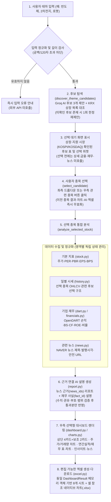
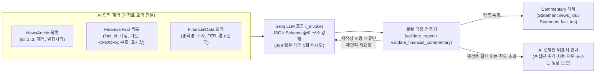
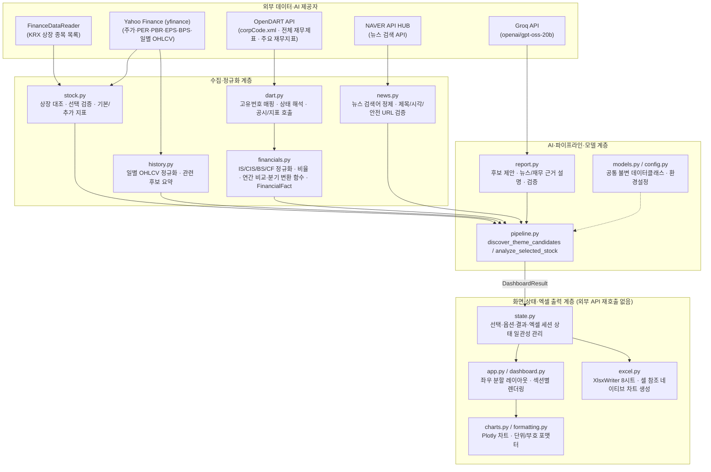

# 기획서·구현 결과 및 최종 보고서 반영 초안

갱신일: **2026-10-20** · 프로젝트: **AI 테마주 인사이트 리포트**

**챗봇 추가 반영:** 사용자 요청으로 대화 기록·후속 질문·종목 변경·채팅 내 리포트·새 대화 초기화를 구현했다. 현재 화면은 좌측 대화/리포트, 우측 지표/차트/뉴스/엑셀이다. 아래 기존 도식과 설명은 챗봇 추가 전 분석 파이프라인을 설명하는 자료로, 최종 제출 편집 때 대화 의도 분기를 함께 반영해야 한다. 최신 구현 및 검사 범위: [챗봇 구현·검수 기록](<D:/ai_agent/docs/검수/챗봇_구현_검수.md>).

연계: [WBS별 상세 상태](<D:/ai_agent/계획3_WBS기반_개발계획.md>) · [실행/기능 안내](<D:/ai_agent/README.md>) · [실제 검수 기록](<D:/ai_agent/검수자료/실제_API_검수.json>)

이 문서는 WBS D122~D124의 **설계·구현 설명과 검증 기록을 최종 보고서에 반영하기 위한 초안**이다. 최종 HWP/PDF 편집·실제 화면 캡처·브라우저/Excel 수동 확인·발표/제출 완료를 뜻하지 않는다. 기존 ‘제출 제외100%/전체97.5%’ 표현은 삭제했다.

**검증 수준:** 코드 구현/모의 자동 검사/실제 API 기록 확인/사용자 수동 확인을 구분한다. 챗봇 추가 전 133개, 추가 후 전체 154개 자동 검사가 통과했다. 금융·뉴스 전체 연동은 기존 검수자료/실제_API_검수.json 기록을 참고한다. 새 챗봇은 가상 종목 자료를 이용한 실제 AI API 세 사례를 확인했으며, 브라우저/별도 서버는 시작하지 않았다.

Week1~2(10/6~19) 보고 내용과10/20 확장 기록은 분리한다. 원본 WBS 날짜·Week·간트는 이번 수정에서 변경하지 않았다.

## 1. 서비스 흐름도·아키텍처·화면 설계도 정리 (WBS `D122`)

본 장에서는 실제 구현된 코드(`src/`)와 일치하도록 **① 사용자 처리 흐름**, **② AI 근거 연결 및 이중 검증 구조**, **③ 모듈·제공자 아키텍처**, **④ 화면 배치 설계도**를 구분하여 정의한다. 구현 범위 밖의 항목(회원 로그인, 실시간 호가 스트리밍, 매매 주문 등)은 제외한다. 아래 그림은 코드 설명용 도식/화면 구성도이며 실제 브라우저 캡처가 아니다. 분기 실제 수집·미선택 후보 요약·수동 검수는 별도 확인 대기다.

### 1.1 사용자 중심 서비스 처리 흐름도 (`[그림 1]`)

초기 기본판의 '첫 번째 후보 자동 분석'을 **'후보 탐색 → 사용자 직접 선택 → 선택 종목 심층 분석 → 동일 결과 엑셀 다운로드'**의 2단계 분리형 흐름으로 개편하였다(`[그림 1]` 참조).


**현재 연결 범위:** DART 수집은 최근3개 연간11011 중심이며 분기 자료를 자동 수집하는 흐름은 아직 연결되지 않았다. 미선택 후보는 기본 경로에서 추가 시세 조회를 하지 않는다.

*`[그림 1]` 사용자 테마 입력부터 후보 선택·대시보드 분석·엑셀 다운로드까지의 실제 구현 처리 흐름도*

---

### 1.2 AI 근거 연결 및 로컬 검증 구조도 (`[그림 2]`)

Groq API로 호출하는 기본 모델은 openai/gpt-oss-20b다. 화면 숫자는 수집/계산 자료에서 표시한다. 기본 AI 응답에 포함되는 회사명·주가·PER 에코는 원자료와 대조하고, 설명은 뉴스 번호(`news_ids`)와 재무 사실 식별자(`fact_id`)에 연결한다(`[그림 2]`, `[표 1]` 참조).


*`[그림 2]` 뉴스 근거(`news_ids`)와 재무 사실(`fact_id`) 분리 입력 및 로컬 검증·폴백 구조도*

| 검증 구분 | 대상 함수 | 세부 검증 규칙 | 위반 시 처리 |
|---|---|---|---|
| **출력 형식·스키마 검증** | `parse_json_response`, `response_format` | 중복 키 거부, 필수 필드 일치, 지원 모델 API 수준 JSON Schema 강제 | `ai_format` / `report_format` 오류 반환 |
| **종목·기본 수치 일치 검증** | `validate_report` | 에코된 `stock_name`, `price`, `per`(소수 둘째 자리)가 실제 조회값과 정확히 일치하는지 대조 | `report_identity` / `report_numbers` 즉시 거부 (재시도 없음) |
| **문장 내 미검증 숫자·링크·권유 차단** | `_comment_text` | 설명 문장(`text`) 내 아라비아 숫자(`0~9`, 단 입력 테마명 내 `'2차전지'` 등은 예외), `http/www` 링크, 매매 권유(`매수`·`매도`·`목표주가`·`투자추천`·`수익보장`, 단 제도명 `'매도/매수 사이드카'`는 허용) 차단 | `report_unverified` / `report_recommendation` (1회 수정 재요청 후 재실패 시 거부) |
| **뉴스 근거 번호 검증** | `_statement` | `news_ids`가 실제 수집된 기사 ID(`1..3`)의 부분집합인지 확인, 뉴스 0건일 때 동향·기회·위험 생성 금지 | `report_evidence` 오류 반환 |
| **재무 사실(`fact_id`) 및 부호·범위 검증** | `validate_financial_commentary`, `_check_fact_semantics` | 현재 선택 종목의 실제 `fact_id`만 인용 허용, 적자(`negative`)를 흑자로 쓰거나 양수 자본을 `자본잠식`으로 쓰는 부호 역전 차단, 별도(`OFS`)를 연결(`CFS`)로 쓰는 범위 혼동 차단, 동일 계정 연도 간 증감 방향 역전 차단 | `report_evidence` / `report_polarity` / `report_scope` 오류 반환 |

*`[표 1]` AI 응답 단계별 검증 규칙 및 실패 시 안전 처리 기준*

---

### 1.3 모듈 책임 및 외부 제공자 아키텍처 (`[그림 3]`, `[표 2]`)

각 계층은 단일 책임 원칙에 따라 분리되어 있으며, **차트 렌더링(`charts.py`)과 엑셀 생성(`excel.py`)은 수집 결과를 받아 사용하며** 파이프라인이 생성한 단일 `DashboardResult`(`AnalysisResult`) 객체만 소비한다(`[그림 3]`, `[표 2]` 참조).


*`[그림 3]` 수집·파이프라인·화면·엑셀 계층별 아키텍처 및 외부 제공자 연결 구조도*

| 계층 | 모듈명 | 핵심 함수 및 클래스 | 연결 제공자 / 입력 | 출력 / 반환 모델 |
|---|---|---|---|---|
| **환경·모델** | `config.py`, `models.py` | `load_settings`, `MetricValue`, `PriceHistory`, `FinancialStatementData`, `FinancialRatios`, `FinancialFact`, `AnalysisResult`(`DashboardResult`) | 환경변수 (`.env`) | 불변 데이터클래스 계약 |
| **종목·지표 수집** | `stock.py` | `load_listing`, `resolve_candidates`, `resolve_selected_target`, `fetch_financial`, `reconcile_financial_metrics` | `FinanceDataReader`(KRX)[^1], `yfinance`[^2] | `StockCandidate`, `FinancialData` (`EPS`·`BPS`·`PBR` 포함) |
| **가격 이력 수집** | `history.py` | `fetch_price_history`, `normalize_price_history`, `fetch_related_stock_summaries` | `yfinance` (`auto_adjust=False`) | `PriceHistory`, `RelatedStockSummary` |
| **기업 재무 수집** | `dart.py`, `financials.py` | `fetch_corp_codes`, `resolve_corp_code`, `fetch_statement`, `fetch_financial_indices`, `normalize_statement`, `calculate_ratios`, `build_annual_comparison`, `build_quarter_comparison`, `build_financial_facts`, `collect_company_financials` | `OpenDART` (`corpCode.xml`, `fnlttSinglAcntAll`, `fnlttSinglIndx`)[^3] | `FinancialStatementData`, `AnnualFinancialSummary`, `QuarterlyFinancialSummary`, `FinancialRatios`, `FinancialFact` |
| **뉴스 수집** | `news.py` | `news_query`, `fetch_news`, `safe_news_url` | `NAVER API HUB`[^4] | `NewsData`, `NewsArticle` |
| **AI 생성·검증** | `report.py` | `propose_candidates`, `generate_commentary`, `validate_report`, `generate_financial_commentary`, `validate_financial_commentary` | `Groq API` (`openai/gpt-oss-20b`)[^5] | 후보 종목명 3개, `Commentary` (`Statement`) |
| **통합 파이프라인** | `pipeline.py` | `discover_theme_candidates`, `analyze_selected_stock`, `analyze_theme` | 위 수집·AI 모듈 전체 | `CandidateDiscoveryResult`, `AnalysisResult` (`timings_ms`, `section_status` 포함) |
| **세션·화면·차트** | `state.py`, `app.py`, `dashboard.py`, `charts.py`, `formatting.py` | `select_candidate`, `store_analysis_result`, `ensure_export_bundle`, `render_dashboard`, `build_price_volume_figure`, `build_annual_performance_figure` | `DashboardResult` | 좌우 분할 Streamlit 대시보드 및 Plotly Figure |
| **엑셀 내보내기** | `excel.py` | `build_workbook_bytes`, `build_export_filename`, `reconcile_workbook_values`, `sanitize_excel_text` | `DashboardResult` (`XlsxWriter`[^6]) | 메모리 내 `.xlsx` 바이트 (8시트 + 데이터에 따른 네이티브 차트, 기록된 사례5개) |

*`[표 2]` 모듈별 책임·핵심 함수·입출력 모델 명세표*

---

### 1.4 화면 배치 설계도 (`[그림 4]`)

기획 단계의 개념 이미지(큰 진행 화살표가 포함된 설명용 시안)와 실제 구현 화면을 명확히 구분하였다. 실제 앱은 `st.columns([1, 2], gap="large")`를 사용해 **좌측 탐색·선택 패널**과 **우측 선택 종목 종합 대시보드 패널**로 구성된다(`[그림 4]` 참조).

```text
+---------------------------------------------------------------------------------------------------+
|  테마주 인사이트 리포트                                                    [ 현재 결과 지우기 ]   |
+---------------------------------+-----------------------------------------------------------------+
| [좌측 패널: 대화형 탐색·선택]   | [우측 패널: 선택 종목 종합 대시보드 (선택 전에는 대기 안내 표시)]|
|                                 |                                                                 |
| 1. 사용자 입력 테마 표시        | 1. 완료/부분결과 상태 배너                                      |
|    💬 "반도체 테마주 분석해줘"  | 2. 핵심 금융·재무 지표 카드                                     |
|                                 |    [ 현재 주가 ]  [ PER ]        [ PBR ]        [ ROE ]         |
| 2. 관련 종목 후보 표 (3종목)    |    [ 보조: EPS ]  [ 보조: BPS ]  + 출처·조회시각·산식 캡션      |
|    - 후보1: 삼성전자 (005930)   |                                                                 |
|    - 후보2: SK하이닉스 (000660) | 3. 일별 주가·거래량 추이 (공유 날짜축 상하단 Plotly 차트)       |
|    - 후보3: SFA반도체 (036540)  |    - 상단: 일별 종가 선 차트 (원) / 하단: 거래량 막대 차트 (주) |
|                                 |                                                                 |
| 3. 분석할 종목 선택 드롭다운    | 4. 기업 실적 및 재무 분석 (OpenDART)                            |
|    [ 삼성전자 (005930·KOSPI) v] |    - 좌: 최근 3개년 매출·영업이익·순이익 막대 차트 (억원)       |
|                                 |    - 우: 연간 실적 요약 표 (억원) + ROE·이익률·부채비율 표 (%)  |
| 4. 일별 시세 차트 기간 선택     |    - [펼침] 상세 재무상태(BS)·현금흐름(CF)·DART 원문링크|
|    [ 최근 3개월 (3M)         v] |                                                                 |
|                                 | 5. 관련 후보 선택 (시세·미니 차트는 현재 선택 종목 중심)|
| 5. 명시적 재조회 버튼           | 6. 하단 2단: [좌] AI 종합 분석 리포트 (news_ids + fact_ids 근거)|
|    [ 선택 종목 재조회 ]         |              [우] 관련 뉴스 목록 및 안전 원문 이동 버튼         |
|                                 | 7. 분석 결과 엑셀 다운로드 버튼 (.xlsx 파일명·종목·기간 안내)   |
+---------------------------------+-----------------------------------------------------------------+
|  [ 하단 채팅 입력창: 관심 테마를 입력하세요 (st.chat_input) ]                                     |
+---------------------------------------------------------------------------------------------------+
```
*`[그림 4]` 코드 구조를 설명한 좌우 분할 화면 구성도(실제 캡처 아님)*

---

## 2. 구현 범위와 실제 기록 — D123

### 2.1 예상 이미지·구성도·실제 화면의 구분 — 표3

| 구분 | 현재 설명 |
|---|---|
| 예상 개념 이미지 | 디자인 시안/예시 수치. 실제 조회값으로 인용하지 않음 |
| 위 화면 구성도 | 코드의 좌우 배치와 기능을 설명한 도식. 실제 화면 캡처가 아님 |
| 자동 화면 검사 | AppTest가 위젯·세션·자료를 실행/대조. 브라우저 렌더링의 미관·잘림 확인은 아님 |
| 실제 API 기록 | 기록된 시점에 수집한 응답/선택/표시/파일 메타. 실시간 보장/테마 연관성 정답 판정은 아님 |
| 최종 보고서 캡처 | 사용자가 실제 실행해 선택 종목·조회일·단위가 보이는 화면을 확보할 필요가 있음 |

### 2.2 기록된 대표 수치 — 표4

아래 값은 새로 조회한 값이 아니라 검수JSON에 저장된 **2026-10-20 10:36~10:37 KST** 값이다. 표시 정밀도만 변환했다. 기록에 없는 개별 연도 손익 금액이나 전환 종목의 세부 비율을 실측값으로 추가 인용하지 않는다.

| 입력 | 당시 선택 종목 | 가격 | PER | ROE 제공값 | PBR/BPS | 기록 판정 |
|---|---|---:|---:|---:|---|---|
| 반도체 테마주 분석해줘 | 삼성전자 (005930) | 211,000원 | 9.40배 | 10.78% | PBR 정보 없음 / BPS 정보 없음 | complete |
| 2차전지 | LG화학 (051910) | 263,000원 | -13.61배 | -2.06% | PBR 정보 없음 / BPS 정보 없음 | passed_with_notice |
| 로봇 | 삼성전자 (005930) | 211,000원 | 9.40배 | 10.78% | PBR 정보 없음 / BPS 정보 없음 | complete |

ROE는 JSON의 roe_basis에 제공값으로 기록돼 있다. 함께 수집한 연간 재무표는 CFS여도 주요지표 API에 fs_div 요청 인자가 없으므로 **공식 ROE까지 CFS로 검증됐다고 단정하지 않는다.** 직접 계산 경로는 공식 제공값과 별개이며 평균자본/기말자본 대체를 구분한다.

반도체 최초 선택에서 후보2 SK하이닉스(000660) 전환과 파일 교체 확인이 저장돼 있다. JSON에는 그 전환의 전체 재무 숫자가 저장되지 않아 상세 실적을 독립적으로 확정 인용하지 않는다. 로봇 입력이 삼성전자를 반환했다는 사실은 테마 관련성이 검증됐다는 뜻이 아니다.

각 사례의 일별 이력은62행, 연간 비교는2023~2025년, 파일은8시트/5차트로 기록됐다. 이는 해당 실행 사례의 자료 구성이다. 모든 회사의 자료 수나 차트 개수가 고정이라는 뜻은 아니다. 네이티브 차트는 셀 범위 참조를 검사했으며 실제 Excel의 셀 편집/차트 갱신은 아직 수동 확인 대기다.

### 2.3 미연결·검토 대기 범위

- 관련 후보 모두의 가격/미니 차트: 현재 선택 종목 이력을 재사용하며 미선택은ready 안내다.
- 분기/반기: 정규화/차트 함수가 있어도 활성 수집은 연간11011 중심이다. 사업연도/보고서 옵션 전체 전달도 미완전이다.
- complete 표시: 기본 금융/뉴스/기본AI 중심 판정으로 DART·이력·재무AI 성공 전체를 보장하지 않는다.
- PBR/BPS: 처리 코드는 있지만 이번 실제 사례에 값이 없는 경우가 있다. 값이 있는 실응답 대조 사례는 추가 확인 대상이다.
- 공식ROE 범위·계산 대체·의미 검토, 데이터 제공 조건·반복 요청, 전수 엑셀 대조·브라우저/Excel 수동 검수가 남아 있다.

## 3. WBS와 검증 기록의 정리 — D124

### 3.1 업무 상태 집계 — 표5

원본은 **7개 대분류·32개 중분류·119개 소분류**다. 체크 개수는 공수/난이도 가중 진행률이 아니므로 전체 개발률로 환산하지 않는다. 부분 구현과 사용자 확인 대기를 완료로 합산하지 않는다.

| 대분류 | 중분류 수 | 업무 수 | 구현·검사 확인 | 부분·확인 대기 | 미수행 |
|---|---:|---:|---:|---:|---:|
| 기획 및 기본 설계 | 6 | 16 | 12 | 4 | 0 |
| 기본 테마 분석 서비스 | 9 | 47 | 47 | 0 | 0 |
| 종목 선택 및 수집 보완 | 3 | 7 | 5 | 2 | 0 |
| 금융 지표·가격 이력 확장 | 3 | 7 | 6 | 1 | 0 |
| 기업 재무 분석 확장 | 5 | 19 | 12 | 7 | 0 |
| 엑셀 자료 제공·서비스 통합 | 3 | 13 | 8 | 5 | 0 |
| 서비스 정리·제출 준비 | 3 | 10 | 2 | 5 | 3 |
| **합계** | **32** | **119** | **92** | **24** | **3** |

세부 판단은 계획3의 같은 D행을 따른다. D122 설계/구조 설명은 갱신됐고, D123 실제 캡처와 D124 최종 제출 형식 반영은 남아 있다. D125~D127 발표자료·리허설·실제 시연/제출은 미수행이다. Week1~2 스냅샷은 이 현재 집계로 소급 변경하지 않는다.

### 3.2 로컬 자동 검사 — 표6

이번 문서 수정 직전 검토에서 **133개 전부 통과(14.860초)**했다. 파일별 개수는 실제 테스트 함수 탐색과 대조했다. 개별 파일 실행 시간을 별도로 측정하지 않았으므로 추측 시간을 쓰지 않는다.

| 검사 파일 | 개수 |
|---|---:|
| [test_additional_regressions.py](<D:/ai_agent/tests/test_additional_regressions.py>) | 4 |
| [test_dart.py](<D:/ai_agent/tests/test_dart.py>) | 6 |
| [test_dashboard.py](<D:/ai_agent/tests/test_dashboard.py>) | 5 |
| [test_data_rules.py](<D:/ai_agent/tests/test_data_rules.py>) | 20 |
| [test_excel_export.py](<D:/ai_agent/tests/test_excel_export.py>) | 4 |
| [test_financial_commentary.py](<D:/ai_agent/tests/test_financial_commentary.py>) | 5 |
| [test_financials.py](<D:/ai_agent/tests/test_financials.py>) | 7 |
| [test_history.py](<D:/ai_agent/tests/test_history.py>) | 10 |
| [test_live_regressions.py](<D:/ai_agent/tests/test_live_regressions.py>) | 25 |
| [test_report_pipeline.py](<D:/ai_agent/tests/test_report_pipeline.py>) | 13 |
| [test_selection_pipeline.py](<D:/ai_agent/tests/test_selection_pipeline.py>) | 9 |
| [test_user_flow.py](<D:/ai_agent/tests/test_user_flow.py>) | 25 |
| **총12개 모듈** | **133** |

### 3.3 실제 API 기록 — 표7

검수JSON의 checked_at은2026-10-20T10:36:33.599651+09:00이며 external_responses_mocked=false, browser_or_server_started=false다. 이번 수정에서는 JSON을 읽어 확인했으며 실제 호출을 다시 실행하지 않았다.

| 입력/전환 | 종목 | 금융(ms) | 이력(ms) | DART(ms) | 뉴스(ms) | 기본AI(ms) | 재무AI(ms) | 파일 |
|---|---|---:|---:|---:|---:|---:|---:|---|
| 반도체 테마주 분석해줘 | 삼성전자(005930) | 1236.54 | 217.42 | 3365.91 | 340.57 | 2725.01 | 1397.47 | 8시트/5차트·29,903bytes |
| 위 후보2 전환 | SK하이닉스(000660) | 1016.26 | 388.74 | 1881.73 | 750.86 | 1235.44 | 602.01 | 8시트/5차트·29,789bytes |
| 2차전지 | LG화학(051910) | 995.87 | 310.49 | 1726.65 | 264.44 | 956.40 | 513.97 | 8시트/5차트·29,616bytes |
| 로봇 | 삼성전자(005930) | 591.28 | 163.58 | 1555.23 | 322.71 | 1326.19 | 578.76 | 8시트/5차트·29,916bytes |

후보 탐색의 discovery_ms는 AppTest에서 후보 탐색 화면 실행을 포함한 경과시간이다. 순수 API 한 번의 지연시간이나 목록 조회 전용 시간으로 해석하지 않는다. 전환 시 이미 있는 후보 결과를 재사용하며 이를 KRX/가격/DART 네트워크 캐시 완료로 부르지 않는다.

JSON의 clear_result와 각 사례 ui_values_links_and_rerun은passed다. 이는 해당 세션 검사 기록이며 장시간 반복/동시 부하·외부 장애 복구·실제 브라우저 미관 확인을 대신하지 않는다. XLSX 대조 함수는 시트/코드/대표값/차트참조 등을 검사하며 모든 재무 셀의 사실성까지 전수 검증했다고 쓰지 않는다.

### 3.4 현재 설치 패키지 — 표8

아래는 이번 문서 수정 시 설치 메타데이터에서 읽은 버전이다. 해당 버전으로 모든 외부 연동을 새로 실행했다는 뜻이 아니며 API 검수 당시 환경 버전 이력이 JSON에 보존돼 있는 것도 아니다. 기존의 다른 버전 숫자는 삭제했다.

Python 현재 설치 버전: **3.13.15**

| 패키지 | 현재 설치 | 용도 |
|---|---|---|
| streamlit | 1.63.0 | 화면·AppTest |
| plotly | 7.0.0 | 가격/재무 차트 |
| yfinance | 1.7.0 | Yahoo 금융·가격이력 |
| finance-datareader | 0.9.202 | KRX 상장 목록 |
| requests | 2.34.2 | DART·뉴스 요청 |
| pandas | 3.0.5 | 표·시계열 정규화 |
| XlsxWriter | 3.2.9 | XLSX/네이티브 차트 생성 |
| langchain-groq | 1.1.3 | Groq 모델 연결 |
| python-dotenv | 1.2.3 | 환경 설정 읽기 |
| openpyxl | 3.1.5 | 엑셀 대조/검수, 현재core목록에는 없음 |

패키지는 설치 여부·활성 사용·재현 가능한 고정 의존성을 구분한다. 지금 core목록은 버전이 고정돼 있지 않으며 이번 수정에서는 패키지 설치/목록 변경을 하지 않았다.

## 4. 최종 제출 전 확인 목록

- [ ] 실제 브라우저에서 긴 이름·뉴스·축 라벨·좁은 화면·스크롤·대기 안내를 확인한다.
- [ ] 실제 Excel에서 파일 열기·값 수정·차트 갱신·저장을 확인한다.
- [ ] 공식 ROE의 범위/산식과 재무 AI 의미를 검토한다.
- [ ] 실제 분기 연결·후보 요약 등 남은 범위는 구현/보류 여부를 확정해 보고서에 표시한다.
- [ ] 비용·화면 제공·다운로드 조건과 반복 요청 검수 결과를 정리한다.
- [ ] 최종 캡처·HWP/PDF 본문·표/그림/주석·페이지·작성 정보·발표자료를 확인한다.
- [ ] 실제 리허설/시연/외부 제출 후에만 완료 표시한다.

## 각주 및 공식 참조

아래는 기존 구현 참고 링크이며 이번 수정에서 새 API 호출이나 이용권한 조사를 수행한 근거는 아니다.

[^1]: [FinanceDataReader 공식 프로젝트](https://github.com/FinanceData/FinanceDataReader)
[^2]: [yfinance 공식 프로젝트](https://github.com/ranaroussi/yfinance). 도구의 라이선스와 원천 데이터의 화면/파일 제공 조건은 별개다.
[^3]: [OpenDART 기업번호](https://opendart.fss.or.kr/guide/detail.do?apiGrpCd=DS001&apiId=2019018), [전체 재무제표](https://opendart.fss.or.kr/guide/detail.do?apiGrpCd=DS003&apiId=2019020), [주요 재무지표](https://opendart.fss.or.kr/guide/detail.do?apiGrpCd=DS003&apiId=2022001)
[^4]: [NAVER 뉴스 검색](https://developers.naver.com/docs/serviceapi/search/news/news.md). 현재 활성 인증/URL은 코드의 API HUB 경로 기준이다.
[^5]: [Groq Structured Outputs](https://console.groq.com/docs/structured-outputs)
[^6]: [XlsxWriter 차트](https://xlsxwriter.readthedocs.io/working_with_charts.html)
